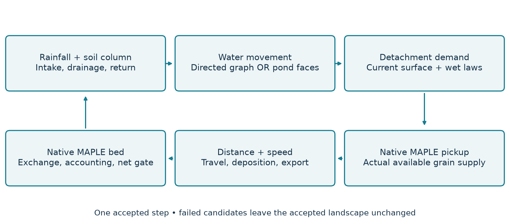

# MAPLE-SYRUP: model structure, governing relationships and numerical methods

## Abstract

MAPLE-SYRUP represents rainfall-driven runoff, soil-water exchange and size-selective sediment redistribution on an evolving granular surface. Its central idea is to combine MAHLERAN-inspired detachment and transport-distance relationships with MAPLE's finite sediment inventory. Material is detached from the current surface composition, moves at a grain-specific virtual velocity, and has an exponential probability of deposition with distance. MAPLE supplies the active layer, buried voxel column, availability rules, conservation accounting and CPU/GPU array infrastructure. SYRUP supplies rainfall, water routing and water-driven transport. Two hydraulic formulations are available: a directed, MAHLERAN method-5 formulation, and an explicitly selected local-inertial pond formulation that permits filling and overflow. These formulations share empirical erosion relationships but are different numerical models. This account states their equations, update order, parameter conventions, boundaries and end-of-event assumptions, followed by a compact reconstruction specification.

This description is bound to committed SYRUP **d05d8c6c66d9fd2969c007681916254e8d1c2c7c**, with qualified native MAPLE **39bcf79e1e67b6ed960f78a923ddfedf1d173e68**. The SYRUP and MAPLE package-content SHA256 values are respectively `c650b786b03601c601b47182f8e3b24b8ad87f9b55b40770d4a38b13cb254392` and `af54626ab432670539ed71480fd884f13581dfdfcfec63d7c85053ca215adfec`. Historical notes in the repository describe earlier milestones; these pinned implementations define the model discussed here.

## 1. Purpose and model family

The model is intended to study runoff and the redistribution of mixed sediment while allowing the landscape left by one event to influence the next. It is a water extension of MAPLE, not a separate aeolian implementation. Wind physics remains in MAPLE. A wrapper such as MASY may alternate wind and water events, with one shared bed passed between them; the processes do not run simultaneously. The letters in SYRUP stand for Sediment Yield, Runoff, and Uptake by Plants. Plant uptake, plant growth, nutrient cycling and full ecohydrology are not implemented in the water model described here. Prescribed vegetation cover can affect rain energy, but it does not grow.

It is essential to specify which member of the model family is being used. Their equations and outputs cannot be treated as interchangeable.

| Formulation | Water movement | Sediment and bed | Intended use |
| --- | --- | --- | --- |
| Legacy replay | MAHLERAN-inspired directed routing on fixed terrain | Fixed composition, unlimited pickup supply, source-assigned deposition walk and a legacy mobile-pool solve | Comparison with legacy MAHLERAN; includes explicit artificial clipping-source accounting |
| Conservative method-5 event | Directed D4 routing with Crank–Nicolson water balance | Current MAPLE inventory; characteristic distance transport by default; evolving bed | Conservative event CLI, Dense or resident-window storage |
| Pond/splash event | Local inertia on signed D4 faces; filling, reversal and overflow | Same native inventory and empirical wet laws; multi-face characteristic transport; optional direct dry-cell splash | Explicit Python API; Dense or resident-window bed |
| Hydraulic candidates | Explicit kinematic wave or local inertia | No sediment exchange or evolving bed in their standalone driver | Water-only numerical and performance experiments |

The conservative method-5 formulation is the main CLI water model. The pond formulation must be selected explicitly through the API. The generic benchmark command defaults to legacy replay; this default is not a statement that replay is the conservative production model.

The scientific starting point is the transport-distance framework of Wainwright et al. (2008). Citations below identify the origin of individual relationships; they do not imply that SYRUP duplicates every equation or numerical choice in those publications. Where MAHLERAN reanalysed data, altered units or retained a particular code convention, that distinction is stated. MAPLE and SYRUP source citations identify implementation choices for which a scientific paper is not the source.

## 2. Spatial discretization and state

### 2.1 Grid, classes and units

The domain is a regular square grid with cell width Δx and area A = Δx². Arrays are south-first: row zero is the southern row; columns increase eastward. The legacy ASCII terrain is north-first and is reversed exactly once during import. A one-cell terrain ring provides boundary elevations but is not an erodible sediment reservoir. The active mask identifies computed cells. Inactive holes are excluded from exchange; a finite nodata sentinel must be explicitly identified rather than allowed to act as a deep depression.

All physical runtime arrays use double precision. Lengths and depths are in metres, time in seconds, sediment mass in kilograms, water volume in cubic metres, and unit-width discharge q in m²/s. Total outlet discharge is unit discharge multiplied by face width and summed over outlets. Empirical relationships with mm, cm, hours or grams are evaluated with the explicit conversions below. In particular, bulk density and particle density have different roles.

| Symbol | Meaning |
| --- | --- |
| h; S | Surface-water depth; retained soil-water depth (m) |
| P, J, D, O | Rain input, intake, drainage and saturation return over a step (m) |
| q; u | Unit-width water discharge (m²/s); water speed (m/s) |
| s; f; k | Held slope; Darcy friction factor; conveyance in equation (5) |
| aᵢₖ; bᵢᵥₖ; Mᵢₖ | Active-layer, buried-voxel and mobile class mass (kg) |
| Fₖ; Pₖ | Current active-layer class fraction; requested or actual pickup, explicitly identified (kg) |
| v_s; L; x | Virtual sediment speed (m/s), mean travel distance (m), within-cell progress (m) |
| ρ_p; ρ_b; Δx | Particle density, bulk density (kg/m³), cell width (m) |

Grain classes are ordered from fine to coarse. A cell stores active-layer class masses aᵢₖ, buried voxel masses and a mobile waterborne pool Mᵢₖ. Surface-water depth hᵢ, retained soil-water depth Sᵢ and hydraulic discharge are separate state. The transport phase describes where mobile mass lies within a cell; it is a distribution of MAPLE's mobile mass, not a second inventory. Further state includes sediment-velocity memory, cumulative water and sediment ledgers, adaptive stepping state, the held hydraulic terrain and the quiet-period monitor.

### 2.2 One native bed and its active layer

A mixed surface layer above stratified substrate follows the active-layer concept associated with Hirano (1971). MAPLE's finite voxel inventory, availability caps and the refill/burial sequence below are its own discrete realization (MAPLE, 2026, pinned source), rather than an implementation of Hirano's original river-bed equations.

MAPLE partitions solid mass into a well-mixed active layer over a subactive voxel column. Its target active-layer mass is ρ_b A H_a, where ρ_b is bulk density and H_a the prescribed active-layer thickness. Erosion first obeys the same availability cap used by the wind model: requested water removal cannot exceed the currently available share. Bound material is not made available automatically. It is then capped independently for each class at what the active layer holds before replenishment. A request for a fine class cannot mine arbitrarily far into the column to find that class.

After removal, the total active-layer deficit is replenished with the physically contiguous mixed material immediately underneath. If the column runs out, the layer remains underfilled and the deficit is reported. Replenished material becomes available for subsequent calls; it does not satisfy additional selective pickup in the same call. Deposition adds the actual incoming class vector to the active layer. Material above the target mass is buried as a proportional mixture of every class. All updates use actual placed or extracted mass, including reported sub-resolution residuals; requested transfer is never substituted for actual transfer.

The availability split is updated against the new layer's actual holdings. A configured fallback fraction is used when a newly supplied class had no previous surface fraction to inherit. The corrected Plot1 recipe starts with every class 100% available. Availability is not used as a substitute for MAHLERAN pavement or vegetation effects.

Physical elevation follows total solid mass, including both active and buried material:

$$
zᵢ = z_base + (Σₖ aᵢₖ + Σᵥₖ bᵢᵥₖ) / (ρ_b A).                         (1)
$$

The water laws convert empirical solid-volume detachment to mass with particle density ρ_p. MAPLE converts that mass to bed height using ρ_b. For Plot1, ρ_p = 2650 kg/m³ and ρ_b = 1250 kg/m³; equal removed mass therefore produces 2.12 times the elevation change obtained by converting it with particle density. This is a documented morphological difference from legacy MAHLERAN, not a mass-balance error.

Equation (1) describes current physical elevation. MAPLE's separately committed elevation is a deliberately lagged `reference_elevation_m + elevation_offset_m` view, updated at accounting commits. The hydraulic geometry can be held longer still. The net gate compares the current native physical surface with the surface of the last actual hydraulic build; these three uses of elevation must not be conflated.

### 2.3 Dense and resident-window storage

Dense storage holds the whole voxel column in memory. Resident-window storage keeps a small band near the surface in the active array namespace and preserves deeper material in immutable host-side store versions. Replenishment and burial access only the involved columns. Maintained prefix/height packets support elevation queries without scanning every buried voxel. Pending exact changes are accumulated in a bounded journal and published at explicit boundaries. Full chunks and exact overlays are alternative persistence encodings; they do not change the intended bed physics.

Changing storage is not permission to discard tiny changes or old referenced state. Checkpoints may reference immutable external deep-store files, which must be retained. Compact ledgers store selected spatial process arrays, while process totals retain canonical seven-process indexing, including surface creep. A compact storage slot is not the canonical process index. Dense and resident-window integration have been tested, but identical physical intent does not imply universal bitwise CPU/GPU equality or that a large storm fits in memory.

## 3. Rainfall and soil-water exchange

### 3.1 Forcing semantics

A rainfall record defines a piecewise-constant intensity. Its initial clock is event time zero. A subsequent record with clock Tₖ specifies the intensity over the interval ending at Tₖ. The conversion from mm/h to m/s is 10⁻³/3600. Local rainfall equals this time-dependent rate multiplied by the supplied nonnegative spatial scaling. Inactive cells receive no input. Rain is integrated exactly over record intervals and stepping is split at each rate change, rather than delaying a change by one numerical step. After the record ends, the rainfall rate is zero and recession may continue.

The record convention is (Tₖ₋₁,Tₖ]. A step beginning exactly at Tₖ uses the next interval's rate through the explicit `rate_after` evaluation; isolated endpoint values are not allowed to introduce an extra interval of rain. Clock parsing allows one midnight rollover only when the unwrapped forward gap is less than 12 hours. Other decreasing or repeated clocks are refused.

An explicitly matched benchmark can instead use the rainfall actually applied by a legacy execution. Such a capture can include MAHLERAN's switching lag. It is a distinct, hashed forcing input; the original imported rainfall is not silently rewritten. Conductivity, antecedent moisture and the forcing convention must all match before interpreting a Fortran comparison.

### 3.2 Retained soil-water column

The soil state S is retained water expressed as an equivalent depth. It includes antecedent water and decreases through drainage; it is not cumulative infiltration since storm onset. For soil thickness L_s, saturation θ_s and initial moisture θ₀, S_max = θ_s L_s and S₀ = θ₀ L_s. Current volumetric moisture is θ = S/L_s.

For a constant-rain step Δt, let P = rΔt and W = h + P. The effective infiltration parameter K is K_sat in model 1. In model 2, while local rain is positive, K = λ[1 − exp(−r/λ)]; in rain-free steps it is K_sat. The pavement relationship is evaluated in its authored units:

$$
λ_mm/s = −0.022891667 ln(p) − 0.098575   if p > 0; otherwise 0.16,
p = pavement_percent × 10⁻⁴;       λ = 10⁻³ λ_mm/s.                 (2)
$$

The capacity has the Smith–Parlange infiltration form (Smith and Parlange, 1978), as adapted in MAHLERAN's `infilt.for`. Equation (3) reproduces that implementation using retained soil water, rather than asserting identity with the original cumulative-infiltration theory. The rain-dependent effective K is described in the MAHLERAN source as a Hawkins-type exponential relationship. The same functional form is presented and experimentally evaluated by Stone et al. (2008, equation 2). The pavement regression for λ in equation (2), its coupling to the capacity, and the finite-column drainage/overflow rules are MAHLERAN parameterizations (MAHLERAN 1.2.3 source); they are not all equations from Smith and Parlange:

$$
x = S / [(ψ + h)(θ_s − θ)],       f = K / [1 − exp(−x)].            (3)
$$

Here ψ is suction head. The denominator is evaluated with −expm1(−x). If K = 0, capacity is zero. If the capillary denominator (ψ+h)(θ_s−θ) is zero, capacity is K. If x is zero while that denominator and K are positive, capacity is unbounded and all available surface water can infiltrate. These limits prevent accidental 0/0 values; they do not remove water.

The update takes intake J first, then drainage based on pre-step moisture, then saturation return O:

$$
J = min(W, fΔt),
D = min[(S/S_max) K_sat c_d Δt, S + J],
O = max(S + J − D − S_max, 0),
S′ = min(S + J − D, S_max),       h_c = W − J + O.                  (4)
$$

Net infiltration is J−O. Water balance is h_c + S′ + D = h + S + P for each cell. Drainage leaves the modeled column; there is no lateral groundwater or storm evapotranspiration. Negative conductivities are rejected. The deterministic Plot1 mean replaces the original normal draw that could produce negative K_sat. RFID uses the documented native setup-derived conductivity, not a generic copy of Plot1's value.

For numerical reproduction, the source evaluates the equivalent surface update in branches: retained surface is exactly zero when J≥h+P, otherwise max[h−max(J−P,0),0]; then h_c=(retained surface + max(P−J,0))+O. It uses this grouping so retained surface and h_pre have coherent rounding. Independently evaluating (h+P)−J can give different last bits even though equation (4) is the same water balance.

Keeping retained water in equation (3) follows MAHLERAN's implementation, but differs from treating its infiltration variable as cumulative storm intake. With wet antecedent Plot1 conditions, capillary enhancement is small. This is a model limitation that matters when interpreting early runoff. Other deliberate changes are local-cell rain in the model-2 condition, explicit nonnegative limits and coherent water accounting; known legacy setup mistakes are not copied.

## 4. Directed MAHLERAN-inspired hydraulics

### 4.1 Routing geometry and constitutive law

The hydrological lineage is MAHLERAN's distributed runoff model (Wainwright and Parsons, 2002); the exact graph, edge rules and constitutive-law implementation described here are taken from the reference source. That paper provides the hydrological context, not a claim of identity with SYRUP's corrected water accounting.

The method-5 graph sends each active cell to the lowest strictly lower D4 neighbor. Candidate neighbors are tested north, east, south and west with strict comparison, fixing the treatment of ties. Elevations are compared in legacy millimetre arithmetic. The slope is the elevation drop divided by cell width. Inactive slopes are zero; the literal legacy slope cap replaces slopes above 1000 by 1. At an exporting cell the legacy edge rule can copy the opposite interior neighbor's slope if its own is larger or zero, in north-to-south then west-to-east order. A receiver must be another active cell or an explicitly designated export receiver.

The Darcy–Weisbach shallow-water friction relation can be written as S_f=f q|q|/(8g h³) (Kirstetter et al., 2016, equation 10). The Darcy–Weisbach law is already used in MAHLERAN; Kirstetter is cited for this friction-slope form. Setting its positive-flow friction slope equal to the held bed slope yields the kinematic law used here:

$$
kᵢ = √(8g sᵢ/fᵢ),       qᵢ(h) = kᵢ h³ᐟ²,       uᵢ = kᵢ√h.        (5)
$$

Here s is the held routing slope, f the Darcy friction factor, g = 9.81 m/s² and u water speed. Friction factors below 0.1 are refused rather than reproducing MAHLERAN's post-solve friction floor. The strict graph refuses pits and flats. Explicit opt-ins can represent them as terminal storage cells with no outgoing conveyance; this stores water and settles sediment but cannot simulate overtopping. True filling and overflow require the pond formulation in section 8.

### 4.2 Infiltration-to-routing coupling and the Crank–Nicolson solve

The time-centred averaging of old and new fluxes follows Crank and Nicolson (1947). The directed nonlinear sweep, root controls and paired post-infiltration face fluxes below are the MAHLERAN/SYRUP discretization of water continuity; they are not claimed to appear in that original heat-conduction paper.

The complete step starts from old surface depth h, retained soil water and old discharge q_prev. After equation (4), define the old routing depth h_pre = max[h − max(J−P,0),0]. The old discharge is selected in this order: zero if J ≥ h+P (complete run-on infiltration); otherwise q_prev if J ≤ P; otherwise k h_pre³ᐟ². A receiver's old inflow is the sum of these same donor discharges. This coherent shared-face choice corrects the legacy use of stale old inflow after infiltration has changed donor outflow.

Cells are solved upstream first. Donor sums use south, west, north, east order. With c = Δt/(2Δx):

$$
Rᵢ = h_c,ᵢ + c(Q_in,old,ᵢ + Q_in,new,ᵢ − q_old,ᵢ),
find y ≥ 0 such that y + c kᵢ y³ᐟ² = Rᵢ,
q_new,ᵢ = kᵢ y³ᐟ²,       h_new,ᵢ = Rᵢ − c q_new,ᵢ,
Fᵢ = A c(q_old,ᵢ + q_new,ᵢ).                                    (6)
$$

F is the water volume delivered to the receiver or exported in the step. Its paired use on both sides of a face is what closes water balance. Instantaneous outlet discharge is a separate diagnostic; endpoint discharge times Δt is not substituted for F.

Bisection brackets y in [0,R] and by default performs 40 iterations, selecting the lower bracket endpoint for the flux. Storage is computed from the conservative identity, while |h_new−y| is checked against the 10⁻¹¹ m root tolerance with the implementation's roundoff allowance. Safeguarded Newton solves the same equation with derivative 1+(3/2)c k√y, retains the proven bracket and falls back to bisection when necessary. The source defines its stopping and failure rules; it must not be replaced by an unconstrained library root solver when seeking the same numerical result.

The old-flow Courant number is q_old Δt/(h_pre Δx), with a dry branch handled explicitly. The default maximum is 1; the accepted range does not exceed 2. A step that violates the allowed Courant condition or has a negative right-hand side is rejected and retried from the original state at smaller Δt. Root nonconvergence, invalid input or failed conservation is a genuine error, not permission to clip depth to zero.

### 4.3 Explicit kinematic candidate

The standalone `explicit` hydraulic experiment uses the same held graph and equation (5), but computes q from h_c at the beginning of lateral redistribution. It sends Fᵢ=ΔtΔx kᵢh_c,ᵢ³ᐟ² once to the receiver, then sets h_new,ᵢ=h_c,ᵢ+(Σ_donorsF−Fᵢ)/A. It has no old-flux Crank–Nicolson term and no nonlinear root solve. Its characteristic-wave bound is (3/2)k√h_c Δt/Δx≤C_max, where C_max defaults to 0.5 and cannot exceed 0.5. This is a first-order explicit water model, not a faster root solver for equation (6). The standalone local-inertial experiment uses section 8's face formulation with its own stated lagged-friction default. Neither water-only experiment changes the bed.

## 5. Detachment from the current surface

### 5.1 Composition and hydraulic regimes

For each class, the surface fraction is Fₖ = aₖ/Σaₖ, with all fractions zero on an empty layer. The median diameter is interpolated in the cumulative fine-to-coarse fractions. At the first cumulative fraction Cⱼ ≥ 0.5, use D₁/(2C₁) for j=1, otherwise Dⱼ₋₁ + (Dⱼ−Dⱼ₋₁)(0.5−Cⱼ₋₁)/(Cⱼ−Cⱼ₋₁). If 0.5 is never reached, including an empty cell, use the largest diameter. Thus selective erosion changes both pickup fractions and the median controlling transport.

The hydraulic indicators are shear velocity u* = √(ghs), Reynolds number Re = uh/ν and stream power ω = ρ_w ghu s, with ν = 1.003×10⁻⁶ m²/s and ρ_w = 1000 kg/m³. For method 5, s is the held bed routing slope. Pond flow supplies distinct friction-based shear and power slopes, described below.

In the conservative directed event, wet-law h is the new conservative storage depth, while u=k√y uses the root's flow depth y from equation (6). They are not replaced by k√h_new; their small root residual is explicitly checked. Replay can select a different depth time level as described in section 12.5.

| Condition | Detachment | Transport relationship |
| --- | --- | --- |
| h = 0 | No wet detachment; optional direct rain splash is separate | Mobile material settles |
| h > 0, rain > 0, Re ≤ 500 | Raindrop-assisted | Diffuse |
| h > 0, rain > 0, 500 < Re < 2500 | Raindrop plus flow | Diffuse |
| h > 0, rain = 0, 500 < Re < 2500 | Flow | Concentrated |
| h > 0, Re ≥ 2500 | Flow | Concentrated or suspended, by class |
| h > 0, rain = 0, Re ≤ 500 | None | Decaying sediment-velocity memory, no new distance hazard |

The exact inequalities matter at Re = 500 and 2500. Dry means exactly zero depth for regime selection, not a user-chosen small-depth cutoff.

This regime division follows the MAHLERAN framework of Wainwright et al. (2008); the precise endpoint tests are implementation rules in `sediment_physics.py` and the reference `route_sediment_xml.f90`. These Reynolds thresholds organize the empirical erosion laws and should not be read as universal transition criteria for every rough overland flow.

### 5.2 Rain-assisted pickup

Rain energy KE is in J m⁻² mm⁻¹, intensity I in mm/h, local rain rate r_mm in mm/s, and prescribed cover V in percent. The logarithmic model is max(11.9+8.73 log₁₀I,0)(1−0.0081V). The default exponential model with the literal legacy vegetation convention is KE = 29−20.88 exp(−0.05I)(1−0.0081V). Its cover factor applies only to the subtracted term, so cover increases this energy. That counter-intuitive precedence is deliberately retained. An explicit alternative applies cover to the whole expression; it changes the scientific configuration.

The uncovered logarithmic energy–intensity relationship belongs to the Wischmeier–Smith formulation (Wischmeier and Smith, 1958); SYRUP uses MAHLERAN's stated coefficients and zero lower bound, with no high-intensity cap applied. The uncovered exponential expression is the Brown–Foster relationship, 0.29[1−0.72 exp(−0.05I)] MJ ha⁻¹ mm⁻¹ (Brown and Foster, 1987), converted by a factor of 100 to the units used here. The MAHLERAN source comment refers this expression to Verstraeten et al.; the API name `verstraeten_exp` follows that comment. The uncovered functional form is attributed here to Brown and Foster (1987), independently of that legacy label. The canopy-energy motivation is Wainwright et al. (1999), as cited by MAHLERAN; the linear cover factor and the literal exponential precedence are properties of the implemented parameterization. In particular, Brown and Foster do not justify the cover-induced energy increase.

The rain–slope power-law basis is Quansah's (1981) splash-detachment and transport experiments. Equation (7) is MAHLERAN's class-specific adaptation of that basis, including its reference scaling and factor two; the exponential reduction with surface-water depth has an experimental basis in Torri et al. (1987). MAHLERAN's source points to Parsons et al. (2004) for the attenuation parameter convention. The exact α values and centimetre-depth evaluation are therefore specified here from the source, rather than inferred from a general citation. For class k, the empirical detached mass per area over the reference interval is

$$
Xₖ = (aₖ/1200)(1200 KE r_mm)ᵇᵏ(100s)ᶜᵏ,
e_r,k = [2Xₖ/(ρ_p t_ref)] exp(−αₖ · 100h),
P_r,k = e_r,k Aρ_pΔt.                                            (7)
$$

Here aₖ, bₖ and cₖ are the authored rain parameters, αₖ is the attenuation per centimetre of water, and e_r is a solid-depth rate in m/s. The factor two reflects the legacy combination of up- and downslope experimental data. t_ref is 1 s. Class 2 alone is capped at F₂ h_s,₂/t_ref before conversion to mass; absent classes request zero. The literal default does not otherwise multiply rain pickup by class fraction. A nearly depleted class can therefore retain a large demand, while MAPLE limits actual removal. Fraction-weighted rain pickup is an explicit alternative. Gravel feedback is neutral in the implemented legacy convention.

The reference-time rate is important: a 0.25 s step requests one quarter of a 1 s demand at unchanged conditions. Literal legacy detachment divides by the current Δt and later multiplies by Δt, effectively imposing a fixed depth per numerical step. That timestep dependence is not copied into the conservative formulation.

### 5.3 Flow pickup

The logarithmic probability expression in equation (8) is the analytical log-normal-velocity pickup approximation of Wu and Lin (2002, equation 7), evaluated with lift coefficient C_L=0.25. The shear variable θ is a dimensionless submerged-weight stress; multiplying probability by h_z, the class fraction and the reference-time rate is MAHLERAN's detachment parameterization, with the explicit time normalization described here (MAHLERAN 1.2.3 source; SYRUP, 2026).

Let σ = (ρ_p−ρ_w)/ρ_w and θₖ = u*²/(σgDₖ). For θ>0 define b = ln[0.049/(0.25θ)]. The pickup probability and depth rate are

$$
pₖ = 1/2 − (1/2) sign(b) √{1 − exp[−(2/π)(b/0.702)²]},
e_f,k = min(pₖ h_z Fₖ, Fₖ h_s,k)/t_ref,
P_f,k = e_f,k Aρ_pΔt.                                            (8)
$$

At θ=0 the probability is zero; at θ=0.196 its continuous value is 0.5. h_z is the empirical detachment coefficient, not active-layer thickness. Its Plot1 value is 1.52×10⁻⁶ mm = 1.52×10⁻⁹ m. Requested pickup is P_r+P_f where the regime permits each contribution. This request enters MAPLE's actual availability and supply-limited transaction; it is not already eroded sediment.

## 6. Transport distance and virtual velocity

Transport is controlled by two quantities: a virtual sediment speed v_s (m/s) and an exponential mean travel distance L (m). Keeping both preserves an arrival-time scale and a deposition-distance scale. Over a traveled distance ℓ, a packet retains exp(−ℓ/L) of its mass. The lost fraction deposits where that distance is traversed. No material deposits downstream before it arrives there.

The separation of transport distance from travel rate follows Wainwright et al. (2008). The empirical ancestors differ by regime: MAHLERAN associates diffuse-flow speed and distance with the experiments of Parsons et al. (1998), with the provenance qualification below; the concentrated-flow distance is attributed in MAHLERAN to Hassan et al. (1991, equation 2b), while the virtual-rate regression is attributed to Hassan et al. (1992, equation 5). Those Hassan studies concern gravel-bed channels: their use for hillslope size classes is an extrapolation, not an independent hillslope calibration. The critical stream-power/density scaling is adapted from Bagnold (1980).

The following empirical expressions must use the stated units. D is particle diameter in metres unless labeled otherwise; m_g is particle mass in grams, ρ_g = ρ_p/1000, and Δρ = ρ_p−1000.

| Regime | Distance L and sediment speed |
| --- | --- |
| Diffuse | E = max(11.9+8.73 log₁₀I,0) r_mm; m_g = ρ_g 10⁶(4π/3)(D/2)³. L = 0.05 E¹·⁸⁵ ω⁰·⁴⁸¹ m_g⁻⁰·⁴²⁵. v_s = min[u, (0.01/60)·0.525 E²·³⁵ ω⁰·⁹⁸¹/m_g]. |
| Concentrated | ω₀ = max[4.554×10⁻³(Δρ D₅₀)¹·⁵ log₁₀(12 h_log/D₅₀),0]. With W=ω−ω₀>0, L=min[30, 0.693·2.85×10⁻³ W¹·³¹ D⁻⁰·⁹⁴]; v_s=min[u,(1.92×10⁻²/3600)W¹·⁰¹]. If W≤0, settle. |
| Suspended | L = 0.693·727.51805244 exp[min(0.007331976 ω,100)] exp(−6.12683698 D_mm)(Δρ/1650)⁻⁰·⁵; v_s=u. |

These are the coefficients and units actually used by MAHLERAN, carried into SYRUP. The diffuse speed is the relationship that MAHLERAN attributes to Parsons et al. (1998) as a median virtual velocity; SYRUP uses it as the sediment speed after unit conversion. The implemented diffuse distance is a MAHLERAN empirical fit. Its adjacent source comment describes a reanalysis of the Parsons data but quotes different coefficients and exponents. That comment therefore does not establish the derivation of the implemented distance coefficients, which are specified from the code rather than claimed as an independently verified published regression. The suspended-distance coefficients are MAHLERAN's empirical fit to suspension-trajectory calculations: `suspended_transport.for` identifies Anderson (1987) as the underlying trajectory-model basis and Bagnold (1980) for density scaling. Anderson's original application was aeolian; SYRUP evaluates the resulting MAHLERAN regression and does not run that stochastic trajectory model. The exponential cap, 30 m cap and literal 0.693 treatment are implementation conventions, not universal physical constants.

The diffuse energy expression always uses the logarithmic rain-energy law without vegetation, even when pickup uses exponential KE. This is intentional legacy behavior. In the literal concentrated threshold, h_log = 1000h while D₅₀ remains metres. This mixes units in the logarithm; the `si_m` alternative uses h_log=h. The default literal distance convention multiplies concentrated and suspended formula distances by the literal 0.693, then treats the result as the exponential mean. This is how the legacy code uses its quantity labeled median; do not silently substitute ln2 or convert it a second time. The explicit `formula_mean` option removes that 0.693 multiplication before the concentrated cap.

At Re≥2500, suspension is selected per class. Settling speed is σgD²/(18ν) for D<10⁻⁴ m and 1.1√(σgD) otherwise. The literal dimensionless diameter is D* = D[(σ−1)g/ν²]¹ᐟ³, despite σ already being relative excess density. A class is suspended when u* ≥ 4w_s/D* for D*≤10, or u*≥0.4w_s otherwise. The `van_rijn` option uses σ rather than σ−1 in D*. These alternatives must be recorded as model choices, not presumed corrections.

The suspension criterion and dimensionless grain-size framework originate with van Rijn (1984, Part II). The piecewise settling formula and the extra subtraction in the default D* are the specific reference-code choices; the latter is not attributed to van Rijn's published definition. Reproducing the named criterion therefore still requires the explicitly selected density convention.

Where a transport law is absent but the cell remains wet, memory speed decays as v_old exp(−Δt/τ), where τ=−t_ref/ln0.9 ≈9.49 s. The implemented evaluation is v_old·exp[ln(0.9)·Δt/t_ref], preserving the source's scalar operation order. The distance hazard is zero there. This reproduces the legacy 0.9-per-second memory without making it depend on the numerical step. Memory speed is not capped again at a slowing water speed. Dry cells, explicit terminal cells and no-capacity regimes settle their mobile mass through deposition requests, with sediment speed set to zero. No capacity includes a diffuse class with nonpositive logarithmic rain-energy flux E, even if rain is positive; this occurs at very small intensities around 0.043 mm/h. A law also requires a positive L. A transport Courant check is therefore needed separately from the water check.

The velocity-memory multiplier and settlement branches are source-specific modelling choices (MAHLERAN 1.2.3 source; SYRUP, 2026), with a continuous-time rescaling introduced in SYRUP. They are not additional experimentally established distance laws.

## 7. Conservative characteristic transport and bed exchange

### 7.1 Travel within a cell

In the default conservative transport, each cell and class has B position bins, default 32. A packet position x lies between zero at the upstream face and Δx at the downstream face. Actual newly detached mass is inserted at x=0 in the first transport substep only. Speeds and inverse distances λ_d=1/L are frozen during the physical step. Internal equal substeps enforce v_s δt/Δx≤0.5; if the allowed substep count is insufficient, the entire coupled attempt is rejected and Δt is reduced.

The directed event starts with n_sub=max[1,ceil(v_max Δt/(Δx C))], where v_max is the domain-wide maximum sediment speed and C is the selected sediment Courant maximum, default 0.5. A recoverable transport-operator refusal doubles this count and retries the same transport. Only after exceeding the configured cap, default 64 in the directed event, does it reject the physical attempt and halve Δt. The pond event defaults to a cap of 1024 and takes its maximum only over cells with outward water flow.

A packet travels v_sδt until it reaches a face. Its survival over distance ℓ is exp(−λ_dℓ); deposition is computed as −m expm1(−λ_dℓ). The time to the face is (Δx−x)/v_s. A crossing survivor goes to the actual receiver, or becomes export at an outlet. On an interior arrival it advances for the remaining substep time using the receiver's speed and hazard. A settling receiver deposits it. The Courant bound guarantees no second crossing during that substep. Position follows the current outflow direction; a hydraulic reroute preserves its scalar value while steering its interpretation toward the new receiver.

### 7.2 Bounded merging

Equation (9) and the bounded position-bin representation are SYRUP numerical constructions (`characteristic_transport.py`, pinned SYRUP source). Their transmission-preservation property follows directly from the stated exponential survival law. A citation to MAHLERAN's conceptual framework does not make this merging scheme a published MAHLERAN algorithm.

Packets ending in the same destination cell, class and position bin are merged using that destination cell's hazard. The bin is min[floor((x/Δx)B),B−1], evaluated with division before multiplication as written. Their total mass is conserved. Their representative position is

$$
x_rep = L ln[(Σⱼ mⱼ exp(xⱼ/L))/(Σⱼ mⱼ)]  when 1/L>0;
x_rep = (Σⱼ mⱼxⱼ)/(Σⱼ mⱼ)                 when 1/L=0.             (9)
$$

This logarithmic mean preserves eventual transmission to the next face under the current local distance law. It approximates the timing of merged constituents and their later fate if hydraulics change. Therefore bin refinement is a scientific sensitivity study, not just a performance setting. Use stable shifted exponential sums: for (x_max−x_min)/L≤0.5, use expm1/log1p around x_max; otherwise use a positive log-sum-exp shifted by the largest ln m+x/L. Only roundoff containment inside the constituent position range is applied. Ordinary arithmetic averaging at positive hazard would change transmitted mass.

Dense phase storage keeps fractions and positions for all cells/classes/bins. CSR storage retains nonempty rows/bins with an explicit capacity and the same transport model. Fractions partition the authoritative mobile pool; they never authorize a hidden mass correction. After native deposit/export, a predicted versus actual mobile discrepancy must pass the declared roundoff bound. Exactly empty actual pools get canonical empty phase. A positive roundoff remnant remains actual mass, with a counted canonical phase if needed; it is not deleted.

### 7.3 The transaction and alternative upwind model

One accepted method-5 physical step executes, in order: rain/infiltration and water routing; current-bed wet-law evaluation; native supply-limited pickup; characteristic transport of old mobile mass plus actual pickup; native deposition and export; phase reconciliation; native bed accounting and any net-elevation-triggered hydraulic refresh; then cumulative diagnostics. Dense transactions may use separate native pickup/deposit calls; the resident-window paired path places pickup, transport callback and deposit within one guarded native transaction, including its allocating fallback. Candidate state is adopted only after all physical and accounting checks pass.

The lateral operator reports an intermediate pool containing the material remaining mobile plus the requested deposition and export. Native MAPLE removes those requests once. Internal face transfer cannot be treated as an external sediment source. Actual pickup, not demand, is the source for transport. Gross erosion and gross deposition are recorded independently even when they occur in the same cell and class and their net elevation effect cancels.

An explicitly selected upwind comparison treats each cell/class as a well-mixed pool. It combines local exponential deposition with conservative advection under a first-order transport discretization and symmetric half-reaction/full-advection/half-reaction splitting (Strang, 1968). That pool model does not have the characteristic model's face-to-face exponential transmission for short L: the well-mixed cell residence changes it toward L/(L+Δx). It is retained for comparison, not silently substituted for characteristic transport. Likewise, a legacy source-walk replay has different supply, distance memory and mobile accounting.

## 8. Pond filling, overflow and optional direct splash

### 8.1 Local-inertial water movement

The pond API connects every active D4 neighbor pair with a signed face, allowing pressure-driven reversal on flats and within depressions. It retains local acceleration and water-surface pressure gradient, drops advective acceleration, and uses Darcy–Weisbach friction. Thus it is a local-inertial approximation, not full shallow-water dynamics. Define η=z+h and face depth h_f=max[max(η_A,η_B)−max(z_A,z_B),0] using post-column depths. Dry faces carry zero flux. For a face between west/south A and east/north B:

The local-inertial approximation and face-depth construction follow the approach of Bates et al. (2010). SYRUP uses the Darcy–Weisbach friction slope described by Kirstetter et al. (2016, equation 10), rather than the Manning resistance in Bates et al. The implicit quadratic time treatment, scalar normal-face resistance, normal-flow outlets and rejection rules below are SYRUP adaptations; equation (10) is not presented as an unchanged solver from either paper.

$$
q* = q_old − gh_f Δt(η_B−η_A)/Δx,
α = Δt f_f/(8h_f²),       q_new + α|q_new|q_new = q*,
h_new = h_c − (Δt/Δx)[q_e−q_w+q_n−q_s].                          (10)
$$

The pond default solves this implicit quadratic friction equation with a stable signed root, equivalent mathematically to q_new=sign(q*)·2|q*|/[1+√(1+4α|q*|)]. The implementation avoids overflow and underflow in that expression. f_f is the arithmetic mean of adjacent cell friction. Each face uses its own normal speed for friction, neglecting tangential coupling. The standalone local-inertial experiment defaults instead to lagged friction, q_new=q*/[1+α|q_old|]; the pond default deliberately changes this time discretization to damp the first wetting impulse. Selecting an explicit default HydraulicControl can restore lagged friction and changes the model configuration.

The same signed face volume ΔtΔx q_new enters both neighboring continuity balances. Interior holes and closed faces transmit nothing. Exterior outlets must be explicitly declared and have a genuine positive bed drop to the ring. There q_out=√(8g s_b/f)h³ᐟ² outward only, with s_b=(z_cell−z_ring)/Δx. Zero-drop, uphill, imposed-stage/backwater and external inflow boundaries are refused. No artificial minimum slope is inserted.

The gravity-wave CFL condition is Δt√(2g h_f,max)/Δx≤0.5 by default. A negative updated depth or CFL failure rejects the whole attempt. The pond API refuses the optional donor limiter because it changes dynamics. Face Froude numbers are reported rather than clipped. Local-inertial accuracy is limited when advective acceleration is important (de Almeida and Bates, 2013); reporting a stable calculation is not proof of physical accuracy at high Froude number. Their analysis motivates this qualification and does not itself validate SYRUP's Darcy-friction implementation.

### 8.2 Depressions, erosion speed and multi-face transport

A host-side minimax path calculation finds each cell's escape elevation: among all active D4 paths to a declared outlet, take the minimum of the maximum bed elevation along a path. It uses a priority queue with ties broken by level and flat cell index. Closed components have infinite escape level and require explicit permission. This escape surface diagnoses retained pond storage and event completion. It does not turn the hydraulic connections on or off: actual water head and face lip determine flow, so overflow can emerge dynamically.

The escape calculation is a minimax adaptation of Dijkstra's (1959) label-setting graph algorithm: the path-combination operation is maximum elevation, not additive distance (`pond_network.py`, pinned SYRUP source). It is a topographic diagnostic, not a substitute for the momentum and continuity equations.

For erosion, the pond model uses outward-water-volume-weighted absolute face speed, not face-averaged flux divided by an almost dry cell's end depth. Let O_d be the positive outgoing volume on face d and u_d the stage-consistent face speed. Cell speed is ΣO_d|u_d|/ΣO_d, zero if there is no outward flow. The default friction slope is s_f=f u²/(8gh) at h>0, zero otherwise. The wet law uses this for shear and stream power, giving u*=√(f/8)u and ω=ρ_w f u³/8. The raindrop law and splash directions still use the held topographic slope. A flat bed can therefore have shear-driven transport while its slope-dependent raindrop detachment is zero.

Characteristic transport is generalized by dividing each face-crossing survivor among positive outflow faces in proportion to their actual step water volumes. Ratios are normalized after scaling to avoid overflow. A cell with no outward water flux has no advective progress and no distance-hazard deposition, retaining its phase and mobile material unless the shared physics explicitly marks it to settle. Scalar progress x remains a face-to-face approximation if flow turns; water-volume weights are frozen across transport substeps. A wet nonmoving cell is not automatically a method-5 terminal sink: wet low-Reynolds rain-free pools can retain sediment, while the shared dry/no-capacity settlement mask is still honored. Event-end sediment disposition is explicit.

### 8.3 Direct dry-cell splash

An exponential splash-distance kernel has experimental and modelling precedent in Savat and Poesen (1981). The four rays, slope weights and coefficient 2.42 used here are the actual MAHLERAN `splash_transport.for` parameterization; the source records an empirical adjustment of the slope coefficient. They are not attributed as an exact equation from Savat and Poesen. SYRUP's closed/open boundary tails and supply-limited accounting are explicit conservative adaptations (SYRUP, 2026).

Optional splash is evaluated only where post-hydraulic depth is exactly zero and rain is positive. The same raindrop pickup law is evaluated at h=0, then capped by genuine native supply. Wet and dry pickup do not overlap. Splash redistribution is instantaneous; it is not assigned an airborne cohort or a water-advection speed. It precedes the wet transaction, whose demand was evaluated from step-start holdings, so actual supply still decides both exchanges.

For each class, the user supplies an inverse splash distance β≥0; no calibrated default is invented. With G=exp(−βΔx), actual source pickup P deposits P(1−G) locally. At the nth cell along ray d it deposits P w_d Gⁿ(1−G). Two cross-slope weights are 0.25 each; downslope weight is 0.5[1−0.5 exp(−2.42s)] and upslope weight is 0.5 minus that value. Flat cells have four weights of 0.25. The remaining tail after m reachable cells is P w_d Gᵐ⁺¹. An explicitly open exterior face exports that tail; a closed edge or first inactive obstruction deposits it at the last active cell. Nothing jumps a masked hole. Infinite tails are evaluated through exact recurrences, not truncated by distance or tiny-mass cutoffs. The legacy edge extra-deposition behavior is not reproduced because it can add mass.

## 9. Evolving topography, accounting and persistence

The net-elevation trigger, exact storage journals and the separation of bed accounting from hydraulic refresh are project-specific coupling and numerical policies (MAPLE, 2026; SYRUP, 2026, pinned sources). The 0.00075 m trigger is a configured MAPLE criterion, not a literature-derived erosion threshold.

Sediment exchange occurs every accepted physical step. Bed accounting commits, hydraulic geometry refresh and disk publication have separate purposes. A geometry refresh is triggered only by

$$
max_active |z_current − z_last_hydraulic_build| ≥ δz,     δz=0.00075 m.       (11)
$$

Changes are signed per cell before the absolute maximum. Erosion and deposition in the same cell can cancel; changes in different cells cannot. Slow net displacement accumulates relative to the last actual build. Time, report cadence, checkpointing, gross turnover and ordinary or forced accounting commits do not trigger hydraulic refresh. Threshold crossing forces a genuine authoritative bed commit before a new validated geometry is adopted.

Method 5 rebuilds receivers, slopes and conveyance from the new physical bed; it retains water depth and recomputes discharge consistently with the new geometry. The pond model refreshes bed face geometry and escape levels while carrying h, soil, signed face momentum, phase and mobile mass unchanged. The external terrain ring, mask and outlet identities remain fixed. An invalid new outlet or other graph failure rejects adoption rather than partially updating the caller. Stored routing source must survive restart; replacing it with the latest committed terrain would incorrectly reset accumulated displacement.

Native accounting records actual gross bed exchange and internal active/voxel movement without counting the latter as external erosion. Deep-store publication preserves exact changed values and referenced versions. Reaching a carried-journal cap can cause publication of the accepted prior state and one retry at the same physical Δt; this is not a physical step or a reason to reroute. An exchange too large for an empty journal fails at the configured cap. Capacity failure is not permission to increase a limit silently.

## 10. Stepping, conservation and event completion

### 10.1 Numerical ordering and failure

Time planning preserves rainfall knots, reporting boundaries and requested endpoints. The method-5 driver partitions intervals into equal planned steps no larger than the configured maximum. Only defined recoverable hydraulic/transport failures halve the full attempt, starting from the unchanged accepted state. The pond driver additionally retains its adaptive step cap. Rejected attempts do not add rain, drainage, deposition, export, time or diagnostic rows. A report may constrain the partition; it is not merely a sampling operation in every driver. For strict reproduction preserve all numerical controls, including report cadence.

Sediment substeps use frozen hydraulic/law fields from one physical attempt. CPU arrays and Numba kernels, or CuPy arrays and CUDA kernels, implement the selected model. Different root solvers, reduction orders and GPU rounding can cause small differences that propagate into switching and routing. Same-source, same-backend restart equivalence is tested separately from cross-backend physical agreement. There is no universal bitwise CPU/GPU claim.

### 10.2 Conservation identities and tolerances

With no external sediment input, the event must satisfy for each class

$$
B_final,k + M_final,k + E_k = B_initial,k + M_initial,k,             (12)
$$

where B includes active plus buried mass and E is integrated boundary export. Pickup/deposition cancel internally. Water balance before reset is

$$
V_surface + V_soil + V_drain + V_export = V_initial + V_rain.         (13)
$$

Saturation return is an internal soil-to-surface transfer. After reset the separately recorded removed water is added to the left side. Export is obtained from accepted face-volume or sediment-export transactions, never by integrating an unrelated sampled endpoint diagnostic.

Roundoff bounds follow native MAPLE policy and the actual operands. Its summation helper uses 4 n ε times the stated mass scale, with ε the FP64 machine epsilon, while local comparisons use their own 16ε operand-scaled bound. Each operator declares its operation count; reservoir and water helpers account for the relevant reductions. A configured physical mass resolution, default 10⁻¹⁰ kg, classifies genuine unresolved transfer residuals and stopping significance; it is not a blanket conservation tolerance. Unplaced mass stays in its source and residuals are reported. No negative mobile pool, failed budget or tiny inventory is erased to make a result pass.

### 10.3 Flow cessation and the dry-again assumption

The quiet-period policy, final deposition of residual load and dry-again reset below are explicit SYRUP event-boundary assumptions (SYRUP, 2026). They do not derive from an evapotranspiration or soil-drying law and should be stated as assumptions in any application.

The default complete method-5 event requires rainfall to have ended, then a continuous accepted quiet period of 60 s with maximum depth ≤10⁻⁸ m, surface volume ≤10⁻⁶ m³, maximum unit discharge ≤10⁻¹⁰ m²/s, outlet discharge ≤10⁻⁹ m³/s, and per-cell/class mobile mass below the configured physical significance. An explicit terminal-storage policy excludes recognized terminal-cell water only from depth/volume gates; it remains in all balances. An explicit flow-end-settlement policy allows remaining finite mobile load to be deposited after all hydraulic quiet gates hold, rather than waiting for mobile significance.

Pond completion instead judges moving/excess water above escape level, zero for explicitly closed components, while retaining all actual stored water in accounting. It also requires bounded depth change across the quiet interval: the sum of per-step maxima is limited, not just the difference between endpoints. Discharge and mobile gates remain. Below-crest pond water can survive until the explicitly accounted reset; over-crest water cannot be mislabeled terminal merely because it is in a depression.

Finalization rechecks the policy, deposits remaining mobile mass through genuine MAPLE transactions, requires no remaining load, commits the bed, audits water and class balance, then resets surface and retained soil water to zero with a reported external removal. This represents assumed inter-event drying, not evapotranspiration physics. Antecedent water for another event must be specified deliberately. A maximum end time or resource limit is a guard, not physical completion: it must return/preserve an incomplete state rather than manufacture a dry handoff. The pond finalization and directed event finalization use different quiet definitions and should not share an unlabeled completion threshold.

## 11. Initial conditions, exclusions and interpretation

The corrected Plot1 case uses the 60×20 interior of a 62×22 legacy raster at 0.5 m. It uses the six distinct supplied grain maps, correcting the root XML's repeated single-map assignments. Their sums are normalized only for roundoff within 10⁻⁶. Let φ_pav be pavement as an ordinary fraction (percent/100), distinct from p in equation (2). Where φ_pav>0 and gravel fraction is nonzero, the legacy pavement rule rescales coarse classes 5–6 to total φ_pav and fine classes 1–4 to 1−φ_pav. At exactly zero pavement, mapped fractions remain unchanged. Undefined rescaling is refused. Input rasters, rainfall, XML, transformations, derived fields and compiled artifacts are hashed.

The bed uses 0.1 m voxels, 0.002 m active layer, 1250 kg/m³ bulk density, at least 0.3 m fill beneath the lowest cell and 0.2 m headroom above the highest initial surface. A documented constant datum offset makes this a finite nonnegative MAPLE column; it must be removed consistently in absolute-elevation comparisons. Soil thickness is separately 0.3 m. Plot1 initial retained water is 0.075 m, θ₀=0.25, θ_s≈0.39 from its map, ψ=0.0466 m, K_sat=2.5×10⁻⁷ m/s, drainage coefficient 0.05 and friction 21.45. These are case choices, not universal defaults for RFID or Chastre.

The model does not provide dynamic vegetation, nutrients, full storm ET, lateral groundwater, channel bank mechanics, general backwater boundaries or simultaneous wind and water. Directed terminal sinks have no spill. The pond formulation supplies spill but omits advective inertia and sediment concentration-driven changes to hydraulics. Its multi-face progress is scalar and its water-volume split is frozen within the step. Splash requires user-provided class inverse distances. Grain laws are inherited empirical relationships, including documented unit and precedence quirks; conservation does not independently validate their magnitude or calibration.

Matched Fortran benchmarks require the same forcing, conductivity, composition, geometry, masks, splash setting and fixed/evolving terrain choice. SYRUP's initial benchmark freezes elevation and routing and disables direct splash in the isolated reference, while retaining rain-assisted wet pickup. A reported water surplus in the Fortran recession is a reference limitation, not a target to copy. Full catchment and CPU/GPU acceptance remain case- and source-specific.

## 12. Reconstruction and validation specification

A separate implementation should target equations (1)–(13), the branch ordering and conventions above, then verify a ladder of cases. The journal description defines the physical/numerical model; the following concise appendices identify the additional numerical choices and exact source needed for same-results work. Exact floating-point reproduction requires the pinned source, inputs, backend and controls, rather than a claim that every independently reordered algebraic expression is bitwise identical.

### 12.1 Required algorithm, one method-5 step

1. Begin with the accepted physical state and held graph/source. Split before the next forcing knot or planned boundary; choose the trial Δt.
2. Integrate local rain and execute equation (4) on the old surface and soil arrays. Select old routing flux using complete/no-run-on/partial-run-on precedence.
3. Execute equation (6) in donor-first order. Check admissibility, constitutive residual, cell and domain water balance. Preserve both accepted storage depth and the root's flow velocity.
4. Evaluate current active-layer fractions, median, regimes, equations (7)–(8), selected transport distances and velocity memory using the post-routing depth and new water velocity. Do not reuse frozen initial composition in conservative runs.
5. Ask MAPLE to remove the demand under native availability and active-holdings limits. Replenish once from contiguous subactive material. Obtain actual pickup.
6. Add actual pickup at upstream-face phase zero and transport with the selected number of substeps. Use the local receiver's speed/hazard after each crossing, the specified bin merge and explicit boundary export.
7. Apply deposition and export requests through the same native transaction semantics. Update availability and ledger; reconcile phase to actual mobile mass within the declared rounding bound.
8. Measure equation (11) before ordinary accounting decisions. Commit for accounting when required, but rebuild hydraulic geometry only on that net gate. Retain actual sediment exchange even when hydraulics are held.
9. Publish only a fully validated candidate. Add accepted water/sediment ledgers, counters and quiet history once. On a recoverable refusal return to step 1 from the untouched original accepted state with smaller Δt.

For pond flow replace steps 2–3 by equations (4) and (10), use volume-weighted erosion speed and friction slopes, perform optional dry splash before the wet transaction, use multi-face weights, retain wet suspension and apply the pond-specific quiet rule. Do not mix the method-5 terminal-pit settlement rule into that event.

### 12.2 Literal Plot1 empirical constants

| Class | D (mm) | a | b | c | α (cm⁻¹) |
| --- | --- | --- | --- | --- | --- |
| 1 | 0.0625 | 4.25e−5 | 1.2 | 0.23 | 2.72 |
| 2 | 0.14365 | 8.07e−4 | 1.08 | 0.21 | 1.61 |
| 3 | 0.375 | 5.1e−4 | 0.79 | 0.11 | 0.92 |
| 4 | 1.25 | 8.07e−4 | 0.75 | 1.06 | 0.85 |
| 5 | 7 | 8.07e−5 | 0.75 | 0.1 | 0.75 |
| 6 | 24 | 8.49e−6 | 0.5 | 0.1 | 0.30 |

All six legacy h_s values are 1000 mm. Particle density is 2.65 g/cm³, h_z=1.52e−6 mm, t_ref=1 s, g=9.81 m/s² and ν=1.003e−6 m²/s. The default kinetic-energy model is `verstraeten_exp`. Default convention strings are `legacy_literal` for KE vegetation and distance, `legacy_sigma_minus_one` for D*, `legacy_mm` for the Bagnold logarithm, and `legacy_none` for raindrop composition scaling. These API conventions are not all independently exposed by every CLI.

### 12.3 Numerical decisions that must be preserved

| Decision | Required specification |
| --- | --- |
| Precision and array ordering | FP64; south-first cells, east-positive x faces and north-positive y faces; class order fine to coarse |
| Method-5 graph | Strict N/E/S/W lower-neighbor choice; legacy edge-slope order; donor sum S/W/N/E; active export flags and ring values retained |
| Root and flux | Bisection lower endpoint by default; 40 iterations, root tolerance 1e−11 m; conservative storage identity; record any Newton selection and iteration budget |
| Source timing | Interval-ending records (Tₖ₋₁,Tₖ]; a step starting at Tₖ explicitly uses the following interval's rate; capture override only when requested |
| Sediment timing | Post-routing depth/new water velocity in conservative event; actual pickup inserted once; L and speed local and frozen during substeps |
| Phase | B=32 by default; 1–128 permitted; Courant≤0.5; stable equation (9); fractions track native mass, no tiny-mass deletion |
| Geometry | Default net threshold 0.00075 m with ≥; routing source changes only on real rebuild; ordinary commit/publication does not reroute |
| Pond | Implicit quadratic friction by default, limiter off; friction-based shear/power slopes; actual signed face volumes; no-outflow blocks travel; wet suspension retained |
| Completion | Physical quiet gates separate from roundoff bounds; no automatic completion at time cap; explicit mobile disposition and water-reset ledger |
| Storage/restart | One native inventory; keep immutable external stores and exact source identity; same backend/configuration and full adaptive/quiet/phase/routing state |

### 12.4 Source map for a reproducing developer

All following paths are within the pinned SYRUP repository unless prefixed MAPLE. They are a reproducibility index rather than additional hidden physics.

| Topic | Authoritative implementation |
| --- | --- |
| Inputs and transformations | `cases/plot1/recipe.yaml`; `case_import.py`; `rfid_case.py`; `chastre_case.py` |
| Rain and soil water | `rainfall.py`; `infiltration.py`; case parameter builders in `column_experiment.py` and case-specific modules |
| Directed water | `routing.py`, `routing_numba.py`, `routing_newton.py`, `storm.py`; compiled equivalents in `hydrology_numba.py` and `hydrology_cuda.py` |
| Empirical erosion | `sediment_physics.py`: parameter construction, median, dry-rain demand and wet-law step |
| Characteristic transport | `characteristic_transport.py`; `characteristic_sparse.py`; Numba/CSR CUDA counterparts; `sediment_event.py` phase reconciliation and integration |
| Pond and splash | `experimental_hydrology.py`; `pond_network.py`; `pond_hydraulics.py`; `pond_transport.py`; `splash.py`; `pond_bed.py`; `pond_event.py` |
| Completion and restart | `complete_event.py`; `checkpoint.py`; `pond_checkpoint.py`; exact deep-store source guards in `sediment_bed.py` |
| Native bed | MAPLE `surface/active_layer/exchange.py`, `surface/voxels/transfer.py`, `surface/availability/exchange.py`, `water/step.py`, windowed transaction counterparts and staged topographic commit |
| Rounding and reservoir checks | `conservation.py`; MAPLE `surface/voxels/_numerics.py` |
| Reference replay | `legacy_experiment.py`, `legacy_transport.py`; extended `legacy_driver.py`, `legacy_native.py` and GPU counterparts |

For scientific equivalence test rainfall integration; analytic soil-column balance; one-cell water roots; converging D4 networks; zero/supply-limited class pickup; single-packet travel and exponential survival; merged-bin transmission; mass arriving at dry/blocked/outlet cells; active-layer refill and burial; retained pond storage and overflow; splash tails at closed/open boundaries; net cancellation versus real threshold crossing; and event-end water/sediment accounting. Then test same-backend wet pause/save/load/continuation against an uninterrupted run, followed by CPU/GPU comparisons within unchanged declared bounds. A passing conservation test alone does not prove timing, sorting or erosion magnitude.

For closer numerical agreement, these compact algorithm details supplement the physical equations:

1. Sum donors sequentially in S/W/N/E slots, with exact zero for missing donors. Form base=h_c+c(Q_in,old−q_old), then R=base+cQ_in,new, rather than freely reassociating equation (6).
2. Bisection starts lo=0 and width=R. Repeat the configured number of times: width←width/2; mid←lo+width; evaluate trial=((((√mid·mid)·k)·c)+mid); if trial<R, set lo←mid. The comparison is strict. For exactly zero k and finite positive R, set lo=R analytically. Then q_new=(√lo·lo)·k, h_new=R−q_new·c, u=√lo·k. This spells out the source's grouping and lower-endpoint policy.
3. Newton defaults to 50 iterations. With a=c k, its initial point is R/[1+a√(R/(1+a√R))]. It updates the bracket using the same trial expression, safeguards a nonconverged step that leaves the bracket with a midpoint, and stops when the residual is exactly zero or the proposed step is at most 16ε times the new point. It then seeks a strict lower point using offsets 0,1,2,4,…,64ε; if this does not succeed, it bisects the retained bracket toward a 4ε relative width, with a 1200-halving guard. The source handles zero/underflowed conveyance explicitly. This is numerical root selection, not another erosion law.
4. The default exponential pickup KE is evaluated as exp(−180 r_mm/s), after forming rain_mm/s=1000r, rather than re-expressing the exponent through I_mm/h. Sediment-velocity decay uses the scalar exponential grouping given in section 6. Retain the stable expm1/log1p and log-sum-exp forms for infiltration, deposition and merging, and do not enable unsafe fast-math reassociation when seeking matching results.

### 12.5 Legacy replay as a separate reconstruction target

The default benchmark replay holds the initial composition and bed fixed and does not request actual MAPLE removal. It evaluates wet laws with the selected depth time level, previous depth by default, and new water velocity. The extended driver also offers current and post-infiltration depth explicitly. Physical step and reports use whole seconds, with Δt=1 s for accepted replay. A source assigns its own exponential distance to a downstream walk: it credits (1−exp(−Δx/L)) of its detachment rate locally and exp(−nΔx/L)−exp(−(n+1)Δx/L) to the nth downstream cell. The source's L remains in force along that walk; downstream deposition is not delayed by arrival time.

Legacy walking stops on the first ring/inactive/terminal condition, at its vanishing-fraction test 10⁻¹⁹Δt, or after the configured distance-derived count max[int(limit/Δx+0.5),2]. Distance limits are 10 m for diffuse, 100 m for concentrated and 500 m for suspended transport. Ring/inactive deposition is recorded as diagnostic credit rather than debited from an active bed. Terminal-pit and aspect-zero behavior differs between the extended native driver and the narrower accepted Plot1 replay; use the identified driver source when reproducing those cases.

For cell/class mobile mass M, sediment flux Q=Mv_s/Δx, source detachment rate d and source-walk deposition rate p, the donor-first pool update is

$$
M_raw,new = [M_old/Δt + (Q_in,new − Q_old + Q_in,old)/2 + d − p]
            / [1/Δt + v_s/(2Δx)].                                  (14)
$$

Negative M_raw,new is set to zero and an explicit effective clipping source C=−M_raw,new[1+Δt v_s/(2Δx)] is recorded. Trapezoidal export Δt(Q_old+Q_new)/2 and endpoint export ΔtQ_new are both diagnostics; they are not identical quantities. The extended CPU driver's optional order-dependent deposition erasure is off by default, requires legacy source order and is refused by the CUDA replay. This algorithm is valuable for matching the legacy program but is not the finite-inventory conservative transport of sections 5–7. Its source-assigned instantaneous walk, unlimited supply and clipping term must all be retained if replay, rather than the conservative model, is the target.

## References and source availability

Author–year citations identify scientific origins and numerical-method precedents. Source records identify the exact implemented variants, fitted constants and project-specific choices. A reference to an empirical relationship does not establish its calibration for a new terrain, grain-size range or hydraulic regime. Some older papers are subscription-access; where a source attribution could be checked only through reference-code comments and bibliographic records, that limit is retained below rather than asserting that every original coefficient was independently recovered from the paper.

### Scientific references

de Almeida, G.A.M. and Bates, P. (2013). Applicability of the local inertial approximation of the shallow water equations to flood modeling. Water Resources Research, 49, 4833–4844. https://doi.org/10.1002/wrcr.20366

Anderson, R.S. (1987). Eolian sediment transport as a stochastic process: The effects of a fluctuating wind on particle trajectories. The Journal of Geology, 95(4), 497–512. https://doi.org/10.1086/629145 . Trajectory-model ancestor identified by MAHLERAN; not the source of the exact suspended-distance regression coefficients printed here.

Bagnold, R.A. (1980). An empirical correlation of bedload transport rates in flumes and natural rivers. Proceedings of the Royal Society of London A, 372, 453–473. https://doi.org/10.1098/rspa.1980.0122 . Cited explicitly in MAHLERAN for threshold/density scaling; the mixed-unit logarithm is a code convention.

Bates, P.D., Horritt, M.S. and Fewtrell, T.J. (2010). A simple inertial formulation of the shallow water equations for efficient two-dimensional flood inundation modelling. Journal of Hydrology, 387, 33–45. https://doi.org/10.1016/j.jhydrol.2010.03.027

Brown, L.C. and Foster, G.R. (1987). Storm erosivity using idealized intensity distributions. Transactions of the ASAE, 30(2), 379–386. https://doi.org/10.13031/2013.31957 . Uncovered exponential rain-energy relationship; not the literal vegetation precedence.

Crank, J. and Nicolson, P. (1947). A practical method for numerical evaluation of solutions of partial differential equations of the heat-conduction type. Proceedings of the Cambridge Philosophical Society, 43(1), 50–67. https://doi.org/10.1017/S0305004100023197

Dijkstra, E.W. (1959). A note on two problems in connexion with graphs. Numerische Mathematik, 1, 269–271. https://doi.org/10.1007/BF01386390

Hassan, M.A., Church, M. and Schick, A.P. (1991). Distance of movement of coarse particles in gravel bed streams. Water Resources Research, 27(4), 503–511. https://doi.org/10.1029/90WR02762 . MAHLERAN attributes its distance expression to equation 2b; this equation-level attribution is retained from source comments, not independently rederived from full paper text.

Hassan, M.A., Church, M. and Ashworth, P.J. (1992). Virtual rate and mean distance of travel of individual clasts in gravel-bed channels. Earth Surface Processes and Landforms, 17, 617–627. https://doi.org/10.1002/esp.3290170607 . MAHLERAN attributes the virtual-rate regression to equation 5; source comments specify the implemented regression choice.

Hirano, M. (1971). River-bed degradation with armoring. Proceedings of the Japan Society of Civil Engineers, 195, 55–65. In Japanese. https://doi.org/10.2208/jscej1969.1971.195_55

Kirstetter, G., Hu, J., Delestre, O., Darboux, F., Lagrée, P.-Y., Popinet, S., Fullana, J.-M. and Josserand, C. (2016). Modeling rain-driven overland flow: Empirical versus analytical friction terms in the shallow water approximation. Journal of Hydrology, 536, 1–9. https://doi.org/10.1016/j.jhydrol.2016.02.022 . Author manuscript: https://arxiv.org/abs/1609.04711 . Equation 10 supplies the Darcy–Weisbach friction slope; SYRUP does not adopt the paper's entire solver or Reynolds-dependent friction prescription.

Parsons, A.J., Stromberg, S.G.L. and Greener, M. (1998). Sediment-transport competence of rain-impacted interrill overland flow. Earth Surface Processes and Landforms, 23(4), 365–375. https://doi.org/10.1002/%28SICI%291096-9837%28199804%2923:4%3C365::AID-ESP851%3E3.0.CO;2-6 . Experimental basis cited by MAHLERAN for its diffuse relationships; the adjacent reanalysis comment does not establish the derivation of the implemented distance coefficients.

Parsons, A.J., Wainwright, J., Powell, D.M., Kaduk, J. and Brazier, R.E. (2004). A conceptual model for determining soil erosion by water. Earth Surface Processes and Landforms, 29, 1293–1302. https://doi.org/10.1002/esp.1096 . Cited in MAHLERAN's attenuation comment for its parameter/depth convention; exact implementation remains source-defined.

Quansah, C. (1981). The effect of soil type, slope, rain intensity and their interactions on splash detachment and transport. Journal of Soil Science, 32(2), 215–224. https://doi.org/10.1111/j.1365-2389.1981.tb01701.x . Experimental power-law basis; MAHLERAN's rescaling and class caps are stated separately.

Savat, J. and Poesen, J. (1981). Detachment and transportation of loose sediments by raindrop splash. Part I: The calculation of absolute data on detachability and transportability. Catena, 8(1), 1–17. https://doi.org/10.1016/S0341-8162%2881%2980001-X

Smith, R.E. and Parlange, J.-Y. (1978). A parameter-efficient hydrologic infiltration model. Water Resources Research, 14(3), 533–538. https://doi.org/10.1029/WR014i003p00533 . Infiltration-theory basis; retained soil water in equation (3) is MAHLERAN's adaptation.

Stone, J.J., Paige, G.B. and Hawkins, R.H. (2008). Rainfall intensity-dependent infiltration rates on rangeland rainfall simulator plots. Transactions of the ASABE, 51(1), 45–53. https://doi.org/10.13031/2013.24226 . Equation 2 documents and tests the Hawkins-type exponential effective infiltration rate. Author copy: https://www.tucson.ars.ag.gov/unit/publications/PDFfiles/1808.pdf . The pavement–λ regression remains MAHLERAN-specific.

Strang, G. (1968). On the construction and comparison of difference schemes. SIAM Journal on Numerical Analysis, 5(3), 506–517. https://doi.org/10.1137/0705041

Torri, D., Sfalanga, M. and Del Sette, M. (1987). Splash detachment: Runoff depth and soil cohesion. Catena, 14(1–3), 149–155. https://doi.org/10.1016/S0341-8162%2887%2980013-9

van Rijn, L.C. (1984). Sediment transport, Part II: Suspended load transport. Journal of Hydraulic Engineering, 110(11), 1613–1641. https://doi.org/10.1061/%28ASCE%290733-9429%281984%29110:11%281613%29 . Suspension criterion; the default extra subtraction in D* is not assigned to this paper.

Wainwright, J. and Parsons, A.J. (2002). The effect of temporal variations in rainfall on scale dependency in runoff coefficients. Water Resources Research, 38(12), 1271. https://doi.org/10.1029/2000WR000188

Wainwright, J., Parsons, A.J. and Abrahams, A.D. (1999). Rainfall energy under creosotebush. Journal of Arid Environments, 43(2), 111–120. https://doi.org/10.1006/jare.1999.0540

Wainwright, J., Parsons, A.J., Müller, E.N., Brazier, R.E., Powell, D.M. and Fenti, B. (2008). A transport-distance approach to scaling erosion rates: 1. Background and model development. Earth Surface Processes and Landforms, 33(5), 813–826. https://doi.org/10.1002/esp.1624 . Scientific framework for MAHLERAN; exact variants in this account follow the pinned implementations.

Wischmeier, W.H. and Smith, D.D. (1958). Rainfall energy and its relationship to soil loss. Transactions, American Geophysical Union, 39(2), 285–291. https://doi.org/10.1029/TR039i002p00285

Wu, F.-C. and Lin, Y.-C. (2002). Pickup probability of sediment under log-normal velocity distribution. Journal of Hydraulic Engineering, 128(4), 438–442. https://doi.org/10.1061/%28ASCE%290733-9429%282002%29128:4%28438%29 . Equation 7 is the specific probability approximation used in equation (8) here.

### Pinned implementation sources

SYRUP (2026). Committed source d05d8c6c66d9fd2969c007681916254e8d1c2c7c. https://github.com/gregokin/SYRUP/tree/d05d8c6c66d9fd2969c007681916254e8d1c2c7c . Includes `sediment_physics.py`, `infiltration.py`, directed and local-inertial hydraulics, characteristic transport, splash, bed transactions, checkpoints, recipes and tests. Section 12.4 maps methods to files. No separate peer-reviewed validation publication is asserted for SYRUP's new numerical and coupling choices.

MAPLE (2026). Committed source 39bcf79e1e67b6ed960f78a923ddfedf1d173e68. https://github.com/gregokin/MAPLE/tree/39bcf79e1e67b6ed960f78a923ddfedf1d173e68 . Native sediment/storage authority; finite inventory, availability and publication/restart rules. Do not substitute an unrelated PyPI package with the same name.

MAHLERAN 1.2.3. Legacy reference source: storm control, `infilt.for`, `route_water.for`, `route_sediment_xml.f90`, `raindrop_detachment.for`, `flow_detachment.for`, `diffuse_flow_transport.for`, `conc_flow_transport.for`, `suspended_transport.for`, `flow_distrib.for` and `splash_transport.for`. This locally supplied implementation, including its inline scientific attributions, is distinct from the 2008 paper. Exact run XML, input rasters and applied-forcing captures must be supplied separately and hashed; they are not replaced by this narrative.
