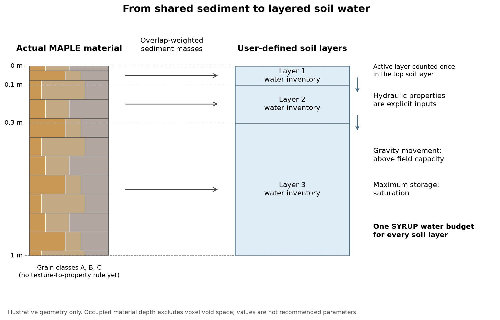

# MAPLE-SYRUP Practical User Guide

*{{official_name}} — {{release_status}} edition, prepared {{prepared_date}}.*

This guide is for a new scientific collaborator. It shows how to install the exact pinned sources, import the corrected MAHLERAN Plot 1 case, run the conservative water–sediment event on CPU and GPU, pause and resume, and read the outputs. Each section connects commands with their intended workflow and outputs.

**Two releases are described.** Sections 1 to 13 describe the surface-erosion reference release (SYRUP `{{surface_syrup_short}}`, MAPLE `{{surface_maple_short}}`): installation, imported cases, the conservative event, legacy replay and benchmark commands, outputs and movies. Their commands, options and defaults are unchanged. Section 14 describes the separate subsurface release (SYRUP `{{syrup_short}}`, LEAF, the historical native MAPLE `9f466d2`, and the scheduler MASY, whose committed identity is {{masy_commit}}): layered soil water and LEAF plants run by a dated scheduled command. Use the release table of Section 14.1 for the second; do not mix the two in one environment.

Pinned sources of the surface-erosion reference, used in Sections 1 to 13:

| Component | Repository | Exact commit |
|---|---|---|
| MAPLE (wind/bed model, dependency) | `https://github.com/gregokin/MAPLE.git` | `{{surface_maple_commit}}` |
| SYRUP (`maple-syrup`, the reference release) | `https://github.com/gregokin/SYRUP.git` | `{{surface_syrup_commit}}` |
| MAPLE package digest the storage guards accept | — | `af54626ab432670539ed71480fd884f13581dfdfcfec63d7c85053ca215adfec` |

Both projects need Python ≥ 3.11. The qualified interpreter was CPython 3.12.3 with NumPy 2.5.3, Numba 0.67.0 / llvmlite 0.49.0 and, for GPU, CuPy 14.2.0 with CUDA 12.9 toolkit components.

An auto-generated reference appendix covering every flag, default and choice is appended after this guide. The guide itself explains how the important controls fit together and which combinations are refused.

**Companion materials.** This guide, its source Markdown and the companion plotting example `render_outputs.py` are distributed together as `SYRUP_Manuals_and_Examples.zip`. They are **not** part of the pinned SYRUP commit `d05d8c6`, so a fresh clone does not contain them. Unpack the archive to `$WORK/manuals` (Section 1.1); every plotting command below runs the helper from there.

---

## 1. Install MAPLE and SYRUP

### 1.0 System prerequisites

The commands below use Bash on Linux or WSL2. Run them in that environment; native PowerShell syntax and paths differ.

You need:

- Git;
- Python ≥ 3.11 (3.12 qualified) with the `venv` module and pip;
- optionally, FFmpeg, only to turn PNG frames into a video;
- for GPU runs only, an NVIDIA driver supporting CUDA 12.x, installed on the host (on WSL2, the Windows driver). The driver is not a pip package.

On Ubuntu 24.04, whose system Python is 3.12, the system packages are typically:

```bash
sudo apt update
sudo apt install git python3.12 python3.12-venv python3-pip ffmpeg   # ffmpeg optional
```

These commands are an example of what to install, not a required recipe. Everything else (the MAPLE base dependencies, Numba, CuPy, `packaging`, Matplotlib) is installed into the virtual environments with pip below.

### 1.1 Choose absolute paths once

Every later command uses these variables. Pick a directory you own; nothing below writes outside it except pip's own caches.

```bash
export WORK=$HOME/syrup-work                 # any absolute path you own
export MAPLE=$WORK/MAPLE-39bcf79             # NEW, separate MAPLE checkout
export SYRUP=$WORK/SYRUP-d05d8c6             # SYRUP checkout
export MAHLERAN=$WORK/MAHLERAN               # your copy of the MAHLERAN inputs (Section 3)
export RUNS=$WORK/runs                       # cases, outputs, checkpoints, stores
export MANUALS=$WORK/manuals                 # unpacked SYRUP_Manuals_and_Examples.zip
export BIN=$MAPLE/.venv/bin                  # CPU environment
export GBIN=$MAPLE/.venv-cupy/bin            # optional GPU environment
export PYTHONDONTWRITEBYTECODE=1
mkdir -p "$WORK" "$RUNS"
```

Keep `$MAPLE` and `$SYRUP` outside `$RUNS`. The runners refuse to write into the MAPLE tree, the MAHLERAN tree, the recipe directory or the SYRUP package.

### 1.2 Clone MAPLE at the exact commit

Use a **new** clone. If you already have a MAPLE checkout that you use for other work, do not repoint it: shared checkouts move forward, and SYRUP binds runs to the exact MAPLE source digest.

```bash
cd "$WORK"
git clone https://github.com/gregokin/MAPLE.git "$MAPLE"
cd "$MAPLE"
git checkout --detach 39bcf79e1e67b6ed960f78a923ddfedf1d173e68
git rev-parse HEAD        # must print 39bcf79e1e67b6ed960f78a923ddfedf1d173e68
git status --porcelain    # should print nothing before you install
```

### 1.3 Create the CPU environment inside the MAPLE clone

```bash
cd "$MAPLE"
python3.12 -m venv .venv
"$BIN/python" -m pip install --upgrade pip
"$BIN/python" -m pip install -e "$MAPLE[windowed]"
```

This installs MAPLE as an **editable** distribution named `maple`, plus its base dependencies from MAPLE's `pyproject.toml`: `jax`, `jaxlib`, `numpy`, `pyyaml`, `xarray>=2024.10`, `zarr>=3.0`, `dask[array]` and `tifffile`. The `windowed` extra adds `numba>=0.67,<0.68`. Without Numba, MAPLE's exact CPU height decode in the resident-window bed refuses with `PrefixPacketError: decode_height on NumPy arrays needs the compiled Numba kernel ...`.

**Never run `pip install maple` from PyPI.** The PyPI project named `maple` is unrelated. MAPLE is not published, so SYRUP deliberately does not declare it as a dependency. Instead, at runtime SYRUP checks which `maple` was imported (`maple_syrup.dependency`) and refuses anything it cannot identify.

### 1.4 Optional: create the GPU environment

```bash
cd "$MAPLE"
python3.12 -m venv .venv-cupy
"$GBIN/python" -m pip install --upgrade pip
"$GBIN/python" -m pip install -e "$MAPLE[windowed,gpu]"
```

The `gpu` extra is `cupy-cuda12x[ctk]>=14.0,<15`. It is **CuPy, not GPU JAX**. The `[ctk]` part pulls in the CUDA 12 toolkit headers that CuPy needs to JIT-compile kernels. Without them, the first kernel launch fails with `Failed to find CUDA headers`. CUDA 12 was chosen because it still supports Pascal (SM 6.1, e.g. GTX 1080 Ti); CUDA 13 does not. The qualified point is CuPy 14.2.0 with CUDA 12.9 components. Other versions in the range are allowed but untested.

The NVIDIA **driver** is not a pip package. Install it separately (on WSL2 that is the Windows host driver). Check with `nvidia-smi` that it supports CUDA 12.x.

### 1.5 Clone SYRUP and install it into the same environment(s)

```bash
cd "$WORK"
git clone https://github.com/gregokin/SYRUP.git "$SYRUP"
cd "$SYRUP"
git checkout --detach d05d8c6c66d9fd2969c007681916254e8d1c2c7c
git rev-parse HEAD        # must print d05d8c6c66d9fd2969c007681916254e8d1c2c7c

"$BIN/python" -m pip install -e "$SYRUP[numba,dependency-delivery]"
"$BIN/python" -m pip install matplotlib          # only for plotting outputs
# GPU environment, if created:
"$GBIN/python" -m pip install -e "$SYRUP[numba,dependency-delivery]"
"$GBIN/python" -m pip install matplotlib
```

`numba` turns on the compiled CPU kernels; nothing falls back silently if they are missing. `dependency-delivery` (`packaging>=23`) is used only by the `maple_syrup.dependency_bundle` helper.

Matplotlib is not a base dependency of either package. MAPLE lists it only in its optional `viz` extra, together with Panel and hvPlot for MAPLE's own interactive viewer. You do **not** need `MAPLE[viz]` to plot SYRUP's NPZ outputs; installing Matplotlib alone is enough for the companion plotting example.

Finally, tell SYRUP which MAPLE it must find:

```bash
export MAPLE_SYRUP_EXPECTED_MAPLE_ROOT=$MAPLE
```

With this set, every resolver call refuses any other MAPLE source root. The plot import, dense event and most other runners also accept `--expected-maple-root`. The windowed runner reads **only** the environment variable.

### 1.6 Using an existing machine's shared environments instead

On a machine whose shared MAPLE environments (for example `/home/okin/MAPLE/.venv` and `.venv-cupy`) already contain the third-party packages, you can reuse them without creating new venvs. However, their editable `maple` points at that machine's live checkout, which has moved past `39bcf79`. **Do not** install your new clone or SYRUP into them. Instead, place the verified materialized MAPLE 39bcf79 bundle ahead of site-packages, and run SYRUP from your pinned source with `python -m`.

A shared environment may **already** contain `maple-syrup-*` console scripts from some other installation. Those scripts launch whatever SYRUP that installation points at, not your pinned clone, so do not use them here. Run every command as `"$PY" -m maple_syrup.<module>` with the `PYTHONPATH` set below, and confirm the selected sources with `check-runtime` and the probe.

```bash
PY=/home/okin/MAPLE/.venv/bin/python             # or .venv-cupy/bin/python for GPU
BIN=$(dirname "$PY")                           # interpreter for the companion plotting commands
GBIN=/home/okin/MAPLE/.venv-cupy/bin             # shared GPU interpreter, when selected
C=/home/okin/SYRUP/outputs/dependencies/content_cache/37a1bc69bfa034be7cd512d8aa7c30d33682b7c053a53c3b0c91edc34d59a96f
PYTHONPATH=$SYRUP/src "$PY" -m maple_syrup.dependency_bundle env "$C" --syrup-src "$SYRUP/src"   # prints; runs nothing
# export exactly what it prints, typically:
export PYTHONPATH=$C/editable:$C/source/src:$SYRUP/src
export MAPLE_SYRUP_EXPECTED_MAPLE_ROOT=$C/source
export MAPLE=$C/source                          # matches explicit --expected-maple-root in later examples
"$PY" -m maple_syrup.dependency_bundle check-runtime "$C"
```

The bundle (ID `37a1bc69…`) is a local artifact, not something a Git clone provides. If it is missing, use the fresh-clone route in Sections 1.2–1.5. To rebuild such artifacts, see `dependencies/maple_shared_storage/README.md` and `docs/cw_e2_dependency_delivery.md`. In that route, substitute `"$PY" -m maple_syrup.<module>` for every console command below. Also do not run from a directory that contains a stray `maple-*.dist-info`: the resolver correctly refuses the shadowing distribution.

---

## 2. Check the installation: the probe

```bash
cd "$WORK"
"$BIN/maple-syrup-probe" --expected-maple-root "$MAPLE" --output "$RUNS/probe_cpu.json"
CUDA_VISIBLE_DEVICES=0 "$GBIN/maple-syrup-probe" --backend cupy --expected-maple-root "$MAPLE" \
  --output "$RUNS/probe_gpu.json"        # optional
```

The probe resolves MAPLE, checks the API surface SYRUP uses, runs a tiny zero-demand MAPLE water exchange and prints a JSON report. `--output` must name a new file outside the MAPLE tree. Check these fields:

- `status` is `"ok"`;
- `maple.dependency.source_root` is your `$MAPLE`;
- `maple.package_source_digest.digest_sha256` is `af54626ab432670539ed71480fd884f13581dfdfcfec63d7c85053ca215adfec`.

A different digest means the imported MAPLE is not the qualified 39bcf79 source. Opt-in overlay storage will then be refused (Section 6.3).

Exit codes: 0 ok; 1 failed probe check; 2 MAPLE dependency refusal, unavailable backend or refused output file. A CuPy probe only round-trips a tiny state. It is not evidence of GPU readiness.

---

## 3. What you must supply: MAHLERAN inputs (not in Git)

The model runs on cases imported from MAHLERAN 1.2.x inputs. **Neither repository contains these inputs.** Obtain them from your collaborators or a MAHLERAN distribution, and treat that tree as read-only.

For corrected Plot 1, `cases/plot1/recipe.yaml` expects:

```
$MAHLERAN/
  mahleran_input.xml          # version 1.2.3 (checked); its input_folder must resolve to Input/input_p1
  Input/input_p1/
    p1dem.asc                 # 62 x 22, 0.5 m cells (checked against the recipe)
    p1vegcover.asc  rm_new.asc  p1pavcoverveg.asc  thetasat39.asc
    <surface-type map named in the XML>
    plot1_phi1.asc ... plot1_phi6.asc
    p1_01_08_06.dat           # rainfall series named by the XML (copied verbatim)
    (p1ksat290806.asc, p1sm290905.asc are hashed only if present)
```

Rules the importer enforces:

- every staged raster must share the DEM header;
- the DEM must have no nodata cells;
- the six grain fractions must close within `1e-6`;
- **no `calib.dat`** may exist in `Input/input_p1`, since legacy calibration multipliers are unsupported.

"Corrected" means the recipe deliberately uses the six distinct `plot1_phi1..6.asc` maps. The supplied `mahleran_input.xml` maps all six classes to `plot1_phi1.asc`; that is a recorded data defect, not a reproduction target. Bed thickness, bulk density (1250 kg m⁻³), voxel size (0.1 m) and active layer (2 mm) are explicit assumptions documented in the recipe, not MAHLERAN values.

---

## 4. Directory layout you will end up with

```
$WORK/
├── MAPLE-39bcf79/                 # pinned MAPLE clone (read-only in use)
│   ├── .venv/  .venv-cupy/        # environments (Section 1)
│   ├── pyproject.toml
│   └── src/maple/
├── SYRUP-d05d8c6/                 # pinned SYRUP clone (read-only in use)
│   ├── cases/plot1/recipe.yaml    # authored recipes (input only; never write here)
│   ├── cases/rfid/recipe.yaml
│   ├── cases/chastre/recipe.yaml
│   ├── src/maple_syrup/
│   └── docs/  dependencies/
├── MAHLERAN/                      # external legacy inputs (Section 3), read-only
└── runs/
    ├── cases/plot1_maple39/       # imported + compiled case package
    │   ├── case.yaml  provenance.yaml
    │   ├── source/mahleran_input_p1/*.asc        # staged copies of the inputs
    │   ├── source/syrup_derived/composition_codes.npy
    │   ├── processed/  diagnostics/              # MAPLE compiler artifacts
    │   └── syrup/
    │       ├── plot1_binding.json                # written last; only then is the import complete
    │       ├── plot1_import_report.json  plot1_fields.npz
    │       └── rainfall/p1_01_08_06.dat
    ├── event_cpu/                 # one run's outputs (must not exist beforehand)
    │   ├── completion_summary.json  final_state.npz  hydrograph.npz
    │   ├── handoff/                # dry-handoff bundle (complete runs only)
    │   └── exchange_history.npz    # only with --record-exchange-history
    ├── event_cpu_checkpoints/
    │   └── step_000001234/         # checkpoint.json, maple_state.npz, continuation.npz
    └── stores/win_cpu/             # resident-window deep store (MAPLE-owned layout)
```

Paths a run creates must be new: the output directory, its sibling `<output>_checkpoints` (unless you pass `--checkpoint-dir` to the dense runner) and, for a fresh windowed run, the `--store-dir`. A run builds its output in a hidden `.<name>.partial-*` sibling and renames it into place only after it succeeds.

The case package records the absolute recipe path and MAHLERAN root. Later runs re-audit it against those paths. **Do not move or edit `$SYRUP/cases/plot1/recipe.yaml` or `$MAHLERAN` after importing.**

---

## 5. Commands: nine installed console scripts, no single `syrup` command

There is no unified `syrup` command. The SYRUP `pyproject.toml` installs nine console scripts. Each one is equivalent to running its module with `python -m`.

| Console script | `python -m` module | Purpose | Backends |
|---|---|---|---|
| `maple-syrup-probe` | `maple_syrup.probe` | dependency/API/provenance check | numpy, cupy |
| `maple-syrup-plot1-import` | `maple_syrup.case_import` | audit + compile corrected Plot 1 | (CPU) |
| `maple-syrup-columns` | `maple_syrup.column_experiment` | no-routing infiltration columns; diagnostic | numpy, cupy |
| `maple-syrup-storm` | `maple_syrup.storm_experiment` | **water-only** storm and recession on frozen terrain | numpy (array/numba), cupy (cuda) |
| `maple-syrup-sediment` | `maple_syrup.sediment_experiment` | water + wet sediment over a **time window** (no stop criterion, reset or restart) | numpy, cupy |
| `maple-syrup-event` | `maple_syrup.event_experiment` | **conservative complete event**, dense MAPLE bed, Plot 1 | numpy (numba/array), cupy (cuda) |
| `maple-syrup-windowed` | `maple_syrup.windowed_experiment` | **conservative complete event**, MAPLE resident-window bed; plot1/rfid/chastre | numpy (numba), cupy (cuda) |
| `maple-syrup-benchmark` | `maple_syrup.benchmark_experiment` | matched fixed-terrain benchmark; default dispatches to the legacy replay | numpy only |
| `maple-syrup-legacy` | `maple_syrup.legacy_experiment` | MAHLERAN legacy sediment replay, Plot 1 | numpy only |

Module-only user commands (no console script):

| Module | Purpose |
|---|---|
| `maple_syrup.rfid_case` | import RFID_2014 (water benchmark case) |
| `maple_syrup.chastre_case` | plan / generate / verify tiled Chastre case |
| `maple_syrup.experimental_experiment` | experimental water-only explicit / local-inertial solvers, with snapshots |
| `maple_syrup.legacy_driver` | legacy replay driver for plot1 / rfid / chastre, CPU/Numba |
| `maple_syrup.legacy_gpu_driver` | resident-GPU legacy replay, plot1 / rfid / chastre |
| `maple_syrup.dependency_bundle` | export / verify / materialize / env / check-runtime of MAPLE bundles |
| `maple_syrup.initial_reimport` | maintainer-only proposal/import of a generation-zero initial assembly under an independently reviewed exact source transition; not wet checkpoint migration |

### 5.1 Which runner should I use?

| You want | Use |
|---|---|
| An actual conservative evolving bed: supply-limited pickup from the real MAPLE active layer and voxels, net-elevation hydraulic refresh, complete event, dry reset, checkpoint/resume | `maple-syrup-event` (dense bed, Plot 1) or `maple-syrup-windowed` (resident window; Plot 1, RFID, Chastre) |
| Comparison with the MAHLERAN legacy program | `maple-syrup-benchmark` / `maple-syrup-legacy` (default `--transport-scheme legacy`) or `legacy_driver` |
| Water only | `maple-syrup-storm`, `experimental_experiment` |
| Infiltration diagnostics | `maple-syrup-columns` |
| Sediment over a fixed window, no completion | `maple-syrup-sediment` |

The two "mainstem" workflows have different defaults, so they are easy to confuse:

| | Benchmark default | Conservative event default |
|---|---|---|
| Transport | `legacy` replay | `characteristic` phase-bin scheme, `--phase-bins 32`, dense phase storage (windowed: CSR, `--phase-max-nnz 1000000`) |
| Sediment supply | fixed composition, **unlimited supply**, explicit clipping source | MAPLE's native exchange: demand capped by currently *available* mass (the same rule as wind), then by active-layer holdings, with refill from the voxel bed; no clipping source |
| Bed | **no evolving MAPLE bed**; frozen terrain and routing | evolving bed; reroute only on net elevation change ≥ 0.00075 m |
| Step | fixed dt = 1 s | adaptive, `--max-dt-s 1` |
| Completion, dry handoff, restart | none | yes (Section 7) |
| GPU | refused (`legacy_gpu_driver` is separate) | `--backend cupy` |

The legacy replay is a benchmark of the old program's behaviour, not MAPLE authority.

**Wind coupling.** A completed conservative event ends with a dry handoff: the dry native MAPLE bed, which a qualified wrapper can pass to MAPLE's wind model. No SYRUP command invokes a wind event. Sequential wind–water coupling is MASY's job (Section 11). The legacy replay produces no handoff bed at all.

### 5.2 CPU vs GPU: explicit pairings, no fallback

| Runner | CPU | GPU |
|---|---|---|
| `maple-syrup-event` | `--backend numpy --implementation numba` (default) or `array` | `--backend cupy --implementation cuda` (`--cuda-mode auto/fused/split`) |
| `maple-syrup-windowed` | `--backend numpy` (Numba hydraulics implied) | `--backend cupy` (CUDA hydraulics implied) |
| `maple-syrup-storm` / `-sediment` | `--implementation numba` (default) or `array` | `--backend cupy --implementation cuda` |
| `experimental_experiment` | `--backend numpy --implementation numpy/numba` | `--backend cupy --implementation cuda` |
| `maple-syrup-legacy`, `maple-syrup-benchmark` | numpy only | refused; use `legacy_gpu_driver` |

For these runners, any pairing not listed in the table (for example `--backend cupy` with `--implementation numba`, or `--implementation cuda` on NumPy) is refused before the case is read. Nothing falls back between CPU and GPU. The table covers the main CLIs only; the exhaustive choices for every command are in the reference appendix. All model arrays are float64. Pascal consumer GPUs have low FP64 throughput, and no speed claim is made for either backend.

Select a GPU with `CUDA_VISIBLE_DEVICES=<index or UUID>`; the runner uses device 0 of the visible set. On shared machines, check that the device is idle first.

- **Dense GPU event:** places the whole small case on the device after a memory preflight.
- **Windowed GPU run:** first sets a hard limit on the CuPy default memory pool, equal to 0.85 × the device's *current* free memory (or a stricter existing limit). It does this before uploading anything and restores the previous limit afterwards.
- **Out-of-memory:** inside that limit, it becomes an explicit `resource refusal`. The failing physical attempt is not adopted or checkpointed; earlier accepted checkpoints remain valid. Initial-store or diagnostic artifacts may already exist. A final successful output directory is not produced for the failed run.
- **Memory plan:** the pre-run plan is known to undercount. Passing it does not mean the run fits.

---

## 6. Plot 1 end-to-end

### 6.1 Import and compile the corrected case

```bash
"$BIN/maple-syrup-plot1-import" \
  --recipe "$SYRUP/cases/plot1/recipe.yaml" \
  --mahleran-root "$MAHLERAN" \
  --expected-maple-root "$MAPLE" \
  --output-dir "$RUNS/cases/plot1_maple39"
```

`--mahleran-root` overrides the recipe's `/home/okin/MAHLERAN` default without editing the recipe. The importer:

1. stages and hashes every input it reads;
2. writes the MAPLE case package;
3. calls MAPLE's real `compile_case`, then reloads and checks the compiled state;
4. writes `syrup/plot1_binding.json` last.

The binding records the case identity, the compiled-artifact hash and the MAPLE package digest. On failure it writes `syrup/FAILED.json` (with traceback) and no binding; delete that directory and use a new path. `--no-compile` writes the audited package without compiling, which is useful only for inspection.

Exit codes: 0 ok; 1 import or MAPLE rejection; 2 MAPLE dependency refusal.

Every later runner re-verifies the case before using it:

- bound file hashes;
- MAPLE's `load_compiled_case` re-hash;
- a fresh audit from the recipe and MAHLERAN inputs;
- the bound MAPLE digest.

If you change MAPLE, re-import (Section 6.5).

### 6.2 Run the conservative event: dense bed, CPU and GPU

```bash
cd "$WORK"
CUDA_VISIBLE_DEVICES='' "$BIN/maple-syrup-event" \
  --case-dir "$RUNS/cases/plot1_maple39" \
  --output-dir "$RUNS/event_cpu" \
  --expected-maple-root "$MAPLE" \
  --max-end-s 5400

CUDA_VISIBLE_DEVICES=0 "$GBIN/maple-syrup-event" \
  --backend cupy --implementation cuda \
  --case-dir "$RUNS/cases/plot1_maple39" \
  --output-dir "$RUNS/event_gpu" \
  --expected-maple-root "$MAPLE" \
  --max-end-s 5400
```

`--max-end-s` is a **horizon, not a target**. After the rain stops, the event keeps running until the completion gates hold: `--hold-s 60`, `--max-depth-m 1e-8`, `--surface-volume-m3 1e-6`, `--max-unit-discharge-m2-s 1e-10`, `--outlet-discharge-m3-s 1e-9`, and the mobile-mass significance threshold. It then makes a forced final terrain commit and the explicit dry reset (Section 7).

If the horizon is reached first, the run **fails** and writes no output directory. It prints `IncompleteEventError: maximum event duration reached; water and sediment were not reset; last accepted checkpoint: <path>` and exits with status 1. That is not completion.

On success, the JSON summary is printed to stdout and saved as `completion_summary.json`. Defaults are listed in the reference appendix; the main ones are `--checkpoint-every-s 600`, `--report-every-s 60`, `--max-dt-s 1`, characteristic transport with 32 bins, and bisection with 40 iterations.

The 5400 s horizon in these examples is a chosen limit, not a newly verified completion time for this source pair. If the strict mobile-load gate prevents drying, a **new** run can explicitly select `--deposit-mobile-at-flow-end`: once all hydraulic gates have held for the quiet period, it deposits the remaining finite mobile mass through MAPLE. This is a model assumption, not a relaxed conservation tolerance; retain the flag in every continuation of that run.

### 6.3 Run the resident-window bed (CPU and GPU)

```bash
CUDA_VISIBLE_DEVICES='' "$BIN/maple-syrup-windowed" \
  --case-kind plot1 --backend numpy \
  --case-dir "$RUNS/cases/plot1_maple39" \
  --store-dir "$RUNS/stores/win_cpu" \
  --output-dir "$RUNS/win_cpu" \
  --max-end-s 5400

CUDA_VISIBLE_DEVICES=0 "$GBIN/maple-syrup-windowed" \
  --case-kind plot1 --backend cupy \
  --case-dir "$RUNS/cases/plot1_maple39" \
  --store-dir "$RUNS/stores/win_gpu" \
  --output-dir "$RUNS/win_gpu" \
  --max-end-s 5400
```

The windowed runner keeps a few top voxels per column resident (`--window-voxels 4`). The deep voxels go to an immutable, versioned MAPLE host store under `--store-dir`. Final outputs and checkpoints contain resident arrays plus **references** to store versions, so they are not standalone archives. **Keep each store** for as long as any output or checkpoint that references it must stay readable or resumable. Old versions are never rewritten. A failed attempt may leave an unreferenced version, but it never damages referenced ones.

Resource controls, all integers in bytes or records:

- `--max-host-bytes` (40 GiB): bounds the host assembly planning estimate and the default checkpoint payload allowance, not the process's operating-system RSS;
- `--max-store-bytes` (256 GiB): bounds the initial deep store's logical size, not the total disk space of every later retained version;
- `--max-journal-records` (1,000,000);
- `--phase-max-nnz` (1,000,000; refused before allocation, mass is never truncated);
- `--max-checkpoint-bytes` (defaults to `--max-host-bytes` and may only tighten it).

The windowed runner disables avalanching for this water-only scope and records the original setting.

`--reuse-initial` restores the persisted initial window assembly from an existing `--store-dir` instead of re-importing it. The source's provenance is recorded. The examples above give each run its own fresh store, which is the simplest safe choice.

**Full vs overlay deep storage.**

- `--deep-chunk-encoding full` is the default.
- `overlay` stores a raw base plus one cumulative, exact final-value overlay per chunk. No tolerance-based dropping and no chains are used.
- Overlay is accepted only when the imported MAPLE package digest is a qualified typed source. For this guide that is `af54626…` (MAPLE 39bcf79); one older MAPLE source is also accepted for historical reproduction. Otherwise it is refused before any case verification or store creation.
- Overlay is also refused for cases with more voxels than MAPLE's `OVERLAY_MAX_VOXELS`, and for dense beds.
- `--deep-overlay-max-bytes` applies only with `overlay`.
- The encoding is part of the bed-storage identity. A run must resume with the same encoding, and a v2 (overlay) store cannot continue under `full`.

### 6.4 Pause and resume (same source, same backend, same controls)

```bash
CASE=$RUNS/cases/plot1_maple39

# Part 1: run to an original boundary and pause (checkpoint written at the pause)
CUDA_VISIBLE_DEVICES='' "$BIN/maple-syrup-event" --case-dir "$CASE" \
  --output-dir "$RUNS/event_pr_part1" --expected-maple-root "$MAPLE" \
  --max-end-s 5400 --pause-at-s 1200

CKPT=$("$BIN/python" -c 'import json,sys; print(json.load(open(sys.argv[1]))["last_checkpoint"])' \
       "$RUNS/event_pr_part1/completion_summary.json")
echo "$CKPT"     # .../event_pr_part1_checkpoints/step_NNNNNNNNN

# Part 2: NEW output directory, identical controls and --max-end-s, same interpreter/backend
CUDA_VISIBLE_DEVICES='' "$BIN/maple-syrup-event" --case-dir "$CASE" \
  --output-dir "$RUNS/event_pr_part2" --expected-maple-root "$MAPLE" \
  --max-end-s 5400 --resume "$CKPT"
```

A paused run exits 0 with `"status": "paused"`. `--pause-at-s` must be a future *original* boundary (rain knots or report times, multiples of 60 s by default) before the horizon. Otherwise the run is refused with `pause time must be a future original boundary before the duration limit`.

For windowed runs, use the same pattern and give both parts the **same `--store-dir`**. A resume restores the initial assembly from that store automatically.

Resume is strict. The checkpoint's recorded identity must equal the current one exactly. That identity covers:

- the SYRUP source digest and the resolved MAPLE package digest;
- the case identity and binding, and the MAPLE configuration;
- the MAHLERAN XML and rainfall hashes;
- the sediment and column parameters;
- the solver and transport controls, the completion policy and the graph (pit/nodata) policy;
- `--max-end-s`, the report cadence and the row cap;
- the backend (plus `--cuda-mode` on CUDA);
- for windowed runs, the window, caps, initial deep manifest and deep encoding.

**CPU checkpoints do not resume on CuPy, and GPU checkpoints do not resume on CPU.** `--max-checkpoint-bytes`, `--checkpoint-every-s` and `--pause-at-s` are resource or scheduling controls and are excluded from the identity. During a run, the SYRUP source, MAPLE source, MAHLERAN XML and rainfall file are re-hashed at every checkpoint, and any change aborts the run. Do not `git pull`, edit or reinstall while a run is active.

The resumed run carries the checkpoint's accumulated result and origin, so its hydrograph continues from the event origin. Check `t_s[0]` before concatenating anything yourself.

### 6.5 When MAPLE changes: `--allow-maple-source-change`

Normal runs should not use this flag: re-import the case with the current pin instead. The flag only acknowledges, at **case verification**, that the MAPLE digest recorded at import differs from the MAPLE imported now. The difference is recorded in the summary (`backend.maple_source_changed_since_import`).

It does **not** override any of these:

- checkpoint/restart identity (a resume still refuses a checkpoint with a different recorded MAPLE);
- the overlay/deferred-publication source guards;
- source-bound windowed store and initial-assembly bindings;
- the within-run source re-hashing.

Old cases, outputs, checkpoints and source locks from earlier MAPLE or SYRUP versions keep their original identities. Normal run/restart commands do not migrate or rebind them. The separate maintainer-only `initial_reimport` utility can reuse a genuinely initial Chastre assembly under an exact reviewed producer-to-consumer transition. It requires an independently reviewed artifact and unchanged original operands; its own unreviewed proposal is refused. It does not convert a wet checkpoint or authorize an ordinary user to bypass source guards.

---

## 7. Event semantics you need to interpret results

- **Completion and dry reset.** `"status": "complete"` means every quiet gate held for `--hold-s` after the rain ended, the forced final commit succeeded and the post-commit checks passed. The dry reset then removes the remaining surface water and soil water as an **external, reported removal** (`reset_accounting` in the summary). Mobile sediment is never erased; it must have been deposited first.
- **`--deposit-mobile-at-flow-end`** (off by default) is an explicit end-of-event assumption that the bed dries again. Once all hydraulic gates hold, MAPLE deposits the remaining finite mobile load, which is reported separately. It waives only the mobile-mass criterion and is not a mass tolerance.
- **Exact dry handoff.** Only a `complete` run writes `handoff/`, the dry-state bundle. A completed handoff cannot be resumed as a wet event.
- **Terminal pit storage.**
  - *Dense runner:* opt in with `--allow-pit-storage`. Cells with no strictly lower D4 neighbour then deposit their mobile load through MAPLE and keep their water. `--allow-flat-storage` extends this to flat sinks.
  - *Windowed runner:* pit storage is on automatically for `rfid`/`chastre` (flat storage too for Chastre) and unavailable for `plot1`.
  - *No overflow.* Pits have no spill, overtopping or backwater. `--terminal-storage-water` lets an event complete with water ponded **only** in terminal-storage cells, and the reset removes it. Large Chastre terminal depths are therefore not credible pond predictions.
- **Routing refresh.** Hydraulics reroute only when the largest per-cell |committed surface − held routing surface| reaches 0.00075 m. Time, reports, checkpoints and ordinary accounting commits never reroute by themselves.
- **Excluded from these runners (the surface-erosion commands of this guide):** running a wind event (the dry handoff bed is the hand-over point; scheduling is MASY's job), direct dry-cell splash, vegetation growth, full ET, nutrients and pit overflow.

**Pond/splash API (no installed CLI).** `maple_syrup.pond_event` is a separate, opt-in Python API. It couples local-inertial pond hydraulics with actual overflow/export at outlet faces, dry rain splash, multi-face characteristic transport and the native MAPLE bed. It supports `PondEventControl(bed_storage="windowed", ...)` and its own checkpoints (`pond_checkpoint`). It is **not** reachable from any console command; see `docs/splash_and_overflow/pond_event.md` and `docs/pond_windowed/README.md`. Local inertia is an alternative hydraulic model, not MAHLERAN method 5/6.

---

## 8. Other workflows

### 8.1 Water-only and diagnostic runners

```bash
C=$RUNS/cases/plot1_maple39
"$BIN/maple-syrup-columns"  --case-dir "$C" --max-dt-s 1 --output-dir "$RUNS/columns"
"$BIN/maple-syrup-storm"    --case-dir "$C" --output-dir "$RUNS/storm_cpu"
CUDA_VISIBLE_DEVICES=0 "$GBIN/maple-syrup-storm" --case-dir "$C" --backend cupy --implementation cuda \
  --output-dir "$RUNS/storm_gpu"
"$BIN/maple-syrup-sediment" --case-dir "$C" --output-dir "$RUNS/sediment_window"
```

- **Columns** are no-routing infiltration diagnostics. They write `column_summary.json` and `final_columns.npz`.
- **Storm** is a water-only storm and recession on frozen terrain with no sediment and no reset. It writes `storm_summary.json`, `final_water.npz`, `hydrograph.npz` and `hydrograph.csv`.
- **Sediment** runs water and wet sediment on the actual bed **up to `--end-s`** (default 5400 s). It has no stop criterion, reset or restart, so it is not a complete storm. It writes `sediment_summary.json`, `final_state.npz` (including `initial_committed_elevation_m`), `hydrograph.npz`, `hydrograph.csv` and `maple_final_snapshot.npz`, which comes from MAPLE's own `save_state_snapshot`.

### 8.2 Benchmark and legacy replay: needs reference artifacts you probably do not have

```bash
"$BIN/maple-syrup-benchmark" --case-dir "$C" --output-dir "$RUNS/legacy_replay" \
  --applied-rainfall "$REF/applied_rainfall.csv" \
  --fortran-ledger "$REF/syrup_sediment_ledger.dat" \
  --reference-run "$REF/mahleran_deterministic_ksat_run"
```

The default `--transport-scheme legacy` dispatches to `maple_syrup.legacy_experiment` (`maple-syrup-legacy` runs the same thing). It **requires** artifacts from an executed, instrumented MAHLERAN reference run:

- the logged applied-rainfall CSV;
- the Fortran sediment ledger;
- a reference-run directory with `execution.json` and `Output/`.

The default values of those flags (`outputs/phase7/...`, `outputs/phase7b/...`) are relative paths to git-ignored local results. A fresh clone does **not** contain them, so this workflow is not turnkey. `$REF` above stands for wherever you hold such artifacts. If they are missing, the run stops with `legacy replay failed: actual Fortran reference ledger and reference run execution.json are required`.

Controls the replay cannot honour are refused with exit status 2 (`legacy replay refused: ...`):

- `--max-dt-s` other than 1;
- `--backend cupy`;
- `--phase-bins`;
- Courant or substep options.

Outputs: `legacy_ledger.npz` and `legacy_summary.json`.

`--transport-scheme characteristic` (or `upwind`) selects the explicit conservative benchmark instead: actual MAPLE exchange on frozen hydraulic geometry with the reference applied rainfall. It still requires `--applied-rainfall`, and has no completion, dry reset, restart, wind or GPU.

`maple_syrup.legacy_driver` (CPU/Numba) and `maple_syrup.legacy_gpu_driver` (resident GPU) support **more cases**: `--case-kind plot1|rfid|chastre`. For Plot 1 they use the parsed case rainfall unless you pass `--applied-rainfall`, and they need no Fortran ledger. They write `legacy_ledger.npz`, `legacy_summary.json` and, with `--snapshot-times`, `legacy_snapshots.npz` (Section 10). A failure leaves `<out>.FAILED/FAILED.json`. Both drivers use frozen terrain, unlimited supply and an explicit clipping source.

### 8.3 Optional case kinds: RFID and Chastre

These cases need extra external inputs and use distinct import commands, not `maple-syrup-plot1-import`.

**RFID_2014** (0.1 m, 106 × 60 including the ring, nodata −9999). You must supply two inputs that are not in Git:

- `$MAHLERAN/Input/RFID_2014/`, with XML version 1.2.0;
- `$NATIVE_CAPTURE`, the `syrup_hydro_steps.txt` written by an executed, instrumented native MAHLERAN run of RFID_2014.

The recipe pins the capture's SHA-256 (`capture_expected_sha256`). A different capture file is refused. The recipe's hydrology values, including its fixed conductivity, come from an audit of that native run. Treat them as values for this one benchmark, not as turnkey defaults for other sites.

```bash
export NATIVE_CAPTURE=/abs/path/to/your/syrup_hydro_steps.txt   # user-supplied artifact
"$BIN/python" -m maple_syrup.rfid_case \
  --recipe "$SYRUP/cases/rfid/recipe.yaml" \
  --mahleran-root "$MAHLERAN" --expected-maple-root "$MAPLE" \
  --applied-forcing-capture "$NATIVE_CAPTURE" \
  --output-dir "$RUNS/cases/rfid_maple39"
```

**Chastre** is a 1 m tiled case (1393 × 1604 interior, about 33 GB of persisted bed). It needs the separately obtained terrain `DTM_Chastre_PD4way.asc`, which the recipe pins by SHA-256, and a completed RFID case. The recipe holds absolute `/home/okin/...` paths, and both `--plan-only` and generation read them as written. Relative paths would resolve against your current directory, not the recipe's directory.

Copy the recipe and set **both** paths to absolute locations you own:

- `terrain.path`: your copy of the DTM;
- `source_rfid.case_dir`: your RFID case.

Keep `terrain.sha256` and every other value unchanged. `--plan-only` always reads `source_rfid.case_dir` from the recipe and ignores `--source-case-dir`. Editing the recipe therefore keeps the plan and the generation consistent, and you can then omit `--source-case-dir`.

```bash
mkdir -p "$WORK/recipes" && cp "$SYRUP/cases/chastre/recipe.yaml" "$WORK/recipes/chastre.yaml"
# edit $WORK/recipes/chastre.yaml:
#   terrain.path:        /abs/path/to/DTM_Chastre_PD4way.asc
#   source_rfid.case_dir: <the value of $RUNS>/cases/rfid_maple39   (write it out in full)
cd "$WORK"
"$BIN/python" -m maple_syrup.chastre_case --recipe "$WORK/recipes/chastre.yaml" \
  --output-dir "$RUNS/cases/chastre_maple39" --plan-only      # writes nothing; exit 3 if disk too small
"$BIN/python" -m maple_syrup.chastre_case --recipe "$WORK/recipes/chastre.yaml" \
  --output-dir "$RUNS/cases/chastre_maple39" --expected-maple-root "$MAPLE"
"$BIN/python" -m maple_syrup.chastre_case --verify-case "$RUNS/cases/chastre_maple39" --hash-only-tiles
```

The case records the copied recipe's absolute path and hash, so keep that copy unchanged after generation.

Run the conservative event on these cases with the windowed runner. You **must** pass the case's declared nodata value; it is never inferred, and a mismatch is refused.

```bash
CUDA_VISIBLE_DEVICES='' "$BIN/maple-syrup-windowed" --case-kind rfid --backend numpy \
  --case-dir "$RUNS/cases/rfid_maple39" --store-dir "$RUNS/stores/rfid_cpu" \
  --output-dir "$RUNS/rfid_cpu" --nodata-value -9999 --terminal-storage-water
```

For Chastre, earlier large runs used `--phase-max-nnz 4000000 --max-journal-records 4000000`. The largest documented run used a separately prepared *rotated* Chastre case. It ran through the Python API `run_complete_windowed(...)` with API-only deferred publication (`deep_publication='boundary'`), not through this CLI, and it stopped **incomplete** at its 10,000 s horizon. A full large storm is not known to fit or complete.

---

## 9. Outputs: files, units, orientation

Read every NPZ with `allow_pickle=False`. All arrays are float64 unless stated.

**Orientation.**

- Grid arrays are `(ny, nx)` with **row 0 = south**. Plot with `origin="lower"`.
- Legacy ASCII grids are north-first; the importer crops the one-cell ring and reverses the rows.
- Sidecar `legacy_full_*` fields in `plot1_fields.npz` keep the ring (62 × 22) and are also south-first.
- Class axes are last, in canonical class order (`c1` = finest phi_1 … `c6` = coarsest).

**Event and windowed outputs (`<output>/`):**

| File / key | Meaning | Units |
|---|---|---|
| `completion_summary.json` | status, identity, budgets, closures, reset accounting, routing counts, timings, `outputs` SHA-256 map | — |
| `final_state.npz: depth_m`, `soil_water_m` | for a `complete` run, the state **after** the dry reset (the removed water is in `reset_accounting`); for a `paused` run, the wet state at the pause | m |
| `pre_reset_depth_m`, `pre_reset_soil_water_m` | physical state at the end of the accepted event, before any reset; use these for final water maps | m |
| `discharge_m2_s` | unit discharge | m² s⁻¹ |
| `committed_elevation_m` | MAPLE committed surface (MAPLE datum: legacy DEM + `datum_offset_m`) | m |
| `active_mass_kg`, `available_mass_kg`, `bound_mass_kg`, `mobile_mass_kg` | per cell and class | kg |
| `voxel_mass_kg` (dense) | full voxel column `(ny, nx, nz, nc)` | kg |
| `window_kg` (windowed) | resident window voxels `(ny, nx, W, nc)` | kg |
| `deep_by_class_kg`, `deep_total_kg`, `deep_room_kg` (windowed) | per-cell totals over the deep voxels below the window: mass by class, total mass, unfilled capacity. The voxel-by-voxel deep contents live in the store | kg |
| `base` (windowed) | `(ny, nx)` int32 logical voxel index of window slot 0, i.e. the first resident level | dimensionless index, **not kg** |
| `terminal_deposition_kg` | final settling deposit (zeros if not complete) | kg |
| `sediment_velocity_m_s` | transport velocity memory per cell and class | m s⁻¹ |
| `phase_fraction` / `phase_csr_fraction` | share of the cell/class mobile mass held in each position bin | dimensionless |
| `phase_position_m` / `phase_csr_position_m` | representative distance from the cell's upstream face | m |
| `phase_csr_row_ptr`, `phase_csr_bin`, `phase_csr_cell_of_slot` | CSR structure | integer indices |
| `hydrograph.npz` | one row per boundary; water columns `t_s`, `cumulative_rain_m3`, `cumulative_intake_m3`, `cumulative_saturation_return_m3`, `cumulative_drainage_m3`, `cumulative_export_m3`, `surface_storage_m3`, `soil_storage_m3`, `outlet_discharge_m3_s`, `max_depth_m`, … ; sediment columns prefixed `sed_` (`sed_mobile_kg`, `sed_cumulative_export_kg`, `sed_export_rate_kg_s`, per-class `sed_cumulative_export_c1_kg` …) | m³, m³ s⁻¹, kg, kg s⁻¹ |
| `exchange_history.npz` | opt-in cumulative per-cell/class MAPLE ledger touch counts and gross activity | counts, kg |

**Interpreting the hydrograph.**

- Columns named `cumulative_*` are running totals since the event origin. Get interval volumes or masses as differences of consecutive rows.
- `outlet_discharge_m3_s` is the **instantaneous** water discharge at the end of the last accepted step before the row.
- `sed_export_rate_kg_s` (and per-class `sed_export_rate_c*_kg_s`) is the actual export of that **last accepted step divided by its Δt**. It is a last-step average, not an average over the report interval.
- For a mean over a report interval, divide the change in a cumulative column by the change in `t_s`, e.g. `np.diff(h["sed_cumulative_export_kg"]) / np.diff(h["t_s"])`. Never multiply either of the rate columns by the report interval to estimate a volume or yield.
- Rows sit at report times (60 s) plus rain knots, so spacing can be irregular.
- The final row includes terminal settling and the final commit, before the external reset.

**Bed change.** `final_state.npz` stores only the final committed surface. For a **Dense Plot 1 event**, compute the change against the initial committed surface of the same compiled case, in the same datum frame:

```python
import numpy as np
from maple.case_tools.compilers.case_compiler import load_compiled_case
from maple.core.types.topographic_commit import committed_elevation_m

case_dir = "/abs/path/runs/cases/plot1_maple39"     # same case the run used
run_dir = "/abs/path/runs/event_cpu"
case = load_compiled_case(case_dir)
z0 = np.asarray(committed_elevation_m(case.committed_topography))
with np.load(f"{run_dir}/final_state.npz", allow_pickle=False) as z:
    z1 = z["committed_elevation_m"]
dz_m = z1 - z0          # + deposition, - erosion; same MAPLE datum, so the offset cancels
```

Run this in the MAPLE environment. `maple-syrup-sediment` already saves `initial_committed_elevation_m` alongside the final surface.

For a **windowed event**, use the actual initial assembly saved in that run's store. Windowed initialization can regroup the Dense baseline for its exact height-packet arithmetic; substituting a separately loaded Dense case can show a small apparent change even before erosion. The saved initial baseline uses the same native committed-elevation definition:

```python
from pathlib import Path
import numpy as np

store = Path("/abs/path/runs/stores/win_cpu")
run = Path("/abs/path/runs/win_cpu")
with np.load(store / "initial_baseline.npz", allow_pickle=False) as initial:
    z0 = initial["reference_elevation_m"] + initial["elevation_offset_m"]
with np.load(run / "final_state.npz", allow_pickle=False) as final:
    dz_m = final["committed_elevation_m"] - z0
np.savez("/abs/path/runs/figures/windowed_change.npz", dz_m=dz_m)
```

Keep the matching store, initial binding and run summary. On a paused run the committed surface can lag the physical bed's pending changes; a completed event forces final accounting. A height-change map of committed surfaces must be labeled accordingly.

`exchange_history.npz` and the per-cell `cumulative_*` maps are **accumulations over the whole event**. They are not time-resolved frames, and you cannot reconstruct a movie from them.

---

## 10. Figures and movies

**What exists.** No committed console runner writes general **evolving-bed spatial movie frames**. The explicit saved map sequences are:

- `experimental_experiment --snapshot-times-s t1,t2,…` writes `snapshots.npz`: **water-only** fixed-terrain maps keyed `t<time>_<field>` (for example `t600_depth_m`, `t600_soil_water_m`, `t600_velocity_m_s`, and face fluxes `t600_qx_m2_s`/`t600_qy_m2_s` for local inertia). The snapshot times are inserted as solver boundaries.
- `legacy_driver` / `legacy_gpu_driver --snapshot-times` (at most 16 whole seconds) writes `legacy_snapshots.npz` with stacked `t_s`, `depth_m` and `mobile_kg`. These are **fixed-bed** legacy maps. Check their shapes with `np.load(..., allow_pickle=False)` before plotting.

A movie of a conservative evolving bed would need explicit capture code written against the event API and checked against the source. There is currently no CLI option for it.

Checkpoints (`<output>_checkpoints/step_*`) hold complete wet states at the checkpoint cadence (600 s by default). A custom script could decode them through the checkpoint API with the run's own context and identity. That is developer work, not a movie command, and the frames would be at checkpoint times only.

### 10.1 The companion plotting example

`$MANUALS/render_outputs.py` is a small companion example; it is not an installed SYRUP command. It needs only NumPy and Matplotlib. It never runs the model, never touches a GPU or checkpoint, and never invents maps that were not saved. Its subcommands are:

- `inspect`: list the keys, shapes and dtypes in an NPZ without loading the payloads;
- `map`: draw one saved 2-D map, or one class (`--class-index`, zero-based) or the class sum (`--sum-classes`) of a 3-D `(row, column, class)` map;
- `hydrograph`: plot one column of `hydrograph.npz` against `t_s`;
- `frames`: render saved snapshots to PNG frames with one fixed colour scale.

Maps are drawn with row 0 at the bottom (south). With `--dx-m` the axes are in metres. The helper refuses to overwrite an existing output file or frames directory.

The helper assumes cell-centred maps. Staggered `qx_m2_s` and `qy_m2_s` need their own face coordinates and should not be passed to its cell-map command. With stacked legacy snapshots it holds one full selected field stack in memory; use small cases or a limited number of snapshots when memory is tight.

```bash
H="$MANUALS/render_outputs.py"
mkdir -p "$RUNS/figures"
"$BIN/python" "$H" inspect "$RUNS/event_cpu/final_state.npz"
"$BIN/python" "$H" map "$RUNS/event_cpu/final_state.npz" --key pre_reset_depth_m \
  --dx-m 0.5 --label "Depth before dry reset (m)" --output "$RUNS/figures/event_cpu_depth.png"
"$BIN/python" "$H" map "$RUNS/event_cpu/final_state.npz" --key mobile_mass_kg --sum-classes \
  --dx-m 0.5 --label "Mobile sediment, all classes (kg)" --output "$RUNS/figures/event_cpu_mobile.png"
"$BIN/python" "$H" hydrograph "$RUNS/event_cpu/hydrograph.npz" --key outlet_discharge_m3_s \
  --label "Outlet discharge, end of last step (m³/s)" --output "$RUNS/figures/event_cpu_q.png"
"$BIN/python" "$H" hydrograph "$RUNS/event_cpu/hydrograph.npz" --key sed_cumulative_export_kg \
  --label "Cumulative sediment export (kg)" --output "$RUNS/figures/event_cpu_sed_export.png"
```

For a complete run, map `pre_reset_depth_m` rather than `depth_m`, which is zero after the dry reset. The default `--label` is `Depth (m)`, so always set a label that matches the key. To map bed change, compute `dz_m` as in Section 9 and save it to a new NPZ (`np.savez(path, dz_m=dz_m)`). Then use `map --key dz_m --cmap RdBu_r` with an explicit symmetric `--vmin`/`--vmax` and label `Committed height change (m)`.

### 10.2 Making a water-depth movie from experimental snapshots

```bash
"$BIN/python" -m maple_syrup.experimental_experiment \
  --case-dir "$RUNS/cases/plot1_maple39" --output-dir "$RUNS/exp_explicit" \
  --solver explicit --backend numpy --implementation numba \
  --max-dt-s 1 --end-s 600 --expected-maple-root "$MAPLE" \
  --snapshot-times-s 60,120,180,240,300,360,420,480,540,600

"$BIN/python" "$H" frames "$RUNS/exp_explicit/snapshots.npz" --field depth_m \
  --dx-m 0.5 --label "Water depth (m)" --frames-dir "$RUNS/frames"

ffmpeg -framerate 4 -i "$RUNS/frames/frame_%05d.png" \
  -c:v libx264 -pix_fmt yuv420p "$RUNS/exp_explicit_depth.mp4"
```

Snapshot times must lie in (start, end]: `0` is refused, and the run starts at 0 s. Each requested time becomes an exact solver boundary. This is a water-only, fixed-terrain experimental solver, not the conservative event and not equivalent to the legacy hydraulics.

### 10.3 Legacy-replay snapshots

```bash
"$BIN/python" -m maple_syrup.legacy_driver --case-kind plot1 \
  --case "$RUNS/cases/plot1_maple39" --output "$RUNS/legacy_plot1" \
  --end-s 600 --snapshot-times 60,120,180,240,300,360,420,480,540,600
"$BIN/python" "$H" frames "$RUNS/legacy_plot1/legacy_snapshots.npz" --field mobile_kg --sum-classes \
  --dx-m 0.5 --label "Mobile sediment, all classes (kg)" --frames-dir "$RUNS/frames_legacy_mobile"
```

`legacy_snapshots.npz` stacks `t_s` (n), `depth_m` (n, ny, nx) and `mobile_kg` (n, ny, nx, nc). Select a class with `--class-index 0`, or sum all classes with `--sum-classes`. These are frozen-terrain legacy maps with unlimited supply. They are not evolving-bed results.

### 10.4 Reading movies correctly

- **Colour scale.** `frames` scans all frames first and uses one fixed scale, which it prints. Pass `--vmin`/`--vmax` to choose a physical range yourself, and use the same range when comparing movies.
- **Time.** Frame rate is playback speed only. The helper writes `frame_times_s.json` and warns when snapshot spacing is unequal; real time maps linearly onto video time only for evenly spaced snapshots. Solver steps are adaptive in the experimental runner, so each frame is labelled with its actual time.
- **Pixel size.** The helper saves fixed-size figures (792 × 624 px at its frame resolution), which suits `-pix_fmt yuv420p`. If a custom Matplotlib configuration changes the saved size (for example `savefig.bbox: tight`), add `-vf "scale=trunc(iw/2)*2:trunc(ih/2)*2"` to the FFmpeg command.
- **No invented frames.** There are no spatial flux or bed-change frames to render, because no runner saves them over time.

---

## 11. Scope limits

- **Supply and availability.** MAPLE's native water exchange caps requested pickup by the currently available mass, using exactly the same rule as wind erosion. The bound share is not released automatically. It then caps pickup per class at the active-layer holdings before refilling from the voxel bed. The corrected Plot 1 case starts with every class 100% available. Prescribed pavement and vegetation affect the water laws independently of that native availability split.
- **Subsurface release.** Layered soil water, LEAF plants and the dated scheduled command are in Section 14 and have their own limits; they are not part of the commands above, and nothing in this section applies to them.
- **Wind.** A complete event hands over a dry native bed; MASY owns the sequential wind/water scheduling and calls each model. No SYRUP CLI runs or schedules a wind event.
- **Storage-admission checks.** `maple_syrup.storage_admission` (`admit_public`, `admit_paired`) provides opt-in caller checks for memory admission of windowed exchanges. Existing runners do not call it automatically.
- **Qualification status.** The 39bcf79 pairing is qualified for the storage integration (`docs/maple39_shared_storage_qualification.md`). That does not qualify:
  - alternating wind–water events;
  - large-catchment storms or whole-Chastre memory fit;
  - universal CPU/GPU bitwise equality.
- **Historical status.** README sections and dated status blocks in older docs are historical. Where they disagree with current source and with `docs/maple39_shared_storage_qualification.md` and `docs/pond_windowed/`, follow the source and those docs.

---

## 12. Troubleshooting

| Message (abridged) | Cause | Fix |
|---|---|---|
| `` `import maple` failed `` | wrong interpreter | use `$BIN`/`$GBIN` (or the Section 1.6 `PYTHONPATH`) |
| `expected MAPLE source root X, but the imported maple resolves to source root Y` | a different MAPLE (e.g. the shared live checkout) | check `MAPLE_SYRUP_EXPECTED_MAPLE_ROOT`, the venv, `PYTHONPATH` |
| `imported maple at … is not inside the editable install root` | another copy shadows it on `sys.path` | unset stray `PYTHONPATH`; leave directories containing `maple*` |
| `MAHLERAN XML not found`, `XML version … != expected '1.2.3'`, `input_folder … not the recipe's` | MAHLERAN inputs missing or different | fix `--mahleran-root` and the inputs (Section 3) |
| `calib.dat exists` | legacy calibration not supported | remove it from your input copy, then re-import |
| `refusing to write into existing path`, `output and checkpoint directories must be new` | reused path | choose new `--output-dir` (and its `_checkpoints` sibling) |
| `refusing to write inside the … tree` | output under MAPLE/MAHLERAN/recipe/SYRUP package | write under `$RUNS` |
| `…/syrup/FAILED.json exists: the import failed` | case directory from a failed import | re-import into a new directory |
| `MAPLE source digest … differs from the one bound at import` | case imported under another MAPLE | re-import with the current pin (Section 6.5) |
| `Numba requested but unavailable; no implicit fallback` | missing Numba | install `[windowed]` / `[numba]` extras |
| `PrefixPacketError: decode_height … needs the compiled Numba kernel` | windowed CPU run without Numba | install MAPLE `[windowed]` |
| `backend 'cupy' with implementation 'numba' is refused` | invalid pairing | `--backend cupy --implementation cuda` |
| `backend 'cupy' is refused: …` / `backend unavailable` | no CuPy or no visible device | use `.venv-cupy`; check `CUDA_VISIBLE_DEVICES`, driver |
| `Failed to find CUDA headers` | CuPy without `[ctk]` | reinstall `[windowed,gpu]` |
| `allow_flat_storage extends allow_pit_storage and needs it`; `terminal_storage_water needs an opt-in pit-storage graph` | dense pit options missing | add `--allow-pit-storage` (dense); not available for windowed `plot1` |
| `masked case requires explicit nodata_value` / `nodata_value … differs from the verified case grid` | windowed rfid/chastre | pass `--nodata-value -9999` (the declared value) |
| `deep_chunk_encoding='overlay' is supported only with an accepted MAPLE source` | MAPLE digest not qualified | use the 39bcf79 pin or `full` |
| `pause time must be a future original boundary …` | pause not on a report/rain boundary | pick a multiple of the report cadence before the horizon |
| `IncompleteEventError: maximum event duration reached; … last accepted checkpoint: …` | horizon reached before completion | not a result; inspect or resume only with the same `--max-end-s` (identity), or start a new run with a longer horizon |
| `checkpoint schema, case/source/config identity or payload set mismatch`; `restart stopping or numerical controls changed`; `restart duration or forcing changed` | resume with different source/backend/controls | resume with exactly the original sources, backend and controls |
| `SYRUP source changed during the event` / `MAPLE source changed …` | files edited or reinstalled mid-run | do not touch the trees during runs |
| `resource refusal: CuPy device memory request exceeded the enforced pool hard limit …` | does not fit the device | earlier checkpoints stay valid; free the device or use CPU |
| `resource refusal: the resident-window planning estimate alone exceeds 85% …` | estimate already too large | smaller case or larger device |
| `legacy replay refused: …` (exit 2) / `actual Fortran reference ledger … required` | unsupported legacy control / missing reference artifacts | Section 8.2 |

**Exit codes.**

- 0: success, including `paused` runs.
- 1: run, import or validation failure.
- 2: dependency refusal, usage error (argparse) or legacy refusal.
- 3: `chastre_case --plan-only` disk refusal.

The dense runners print errors to stderr. The windowed runner prints progress and errors to stdout.

---

## 13. Reproducibility checklist

Record these for every study:

1. **Exact commits and cleanliness.** Capture `git -C "$MAPLE" rev-parse HEAD`, `git -C "$SYRUP" rev-parse HEAD` and `git status --porcelain` for both. HEAD alone does not identify uncommitted edits; the digests do.
2. **Probe report.** Save it (`--output`), with the MAPLE package digest `af54626…`, `source_root`, Python and package versions. Also save `pip freeze` from each environment.
3. **Case provenance.**
   - `syrup/plot1_binding.json`: case identity, artifact hash, MAPLE digest, SYRUP provenance, environment.
   - `syrup/plot1_import_report.json`: recipe and XML hashes, staged-source hashes, resolved legacy settings, datum offset.
   - MAPLE's `provenance.yaml`.
4. **Run summary** (`completion_summary.json`):
   - `identity`: `syrup_source_sha256`, `maple_source_sha256`, `case_identity_sha256`, `mahleran_xml_sha256`, `rainfall_sha256`, `sediment_parameters`, `column_parameters`, `control`, `completion_policy`, `graph_policy`, `backend`;
   - `backend.maple_source_changed_since_import`;
   - `outputs`, the SHA-256 of every output file.
5. **Retention.** Keep every checkpoint directory you might resume from, and every windowed `--store-dir` that is referenced. Treat them as immutable.
6. **Subsurface release runs (Section 14).** Keep the run's `resolved.json`, `RUN_STATUS.json`, the three LEAF input files with their pins, and the manifests or production recipe and receipt that identified the sources; a checkpoint resumes only under exactly those sources.
7. **Dependency pins and bundles (advanced).** `dependencies/maple_shared_storage/README.md` (reconstruction recipe, fixed manifest SHA-256 `877826de…`), `qualification.lock.json`, `docs/cw_e2_dependency_delivery.md` (bundle export/verify/materialize/env/check-runtime) and `docs/maple39_shared_storage_qualification.md`. Bundles certify integrity, not authenticity, and do not carry third-party packages or deep-store data.

---

## 14. Layered subsurface water: scheduled water and LEAF runs (subsurface release)

*This part is additive. Sections 1 to 13 and the CLI reference describe the installed commands and the surface-erosion workflows of the historical reference release; their commands, options and defaults, including the legacy replay and benchmark defaults, are unchanged. The scheduled water command described here is a separate module, `masy.native_water_run`, which is not one of the installed console scripts and is not in the generated CLI reference. Its science is described in Section 13 of the Model Structure and Physics document.*

### 14.1 What this part covers, and what is and is not available

The subsurface release adds soil-water layers, a persistent infiltration history, evaporation, optional LEAF plant withdrawals and growth, and a dated calendar of rain and interevent periods on top of an existing MAPLE case. It is a different release from the one the earlier sections install:

| | Surface-erosion reference (earlier sections) | Subsurface release (this part) |
|---|---|---|
| SYRUP | `{{surface_syrup_commit}}` | `{{syrup_commit}}`, branch `{{syrup_branch}}` |
| MAPLE | `{{surface_maple_commit}}` | `{{maple_native_commit}}` (historical native 9f bundle, explicitly pinned; not the latest MAPLE and not the earlier pin) |
| LEAF | not used | `{{leaf_commit}}` (branch `{{leaf_branch}}`) |
| Scheduler (MASY) | not used | `{{masy_commit}}` (branch `{{masy_branch}}`) |

The four repositories are `https://github.com/gregokin/SYRUP.git`, `MAPLE.git`, `MASY.git` and `LEAF.git`. A default clone of the main branch does not contain the subsurface release: use the exact commits above (Section 14.2). The release commits are on the branch named in the table of each repository; the commits of the four release sources are pushed to these repositories and were verified against the remotes (build metadata: published {{sources_published}}); the later documentation commit is a separate packaging step that does not change these source identities. Use the earlier release for the surface commands and this release only for the commands below, in separate environments.

Two configuration schemas exist, selected by `schema:` in `run.yaml`:

| Schema | Command | Contents | Source modes |
|---|---|---|---|
| `masy.native_water_run.v1` | standalone water-only scheduled run | layered water, interevent evaporation; transpiration and growth refused | `development_snapshot` only; `production_committed` refuses with `production_recipe_unavailable` |
| `masy.native_water_run.v2` | LEAF and water scheduled run | v1 plus one closed `leaf` block: actual LEAF plants, withdrawals, growth | `development_snapshot` and `production_committed` (Section 14.10) |

A v2 file never silently runs water-only, and a v1 file containing `leaf` is refused. Neither schema runs wind: wind is refused. Daily small-rain recharge (Phase 1.5) has no interface or option yet.

**Qualification in one paragraph.** {{qualification_statement}} The committed LEAF-and-water runtime (v2, production mode) was prepared and run from the committed sources of the table above with the existing CPU and CUDA environments. The full public two-layer 4×6 dense example completed all three occurrences (interevent, a 0.25 s rain with its native recession to genuine completion, interevent, with evaporation, transpiration and growth on) on NumPy, Numba and CUDA. A run paused after the first interevent, resumed and paused after the completed storm, and resumed to the end reproduced the uninterrupted run exactly on both the CPU and the CUDA device: 44 of the 45 stored physical array entries (29 floating-point and 15 other state arrays) are identical with maximum relative difference 0, the plant arrays are identical and all four biology files are byte-identical; the 45th entry is a provenance record that differs by backend and source paths by design and is checked separately. NumPy, Numba and CUDA agree on the same 44 state arrays with maximum relative difference 0 and exactly on the plant arrays. The plant grew from 100 kg to 100.12256745482205 kg and its transpiration request and the accepted amount were equal (8.461372331859172e-5 m³, nothing unmet). Six real command-line refusals (unknown configuration key, zero memory cap, wrong recipe pin, unreviewed receipt, wrong existing environment interpreter and wrong restart seal) occurred before any physical step and left the accepted checkpoint unchanged, and 154 portable scientific controls (4 of them on CUDA) passed. Runs report `production_qualified: false` and `production_runtime_verified: true`; the first flag is deliberately not relabelled. This is bounded evidence on one small fixed-geometry fixture, not a field validation or a performance, scaling or wind result (Section 13.10 of the Model Structure and Physics document lists the evidence and limits).

### 14.2 Obtain the sources and set up the environments

The surface-erosion sections of this guide install SYRUP into an environment with the earlier MAPLE. The subsurface release needs a **separate MAPLE environment** built from the historical native MAPLE commit `{{maple_native_commit}}`; the current live MAPLE, a default clone and the earlier MAPLE `{{surface_maple_short}}` do not satisfy the source guards, which check frozen content, and nothing is rebound or fallen back to. The release commands refuse rather than adapt if a source, interpreter or package differs.

```bash
export WORK=$HOME/syrup-subsurface            # choose once; absolute path
mkdir -p "$WORK" && cd "$WORK"
git clone https://github.com/gregokin/MAPLE.git MAPLE-9f466d2
git clone https://github.com/gregokin/SYRUP.git SYRUP-subsurface
git clone https://github.com/gregokin/LEAF.git  LEAF-subsurface
git clone https://github.com/gregokin/MASY.git  MASY-subsurface
git -C MAPLE-9f466d2     checkout --detach {{maple_native_commit}}
git -C SYRUP-subsurface  checkout --detach {{syrup_commit}}
git -C LEAF-subsurface   checkout --detach {{leaf_commit}}
git -C MASY-subsurface   checkout --detach {{masy_commit}}
for d in MAPLE-9f466d2 SYRUP-subsurface LEAF-subsurface MASY-subsurface; do git -C $d rev-parse HEAD; git -C $d status --porcelain; done
```

Each `rev-parse` must print the commit given in Section 14.1 and each `status` must print nothing: the runtime seals only clean committed `src/` and `pyproject.toml` blobs and refuses untracked, ignored-in-scope or modified files. Do not build `*.pyc` caches inside the trees (always run with `-B`).

**CPU environment (MAPLE clone, as in Section 1.3).**

```bash
cd "$WORK/MAPLE-9f466d2"
python3.12 -m venv .venv
.venv/bin/python -m pip install --upgrade pip
.venv/bin/python -m pip install -e ".[windowed]"
.venv/bin/python -m pip install "packaging>=23"
```

**CUDA environment (optional).**

```bash
python3.12 -m venv .venv-cupy
.venv-cupy/bin/python -m pip install --upgrade pip
.venv-cupy/bin/python -m pip install -e ".[windowed,gpu]"
.venv-cupy/bin/python -m pip install "packaging>=23"
```

Only MAPLE, its dependencies, Numba and `packaging` are installed. SYRUP, LEAF and MASY are **not** pip-installed: the runtime seals their committed bytes into a store and imports those sealed copies. The qualified environments contained Python 3.12.3, NumPy 2.5.3, Numba 0.67.0 with llvmlite 0.49.0 and, for CUDA, CuPy 14.2.0 (`cupy-cuda12x`) with the CUDA 12.9 components; I did not build a new environment from scratch for this guide, so check these against your own `pip list` and expect a refusal rather than a silent adaptation if a check fails. Never `pip install maple` from PyPI (an unrelated project). The extras names `windowed` and `gpu` are those of the MAPLE `pyproject.toml` at this commit.

The MAPLE environment is the one the runtime preparation (Section 14.10) names as `runtime.python`; its own `site-packages` metadata is **not** the `distribution_metadata` input of that preparation (the companion fixture of Section 14.10 is); the CPU and CUDA interpreters each get their own runtime store and lock, which are not interchangeable. Keep the earlier surface-release environments untouched.

### 14.3 Who initializes what

The MAPLE case directory (`case.yaml`, `model.yaml`, `wind.yaml`) initializes the landscape: terrain, grain classes, voxels, active layer, native water and the site latitude, read from `location.latitude_deg` in `case.yaml` and nowhere else. A missing, null or out-of-range latitude refuses before any physical work, even when PET is supplied explicitly. The SYRUP water file (`layered_water.yaml`) adds the water-specific settings. In a v2 run LEAF initializes the vegetation from its own species catalog and plant files (Section 14.8); in a v1 run the cover fraction and the preferential-pathway species of the water file are prescribed numbers, not LEAF plants. LEAF calculates plant withdrawals; SYRUP checks them against available water, debits the accepted amount once and reports accepted and unmet amounts back to LEAF, which keeps no second soil-water store.

Wind, rain and interevent periods never overlap. Evaporation, transpiration and growth occur only in interevent periods. In the current dated calendar, time advances through every period, rain and recession included, and nothing is applied retroactively to the length of a wind or rain period. Soil water and the wetting history carry across events; nothing resets them at the end of a storm, a file, a checkpoint or a schedule boundary. The planned nominal-day clock of Phase 1.5 is a different, future contract (Section 14.13).



### 14.4 File layout

The shipped example input sets keep their files in one directory:

| File | Contents |
|---|---|
| `case/case.yaml`, `case/model.yaml`, `case/wind.yaml` | The MAPLE case. |
| `layered_water.yaml` | Soil layers, retention thresholds, infiltration, evaporation partition, initial water and hydraulic boundaries. |
| `scenario/scenario.json` | Calendar start, the ordered list of event files and the weather file. |
| `scenario/weather.json` | Dated daily weather and the PET method. |
| `scenario/events/ie.json`, `scenario/events/rain.json` | One interevent and one rain event. |
| `run.yaml` | Which files to use, the source statement, step and resource limits, output limits. |

File names are examples. Paths in `run.yaml` other than the `source` block are relative to the `run.yaml` file. `scenario.json` records the SHA-256 digest of the weather and event files it names, so a changed event or weather file must be matched by a changed digest, and the run pins every input by hash when it starts. Map files named from the water file (below) are relative to the directory holding that water file.

### 14.5 YAML conventions

* The water file uses the schema name `maple-syrup-layered-case/1`. Unknown keys, missing keys, duplicate keys, anchors, aliases and tags are refused. The parser's default bounds (`LayeredCaseLimits`) are: file size 65 536 bytes, 5000 YAML nodes, nesting depth 8, 64 layers, 16 species and 4096 outlets. These are defaults of the Python interface, not absolute limits: a caller may pass other positive integers, which are then honoured exactly and never raised silently. A value that is not a positive integer is refused. The run command uses the defaults.
* **Numbers in scientific notation must contain a decimal point:** write `1.0e-5`; a bare `1e-5` is read by YAML as text and is refused.
* A key described as "scalar or map" accepts either a number or `{file: name.npy}`, with an optional `sha256` (the hexadecimal digest of the file, checked when the file is read). The file name is one plain name with no directory part, opened relative to the directory of the water file; symbolic links are refused. A map is an ordinary NumPy `.npy` file (format version 1.0 or 2.0) holding a C-ordered two-dimensional array of shape `(ny, nx)` equal to the MAPLE grid: little-endian 64-bit floats (`<f8`) for numeric maps and Booleans for the active mask. Numeric maps must be finite and lie in the range of their key; no halo, rotation or resampling is applied. By default at most 32 map files are read, each at most 256 MiB, and 256 MiB in total; a file named twice is read once.
* Retention thresholds and layer properties vary by layer, not by cell.

### 14.6 The water file, `layered_water.yaml`

The first block chooses the compute backend, and it is the **only** place the backend is chosen: there is no command-line or `run.yaml` backend override. In a CPU file, `numpy` or `numba` is accepted and a GPU value is refused. A GPU file uses the same keys with `compute.backend: cuda`, which the GPU loader accepts and the CPU loader refuses; the value is never overridden or relabelled, and a CPU file is never run on the GPU nor the reverse. The source profile in `run.yaml` must match (a `..._cpu_v1` profile with a CPU file, `..._cuda_v1` with a CUDA file); a mismatch is a typed refusal before physical work. In the shipped CUDA example the CPU reference file differs from the GPU file in that one line only.

**Soil**

| Key | Meaning and unit |
|---|---|
| `soil.layers.thickness_m` or `soil.layers.edges_m` | Layer thicknesses in m from the surface down, or edges beginning at 0. The stack must fit inside the actual MAPLE material of every active cell. |
| `soil.theta_residual`, `theta_field_capacity`, `theta_saturation` | Volumetric water fractions (m³/m³), a scalar or one per layer, with residual ≤ field capacity ≤ saturation and residual < saturation. |
| `soil.theta_evaporation_stress` | Moisture (m³/m³) of the top layer below which evaporation is reduced. Must exceed its residual. |
| `soil.gravity_drainage` | `true` lets water above field capacity move down; `false` disables the whole cascade. |
| `soil.bottom` | `open`: excess leaves at the bottom as drainage. `closed`: nothing leaves, and water stays within the profile. This is not a groundwater or wicking boundary. |
| `soil.diffusion.mode` | `tietjen_donor_depth` or `constant`. |
| donor-depth inputs | `interface_conductivity_m_s` (m/s, a scalar or one per interface) and `coefficient` (dimensionless). |
| constant-mode input | `diffusivity_m2_s` (m²/s, a scalar or one per interface). |

For L layers there are L − 1 interfaces. Hydraulic properties are explicit user inputs in this release. The actual MAPLE texture is computed, but it does not select conductivity, suction or thresholds; a texture-to-property method is later work.

**Infiltration**

| Key | Meaning and unit |
|---|---|
| `matrix.conductivity_m_s`, `matrix.suction_m`, `matrix.vegetation_factor` | Matrix infiltration conductivity (m/s), suction (m) and the vegetation factor g in 0–1. |
| `preferential.a3` | Background coefficient of the reference. A scalar must be exactly 0.1, 0.5 or 0.8; a map is accepted when every value lies in 0–1. |
| `preferential.max_fraction_per_hour` | Dimensionless hourly fraction of the standing water. The setup is refused unless, in every cell, this value times the summed receiver map lies in 0–1. |
| `preferential.max_intake_rate_m_s` | An additional cap on the preferential intake rate: a positive number, a map or the word `unlimited`. |
| `preferential.background_receiver_weights` | Nonnegative receiving weights, one per layer, for the background pathway. |
| `preferential.species` | A list of prescribed pathways, each with `name`, `receiver_weights` (one per layer) and `contribution` (a scalar or map, ≥ 0). |

**Receiving weights are not root fractions.** The background weights and the species weights decide which soil layers receive preferential water. Weights are nonnegative and need not sum to one. A vector with a positive sum is normalized; `[0, 1, 1]` sends equal shares to layers 2 and 3. A vector of zeros switches that pathway off. Root-uptake fractions belong to LEAF, are different quantities and appear nowhere in this file. All pathways share one supply of surface water, one maximum intake rate and the receiving capacity of the layers; the background allowance is not spent again for each species.

**Evaporation and transpiration.** The five `evaporation` numbers are dimensionless: `canopy_intercept`, `canopy_slope`, `transpiration_slope`, `transpiration_offset` and `soil_factor`. `soil_factor` is the site factor (the reference's EPfactor) that multiplies the combined soil potential. It is not the evaporation share. The share is 1 − clip(`transpiration_slope` × cover − `transpiration_offset`, 0, 1) and is applied after the soil moisture limit has capped the combined loss. Only the resulting evaporation is debited. SYRUP does not debit plant transpiration through this calculation; LEAF requests transpiration separately from the remaining available water. `cover` is the prescribed canopy fraction, 0–1, scalar or map.

**Initial state**

| Key | Meaning |
|---|---|
| `initial.soil_moisture.units` and `by_layer` | `theta` (m³/m³) or `inventory_depth_m` (m of water in the layer), one value per layer. Zero is allowed. The water in a layer must not exceed its saturation depth. |
| `initial.wetting_history_m` | The persistent infiltration history J (m), scalar or map. It records history and adds no water. |
| `initial.cumulative_intake_m` | Lifetime actual matrix intake (m), scalar or map. A ledger; it adds no water. |

**Domain**

| Key | Meaning |
|---|---|
| `domain.active_mask` | `all` or a Boolean map `(ny, nx)`. |
| `domain.friction_factor` | Positive Darcy–Weisbach factor, scalar or map. |
| `domain.closed_ring_rise_m` | Positive elevation offset (m above the bed maximum) that closes every non-outlet boundary cell. |
| `domain.outlets` | A list of edge faces, each with `row`, `col`, `d_row`, `d_col` (one of (1,0), (−1,0), (0,1), (0,−1)) and a positive `drop_m` in m. An empty list is a closed basin. MAPLE's periodic wind boundaries never define water outlets implicitly. |

The values in the example files are numerical test settings. They are not field calibration or defaults, and the example calendar file differs from the commented example file (including its use of four outlet faces).

### 14.7 Weather, scenario and event files

`weather.json` has closed declarations followed by rows. The declarations are: `units` (exactly `degC`, relative humidity as a `fraction`, `kPa`, `MJ_m2_day` and `mm_day`; no other spelling is converted); `utc_offset` and `sampling` (daily; the offset must equal the scenario's calendar offset); `temperature` with a Boolean `extrema` and a `tmean` mode; `humidity.supplied` (`none`, `rh`, `vpd` or `both`, with `derivation: maple_syrup.weather_pet`); `radiation.supplied` (Boolean); `pet.method`; and `provenance` with `kind`, `description` and `source`. Rows are consecutive calendar days with no gaps or nulls. Simplified forcing is valid, and should be labelled `prescribed` or `estimated` rather than `observed`.

Which row fields are required follows from the declarations:

| Row field | Required when |
|---|---|
| `date` | always |
| `tmean_c` | `temperature.tmean` is `supplied` |
| `tmin_c`, `tmax_c` | `temperature.extrema` is true (both together) |
| `relative_humidity_fraction` | humidity is `rh` or `both` (0–1, never a percentage) |
| `vpd_kpa` | humidity is `vpd` or `both` |
| `radiation_mj_m2_day` | `radiation.supplied` is true |
| `pet_mm_day` | `pet.method` is `explicit` |

A mean temperature is always available to SYRUP and LEAF: it is either supplied in each row or, when `tmean` is declared `arithmetic_mean_of_tmin_tmax`, derived as the average of the extrema (a declared convention, recorded as derived, allowed only when extrema are present). The daily extrema are needed only for `ecohyd_hargreaves` and for any humidity field, because the humidity relation uses them. With `explicit` PET, no humidity and no extrema, a row may hold just `date`, `tmean_c` and `pet_mm_day`. If both humidity values are given they must agree within the library's tolerance (an optional `consistency_tolerance_kpa` may be declared only for `both`); if one is given the other is derived once. Hargreaves needs no radiation. The method `penman_monteith` is refused until implemented.

Latitude is not a weather field. The integrated case always takes it from `location.latitude_deg` in the MAPLE `case.yaml`, with no default, whatever the PET method; do not omit it from the case even if PET is supplied explicitly.

`scenario.json` names the calendar start (a date and time with an offset), the weather file and an ordered list of occurrences, each referring to an event file by name and digest. `native_epoch_s` must be 0. A rain event (`rain.json`) lists intervals with `duration_s` and `intensity_mm_h` and a `recession_guard_s` allowance; a rain event completes when its surface is quiet, not when rain ends. An interevent file gives `duration_s` and the switches `processes.evaporation`, `processes.transpiration` and `processes.growth`. In the water-only command (v1), only evaporation can be enabled; enabled transpiration or growth is refused. In the LEAF command (v2) transpiration and growth may be enabled, subject to the gates of Section 13.6 of the Model Structure and Physics document; neither occurs during rain or recession.

### 14.8 LEAF inputs (v2 only)

The `leaf` block names three LEAF files and the limits for reading them. All are pinned by their bytes when the run starts.

| File | Contents |
|---|---|
| `catalog.json` | LEAF species catalog (`leaf.species_catalog`, version 1): units, number of root layers (must equal the soil layers), and for each species its allometry, root layer fractions and lateral radius, growth law and traits (for example monthly activity and temperature limits), and water-use law (`biomass_specific_pet_v1`: demand per kg per day at a reference PET). |
| `plants.csv` | One plain nine-column row per plant: `plant_id, species, x_m, y_m, establishment_ground_m, agb_dry_kg, seasonal_agb_dry_kg, age_days, status`. Coordinates are in the landscape frame, in metres, not relative to the grid origin. |
| `plants.metadata.json` | Required companion beside the CSV, written by LEAF's own plant-file writer (`leaf.plant_state_metadata`): domain, cell sampling, units, species order, row count and the CSV hash. Never edit the CSV or the metadata by hand without the other. |

`establishment_ground_m` may be a number or `SURFACE`. A `SURFACE` anchor is resolved at the start of a run from the retained initial bed height of the plant's cell (the public LEAF establishment resolver, on both backends); nothing is filled or invented, and an anchor in an inactive or unknown cell is refused. Plants outside the grid, a grid, cell-area or layer-count mismatch with the catalog, and an inconsistent CSV and metadata pair are refused before any physical step. The known active mask of the water setup is used for the canopy geometry, so inactive cells carry no canopy area; changing it on resume is refused. The example catalog values are fixture values, not calibrated parameters.

The `leaf` keys, all required, are:

| Key | Meaning |
|---|---|
| `leaf_variant` | `8da` only. |
| `leaf_root` | Development mode: absolute path of the clean LEAF 8da source (23 modules plus pyproject). Production mode: not allowed; the root is derived from the sealed LEAF capsule. |
| `catalog`, `plants` | Relative file names; the metadata file must sit beside `plants`. |
| `cadence_days` | Integer 1 to 7, the growth grid. |
| `geometry` | `max_edges`, `max_bytes`, `canopy_max_edges`, `canopy_max_bytes` (positive integers) and `builder` (`numpy` or `compiled`). |
| `budgets` | `leaf_budget_bytes` and `checkpoint` with `max_host_bytes`, `max_device_bytes` (0 on CPU), `max_disk_bytes`, `max_biology_bytes`. |
| `io` | `max_catalog_bytes`, `max_plants_bytes`, `max_plant_records`; the record count is checked by a streamed count before any plant array exists. |

### 14.9 The run file, `run.yaml`

| Block | Purpose |
|---|---|
| top level | `schema` (v1 or v2), `run_id`, `maple_case_dir`, `syrup_parameters`, `scenario`, `profile_id`. Paths other than those in `source` are relative to `run.yaml`. |
| `source` | `mode` and the fields of that mode (Section 14.10); `profile` (below). |
| `execution` | `quiet_policy`, which must be `default`: the storm owner's standard flow-end gates (60 s hold; depth change 1e-8 m; unit discharge 1e-10 m²/s; outlet discharge 1e-9 m³/s; excess depth 1e-8 m; excess volume 1e-6 m³). No override is offered. |
| `limits` | `interevent_max_dt_s`, `interevent_min_dt_s`, `interevent_max_retries`; `storm` with `max_dt_s`, `min_dt_s`, `max_retries`, `max_steps` (the native work budget of one call), `max_recession_s`; and `max_occurrences`, `max_dates_per_interevent`, `max_accepted_steps_per_occurrence`, `call_step_budget`, `max_record_bytes`. |
| `resources` | Explicit memory reserves `caller_reserve_bytes`, `temporal_reserve_bytes`, `lifecycle_extra_reserve_bytes`, `preparation_reserve_bytes` and optional `host_available_cap_bytes`. There are no default reserves. |
| `output` | `run_dir` (must not exist; its parent must), `step_cadence`, `max_output_bytes`, `max_file_bytes`, `max_step_lines`, `physical_checkpoint` and `compile_output_reserve_bytes`. `physical_checkpoint` is `none`, `terminal_standalone` (v1 and CPU only; the final physical state without a cursor) or `combined_terminal` (CPU or CUDA, the sealed artifact used for pause and resume; required for a LEAF run to be resumable, and `terminal_standalone` is refused for LEAF runs because it would drop the biology). |
| `cuda` | Required with a CUDA profile and refused with a CPU profile: `device_id`, `device_reserve_bytes`, `device_cap_bytes`, `native_reserve_bytes`; no defaults and no unlimited cap. |
| `leaf` | v2 only (Section 14.8). |

**Source profiles.** `source.profile` is one of a closed set; a profile fixes the SYRUP package digest, which is never read from the file.

| `source.profile` | Backend | Notes |
|---|---|---|
| `native9f_layered_factory_afca_cpu_v1` | NumPy or Numba | The 109-file SYRUP water source; the profile for v1 and v2 CPU runs. |
| `native9f_layered_factory_afca_cuda_v1` | CUDA, one device | Same SYRUP digest; needs the `cuda` block and an interpreter with CuPy. |
| `native9f_layered_factory_95ef_cpu_v1` | NumPy or Numba | Earlier source kept for its historical artifacts; v1 only; never rebound. |

The profile's capability must match the water file's `compute.backend` (Section 14.6): a mismatch is a typed refusal, and there is no `run.yaml` or command-line backend override and no fallback from CUDA to CPU. The v2 command accepts only the two `afca` profiles.

The time-step limits are numerical controls, not soil properties. A step is halved and rerun from the unchanged accepted water only after a late hydraulic rejection; an interevent step has no default and must be declared. The output caps are hard limits that are never raised silently, and the run refuses before writing anything that cannot fit; the shipped examples need a compile reserve of about 8 MiB.

### 14.10 Source modes: development snapshot and production

Both source trees are checked before anything runs, and every refusal happens before the first physical step (exit 2) so that nothing is left partly adopted.

**Development snapshot** (`source.mode: development_snapshot`). Fields: an operator `origin` (`label`, `declared_by`), `profile`, `native_target` (the genuine native 9f bundle directory), `masy_root`, `masy_manifest`, `syrup_root`, `syrup_manifest`. The two roots must be read-only sealed copies (no write bits, no symlinks, no caches or version-control metadata) and each manifest must describe its tree exactly; the command verifies them in place. Record a manifest with `manifest ROOT OUT`. Every output is labelled `production_qualified: false`. The manifest is a declarative expectation, never qualification: the literal package digest and the real source census are the authority.

**Production** (`source.mode: production_committed`, v2 only). Its configuration keys are `recipe`, `recipe_sha256`, `receipt`, `receipt_sha256`, `production_store`, `production_lock`, `release_masy_root` and `leaf_capsule_namespace`; the `leaf` block has no `leaf_root` (the LEAF root comes from the sealed capsule). The parent checks the recipe and the review receipt against the sha256 values you pin, the runtime lock, the sealed MASY, SYRUP and MAPLE objects, the immutable LEAF capsule and the interpreter, runs the existing runtime `verify` in a bounded child, and the worker re-derives the same identity before any physical work. A run reports `production_qualified: false` and `production_runtime_verified: true`; the second flag states that the pinned bytes and interfaces were verified, not that the science is field-qualified.

In the configuration the file hashes appear as `recipe_sha256` and `receipt_sha256`: the **recipe identity is the SHA-256 of the recipe file**, and the receipt's is the SHA-256 of the receipt file. (The recipe's `name` is a label.) The values recorded for the committed release run were:

| Device | `recipe_sha256` | Component review receipt `receipt_sha256` |
|---|---|---|
| CPU (`native9f_layered_factory_afca_cpu_v1`) | `{{production_cpu_recipe_sha256}}` | `{{production_cpu_receipt_sha256}}` |
| CUDA (`native9f_layered_factory_afca_cuda_v1`) | `{{production_cuda_recipe_sha256}}` | `{{production_cuda_receipt_sha256}}` |

**These are evidence of what was run, not files you can reuse.** A recipe names source-object identities, the LEAF capsule and the MAPLE bundle. The run configuration separately selects the runtime lock and store, and the lock binds the interpreter. These operational records are produced for the machine and paths used by your own preparation. Running the steps below on another machine yields a different lock, bundle ids, recipe and recipe sha256, even from the same commits. A receipt is bound to one recipe sha256, so another party's receipt does not apply to your recipe, and no ready, portable receipt is supplied. The hashes in a recipe and receipt prove consistency of bytes, not authenticity or independent review; the receipt is accepted only if its status and independence fields carry the reviewed values, and a draft you generate (`draft-receipt`) is refused with `recipe_unreviewed`. Whether you accept your own review is your decision under the declared trust model (protection against accidental drift, not against a hostile operator); the review recorded for the release attested independent code review and the bounded component checks, not the later full runs.

The derivation, with the real tool names and flags (the tools of the MASY tree must be started by the environment's interpreter with `-I -B`; use the CPU interpreter for the CPU store and the CUDA interpreter for the CUDA store; `MASY` is your checkout of Section 14.2):

1. Write a runtime file for each device (example below), in the TOML form `schema = "masy.runtime.v1"`, with `[sources.maple]` (`root` = the MAPLE clone, `distribution_metadata` = the `distribution` folder of the companion fixture `examples/native9f_metadata` described below, `expected_revision`), `[sources.syrup]` (`root`, `expected_revision`), `[sources.masy]` (`expected_revision`), `[runtime]` (`python` = that environment's interpreter spelled as invoked, `store` = a new absolute path outside every source tree and environment whose parent already exists) and optionally `[limits]` (for example `worker_timeout_s`; defaults include a 4 GiB new-bytes cap and a 1 GiB disk reserve). The storage and layout rules are in the runtime document of the MASY tree.
**The metadata fixture.** The `distribution_metadata` of a MAPLE source is a folder holding four pinned files (`METADATA`, `WHEEL`, `entry_points.txt`, `top_level.txt`) that the source-bundle export reads. Pointing it at whatever a new `pip install -e` generates is not a qualified recipe and can be refused, because metadata revisions differ between installers. The companion archive therefore carries the four genuine files used in the actual qualification, byte for byte, in `examples/native9f_metadata/distribution/` (with a `README.md` and `provenance_manifest.json` beside, not inside, that folder). They come from the qualified native 9f reference bundle; SYRUP's native-case profile pins their SHA-256 values and the MAPLE 9f `pyproject.toml` identity, and all those guards still run. This is metadata input to the bundle export: it installs nothing, replaces no environment and does not validate an arbitrary MAPLE source or third-party versions. A fresh dependency installation was not re-run for this guide; the existing qualified MAPLE environments are the evidence, and the instructions use the tested metadata rather than guessing installer output.

Unpack the companion archive into a folder of your choice and write each runtime file with the shell expanding the paths, because TOML itself does not expand `$HOME` or other variables:

```bash
export MANUALS=$HOME/manuals                  # where you unpacked the companion archive
export META=$MANUALS/examples/native9f_metadata/distribution
mkdir -p "$WORK/runs"                         # choose an unused store for this first-run example
cat > "$WORK/runtime_cpu.toml" <<EOF
schema = "masy.runtime.v1"
[sources.maple]
root = "$WORK/MAPLE-9f466d2"
distribution_metadata = "$META"
expected_revision = "{{maple_native_commit}}"
[sources.syrup]
root = "$WORK/SYRUP-subsurface"
expected_revision = "{{syrup_commit}}"
[sources.masy]
expected_revision = "{{masy_commit}}"
[runtime]
python = "$WORK/MAPLE-9f466d2/.venv/bin/python"
store = "$WORK/runs/runtime-store-cpu"
[limits]
worker_timeout_s = 900.0
EOF
sed -e 's#/.venv/bin/python#/.venv-cupy/bin/python#' -e 's#runtime-store-cpu#runtime-store-cuda#' "$WORK/runtime_cpu.toml" > "$WORK/runtime_cuda.toml"
```

The CPU and CUDA files differ only in `runtime.python` and `runtime.store` and use the same fixture; each store gets its own lock. The unquoted `EOF` lets the shell fill `$WORK`, `$META` and the commits; check the result with `cat`. The MASY section names no root because the launcher tree is the MASY checkout that runs the tool.

2. Seal and lock: `python -I -B MASY/tools/masy_runtime.py prepare --config RUNTIME.toml`. For a CPU store hide the GPU (`CUDA_VISIBLE_DEVICES=""`). Check a lock later with `verify --store STORE --lock LOCK_ID`. The output names the lock id.
3. Seal the clean LEAF checkout into an immutable capsule outside any store: `python -I -B MASY/tools/masy_leaf_capsule.py seal --leaf-root LEAF --expected-revision {{leaf_commit}} --namespace NS --run-id ID --wrapper-root MASY --reserve-bytes N`, then `verify --namespace NS --capsule-id ID --reserve-bytes N`. The namespace must not lie inside a store, a wrapper root or an input; one capsule namespace can serve both devices.
4. Derive a recipe from the real lock and capsule: `python -I -B MASY/tools/masy_production.py draft-recipe --store STORE --lock LOCK_ID --capsule-namespace NS --capsule-id CAPSULE_ID --name NAME --profile native9f_layered_factory_afca_cpu_v1 --device cpu --reserve-bytes N --out RECIPE.json` (use the `afca_cuda_v1` profile and `--device cuda` for the CUDA store). Nothing is typed in: heads, object ids, package digests and the bundle id come from the lock and capsule. Compute `sha256sum RECIPE.json`.
5. Review and write the receipt. `draft-receipt --recipe RECIPE.json --out RECEIPT.json` writes only an unreviewed draft. A receipt that the gate accepts has schema `masy.production_release_receipt.v1`, `status` `root_reviewed`, `independent` true, the recipe's sha256, and evidence and limits statements. Writing that receipt is a review act; this guide does not supply one.
6. Write the run configuration: `python -I -B MASY/tools/masy_production.py render-config OUTDIR --recipe RECIPE.json --receipt RECEIPT.json --store STORE --lock LOCK_ID --release-root MASY --capsule-namespace NS [--profile PROFILE]`. It copies the example inputs outside the source trees and fills `source` (the recipe and receipt sha256 values are computed from the files).
7. Run it (Section 14.11).

The statement that the full committed-runtime run succeeded refers to the release run of the table above on its own stores. Your own run from the same commits will be bound to your own lock and recipe; this guide does not claim that it reproduces the recorded hashes, only that its identity checks will pass or refuse.

### 14.11 Running, pause and resume

**Command forms.** The module is run with the Python interpreter of the CPU or CUDA environment (the one named as `runtime.python` of the store being used), with the MASY `src` of the release root on `PYTHONPATH`, and with `-B`; there is no installed command. In the release run the environment variable `CUDA_VISIBLE_DEVICES` was empty for CPU runs and `0` for CUDA runs, and Numba and CuPy cache directories were set to run-owned paths.

```
PYTHONPATH=MASY/src CUDA_VISIBLE_DEVICES="" .venv/bin/python -B -m masy.native_water_run run run.yaml
```

The general forms are:

```
python -B -m masy.native_water_run manifest ROOT OUT
python -B -m masy.native_water_run run CONFIG
python -B -m masy.native_water_run run CONFIG --pause-after-occurrences N
python -B -m masy.native_water_run run CONFIG --resume CKPT --expected-seal-sha256 SHA [--pause-after-occurrences N]
```

| Option | Meaning |
|---|---|
| `manifest ROOT OUT` | Development helper: record the expected manifest of a source tree. Not qualification. |
| `run CONFIG` | Execute the configuration. The parent reads only the configuration and checks the sources; the work runs in a fresh child process. |
| `--pause-after-occurrences N` | Stop cleanly after the N-th accepted occurrence in total (rain or interevent), then write the checkpoint. Needs `output.physical_checkpoint: combined_terminal`; `0 ≤ N <` the scenario length; exit code 4. |
| `--resume CKPT` | Resume from a sealed combined checkpoint directory into a fresh `output.run_dir`. There is no "latest" lookup. |
| `--expected-seal-sha256 SHA` | Required with `--resume`: the 64-hex manifest seal the checkpoint must carry. |

The two options are not configuration keys. A pause or checkpoint is made only between whole accepted occurrences. On resume the native calendar limits are split into behavioural limits and three resource fields (`caller_reserve_bytes`, `temporal_reserve_bytes`, `max_record_bytes`; the last is a size cap, not a reserve); only those three may differ from the writer's, under fresh admission, and the change is disclosed in the run record. Every behavioural limit, the scenario, events, weather, case and latitude, the source identity and the quiet policy must be identical, or the resume is refused (exit 2); how other `resources`, `output` and `cuda` values are treated on resume is not stated here and they should be left unchanged. In a v2 run the catalog, plants and metadata, cadence, geometry and limits are re-pinned and any change is an `inputs_mismatch`; plants are not read again at resume because the biology comes from the joint artifact. A checkpoint resumes only under the exact sources that wrote it: a CUDA checkpoint under the CUDA profile, a CPU one under a CPU profile, a water-only artifact never under v2 and a joint artifact never under v1. A checkpoint that already holds the whole schedule resumes as a verified no-step run. A checkpoint after a rain occurrence holds the completed storm, which stays a completed storm until its true end.

**Worked pause and resume sequence (as run for the release).** With `output.physical_checkpoint: combined_terminal` and a three-occurrence scenario (interevent, rain, interevent): (1) `run run_p1.yaml --pause-after-occurrences 1` stops after the first interevent with exit code 4 and writes `out/p1/combined_checkpoint`; (2) `run run_p2.yaml --resume out/p1/combined_checkpoint --expected-seal-sha256 SEAL1 --pause-after-occurrences 2` (a configuration identical except for a new `output.run_dir`) resumes, runs the rain occurrence to its genuine completion and pauses, again exit 4; (3) `run run_resumed.yaml --resume out/p2/combined_checkpoint --expected-seal-sha256 SEAL2` finishes the last interevent, exit 0. The seal of each checkpoint is printed in the run's `RUN_STATUS.json` and `MASY_RUN_RESULT` record. The CUDA sequence is identical with the CUDA configuration.

**Changing the backend.** The same input set serves all three backends by changing only: the water file's `compute.backend` (`numpy`, `numba` or `cuda`); in `run.yaml` the `source.profile` (`afca_cpu_v1` or `afca_cuda_v1`), the production store, lock, recipe and receipt of that device, the top-level `cuda` block (CUDA only) and `leaf.budgets.checkpoint.max_device_bytes` (0 on CPU, positive on CUDA). A checkpoint written by one backend is not resumed by another.

**CPU setup.** Water file `compute.backend: numpy` or `numba`, an `afca_cpu_v1` profile, no `cuda` block, and an interpreter that does not need CuPy.

**CUDA setup.** Water file `compute.backend: cuda`, the `afca_cuda_v1` profile and a `cuda` block. Start the parent with an interpreter that has CuPy (there is no auto-install and no CPU fallback). `cuda.device_id` is the only device the run may use and must be the actual current device of the process, so expose one device (for example `CUDA_VISIBLE_DEVICES=0`). `device_reserve_bytes` is your reserve outside the model, `device_cap_bytes` the bound the planned requirement plus that reserve must not exceed, and `native_reserve_bytes` the native-compile reserve; the host reserves apply as for the CPU. In a v2 CUDA run set `leaf.budgets.checkpoint.max_device_bytes` above zero.

**Incomplete calls.** The command may call the scheduler several times for one occurrence. If a call stops because `call_step_budget` or `limits.storm.max_steps` is exhausted, the scheduler reports `incomplete`, keeps its bounded working progress and leaves the accepted state unchanged; the command writes an `incomplete` line to `steps.jsonl` and continues the same occurrence on the next call. That per-call limit alone does not stop the run and nothing is replayed or applied twice. A run stops only at a final limit: a terminal failure, `max_accepted_steps_per_occurrence`, the storm and recession limits, the output caps or the bound `output.max_step_lines` on the number of calls. If the run ends while an occurrence is incomplete it is reported `incomplete` (exit 3, code `event_incomplete`), never as complete, with the last accepted state kept, no checkpoint written (a partial occurrence is never checkpointed) and no pause taken. This describes the current command, not a recommendation.

**Outputs and exit codes.** The output directory holds `inputs/`, `resolved.json`, `steps.jsonl` and `RUN_STATUS.json` (written last), and `combined_checkpoint/` or `physical_terminal_checkpoint_standalone/` when requested. The last printed line is `MASY_RUN_RESULT:` followed by a JSON record. Exit codes: 0 complete; 1 internal error; 2 refused before physical work; 3 failed or incomplete; 4 paused. `RUN_STATUS.json` records the invocation (resumed, seal, pause point, cursor) and the checkpoint written. A v2 run adds bounded `leaf_source`, `leaf_inputs` and `leaf` entries (generation, plant counts, calendar cursor, pending growth days); `summary.leaf` is comparable between an uninterrupted run and a paused and resumed one, while run-specific facts such as fresh free-memory readings are in `summary.leaf_create`. Plant rows are never written to status files.

**Wetting-history reset.** It is not a key of these files and not an option of the command. It is an explicit controlled operation, available only between episodes when no storm or interevent state is open, the surface is exactly dry and the flow is quiet. It preserves soil water and every water ledger and sets only the wetting history to zero.

### 14.12 Memory, refusals and what is checked

Memory is handled by declared admission: before each stage the model arrays the code and its caller hold are estimated from stated formulas and compared with a fresh availability reading plus your reserve, and the stage refuses if they do not fit. These figures are modelled, not measured resident memory (RSS): the interpreter, JIT caches, allocator pools, the CUDA context and the child process that verifies the native stack are not counted, and a reading of free memory is not a reservation. The host and device figures are kept separate and each reserve is counted once. The parent refuses with a cold-memory error before starting any helper when the caller reserve plus a small buffer is not available.

Everything is validated before any state changes. Refusals before the first step include: unknown, missing or duplicate keys and wrong types in any file; symbolic links; a changed input after pinning; a source tree, manifest, profile, capsule or interpreter that does not match; a backend and profile mismatch; a missing latitude; and a plant or catalog mismatch. A refused or failed step publishes nothing, and a failed run keeps its last accepted state. Dated events in a v2 run must fall on instants exactly representable in the microsecond LEAF clock (`leaf_instant_not_exact` otherwise; a 0.05 s interval is refused and a 0.0625 s interval is accepted); old clocks are never rounded.

### 14.13 Native Phase 1.5: daily small-rain recharge (separate source N15)

**What this is.** A native Python capability of SYRUP, added as a **separate source package** (the *N15* source: package SHA-256 `{{n15_syrup_package_sha256}}`, {{n15_package_file_count}} files; native MAPLE `{{n15_maple_native_commit}}`). It is *not* a command-line option, a weather or CSV reader, a scheduler or a change to LEAF. The dated scheduled command of Sections 14.9 to 14.12 and its C1 recipes, locks, receipts and checkpoints are **unchanged and are never repointed to N15**: C1 code keeps the C1 identities of Section 14.1, and the old C1 checkpoint helpers refuse an N15 state. Use N15 only from your own Python program, in an environment built from the pinned native MAPLE and the N15 package. Stages are kept distinct: (1) the earlier bounded model-capability acceptance of the code (status `{{n15_root_s4_acceptance_status}}`, receipt SHA-256 `{{n15_root_s4_acceptance_sha256}}`; native daily lifecycle and V3 restart, not the complete phase); (2) the bounded whole-phase acceptance (`ACCEPTED_BOUNDED_NATIVE_DAILY_RECHARGE`), recorded after Root's independent review of the final examples, documents and CPU and CUDA example runs: receipt **{{n15_whole_phase_receipt_status}}**, file SHA-256 `{{n15_whole_phase_receipt_sha256}}` (`phase15_acceptance.json`; it binds the source and example programs, not these manuals); (3) publication, where `published` is **{{n15_published}}** and the first phase commit that holds the accepted code and both manuals is **{{n15_source_commit}}**. That commit cannot name itself, so a later documentation-only refresh fills it in after the real push. A clone can check the 114 source files without trusting a private path: `python docs/subsurface_hydrology/verify_phase15_source.py CHECKOUT` compares them with the shipped `phase15_source_manifest.json` and the package digest above; the shipped `phase15_native_acceptance.json` and `phase15_acceptance.json` are the two Root receipts, byte for byte.

**Rule, chosen by the user.** You give the day's precipitation P (mm), its intensity I (mm/h) and an amount threshold T (mm). **T has no default and no recommended value**: it is your scientific choice; the examples use illustrative numbers.

| Condition | What runs |
|---|---|
| P = 0 | No precipitation operation. The day still runs one 86 400 s soil update with evaporation and diffusion. |
| 0 < P ≤ T (equality included, by the user's choice) | A simplified recharge is *attempted*: P/1000 m is added uniformly over the active cells to the **top layer** and moved down by the ordinary gravity drainage in the same daily update. |
| P > T | The **full native storm** with the full P, forcing duration 3600 P/I s, then one daily update. |
| Recharge attempted but any **active** column cannot hold the pulse (closed bottom, capacity exceeded) | The whole trial is discarded, the accepted original state is untouched, and the **full native storm with the full P** is run from that same original state (never a partial recharge plus a storm; no mixed columns). |

**API (Python).** The calls below are the real ones; the runnable script `examples/native_daily_recharge/daily_recharge_example.py` calls them in order (arguments abbreviated).

```
from maple_syrup import native_case_profile as ncp, native_dense_profile as nd, layered_case as lc
from maple_syrup import daily_water as dw, water_lifecycle as wl

profile = ncp.verify_source_profile(BUNDLE, expected_syrup_digest="{{n15_syrup_package_sha256}}")
admission = ncp.admit_package_case(profile, CASE_DIR)                 # the native case; MAPLE initializes the landscape
prep  = nd.prepare_native_dense_case(admission, caller_reserve_bytes=RESERVE)
setup = lc.prepare_layered_case(prep, lc.load_layered_config("layered_water.yaml"),
                                caller_reserve_bytes=RESERVE, lifecycle_extra_reserve_bytes=RESERVE)
lop, boundary = setup.lifecycle_operator, setup.state
state = dw.start_daily_lineage(lop, boundary, expected_parent=wl.expect_parent(boundary), run_digest=RUN_DIGEST)
plan  = dw.next_plan(state, p_mm, i_mm_h, t_mm)                         # the selection and its reason, before any mutation
res   = dw.daily_water_action(lop, state, expected_parent=wl.expect_parent(state), plan=plan, pet_terrain_m_s=PET)
# res.status == "complete": res.state is the accepted boundary after ONE daily update, res.receipt its bounded scalars
# res.status == "capacity_failure": res.fallback is the evidence; then run the FULL storm:
storm = dw.begin_daily_storm(lop, state, expected_parent=wl.expect_parent(state), plan=plan, fallback_of=res.fallback, control=CONTROL)
# P > T: dw.begin_daily_storm(..., plan=plan, control=CONTROL) directly; drive wl.evolve_storm(...) until it GENUINELY completes, then
day = dw.finish_daily_storm(lop, done, expected_parent=wl.expect_parent(done), plan=plan, pet_terrain_m_s=PET)
```

Plant withdrawals use the existing `wl.request_withdrawal` (LEAF calculates T; SYRUP accepts what the soil can supply and reports it), then `wl.close_interevent`. The CUDA path has the same sequence through the CUDA factories (`native_dense_cuda_profile`, `layered_case_cuda`) and refuses a CPU state.

**Parameters.** The only new inputs are the three descriptor numbers and a run identity (64 hexadecimal characters chosen by the caller). Units: P mm, I mm/h, T mm; soil state m; PET in m/s over the one 86 400 s day; clocks in seconds; volumes in m³ over the active cells. The layered-water file is the **same file of Section 14.6** (layers, θ_r, θ_fc, θ_s, `bottom: open` or `closed`, preferential weights, initial moisture); nothing in it is new for N15. `T` is *not* a file key.

**Clocks.** There are two clocks and they are kept apart. The *nominal ordinal* counts the accepted daily occurrences. The *native physical clock* counts seconds: a recharge or zero-rain occurrence advances it by exactly 86 400 s; a storm occurrence advances it by the storm duration, its recession to genuine completion **plus** one 86 400 s day. A year of nominal days can therefore be longer than 365 physical days; no growth, evaporation or transpiration runs during wind, rain or recession, and nothing is applied afterwards to those durations. The storm forcing keeps *local* times (0 to the rain duration D) and records its physical origin; the storm's absolute edges are origin and origin+D. This clock contract is new and versioned for N15 only; the old dated calendar and its checkpoints are not changed or reinterpreted.

**Receipts and outputs.** Each accepted occurrence returns a bounded receipt of scalars: `branch` (`no_rain`, `recharge`, `storm`, `storm_fallback`), the plan's `selection` (what the rule chose; a fallback keeps `selection: recharge` and sets `branch: storm_fallback`), `capacity_failing_columns`, `recharge_m3` (credited as external rain), the **modeled** `preferential_intake_m3` and `matrix_intake_m3` (these are reported separately and are **not** changed by the recharge pulse), `drainage_m3`, `soil_evaporation_m3`, `surface_evaporation_m3`, `export_m3`, the occurrence start, the day start and end and the plan, forcing and parent digests. `wl.audit_lifecycle` gives the closure residual against the floating-point bound. Wetting history J and cumulative matrix intake are **never reset** by recharge, a rain end, a checkpoint or a day; the explicit controlled reset of the box above is the only reset.

**Restart (version 3).** Between accepted occurrences, and also in the middle of a storm, the physical state and the daily cursor are saved by the V3 codecs (CPU `lifecycle_checkpoint_v3`, profile `native9f_dense_lifecycle_cpu_v3`; CUDA `lifecycle_checkpoint_cuda_v3`). To resume, rebuild the same fixed components (source profile, case, layered file, reference bed), supply the run identity, the role and, for a storm, the same descriptor, and load; the loaded operator and state are adopted by the caller. A V3 directory is accepted only by V3 code. The earlier V1/V2 CPU and CUDA helpers refuse an N15 state and V3 refuses a cursor-free state: there is **no migration**. A genuine, frozen C1 V2 CUDA checkpoint is kept as a *wrong-version control* (refused), not as a migration source. The occurrence count is bounded at 2⁶³−1 and a checkpoint is refused if a counter would exceed it.

**Refusals (typed `DailyRefusal` codes).** `entry`, `forcing`, `memory`, `occurrence`, `router_step_rejected`, `state`, `step_refused`, `storm_incomplete`. A refusal before or during a staged trial leaves the accepted state unchanged. In particular, a day step whose retained surface water makes the router's gravity-wave CFL number exceed 0.5 is refused as `router_step_rejected`; the example script shows it truthfully (Section 14.14). It is not erased by substeps or a looser CFL. A storm is complete only when the native storm completes; reaching a step or time limit is `storm_incomplete`, never completion.

**Examples.** `examples/native_daily_recharge/` (in the archive; Section 14.14) contains one script and compact result files for: recharge, open-bottom drainage, closed-bottom retention, the whole-P native fallback on a flat closed owned case, a V3 save/load and a later storm at the new clock. The stored results are the author's CPU NumPy and compiled Numba runs. Root independently ran the CPU scenarios and the CUDA branch of the script (all with checkpoint, positive T and later storm) and recorded them in the whole-phase receipt; the author of this guide ran no GPU code.

**Limits.** Small fixed-geometry fixtures only (4×6 dense cells, fixed layers and hydraulic properties); recharge is a *user-chosen approximation* to infiltration, not Tietjen's or MAHLERAN's exact law; the retained-wet/CFL limit above; general repeated-storm infiltration and automatic recovery of the wetting history are unqualified; no splash, texture-to-property, soil remapping, LEAF cover feedback, windowed bed, daily scheduler, weather CSV, field validation, large-domain or performance claim.

### 14.14 Example input sets and remaining release work

The scheduler commit holds two example directories (the public input set that the release run used): `examples/native_leaf_calendar_cli/` (a 6×4-cell, 0.25 m case, a two-layer water file, a scenario with interevent, rain and interevent periods, a two-species catalog, one plant with a `SURFACE` anchor and its metadata, `run.template.yaml` and a stdlib helper `fill_config.py` that copies the inputs outside the source tree and fills the absolute paths) and `examples/native_production/` (a production template whose placeholders are filled by `render-config`). The development sequence for the first is:

```
python fill_config.py OUTDIR --masy-root SEALED_MASY --syrup-root SEALED_SYRUP_109 --leaf-root CLEAN_LEAF_8DA --native-target NATIVE9F_BUNDLE
cd OUTDIR
python -B -m masy.native_water_run manifest SEALED_MASY masy_manifest.json
python -B -m masy.native_water_run manifest SEALED_SYRUP_109 syrup_manifest.json
python -B -m masy.native_water_run run run.yaml
```

with `PYTHONPATH` set to the sealed MASY `src`.

A third example, `examples/native_daily_recharge/`, belongs to the separate N15 source of Section 14.13. It needs the materialized native-9f bundle and the N15 `src`; `python daily_recharge_example.py --bundle BUNDLE --scenario recharge --workdir NEW_DIR` (scenarios `recharge`, `open_drainage`, `closed_retention`, `fallback`; `--backend numpy|numba`; `--checkpoint`, `--later-storm`) prints one compact JSON record. Its stored results were produced with the existing MAPLE environment on CPU, with the operating system's real available-memory reading and a **new** work directory for every run (an existing work or checkpoint directory is refused and nothing is deleted or rewritten; `check_preservation.py` demonstrates this on sentinel files). The JSON summary reports `first_day_audit_before_T` (the first occurrence, before the T withdrawal, checkpoint and later storm) separately from `final_state` and `closure`, which is the native audit of the final accepted state, with T and the later storm counted once; `check_results.py` verifies that on the stored results. Without `--pet-m-s 1e-7` the `fallback` scenario ends in the typed `router_step_rejected` refusal (the retained pond of the saturated closed flat column makes the router CFL number 28 720 on the one daily step) and the script reports it rather than hiding it. Earlier water-only examples in development task snapshots name absolute paths on one machine and are historical. The example grid, units, catalog and plant values are small test values, not calibrated parameters.

Not supplied by this guide: portable per-user review receipts, because a receipt is bound to a machine-specific recipe (Section 14.10), and any qualification beyond the bounded fixture. The release source commits are published; the documentation itself is packaged and committed as a separate later step. The earlier task-snapshot example water files carry a `soil_factor` comment that wrongly calls it the evaporation share; the committed example files have no such comment and `soil_factor` is the site factor (Section 14.6).


## 15. Phase 2: evolving soil profile, native Python API (not a command)

**Status.** The Phase 2 evolving-soil native APIs are independently qualified at a bounded scope (whole-phase receipt `phase2_qualification.json`; clean source package 169 files; 111 CPU/host and 39 actual-GPU controls) and the source is published at the commit in the table below (`phase2_publication.json`; integration into `main` is still pending). There is **no field validation, no large-domain fit and no full scheduled MAPLE-SYRUP-LEAF acceptance**. Phases 1 and 1.5 (Sections 14.1–14.14) are committed and published and keep their own recipes. The scheduled command `masy.native_water_run`, its `run.yaml` and `layered_water.yaml` schemas are historical for Phase 1/1.5: they do not read, accept or upgrade any Phase 2 object, and **no Phase 2 command-line flag or configuration key exists**. Do not invent one. Phase 2.5 (LEAF canopy to rainfall splash and hydrology cover feedback) comes next, before Phase 3 observations.

| Native Phase 2 source identity | Value |
|---|---|
| Source commit (independently accepted model code; this document's own publication may follow it) | {{p2_source_commit}} (published: {{p2_published}}) |
| Source branch | {{p2_source_branch}} |
| SYRUP source package | SHA-256 `{{p2_syrup_package_sha256}}`, {{p2_package_file_count}} files; file-by-file manifest SHA-256 `{{p2_source_manifest_sha256}}` |
| Native MAPLE (historical 9f, explicitly pinned) | commit `{{p2_maple_native_commit}}`; CPU package SHA-256 `{{p2_maple_native_package_sha256}}` |
| Whole-phase acceptance record | SHA-256 `{{p2_whole_phase_acceptance_sha256}}` |

The Native Phase 2 source is a **different identity** from the historical CLI release C1 (`{{syrup_short}}`) named on the cover and elsewhere: the Phase 2 Python API described here is **not** available in the historical CLI release. The document that names this commit is published after it and does not name itself.

### 15.1 What a user can do with it

Use it from Python, with explicit caller-supplied memory readers (and, on a GPU, separate device and host pools) and reserves. The pieces are: (1) texture-derived or explicit hydraulic properties for fixed-thickness layers that follow the evolving surface; (2) a native storm (the actual Pond event on a Dense or published resident-window MAPLE bed, CPU or CUDA); (3) a lifecycle that keeps current water and the infiltration history across events and refreshes properties of the touched columns when an event has genuinely completed; (4) dry and wet interevent days; (5) optional every-N-day soil-moisture frames; (6) explicit physical checkpoints. The module and entry-point table is in the parameter reference (last section); each entry has its own page in the repository folder `docs/subsurface_hydrology/` (the `qualification/` folder inside the current archive is the earlier Phase 1/1.5 packaging and is refreshed only by the final rebuild).

### 15.2 How a run is ordered

Events never overlap. Wind, rain and interevent intervals occur in any order. Evaporation, transpiration and growth happen only in interevent intervals, never during wind, rain or storm recession, and nothing is caught up later. The calendar still advances through every period; a nominal calendar day (86400 s) is distinct from the extra physical time of wind, rain and recession. A rain event ends only at a **genuine** completion (quiet water and sediment); a time cap is never an event completion. When the properties of the touched columns change at the event boundary, any water that no longer fits is exported once through the open bottom or, with a closed bottom, returned to the surface as an internal transfer (a pending recession then requires a real Rain-0 recession).

### 15.3 Days

A **dry** interevent day is one 86400 s soil update followed by plant withdrawals (LEAF requests them; SYRUP checks supply, debits accepted water once and reports back). A **wet** interevent day (standing surface water) uses short hydrology/evaporation fragments that total exactly 86400 s; transpiration occurs once at the end of the day; the day is still one nominal day. A wet boundary with positive rain requires the full native storm from the unchanged parent. The persistent wetting history and cumulative intake are never reset or automatically recovered.

### 15.4 Every-N-day soil-moisture output

`every_n_days` is optional and positive; leaving it out turns output off. A frame is written after a completed nominal day (N, 2N, ...), after the actual transpiration and the audited daily close. Wind and storm time create no extra days. Each frame holds the actual per-cell layer water in metres, the actual porous geometry and mask (inactive cells stay inactive) and the source and property-generation identities; the volume is the water depth times the cell area over the actual porous geometry. On a GPU the bed is copied to the host only when a save is due, in bounded chunks, and unsaved times are never reconstructed. **A frame is a diagnostic. It is not a physical checkpoint and cannot restart a run.**

### 15.5 Physical checkpoints (separate from frames)

Child checkpoints save a state of a running event (CPU `/1`–`/6`, CUDA `/7` Dense and `/8` Windowed) and require the same source pair, backend and storage; a wrong source, kernel or storage is refused. A **continued-event** checkpoint separately records the original terrain datum and the carried routing origin and generation, keeps event-local counters truthful and restores from a static case recipe with a verified held-property record, without constructing an original bed, owner or probe. A **closed-boundary/daily** physical file (CPU NumPy/Numba and CUDA, Dense and published Windowed; qualified in `phase2_qualification.json`) keeps the accepted closed-day identity, cursor, ledger and every-N cadence, requires the caller's expected seal at load, and does not hold an in-flight storm, a pending storm, a pending recession or a mid-day trial; it invents no quiet state and its load result keeps no transient event/state carrier.

### 15.6 What is not claimed

No published evolving-soil CLI or coordinator schema key, no full scheduled MAPLE-SYRUP-LEAF acceptance, no field validation, no large-domain fit (memory models are declared payload arithmetic; measured peaks exist only where a receipt names them), no wind-with-persistent-soil integrated clock (Phase 0 wind adapters are separate; one bounded engineering control of the native wind and refresh calls is recorded in `phase2_native_wind_check.md` and is not a production adapter), and no pending-storm or pending-recession restart. A small seven-day N=3 example (frames on days 3 and 6) is in `examples/native_phase2_daily_example/`; it is a native-API fixture example, not a scenario or calibration.
