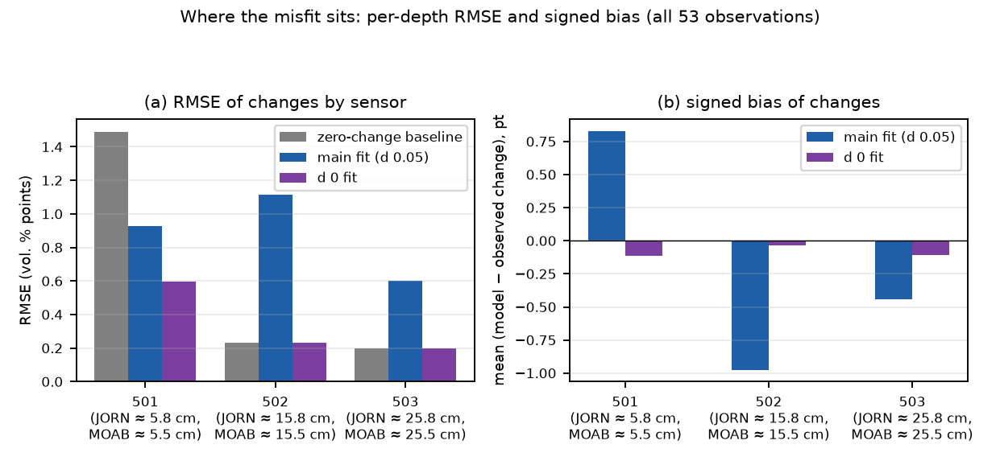
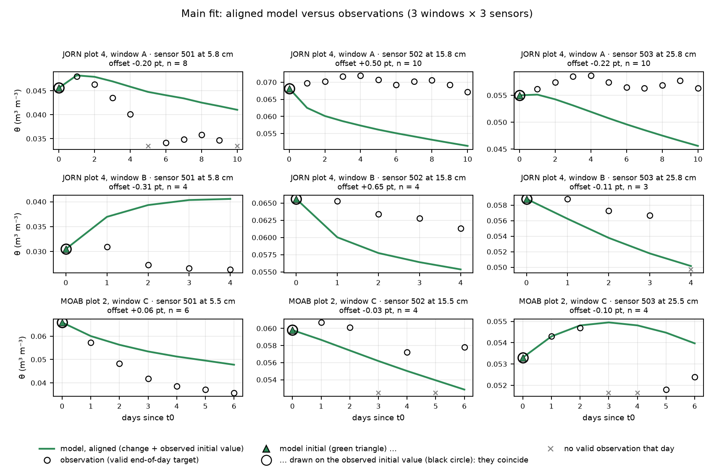
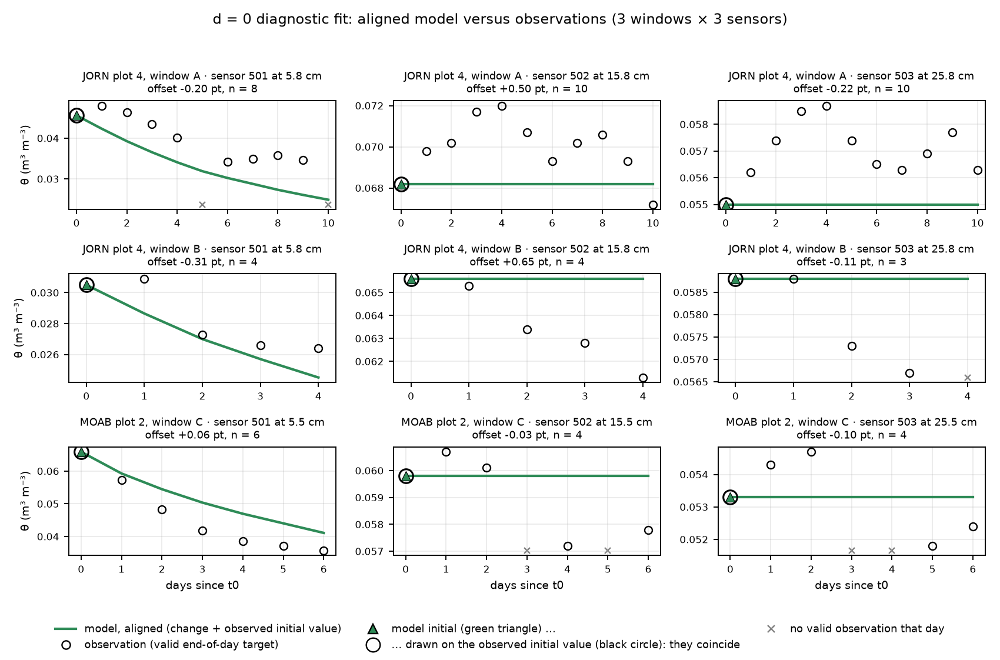
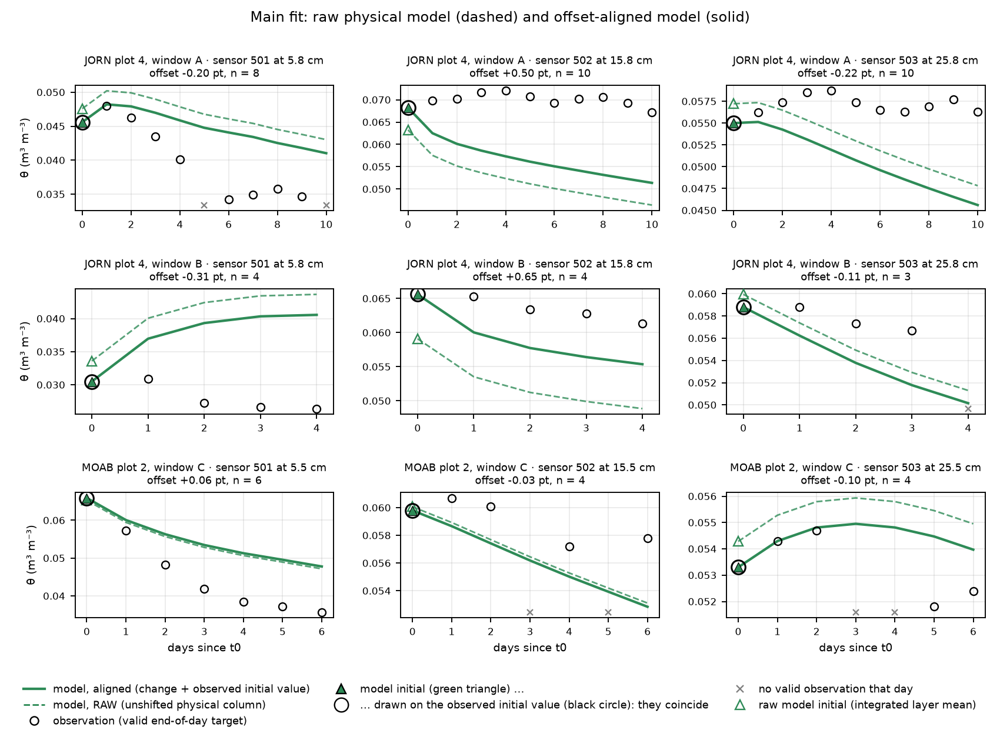

# Calibrating one evaporation-stress threshold to JORN and MOAB dry-downs (E = 1)

*SYRUP subsurface diagnostic · pooled fit to all three observed windows · results of 2026-11-17/18 · not field validation*

## 1. Summary

We kept the soil-evaporation factor at **E = 1** and asked a single question: which one **evaporation-stress threshold** θ* makes SYRUP's actual native column reproduce the observed *changes* in moisture at the three NEON dry-down windows (JORN plot 4 windows A and B, MOAB plot 2 window C) when everything else is held at the values used in the earlier hydraulics comparison? One threshold was fitted to all windows and sites together, and the three windows were all used for the fit, so **there is no held-out claim**.

- **Main fit** (harmonic interface mixing, d = 0.05): θ* = **0.2172** m³ m⁻³ (21.72 vol. %), pooled RMSE of changes **0.912** percentage points (pt).
- **Secondary fit** (geometric mixing, d = 0.05): θ* = 0.2172, RMSE 0.912 pt, practically the same as the main fit.
- **Diagnostic fit** (d = 0): θ* = **0.2064**, RMSE **0.389** pt.
- The benchmark to beat is the **zero-change baseline** (the model simply keeps the initial moisture): RMSE 0.886 pt. The main fit is **worse** than that baseline (it has 5.9 % MORE squared error than the no-change reference, skill -0.059); only the d = 0 fit beats it (SSE reduction 80.7 %).
- All three optima (one per fit) are interior (not at the 0.010001 or 1 limits) and each fit found exactly one local minimum on the searched grid. Near-optimum bands are descriptive, not confidence intervals.

**What this does and does not mean.** The fit calibrates an *empirical* stress threshold. It is not a measured wilting point, not the retention at 1500 kPa, and it does not change any hydraulic property. It is not an overall good field validation, and we do not recommend d = 0 as a new production default: the strong dependence of the score on d says that interlayer redistribution, not the stress threshold, controls most of the misfit in these windows.

## 2. What was fitted and what was held fixed

The setup is the one used for the harmonic/geometric comparison: the same three 10 cm layers, the same texture-derived JORN and MOAB properties with their declared floors, the same observed temperature and Hargreaves daily PET, the same observed rain-free windows and the same integrated initial water profiles. Each run uses a flat terrain, an open bottom boundary and gravity redistribution, with no rain, wind, vegetation, bed change or transpiration (T = 0). Nothing in this list was altered for the fit.

- **E = 1** is held constant (never fitted). **d** is never fitted: 0.05 is the main and secondary value, and d = 0 is a diagnostic that switches the interlayer diffusion off, not a tuned value.
- **One calibrated stress for all windows and sites in each fit** — not one per site. The two controls are separate runs with no refit: θ* = 0.18 and each site's own predicted θ1500 (JORN 0.0395, MOAB 0.0590).
- The search covers θ* from 0.010001 (the native column requires the threshold to exceed the 0.01 residual) to 1.0: a 199-point grid including both ends, a bounded local refinement of every local minimum, and a comparison of all 208 evaluated values. Every evaluation is the actual compiled-Numba native column on the three windows (three prepared once, evaluations cached).

**Table 1. The three observed windows (all times UTC; initial times differ and are not midnight; every window is a rain-free run with daily end-of-window updates of 86400 s).**

| Window | Site / plot | t0 (UTC) | Last modelled end (UTC) | Daily updates | Valid targets | Missing targets | Sensor depths (cm) |
|---|---|---|---|---|---|---|---|
| JORN4_A | JORN plot 4 | 2025-04-08T22:00:00Z | 2025-04-18T22:00:00Z | 10 | 28 | 2 | 5.8 / 15.8 / 25.8 |
| JORN4_B | JORN plot 4 | 2025-04-26T06:30:00Z | 2025-04-30T06:30:00Z | 4 | 11 | 1 | 5.8 / 15.8 / 25.8 |
| MOAB2_C | MOAB plot 2 | 2025-05-22T03:30:00Z | 2025-05-28T03:30:00Z | 6 | 14 | 4 | 5.5 / 15.5 / 25.5 |

### How the stress threshold acts

Only the top layer evaporates. Its evaporation demand is the potential rate times E, scaled by a moisture factor f that depends on the layer's volumetric moisture θ, its residual θr = 0.01 and the threshold θ*:

f(θ) = 0 for θ ≤ θr;   f(θ) = (θ / θ*)² for θr < θ < θ*;   f(θ) = 1 for θ ≥ θ*

E_actual = min( f(θ) · E · PET · Δt ,  water above the residual in the layer )

So a larger θ* means evaporation starts to be throttled at wetter conditions. Changing θ* alters only this factor: it does **not** change Ks, field capacity, saturation, bulk density, the interface conductivity or the original Saxton–Rawls θ1500 anchor that these properties were derived with. A fitted θ* of 0.217 therefore does **not** mean the soil holds 21 % water at the limit or that the dry floor is 0.2; the residual stays 0.01. In every window the moisture stays far below field capacity (top-layer field capacity 39.8 % at JORN and 38.0 % at MOAB), so the calibrated θ* lies below FC and saturation (checked in the data).

### What the data can and cannot identify: E versus the stress threshold

In every window the modelled top-layer moisture stays below both the fitted threshold and 0.18 (Table 2). In that regime the evaporation demand is E × PET × θ² / θ*², so the observations constrain only the **combination E / θ*²**, not E and θ* separately. Fixing E = 1 therefore gives a valid *conditional* estimate of θ*, but it cannot tell an error in E apart from an error in the threshold, and it cannot validate θ* as a physical moisture limit or θ1500. Algebraically, θ* = 0.18 with E ≈ 0.687 (main), 0.687 (secondary) or 0.760 (d = 0) would give the same evaporation response while all states stay in this regime. This is analytical equivalence only: no fit with E ≠ 1 and no extra run was made, and every actual fit used E = 1. Here the stress threshold acts as an amplitude calibration of evaporation rather than as an identified moisture physiology.

**Table 2. Evidence for the E / θ*² degeneracy (analytical equivalence; no E ≠ 1 run was made).**

| Fit | Fitted θ* | Modelled top-layer θ, min–max | Below 0.18 and θ*? | Equivalent E at θ* = 0.18 (algebra only) |
|---|---|---|---|---|
| Main | 0.2172 | 0.0336–0.0653 | yes, every day | 0.6870 |
| Secondary | 0.2172 | 0.0336–0.0653 | yes, every day | 0.6869 |
| Diagnostic | 0.2064 | 0.0269–0.0653 | yes, every day | 0.7602 |

## 3. How the score works

The model's initial layer value is the *integrated* mean of the observed point profile over the 10 cm layer, while the observation is a single point sensor. That constant support difference should not be scored as an evaporation error. The score therefore compares **changes** from the initial instant t0:

residual(t) = [ θ_model(t) − θ_model(0) ] − [ θ_obs(t) − θ_obs(0) ]

Equivalently, the model is plotted as θ_model(t) + offset, with offset = θ_obs(0) − θ_model(0), so the green triangle (model initial) and the black circle (observed initial) coincide. The offset is a fixed constant for each window and sensor, set by the two initial values; it is not optimised and it is not a mean-bias shift. It is applied only for scoring and plotting: **the physical model state, water inventory and water budget are never shifted**, and no water is added. The raw model series and the aligned series are both kept (Figure 4).

- t0 is excluded from the objective (including it would add forced zeros). Only post-initial targets with a valid, quality-passed observation count: **53 points** — JORN 39 (window A 28, window B 11) and MOAB 14. Targets that failed quality control are simply not counted (2, 1 and 4 missing sensor-days in windows A, B and C), never filled.
- The pooled objective is the sum of all squared residuals divided by the number of valid points, so each observation has equal weight (it is not an average of window RMSEs).
- Sensors are the NEON vertical positions 501, 502 and 503. They sit at 5.8, 15.8 and 25.8 cm at JORN and 5.5, 15.5 and 25.5 cm at MOAB (different actual depths, so we aggregate by sensor ID and keep each window's actual depth label). The model value compared with a sensor is the whole 10 cm layer containing it, so the 'surface' layer is 0–10 cm, not a 5.5–5.8 cm point.

## 4. Results

**Table 3. Selected stress thresholds and pooled scores (RMSE in volumetric percentage points, pt; 1 pt = 0.01 m³ m⁻³).**

| Fit | Interface | d | Selected stress θ* (m³ m⁻³) | (vol. %) | Pooled RMSE (pt) | Zero-change RMSE (pt) | SSE reduction vs zero change | n | Evaluations (grid + refine) |
|---|---|---|---|---|---|---|---|---|---|
| Main | harmonic | 0.05 | 0.21717 | 21.72 | 0.912 | 0.886 | -5.9 % | 53 | 208 (199 + 9) |
| Secondary | geometric | 0.05 | 0.21718 | 21.72 | 0.912 | 0.886 | -6.0 % | 53 | 208 (199 + 9) |
| Diagnostic | harmonic | 0 | 0.20644 | 20.64 | 0.389 | 0.886 | +80.7 % | 53 | 208 (199 + 9) |

The profile has one clear minimum in each fit, at θ* ≈ 0.217 for d = 0.05 and ≈ 0.206 for d = 0. With d = 0.05 the minimum RMSE (0.912 pt) never gets below the zero-change baseline (0.886 pt) at any threshold; with d = 0 the whole minimum is far lower. The harmonic and geometric fits are nearly identical (θ* differs by 9.5e-06, RMSE by 5.5e-05 pt), because the harmonic and geometric interface coefficients are close for the actual neighbouring-layer conductivities. This is not because the exchange is small: at a given d the exchange dominates the misfit (section 5).

**Table 4. Pooled RMSE (pt) at the selected stress and for the two no-refit controls (same E = 1 and offset rule).**

| Fit | At selected θ* | Control θ* = 0.18 | Control site θ1500 (JORN 0.0395, MOAB 0.0590) | Zero change |
|---|---|---|---|---|
| Main | 0.912 | 0.936 | 2.364 | 0.886 |
| Secondary | 0.912 | 0.936 | 2.364 | 0.886 |
| Diagnostic | 0.389 | 0.425 | 1.783 | 0.886 |

Calibration helps relative to the older choices: for the main fit the RMSE drops from 0.936 pt at 0.18 and 2.364 pt with the site θ1500 thresholds to 0.912 pt. Using the (very low) site θ1500 as the stress threshold is clearly the worst of the three, which is a statement about this empirical parameter, not about the measured wilting point.

**Table 5. Scores by window and site. Bias is the mean of (model change − observed change); positive means the model dries less (or wets more) than observed.**

| Window / site | n | Main RMSE (pt) | Main bias (pt) | d 0 RMSE (pt) | d 0 bias (pt) | Zero-change RMSE (pt) |
|---|---|---|---|---|---|---|
| JORN plot 4, window A | 28 | 1.024 | -0.593 | 0.411 | -0.335 | 0.466 |
| JORN plot 4, window B | 11 | 0.826 | +0.107 | 0.208 | +0.072 | 0.270 |
| MOAB plot 2, window C | 14 | 0.718 | +0.373 | 0.449 | +0.292 | 1.575 |
| JORN (all windows) | 39 | 0.972 | -0.395 | 0.365 | -0.220 | 0.420 |
| MOAB (all windows) | 14 | 0.718 | +0.373 | 0.449 | +0.292 | 1.575 |

**Table 6. Scores by vertical sensor ID (all windows pooled).**

| Vertical sensor | n | Main RMSE (pt) | Main bias (pt) | d 0 RMSE (pt) | d 0 bias (pt) | Zero-change RMSE (pt) |
|---|---|---|---|---|---|---|
| 501 (all sites) | 18 | 0.930 | +0.828 | 0.596 | -0.115 | 1.490 |
| 502 (all sites) | 18 | 1.114 | -0.974 | 0.230 | -0.033 | 0.230 |
| 503 (all sites) | 17 | 0.603 | -0.445 | 0.200 | -0.108 | 0.200 |

**Table 7. Descriptive near-optimum bands from the sampled grid. These are not confidence intervals and their endpoints are grid points, not precise continuous limits.**

| Fit | Selected θ* | Grid points with MSE within +1 % of the minimum | ... within +5 % |
|---|---|---|---|
| Main | 0.2172 | 0.2000–0.2350 | 0.1850–0.2750 |
| Secondary | 0.2172 | 0.2000–0.2350 | 0.1850–0.2750 |
| Diagnostic | 0.2064 | 0.2000–0.2100 | 0.1950–0.2200 |

The 1 % MSE band is 0.2000–0.2350 for the main fit and 0.2000–0.2100 for d = 0. Each fit found a single minimum at this grid resolution; we make no claim of a mathematical global proof outside the searched grid and bounds.

## 5. Why the main fit is worse than doing nothing, and what d = 0 reveals

The d = 0.05 score is dominated by *redistribution*, not evaporation. In the d = 0 diagnostic the middle and deep layers stay exactly constant (no drainage because moisture is below field capacity, and no exchange), so their RMSE equals the zero-change baseline (0.23 and 0.20 pt). Only the top layer changes, and the fit then reduces the top-sensor RMSE from 1.49 to 0.60 pt: evaporation with θ* ≈ 0.21 captures much of the observed surface drying. That cuts the pooled SSE by 80.7 %.

With d = 0.05 the model moves water between layers. The signed biases show the result (Figure 5, Table 6): the top layer is too wet in the changes (0.83 pt) while the middle and deep layers are too dry (-0.97 and -0.44 pt). This is consistent with the deeper layers exchanging water with the layers above and below, whereas the observed deeper sensors change only weakly. The middle-layer RMSE rises from 0.23 pt (zero change) to 1.11 pt. This does not show that there is no real diffusion or no plant transpiration in the field; it shows that, with the present exchange coefficient and without plants, the modelled redistribution does not match the weak observed deep changes in these three windows.

## 6. Aligned model and observations

The next figures show, for every window (rows) and sensor (columns), the aligned model (green line) and the valid observations (open black circles). Observations are drawn only at valid targets and are never joined across a missing day; grey crosses at the bottom of a panel mark days with no valid observation. The green filled triangle is the model initial value and the black open circle the observed initial value: both are plotted at the same position by construction. The panel titles give the actual sensor depth, the fixed offset and the number of valid points.

The offsets are small (pt): JORN plot 4, window A: -0.20, +0.50, -0.22; JORN plot 4, window B: -0.31, +0.65, -0.11; MOAB plot 2, window C: +0.06, -0.03, -0.10. They remove the initial point-versus-layer difference but not later support differences or initial sensor noise.

## 7. Model verification

**Table 8. What was verified (actual computation, not analytic substitutes).**

| Check | Result |
|---|---|
| Optimisation | 624 stress evaluations (208 per fit) × 3 windows = 1872 actual compiled-Numba column runs |
| Per-step and cumulative water ledger | checked inside every native run (residual far below the native bound); no water added, drainage 0, unmet evaporation 0 in the selected main trajectories |
| NumPy vs Numba, midpoint public-state export/reconstruction | selected solutions and E = 1 controls: PASS (identical trajectories after reconstruction) |
| CUDA | 27 configurations (3 fits × selected + 2 controls × 3 windows) on NVIDIA GeForce GTX 1080 Ti, CuPy 14.2.0; selected CUDA trajectories match the saved CPU ones; largest NumPy/Numba/CUDA difference over all compared fields 1.4e-20 |
| Independent exact scoring (Root) | Fraction-arithmetic recomputation of all 53 observations for all 3 fits: PASS; selected stress is the lowest evaluated in every fit |
| Unit tests | 83 tests pass; the 180 production SYRUP modules and 412 MAPLE files are unchanged; the 1742 pre-existing tracked project files were also verified untouched |
| Scope | single-column selected-case equivalence; not GPU performance, not scaling, not production restart/lifecycle checkpoint qualification |

## 8. Limits and honest reading

- **E and θ* are not separately identified**: with moisture below the threshold only E / θ*² is constrained (section 2). The fitted θ* is a conditional amplitude calibration at E = 1, not a validated moisture limit or θ1500.
- All three windows (53 points, only 14 at MOAB) were used for the fit, so a smaller error than the controls is expected and is not validation. There is no independent test of the fitted threshold.
- The fitted θ* is a lumped empirical parameter. It can absorb errors in the Hargreaves PET (the same observed temperature but a flat, simple formula) (PET 5.8–7.2 mm/day in these windows), in the E = 1 assumption, in the layer properties, and in missing processes (plant transpiration is omitted, roots and litter are absent).
- A fixed initial offset removes a constant point-versus-layer bias but does not fix representativeness differences later in the window, or noise in the initial sensor value; sensors at 5.5–5.8 cm are compared with a 0–10 cm layer.
- The strong sensitivity to d (RMSE 0.91 versus 0.39 pt) means the stress threshold cannot be interpreted alone. We did not tune d and recommend no change of defaults.
- Moisture never exceeds field capacity in these windows, so gravity drainage is inactive; behaviour near saturation, after rain, and over longer periods is untested here.
- CUDA was checked on one column for selected cases only: no GPU fitting, performance, scaling or production restart claim.

## References

[1] Saxton, K. E. and Rawls, W. J. (2006). Soil water characteristic estimates by texture and organic matter for hydrologic solutions. Soil Science Society of America Journal 70, 1569–1578. https://doi.org/10.2136/sssaj2005.0117
[2] Tietjen, B., Zehe, E. and Jeltsch, F. (2009). Simulating plant water availability in dry lands under climate change: a generic model of two soil layers. Water Resources Research 45, W01418. https://doi.org/10.1029/2007WR006589
[3] Hargreaves, G. H. and Samani, Z. A. (1985). Reference crop evapotranspiration from temperature. Applied Engineering in Agriculture 1(2), 96–99. https://doi.org/10.13031/2013.26773
[4] NEON (National Ecological Observatory Network). Soil water content and water salinity, DP1.00094.001 (RELEASE-2026). https://data.neonscience.org/data-products/DP1.00094.001
[5] NEON. Single aspirated air temperature, DP1.00002.001 (RELEASE-2026). https://data.neonscience.org/data-products/DP1.00002.001
[6] NEON. Precipitation (tipping bucket), DP1.00045.001 (RELEASE-2026). Used for the rain-free windows in the project's pinned inventory. https://data.neonscience.org/data-products/DP1.00045.001
[7] NEON. Megapit soil characterization, DP1.00096.001 (RELEASE-2026), source of the texture/density inputs to the derived properties. https://data.neonscience.org/data-products/DP1.00096.001

## Appendix A. Per-window and per-depth detail (main fit)

**Table A1. Offsets, counts and scores by window and sensor. 'Unshifted RMSE' compares the raw model with the observation without the offset. Pt = volumetric percentage points.**

| Window | Sensor @ depth | Valid / targets | Offset (pt) | RMSE of changes (pt) | Unshifted RMSE (pt) | Bias of changes (pt) | Zero-change RMSE (pt) |
|---|---|---|---|---|---|---|---|
| JORN plot 4, window A | 501@0.058m | 8 / 10 | -0.199 | 0.626 | 0.805 | +0.541 | 0.791 |
| JORN plot 4, window A | 502@0.158m | 10 / 10 | +0.497 | 1.435 | 1.923 | -1.403 | 0.230 |
| JORN plot 4, window A | 503@0.258m | 10 / 10 | -0.222 | 0.752 | 0.555 | -0.689 | 0.235 |
| JORN plot 4, window B | 501@0.058m | 4 / 4 | -0.310 | 1.195 | 1.495 | +1.150 | 0.326 |
| JORN plot 4, window B | 502@0.158m | 4 / 4 | +0.650 | 0.583 | 1.232 | -0.581 | 0.280 |
| JORN plot 4, window B | 503@0.258m | 3 / 4 | -0.114 | 0.379 | 0.270 | -0.367 | 0.149 |
| MOAB plot 2, window C | 501@0.055m | 6 / 6 | +0.062 | 1.058 | 1.000 | +0.996 | 2.399 |
| MOAB plot 2, window C | 502@0.155m | 4 / 6 | -0.026 | 0.318 | 0.294 | -0.296 | 0.171 |
| MOAB plot 2, window C | 503@0.255m | 4 / 6 | -0.098 | 0.155 | 0.235 | +0.109 | 0.123 |

## Appendix B. Source and receipt identities

Production sources were unchanged before and after the runs (maple_syrup 180 files, maple 412 files); the 1742 pre-existing tracked project files (not Python modules only) were also verified untouched. The calibration helper and tests are frozen and hashed below. The fits and the independent exact-fraction check used 53 observations. Hardware for the CUDA check: NVIDIA GeForce GTX 1080 Ti, CuPy 14.2.0.

**Table B1. Source packages, frozen helper files and data receipts.**

| Item | Kind | SHA-256 |
|---|---|---|
| maple_syrup package | 180 files | 37d89f23dbf60626c85f85ea5dd6d1734d3bc7a4aa61d8f2fdfc29f237bcfbd0 |
| maple package | 412 files | fbc504bbcd1ec0c02e6a96089134a06187532455ef7ba5e6f146801c8313c02e |
| actual_cpu/summary.json | data file | 436dce71a9390d1af3bfe83fca1fe027db8529d4d3de5da182dbc1985f815fd3 |
| actual_cpu/fits/main.json | data file | f81543eedc3cc58fd7508612021fc0dbfd61baccd5a29d625cf2f7edf03a216b |
| actual_cpu/fits/secondary.json | data file | b47922fd914427eee1a7fc2e49e299e6c13ad244c550d89d87c78d047075268a |
| actual_cpu/fits/sensitivity_d0.json | data file | 8f170fe89afcf41888be1a9e2faee0f7a5eea4dc5c59651ebb098434fec0dc5c |
| actual_cuda/completion.json | data file | 2d4b3301102d7d6682314620ca374d53bbbe3761a8c3ab05dbf1558ae5e41f7f |
| root_independent_scores.json | data file | 7d98b2431ff34c0d550d7d52a9e29272d61680bd96083095fa0fa2aa6d83ef94 |
| root_run_acceptance.json | data file | 00badbca47da4c966b056ecedb09102036a04dc16ba8b00e23553eb7d8f4ae29 |
| actual_cpu/prepared_inputs/JORN4_A.json | prepared inputs | 94c5c787f60a40cb66bae6828ab91b27593b95637639e5c5d6ccd6a45e17f772 |
| actual_cpu/prepared_inputs/JORN4_B.json | prepared inputs | 2ca19b232d4fcc30e52c8ab9a2fea5f9b59400c30a45502a47246c84300ccb72 |
| actual_cpu/prepared_inputs/MOAB2_C.json | prepared inputs | 1b4ac2657d34f19b200b0f4412fa0eeb31cf5f1060d5af102afd591c7c46ef66 |
| benchmarks/subsurface_stress_calibration/__init__.py | frozen helper | e3b0c44298fc1c149afbf4c8996fb92427ae41e4649b934ca495991b7852b855 |
| benchmarks/subsurface_stress_calibration/calibrate.py | frozen helper | e40eb32beb89f70eefa36514f1a4eaf6574a4aa088a09157b1a76a7b56c8c0ca |
| benchmarks/subsurface_stress_calibration/scoring.py | frozen helper | 33c8c061d2ef02714260a7dd108474f457d9ec107cc4c7ed008d853a61462ea2 |
| benchmarks/subsurface_stress_calibration/search.py | frozen helper | d338da6369bc2ec0d8d1e036ab52c77f6eb83cf52a3261f453cf5c1c76f56b8a |
| tests/subsurface_stress_calibration/test_stress_calibration.py | frozen helper | 63b7c84e84b2852d3956543c6b94356bc02c624dea1a43452931aeefcd8bd7de |
