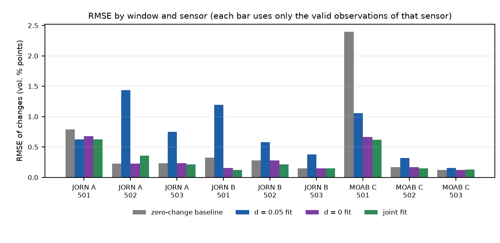

# Fitting the diffusion multiplier d and the evaporation-stress threshold together (E = 1)

*SYRUP subsurface diagnostic · joint fit to all three observed JORN/MOAB dry-downs · results of 2026-11-18/19 · calibration, not field validation*

## 1. Summary

The previous study fitted one evaporation-stress threshold θ* with the soil-diffusion multiplier d held fixed at 0.05 (and a d = 0 diagnostic). Here we repeat that study with **d fitted as well**, keeping E = 1 exactly, the same layers, hydraulic properties, weather, initial water and the same 53 valid observations. One common (d, θ*) is fitted to all windows and sites at once, separately for the harmonic and geometric interface-conductivity versions. All three windows are used for fitting, so **nothing here is a held-out validation**.

- **Harmonic fit:** d = **0.001024** (dimensionless), θ* = **20.171 vol. %**, pooled RMSE of changes **0.380 percentage points (pt)**. **Geometric fit:** d = 0.001023, θ* = 20.171 vol. %, RMSE 0.380 pt. Both optima are interior; no bound was reached or expanded.
- d is about **48.8 times smaller** than the earlier fixed 0.05, and the error falls from 0.912 pt (the previous published fit, worse than the zero-change baseline of 0.886 pt) to 0.380 pt.
- Against the earlier **d = 0** diagnostic (RMSE 0.389 pt) the improvement is small: **4.82 % less squared error, but only about 2.44 % less RMSE**. The difference from d = 0 is modest and does not establish statistically significant positive diffusion; no significance test or confidence interval was computed (the d = 0 profile is 5.1 % above the best in MSE).
- The harmonic and geometric fits are nearly identical because the two interface coefficients are close for these profiles, not because exchange is assumed small.
- Not every window improves: JORN window A is slightly worse than at d = 0; JORN window B and MOAB window C improve. The shared (d, θ*) is a compromise, not a universal improvement.
- d is a dimensionless model multiplier, θ* is an empirical E = 1 parameter (not the measured θ1500), and neither is validated independently. No default changes.

## 2. What was fitted and what stayed fixed

Everything except d is as in the previous study. The model is SYRUP's actual native column: three 10 cm layers with texture-derived hydraulic surrogates [1], open lower boundary, gravity enabled (inactive here because moisture stays below field capacity), no rain, wind, vegetation or bed, T = 0, and potential evaporation from observed-air-temperature Hargreaves PET [3] (5.8–7.2 mm day⁻¹ in these windows) multiplied by E = 1 and limited by the stress threshold. The diffusion term is the Tietjen-type moisture-gradient exchange [2]; d scales it, and the actual exchange also depends on the prescribed interface conductivity, geometry and donor-layer thickness.

**Table 1. The three dry windows (identical to the previous study): dates, sensor depths, valid targets (t0 excluded) and fixed offsets. Pt = volumetric percentage points; offsets are the observed minus model initial values per sensor.**

| Window | t0 (UTC) | End (UTC) | Days | Sensor depths (cm) | Valid n (501/502/503) | Missing | Fixed offsets (pt) |
|---|---|---|---|---|---|---|---|
| JORN plot 4, window A | 2025-04-08 22:00 | 2025-04-18 22:00 | 10 | 5.8 / 15.8 / 25.8 | 8 / 10 / 10 | 2 / 0 / 0 | -0.20 / +0.50 / -0.22 |
| JORN plot 4, window B | 2025-04-26 06:30 | 2025-04-30 06:30 | 4 | 5.8 / 15.8 / 25.8 | 4 / 4 / 3 | 0 / 0 / 1 | -0.31 / +0.65 / -0.11 |
| MOAB plot 2, window C | 2025-05-22 03:30 | 2025-05-28 03:30 | 6 | 5.5 / 15.5 / 25.5 | 6 / 4 / 4 | 0 / 2 / 2 | +0.06 / -0.03 / -0.10 |

**Scoring.** For each window and sensor we compare model *changes from t0* with observed *changes*, i.e. the model series is shifted by a constant offset so that it starts on the observed initial value. t0 itself is not scored, invalid observations are not filled, and every valid observation has equal weight (pooled squared error divided by 53). The offsets exist for plots and scores only: the physical initial water in every layer is never changed and no water is added. This is why, in Figure 3, the green model triangle sits exactly on the black observed circle at day 0.

## 3. How the search was done

Every objective value is an actual native Numba column run on all three windows. Per interface version we evaluated a 43 × 85 grid (d = 0, 41 log-spaced values from 10⁻⁶ to 1, and 0.05; θ* from 1.0001 % to 100 %, including the earlier optima), then profiled θ* at every grid d, refined along the box edges, and started 8 bounded Nelder–Mead refinements (6 separated candidates plus the two earlier optima); all 8 reported success for each version. The reported optimum is the lowest value over **every** pair evaluated (5103 for harmonic, 5017 for geometric; 10120 in total = 30360 native window runs). The previous published pairs were re-evaluated, not refitted, and reproduce exactly. A dense grid with multiple starts is evidence, not a proof of a global optimum; the search was confined to d ∈ [0, 1] and θ* ∈ [0.010001, 1].

## 4. Results

**Table 2. Fitted parameters and scores. 'SSE reduction vs zero-change' compares squared error with a model that predicts no change. The last-but-one column is the squared-error ratio, which is the square of the RMSE ratio.**

| Fit | d | θ* (vol. %) | Pooled RMSE (pt) | SSE reduction vs zero-change (%) | SSE relative to new harmonic fit | Note |
|---|---|---|---|---|---|---|
| NEW joint, harmonic | 0.0010239 | 20.1706 | 0.3797 | 81.6 | 1.000 | interior optimum |
| NEW joint, geometric | 0.0010233 | 20.1708 | 0.3797 | 81.6 | 1.000 | interior optimum |
| Previous fixed d = 0, harmonic | 0 | 20.6443 | 0.3892 | 80.7 | 1.051 | diagnostic, not a default |
| Previous fixed d = 0.05, harmonic | 0.05 | 21.7170 | 0.9120 | -5.9 | 5.769 | published main fit |
| Previous fixed d = 0.05, geometric | 0.05 | 21.7180 | 0.9121 | -6.0 | 5.770 | published secondary fit |
| Control: d = 0.05, θ* = 18 % | 0.05 | 18.0000 | 0.9362 | -11.6 | 6.079 | no refit |
| Zero-change baseline | – | – | 0.8860 | 0.0 | 5.445 | model change = 0 |

Because the objective is a *squared* error, percentages of SSE and RMSE differ: the joint fit removes 4.82 % of the d = 0 fit's squared error but only 2.44 % of its RMSE (0.3892 → 0.3797 pt). Relative to the zero-change baseline (0.886 pt) the joint fit has 81.6 % less SSE than the zero-change reference (a reduction of squared error against predicting no change, not variance explained or an R² against a mean). The earlier fixed d = 0.05 fit does worse than no change at all.

The profile is the useful way to see how well d is determined. Going from d = 0 to the optimum lowers the RMSE only from 0.389 to 0.380 pt, whereas values above about 0.004 are clearly worse, and the earlier d = 0.05 is far off. The minimum of the sampled profile is near d = 0.001 with a modest gain over zero; large d is clearly worse. This is a description of the sampled profile (Table 3), not a statement of tightly constrained parameters.

**Table 3. Profile over d (harmonic) at selected grid values: lowest RMSE and its θ*. 'MSE above refined best' is relative to the off-grid refined optimum and shown to four decimals: the grid value d = 0.001 is about 0.0024 % above it, not exactly zero, so no grid row equals the reference.**

| d (grid value) | Best θ* at this d (vol. %) | Profile RMSE (pt) | MSE above refined best (%, 4 decimals) | Distinct θ* evaluated at this d |
|---|---|---|---|---|
| 0.0010239 (refined optimum, off-grid) | 20.171 | 0.3797 | 0 (reference) | – |
| 0 | 20.644 | 0.3892 | +5.0630 | 96 |
| 1.12202e-05 | 20.638 | 0.3890 | +4.9437 | 95 |
| 8.91251e-05 | 20.596 | 0.3875 | +4.1598 | 95 |
| 0.000354813 | 20.460 | 0.3836 | +2.0427 | 94 |
| 0.000707946 | 20.299 | 0.3805 | +0.4309 | 94 |
| 0.001 | 20.180 | 0.3797 | +0.0024 | 96 |
| 0.00141254 | 20.030 | 0.3808 | +0.5850 | 94 |
| 0.00199526 | 19.852 | 0.3860 | +3.3525 | 210 |
| 0.00398107 | 19.444 | 0.4222 | +23.6300 | 95 |
| 0.0112202 | 19.079 | 0.5764 | +130.3920 | 208 |
| 0.0316228 | 20.221 | 0.8117 | +356.9260 | 94 |
| 0.05 | 21.717 | 0.9120 | +476.8835 | 102 |
| 0.177828 | 27.157 | 1.0588 | +677.5595 | 95 |
| 1 | 28.488 | 1.0728 | +698.1889 | 94 |

## 5. Where the fit helps and where it does not

**Table 4. RMSE by window and site for the zero-change baseline, the two earlier fixed-d fits and the joint fit, with signed bias (model − observed change) of the joint and d = 0 fits.**

| Subset | n | Zero-change RMSE (pt) | d = 0.05 fit (pt) | d = 0 fit (pt) | Joint fit (pt) | Joint vs d = 0 | Signed bias joint / d = 0 (pt) |
|---|---|---|---|---|---|---|---|
| JORN plot 4, window A | 28 | 0.466 | 1.024 | 0.411 | 0.419 | slightly worse | -0.368 / -0.335 |
| JORN plot 4, window B | 11 | 0.270 | 0.826 | 0.208 | 0.166 | better | 0.064 / 0.072 |
| MOAB plot 2, window C | 14 | 1.575 | 0.718 | 0.449 | 0.417 | better | 0.268 / 0.292 |
| Pooled JORN (39 obs.) | 39 | 0.420 | 0.972 | 0.365 | 0.365 | slightly worse | -0.246 / -0.220 |
| Pooled MOAB (14 obs.) | 14 | 1.575 | 0.718 | 0.449 | 0.417 | better | 0.268 / 0.292 |
| All windows | 53 | 0.886 | 0.912 | 0.389 | 0.380 | better | – |

JORN window A is slightly worse than at d = 0 (0.4186 versus 0.4112 pt); JORN window B (0.1655 versus 0.2076) and MOAB window C (0.4169 versus 0.4489) improve. Pooled JORN is essentially unchanged (it holds 39 of 53 observations and is dominated by window A); MOAB improves. With a single shared (d, θ*) the fit trades small losses at one window for gains at others.

**Table 5. RMSE and signed bias by sensor depth, pooled over windows (pt).**

| Sensor | n | Zero-change RMSE | d = 0.05 RMSE | d = 0 RMSE | Joint RMSE | d = 0.05 bias | d = 0 bias | Joint bias |
|---|---|---|---|---|---|---|---|---|
| 501 (JORN ≈ 5.8 cm, MOAB ≈ 5.5 cm) | 18 | 1.490 | 0.930 | 0.596 | 0.553 | 0.828 | -0.115 | -0.101 |
| 502 (JORN ≈ 15.8 cm, MOAB ≈ 15.5 cm) | 18 | 0.230 | 1.114 | 0.230 | 0.293 | -0.974 | -0.033 | -0.137 |
| 503 (JORN ≈ 25.8 cm, MOAB ≈ 25.5 cm) | 17 | 0.200 | 0.603 | 0.200 | 0.187 | -0.445 | -0.108 | -0.092 |

## 6. How to read d and θ*

- **d is not a diffusivity.** It is a dimensionless multiplier on a moisture-gradient exchange whose size also depends on the prescribed interface hydraulic conductivity (m s⁻¹, from the approved texture-derived property recipe [1]) and on the explicitly specified 10 cm layer geometry and donor-layer thickness (m), which are user-specified rather than derived from texture. A value of 0.0010 must not be read as m² s⁻¹, and fitting d says nothing about having estimated or validated Ks.
- **A small positive d is not established.** The improvement over d = 0 is modest and no significance test or confidence interval was computed; the fit sums every layer of three short, correlated time series (not independent replicates), and the fixed offsets carry the noise of the initial measurements into every score. We do not infer statistically significant diffusion, universal soil properties or an independent validation.
- **The fit is conditional.** It depends on the texture-derived hydraulic properties, the moisture-gradient law, Hargreaves PET and the omission of transpiration, roots, litter and site heterogeneity; any of these can be compensated by d or θ*.
- **θ* stays an empirical E = 1 parameter.** With moisture well below θ* only E/θ*² is identified by evaporation in these windows; fixing E = 1 selects one conditional scale. It is not the measured θ1500 or a wilting point and does not change the retention curve or Ks. No E ≠ 1 run or fit was made. The value moved from 21.7 % (d = 0.05) to 20.2 % when d was freed.
- **Interface versions agree.** Harmonic and geometric fits differ by about 0.00001 pt in RMSE and about 0.0002 vol. % in θ*; this reflects the nearly equal interface coefficients, not a small-exchange assumption.

## 7. Verification and what was not run

**Table 6. Verification of the actual CPU joint fits.**

| Check | Result | Scope |
|---|---|---|
| Helper tests and Ruff | 121 tests PASS; Ruff clean | new helper + old stress/site suites; synthetic and mocked objectives, no physics qualification |
| Source packages before/after | maple_syrup 180 files and maple 412 files unchanged | accepted native sources, hashes in Table B1 |
| Pinned raw and air inputs before/after | unchanged | same pinned inventory as the previous study |
| Prepared inputs vs previous study | identical (both fits) | same initial integrated water, weather and PET |
| Independent exact-fraction scores | PASS (53 observations, both fits) | Fraction recomputation by Root; selected is the lowest evaluated pair |
| Native NumPy vs Numba, full trajectory | maximum absolute difference over all water, flux and ledger arrays = 0 (3 windows × 2 fits) | N = 1 column, selected pairs |
| Midpoint public column-state export/reconstruction | identical continuation (NumPy and Numba) | driver-level check, NOT a production restart claim |
| Native water ledgers | per-step and cumulative residuals within bounds (all runs) | no water added; no unmet evaporation |
| Independent native control reproduction | PASS (24 controls) | Root |
| New selected CUDA cases | NOT RUN | authorized GPU 0 was occupied (last 2645 MiB, 56 %); GPU 1 not authorized; no GPU child, no fallback |

Root measured 37.6 s for the fit and its CPU verification on one column, with the timer started after the Python, NumPy, Numba and SciPy imports and with existing, previously warmed Numba caches (peak resident memory 341 MiB). Cache loading and JIT compilation costs were not separated, so this is not a cold-start figure; it is not a storm-timing or scaling benchmark. (The frozen receipt's historical field name is `elapsed_including_startup_s`; its bytes are unchanged.) **The new selected CUDA cases were not run**: the authorized GPU 0 was occupied and no other device is authorized, so nothing here claims CPU/GPU equivalence for the new fit. The earlier accepted GPU tests at the old parameters remain historical. The midpoint state check exercises the public column-state interface, not a production restart.

## 8. Limits and honest reading

- All 53 observations (only 14 at MOAB) were used for fitting; a lower error than the earlier controls is expected and is not validation.
- The search is bounded (d ≤ 1, θ* ≥ 0.010001); the optimum is interior but a dense grid plus multi-start refinement does not prove global optimality.
- The windows are dry, rain-free and below field capacity, so gravity drainage, behaviour after rain, near saturation and over longer periods are untested.
- Sensors at 5.5–5.8 cm are compared with a 0–10 cm layer mean; representativeness differences remain after the offset.
- This is a calibration diagnostic. No model default, hydraulic property or source was changed.

## References

[1] Saxton, K. E. and Rawls, W. J. (2006). Soil water characteristic estimates by texture and organic matter for hydrologic solutions. Soil Science Society of America Journal 70, 1569–1578. https://doi.org/10.2136/sssaj2005.0117
[2] Tietjen, B., Zehe, E. and Jeltsch, F. (2009). Simulating plant water availability in dry lands under climate change: a generic model of two soil layers. Water Resources Research 45, W01418. https://doi.org/10.1029/2007WR006589
[3] Hargreaves, G. H. and Samani, Z. A. (1985). Reference crop evapotranspiration from temperature. Applied Engineering in Agriculture 1(2), 96–99. https://doi.org/10.13031/2013.26773
[4] NEON. Soil water content and water salinity, DP1.00094.001 (RELEASE-2026). https://data.neonscience.org/data-products/DP1.00094.001
[5] NEON. Single aspirated air temperature, DP1.00002.001 (RELEASE-2026). https://data.neonscience.org/data-products/DP1.00002.001
[6] NEON. Megapit soil characterization, DP1.00096.001 (RELEASE-2026), source of the texture/density inputs. https://data.neonscience.org/data-products/DP1.00096.001
[7] SYRUP project. Pooled E = 1 evaporation-stress calibration (previous report, 2026-11-17), docs/subsurface_hydrology/evaporation_stress_calibration; fixed-d fits read unchanged.

The physics follows the native SYRUP column code identified in Appendix B; it adopts Saxton–Rawls retention-derived properties as prescribed inputs and the Tietjen-type moisture-gradient exchange, not the full SR unsaturated-conductivity equations. The results are this project's own calibration, not primary field validation.

## Appendix A. Near-optimal grid points (descriptive)

Table A1 lists grid points whose MSE is within 1 % or 5 % of the **refined** best. These are *sampled grid values only*: they are not continuous parameter bounds or confidence intervals and need not contain the refined optimum. In particular the 1 % grid points reach only d = 0.001, slightly below the refined best d = 0.001024, simply because the grid has no value between 0.001 and 0.00141. The 5 % band almost reaches d = 0 but omits it by construction of this arbitrary MSE criterion (the d = 0 profile is 5.06 % above the best). This is a descriptive threshold, not a confidence test, and it cannot establish statistical exclusion of d = 0.

**Table A1. Grid-sampled near-optimal points for harmonic interfaces (descriptive only).**

| Band (MSE ≤ (1+x) × refined best) | Grid points inside | d range of those grid points | θ* range of those grid points (vol. %) | Components |
|---|---|---|---|---|
| 0.01 | 5 | 0.000707946 – 0.001 | 19.56 – 20.80 | 1 |
| 0.05 | 44 | 7.94328e-06 – 0.00199526 | 19.56 – 21.72 | 1 |

## Appendix B. Source and receipt identities

Production sources were unchanged before and after the runs (maple_syrup 180 files, maple 412 files), as were the pinned raw/air inputs and the 1812 existing project files. Python 3.12.3, NumPy 2.5.3, Numba 0.67.0, SciPy 1.18.1. The new helper was frozen before the run and is hashed below, together with the frozen result files and the previous study's read-only inputs.

**Table B1. Source packages, helper files, frozen data and read-only previous-study files.**

| Item | Kind | SHA-256 |
|---|---|---|
| maple_syrup package | 180 files | 37d89f23dbf60626c85f85ea5dd6d1734d3bc7a4aa61d8f2fdfc29f237bcfbd0 |
| maple package | 412 files | fbc504bbcd1ec0c02e6a96089134a06187532455ef7ba5e6f146801c8313c02e |
| benchmarks/subsurface_joint_stress/__init__.py | frozen helper | e3b0c44298fc1c149afbf4c8996fb92427ae41e4649b934ca495991b7852b855 |
| benchmarks/subsurface_joint_stress/joint.py | frozen helper | dfe357a536e4437cd5b410c9d00fa4c62892f2bf4ab0892761487c3a22dcab59 |
| benchmarks/subsurface_joint_stress/search2d.py | frozen helper | 48b0a908742e73141824b47dc98638e62fc416219f64b02270eb73a76976c9f3 |
| tests/subsurface_joint_stress/test_joint.py | frozen helper | 7c3a9aa8a3246ac376cc798634eec007d91b44e93de220eb410c29cff603123a |
| data/actual_cpu/evaluations/geometric.json | frozen result | ba8559e4b560145a29b13a71c61eee634af355f3b2073c2b605913c95a7c7b62 |
| data/actual_cpu/evaluations/harmonic.json | frozen result | 3caf91245e758f6a2e9d6535cc9f8958bb5196c22f6c04c026103556228c225d |
| data/actual_cpu/fits/geometric.json | frozen result | c154eeafea3a3b1cc886f8e99f26140c5694f61ac1ff8605252cfdd77e306bf0 |
| data/actual_cpu/fits/harmonic.json | frozen result | 6866828d19645d3ce8104f382e3a8d648e1b8aaa88a2d1f6831eac85a429ec23 |
| data/actual_cpu/prepared_inputs/JORN4_A.json | frozen result | 94c5c787f60a40cb66bae6828ab91b27593b95637639e5c5d6ccd6a45e17f772 |
| data/actual_cpu/prepared_inputs/JORN4_B.json | frozen result | 2ca19b232d4fcc30e52c8ab9a2fea5f9b59400c30a45502a47246c84300ccb72 |
| data/actual_cpu/prepared_inputs/MOAB2_C.json | frozen result | 1b4ac2657d34f19b200b0f4412fa0eeb31cf5f1060d5af102afd591c7c46ef66 |
| data/actual_cpu/protocol.json | frozen result | 2834ce2612f5826d94c461793ddd079b9e17598c1b002828a095ab715968cc02 |
| data/actual_cpu/summary.json | frozen result | 3908b37d37d27717f48967a79649602a657f36165fb332ad9d598e17e6381678 |
| data/frozen_helper_manifest.json | frozen result | 10bf692c850b27566d7de0059cd50d623521fa779ad31708e3b548c0f880810a |
| data/root_independent_verification.json | frozen result | 17636cc3a26e137c2d49018240ec19ad71a9026a812e811e0cf3c3b54840e8e8 |
| data/root_run_acceptance.json | frozen result | 06e7472e4d3a1571f2c9dc3ba682550c8f138962978886d8b1ce7cbd7db27326 |
| data/runtime_cpu.json | frozen result | 36bf517bbf9aa17af38b0408b652674aa718607b747b0ff73932d97c989ad1a6 |
| data/stage1_acceptance.json | frozen result | 461e18e5816d4d334ef71202a4d17ba84792a1c22daddda5840c5c02d7d108b9 |
| previous artifact manifest (immutable e11) | read-only | 4af7b08fc2f1234a2130dabdd82e00b9acc9e28e3ed7fbd4c85388dea3504e23 |
| previous fits/main.json | read-only | f81543eedc3cc58fd7508612021fc0dbfd61baccd5a29d625cf2f7edf03a216b |
| previous fits/secondary.json | read-only | b47922fd914427eee1a7fc2e49e299e6c13ad244c550d89d87c78d047075268a |
| previous fits/sensitivity_d0.json | read-only | 8f170fe89afcf41888be1a9e2faee0f7a5eea4dc5c59651ebb098434fec0dc5c |
