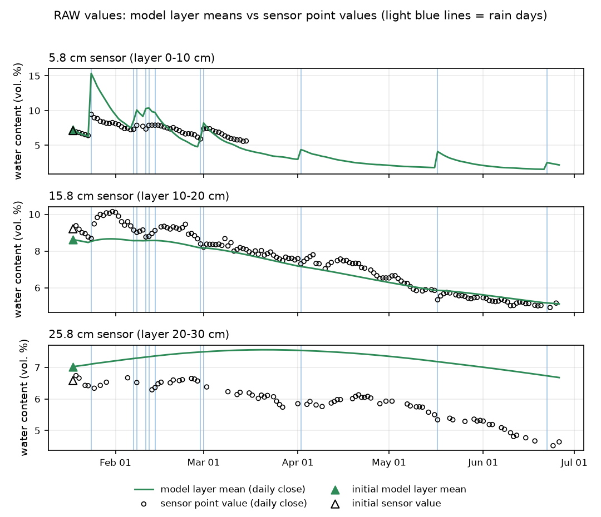
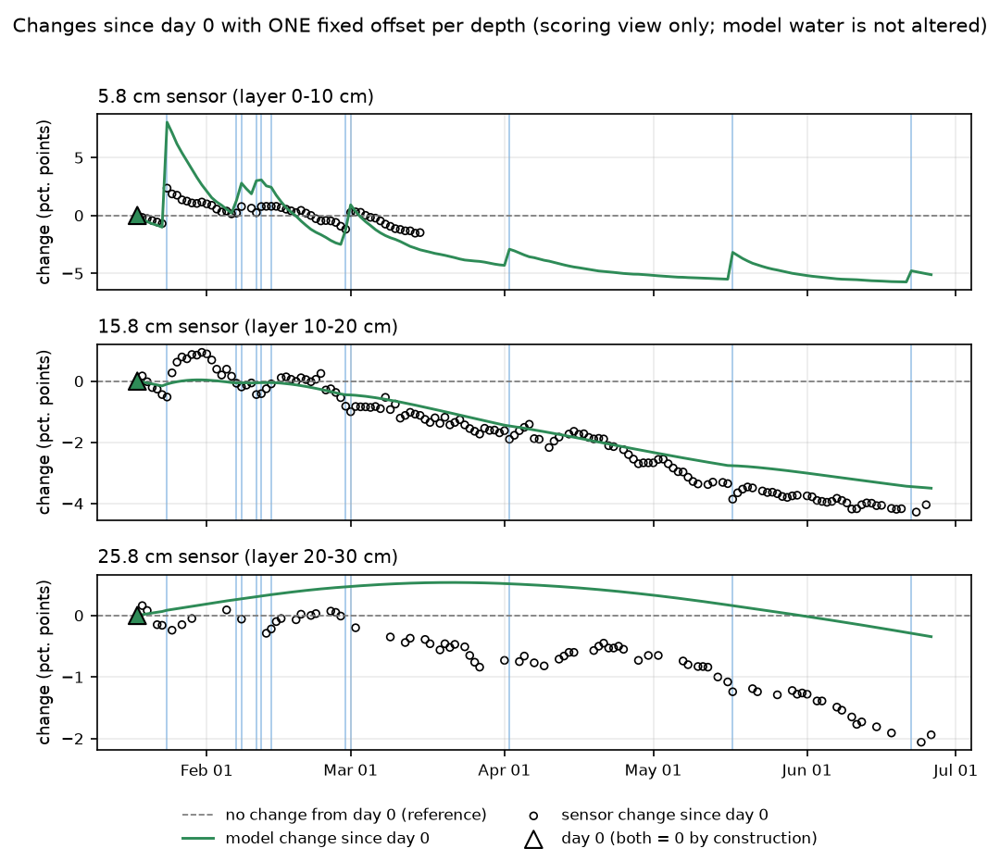
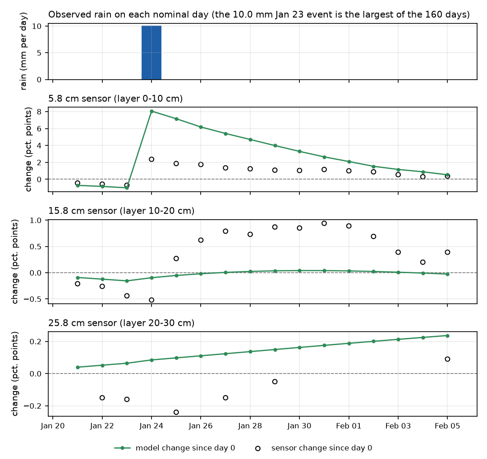

# SYRUP on a real 160-day rain record: JORN, January-June 2024

*A frozen-parameter comparison of the native SYRUP column with NEON soil-moisture sensors. The model runs were executed and sealed by Root; this document reports them.*

## 1. What this report shows

- One 1 m², 30 cm, three-layer soil column was run for 160 nominal days (Jan 18 - Jun 25, 2024) with NEON observed rain [5] (25.088 mm over this study period, on 11 days), Hargreaves evaporation demand from NEON air temperature [6] and the **frozen** dry-down parameters. Nothing was refitted. Soil-moisture sensors [4] only start the run (day 0) and score it.
- **All rain entered the soil.** Two separate reasons: (i) rain (peak 10.0 mm/h) stayed below the unponded intake limit K (38.2 mm/h) and the top layer always had pore room, so no pond or runoff formed; (ii) modelled water content stayed far below field capacity (highest 0.153 vs lowest field capacity 0.395), so there was no gravity flow or bottom drainage. Ponding being absent does not by itself imply no drainage; both were checked. The reference suction psi and vegetation factor g did not control intake because the unponded branch was always taken [7].
- **Water budget:** 22.94 mm initially + 25.09 mm rain - 34.05 mm evaporation = 13.98 mm at the end. Rain minus evaporation is -8.96 mm, exactly the loss of stored water (closure error 8.7e-18 m³, far inside the native bound).
- **Against 282 sensor values** the model's pooled error after one fixed start-up offset is 1.05 percentage points, versus 1.80 for assuming no change (42% lower RMSE). The gain is not uniform: it comes mainly from the 15.8 cm sensor (147 points); the 5.8 cm sensor is about twice as bad as no change (RMSE 1.82 vs 0.88) and the 25.8 cm sensor is also worse (1.05 vs 0.89).
- The model's top layer reacts much more strongly to rain than the 5.8 cm sensor, and the deepest layer is on average too wet. Preferential flow is a possible but **unproven** explanation for part of the middle-depth behavior; it was switched off and nothing was fitted.

## 2. What was run

SYRUP owns the soil water. For each nominal day the native rainfall schedule is integrated in storm sub-steps (at most 30 minutes), in which rain enters through the Green-Ampt matrix intake of the Tietjen-style two-layer scheme [1] and the column redistributes water; any rain the soil cannot take would leave immediately as runoff (the user's open-surface boundary). After the storm, one 86,400 s inter-event step applies evaporation from the day's Hargreaves demand [3] (the native EcoHyD-style Hargreaves family, not an exact FAO-56 implementation). There is no evaporation, transpiration or growth during rain; transpiration is zero all run (no plants are modelled), so the late-spring evaporation here is **not** a field evapotranspiration budget.

**Clock.** This is a daily-weather approximation, not an hourly field clock. The 27.5 h that rain occupies (99,000 s) is added on top of 160 nominal days, so the physical clock ends at 161.146 days. Sensor targets are matched to the nominal day closes (07:00 UTC = local midnight), not to the physical clock. A storm that crosses local midnight counts as two daily occurrences; wetting history carries across.

**Table 1. Case summary.**

| Item | Value |
|---|---|
| Period | 160 nominal days, 2024-01-18 to 2024-06-25 (UTC-7 days) |
| Column | one 1 m² column, three 10 cm layers (0-30 cm), open bottom, gravity on |
| Observed rain | 25.088 mm; 26 positive half-hours on 11 days; peak 10.034 mm/h |
| Matrix intake limit K | 38.2117 mm/h (peak rain is 26% of it) |
| Diffusion d / evaporation stress | 0.0010239461376024856 / 0.20170581117963332 (m³/m³); E factor 1; transpiration 0 |
| Initial water | 22.9424 mm (layers 7.295, 8.625, 7.022 mm) |
| Steps | 55 matrix-intake steps, 215 soil steps |
| Clock | nominal 160.000 days; physical 161.146 days (+27.5 h of storm time) |

**Soil properties** (Table 2) come from the approved Saxton-Rawls [2] surrogate recipe (density floor, air-entry floor of zero), not from measured hydraulic properties. The Saxton-Rawls floors are this project's choices, not published recommendations. The field capacity of 0.395-0.399 was kept as approved. It is high compared with every observed and modelled water content in this run (observed at most 0.10, modelled at most 0.153), which is why gravity drainage never switches on here. Diffusion d and the evaporation stress value are conditional empirical values fitted jointly to 53 dry-period sensor values from 2025 (JORN and MOAB). The 2024 data were not used in that 2025 calibration, so this is a conditional out-of-sample temporal check at one site with surrogate properties; it does not validate the hydraulic properties or other sites. The stress value is an empirical scale, not a measured wilting point.

**Table 2. Soil layers used (surrogates; volumetric fractions).**

| Layer (cm) | Field capacity | Saturation | Residual | Ks (mm/h) | Density used (g/cm³) |
|---|---|---|---|---|---|
| 0-10 | 0.398 | 0.464 | 0.010 | 120.8 | 1.420 |
| 10-20 | 0.399 | 0.465 | 0.010 | 119.7 | 1.417 |
| 20-30 | 0.395 | 0.459 | 0.010 | 104.3 | 1.435 |

**Other limits to keep in mind.** The air temperature is the 030 height of the NEON sensor [6], while the dry-down calibration used 020; 36 of 7,680 half-hours (up to 4 h) are interpolated, with flags kept. Preferential flow is off by the user's decision. The sensor values [4] are point readings at 5.8, 15.8 and 25.8 cm, while the model reports 10 cm layer means.

## 3. Where the water went

**Table 3. Water budget (mm over the 1 m² column).**

| Term | mm of water | Note |
|---|---|---|
| Initial storage | 22.9424 | integral of the three sensor values |
| + Rain | 25.088 | all entered the soil |
| - Evaporation | 34.0455 | actual soil evaporation |
| - Runoff | 0.0 | none |
| - Bottom drainage | 0.0 | none |
| = Final storage | 13.9849 | initial + rain - evap. = 13.985 mm |
| Closure residual | -8.67e-18 m³ | native bound 2.710e-13 m³ |

Stored water fell by about 9 mm (22.9 to 14.0 mm): evaporation removed 34 mm, more than the 25 mm of rain that fell. Even so, evaporation stayed far below the demand because the dry top layer limits it.

## 4. Comparison with the sensors

Two views are shown. **Figure 2 (RAW)** compares model layer means directly with the sensor point values. The model's initial layer means differ from the point readings (offsets +0.19, -0.59, +0.44 percentage points at 5.8, 15.8 and 25.8 cm) because a layer mean integrates the whole profile. **Figure 3 (aligned)** removes only that constant offset, measured once at day 0, to compare *changes*. It is a scoring view: the model's actual water is never changed, and nothing is re-aligned after storms. Missing sensor values are simply absent (no interpolation). The last shallow-sensor value used is at the daily close of 2024-03-15 07:00 UTC (nominal day Mar 14). A later raw record ending 2024-03-15 14:30 UTC passes quality control, but no valid record ends at any subsequent daily close, so the shallow comparison stops there while the model continues to June; the lower sensors continue. No post-initial moisture value drives the model.

**Table 4. Scores in percentage points of water content (100 x m³/m³). Aligned = one fixed offset from day 0; no-change = predicting the day-0 value forever.**

| Depth | n | RAW RMSE | Aligned RMSE | No-change RMSE | Aligned bias | vs no change |
|---|---|---|---|---|---|---|
| 5.8 cm sensor | 56 | 1.865 | 1.817 | 0.881 | 0.381 | worse |
| 15.8 cm sensor | 147 | 0.534 | 0.506 | 2.343 | 0.268 | better |
| 25.8 cm sensor | 79 | 1.469 | 1.054 | 0.886 | 0.961 | worse |
| All depths pooled | 282 | 1.202 | 1.049 | 1.799 | - | better |

Pooled over all 282 values the aligned RMSE is 1.049 points against 1.799 for no change (pooled squared error 66% lower; the pooled RAW RMSE is 1.202). The pooled gain is dominated by the 147 middle-sensor points, where the model removes much of the drift that persistence cannot. At 5.8 cm (1.82 vs 0.88) and 25.8 cm (1.05 vs 0.89) the model is worse than no change. This report does not claim uniform success, a physically verified d, an R², or statistical significance.

## 5. Rain events and the preferential-flow question

The largest event (Jan 23, 10.0 mm) is the best test. Within 24 h the 5.8 cm sensor rose 3.06 points while the model's top layer rose 9.06; after 72 h the values are 2.45 and 7.18. The 10 cm layer mean absorbs 10 mm of rain over a thin 10 cm slab, so a much larger modelled pulse than at a point 5.8 cm deep is partly a support difference. At 15.8 cm the sensor changed -0.08 points in 24 h and +1.06 in 72 h, against +0.06 and +0.14 modelled. The 25.8 cm sensor has no valid pre/post values for this event.

**Table 5. Responses (percentage points) from the daily close before each wet day to 24 h and 72 h after it, (fixed windows), as computed in Root's independent audit. Each cell is observed / model; n/a = no valid sensor value.**

| Wet day | Rain (mm) | 5.8 cm 24 h obs / model | 15.8 cm 24 h obs / model | 15.8 cm 72 h obs / model | 25.8 cm 24 h obs / model |
|---|---|---|---|---|---|
| 01-23 | 10.0 | 3.06 / 9.06 | -0.08 / 0.06 | 1.06 / 0.14 | n/a / 0.02 |
| 02-06 | 1.5 | 0.07 / 1.11 | -0.23 / -0.01 | -0.29 / -0.01 | n/a / 0.01 |
| 02-07 | 2.0 | 0.56 / 1.48 | -0.12 / 0.00 | 0.01 / -0.00 | n/a / 0.01 |
| 02-10 | 1.5 | -0.39 / 1.13 | -0.38 / 0.01 | -0.19 / 0.01 | n/a / 0.01 |
| 02-11 | 0.5 | 0.53 / 0.07 | 0.03 / 0.01 | 0.35 / 0.01 | n/a / 0.01 |
| 02-13 | 0.5 | 0.00 / -0.12 | 0.16 / 0.00 | 0.36 / -0.02 | 0.07 / 0.01 |
| 02-28 | 1.5 | -0.26 / 1.28 | -0.28 / -0.03 | -0.29 / -0.04 | n/a / 0.01 |
| 02-29 | 2.5 | 1.45 / 2.14 | -0.18 / -0.01 | -0.02 / -0.03 | n/a / 0.01 |
| 04-01 | 1.5 | n/a / 1.39 | -0.28 / -0.02 | 0.00 / -0.07 | n/a / -0.00 |
| 05-16 | 2.5 | n/a / 2.32 | -0.51 / -0.01 | -0.18 / -0.02 | -0.16 / -0.01 |
| 06-21 | 1.0 | n/a / 0.96 | n/a / -0.01 | n/a / -0.04 | n/a / -0.01 |

What the table supports: (i) the top layer is modelled much wetter after rain than the 5.8 cm sensor in 6 of 8 events with data; (ii) at 15.8 cm, observed 24 h changes are positive in only 2 of 10 events (Feb 11, +0.03, and Feb 13, +0.16 points), and a 72 h rise at least 0.3 points larger than modelled occurs in 3 of 10 events with data (Jan 23, Feb 11, Feb 13). The 72 h windows are FIXED windows that can contain further rain (the Feb 11 window includes Feb 13), so they are not independent, isolated storm responses; (iii) only 2 of the 11 wet days have valid 25.8 cm values both before and after, and a missing value is not evidence of no response. The deepest layer is on average too wet (aligned bias +0.96 points, RAW +1.40), so there is no support for a blanket bypass of water to the deepest layer, which would make it worse.

**Assessment.** A selective, middle-layer preferential path is *plausible* for the Jan 23 and a few February events, but the evidence is thin and mixed; it is not established, and no rate or weight was fitted. Several other explanations remain open and can produce the same pattern: (a) instantaneous mixing over a 10 cm layer versus a point value 5.8 cm deep (a constant day-0 offset cannot correct this after rain); (b) wetting-front timing that a daily clock cannot resolve; (c) the surrogate field capacity of about 0.40, which prevents gravity flow in the model; (d) a small shared diffusion d; (e) transpiration by field roots, which is not modelled; (f) the thin 30 cm column, with no capillary rise from below or lateral flow; and (g) temperature or calibration effects on the sensors. The model is not too dry everywhere: more deep water than predicted is not seen at every depth.

**Recommended next step (for the user to decide).** Do not adopt a new physical model on this evidence. If a diagnostic is wanted, run a small, pre-declared sensitivity test with the existing preferential option on the Jan 23 - Feb 13 window only, targeting the middle layer, with values chosen by the user rather than fitted, and judge it against the quantitative response pattern in Table 5. First check alternatives (a) and (c) by examining sub-layer sensor support and a lower-field-capacity sensitivity.

## 6. Verification and run time

**Table 6. Independent checks by Root.**

| Check | Result |
|---|---|
| NumPy vs Numba | every trajectory/flux array identical (max difference 0) |
| Storm step 1800 s vs 900 s | max water-content difference 0.000619 percentage points |
| Independent 90-digit calculation | max water error 5.77e-18 m (Numba/NumPy), 9.30e-18 m (900 s); under 0.05 of the native one-step bound |
| Restart at day 80 (separate process) | rows, ledgers, clocks, scores identical (driver-level, not a production checkpoint qualification) |
| Closure | -8.67e-18 m³ vs bound 2.710e-13 m³ |
| Tests | 77 focused tests passed, Ruff clean (Root); no GPU run |
| Ponding / onset / runoff / drainage counts | all zero (Root's a-priori bound: max water content 0.3371 < lowest field capacity 0.3951) |

**Table 7. Measured run time (raw seconds). The Numba column includes one-time compilation.**

| Run | Integration (s) | Operator prep + JIT (s) | Warm-up control (s) | Source checks + input prep (s) | Output write (s) | Driver call wall (s) | Full fresh command (s) |
|---|---|---|---|---|---|---|---|
| Numba, 1800 s storm step | 0.0398 | 4.891 | 0.0006 | 1.067 | 0.049 | 6.286 | 7.446 |
| NumPy, 1800 s storm step | 0.1252 | 0.142 | 0.0019 | 1.117 | 0.041 | 1.851 | 2.801 |
| Numba, 900 s storm step | 0.0496 | 4.555 | 0.0006 | 1.116 | 0.047 | 6.008 | 7.175 |

The Numba run integrates the 160 days in 0.040 s, about 3.1 times faster than NumPy (0.125 s) for this one small fixture; this is not a general performance claim. In a fresh process, compilation dominates (7.4 s total for Numba against 2.8 s for NumPy). The full fresh command also includes Root's source-verified bootstrap and imports, so the difference between the driver-call wall time and the full command is not model time. Development, data download, qualification and reporting are not included. Software: Python 3.12.3, Numba 0.67.0, one CPU column. No GPU was used and no scaling is claimed. No three-model coupled simulation is accepted by this study.

## 7. Main limitations

- Surrogate soil properties and conditional empirical d and stress; no measured Ks or hydraulic validation.
- The rain was too light to test ponding, runoff, suction, gravity drainage or the preferential-flow path.
- Evaporation only (T = 0); no plants, wind, sediment, bed or routing.
- Point sensors versus 10 cm layer means, a daily weather clock and a 030 vs 020 air-height difference.
- One site, one half-year, one soil column; no significance testing.

## References

[1] Tietjen, B., Zehe, E., & Jeltsch, F. (2009). Simulating plant water availability in dry lands under climate change: a generic model of two soil layers. Water Resources Research 45, W01418. https://doi.org/10.1029/2007WR006589
[2] Saxton, K. E., & Rawls, W. J. (2006). Soil water characteristic estimates by texture and organic matter for hydrologic solutions. Soil Science Society of America Journal 70, 1569-1578. https://doi.org/10.2136/sssaj2005.0117
[3] Hargreaves, G. H., & Samani, Z. A. (1985). Reference crop evapotranspiration from temperature. Applied Engineering in Agriculture 1, 96-99. https://doi.org/10.13031/2013.26773
[4] NEON (RELEASE-2026). Soil water content and water salinity, DP1.00094.001 (soil moisture sensors). https://data.neonscience.org/data-products/DP1.00094.001/RELEASE-2026
[5] NEON (RELEASE-2026). Precipitation, DP1.00045.001 (rain forcing). https://data.neonscience.org/data-products/DP1.00045.001/RELEASE-2026
[6] NEON (RELEASE-2026). Single aspirated air temperature, DP1.00002.001 (evaporation-demand forcing). https://data.neonscience.org/data-products/DP1.00002.001/RELEASE-2026
[7] EcoHyD reference code used for the Green-Ampt matrix law and the unmeasured reference values psi = 0.166 m and the vegetation factor g: GitHub repository selinaZitrone/Baldauf_et_al_Biocrust_Ecohydrology, commit 80b10e6b6b82ad16e9fd41a31901cc3157d880e9 (files model/src/WaterCell.cpp and model/Parameters/soilparameters_tabernas.txt). A later EcoHyD descendant, not a verified original 2009 release; local archive described in reference_models/ecohyd/README.md. https://github.com/selinaZitrone/Baldauf_et_al_Biocrust_Ecohydrology/tree/80b10e6b6b82ad16e9fd41a31901cc3157d880e9

## Appendix A. Provenance (compact)

Sources (Root's source-verified bootstrap, CPU): SYRUP production package 180 files, SHA-256 37d89f23dbf60626c85f85ea5dd6d1734d3bc7a4aa61d8f2fdfc29f237bcfbd0, unchanged; MAPLE package 412 files, SHA-256 fbc504bbcd1ec0c02e6a96089134a06187532455ef7ba5e6f146801c8313c02e. Baseline main 7c14c74 plus a frozen manifest of ten files: four pre-existing subsurface_validation helpers and six new files (four wet-validation driver modules and two test files). Primary Numba case config SHA-256 e7513f545b074da5fc5627e96b79f62ed787863fb32c9df545a9422547e521ee (exact copy in data/case_numba.json).

Full evidence is in the attached files rather than this document: tables/provenance_seal.csv (SHA-256 of every sealed result and audit file), tables/provenance_inputs.csv (all pinned forcing and 18 soil-moisture input files with SHA-256 and sizes), data/ (primary config, result, timings, audit and verification JSON) and artifact_manifest.json. Raw NEON files are referenced by hash only and are not copied.
