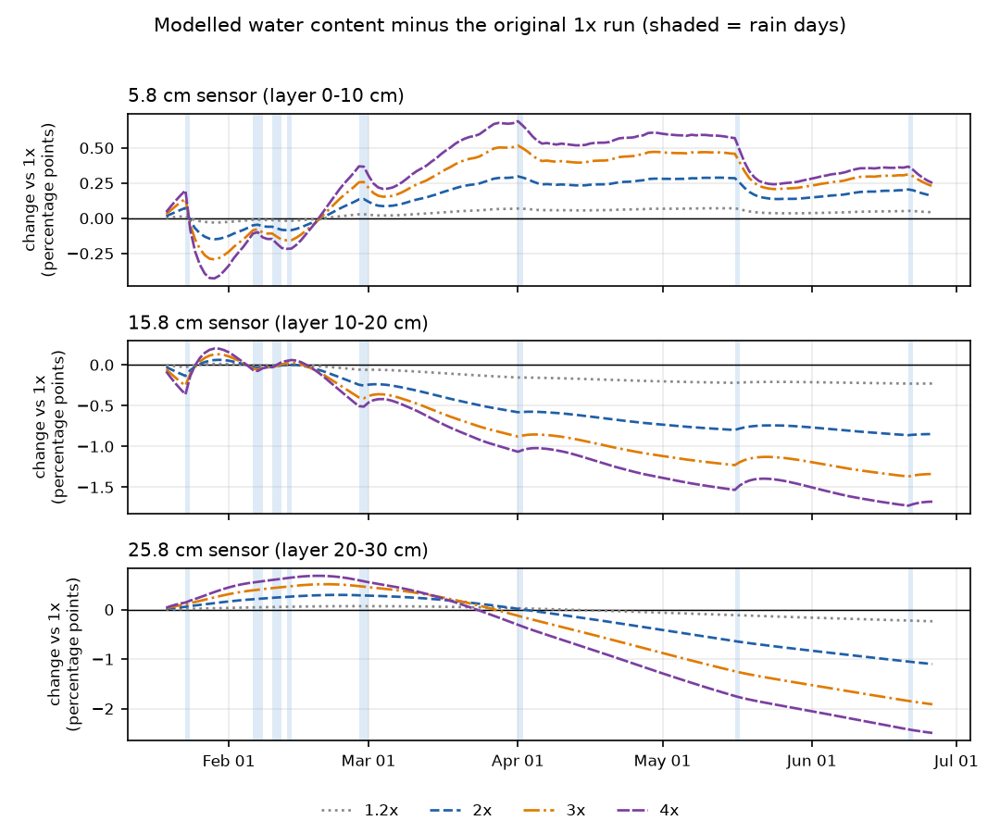

# What happens if every conductivity is doubled, tripled or quadrupled? JORN, January-June 2024

*A prescribed sensitivity of the native SYRUP column: every K and Ks is multiplied once by 2, 3 or 4 relative to the original run, with everything else identical. The original 1x and 1.2x results are shown for comparison. This is not a recalibration.*

## 1. Summary

- **Lowest pooled error at 2x, but not a best parameter.** Pooled aligned RMSE against 282 sensor values is 1.049 (1x), 1.004 (1.2x), 0.923 (2x), 0.934 (3x) and 0.995 (4x) percentage points; relative to 1x that is 4.3%, 12.0%, 11.0% and 5.1% lower. The no-change reference is 1.799. 2x is only the lowest of the five tested values under this one scoring; it is not a calibration or a recommended setting.
- **The RAW score disagrees.** Pooled RAW RMSE is 1.202, 1.192, 1.194, 1.239, 1.304: the best tested value is 1.2x, and 3x and 4x are worse than the original.
- **All rain still enters the soil in every case** (25.088 mm; peak rain 10.034 mm/h is below the matrix K of 38-153 mm/h and pore room is always available), with no runoff, ponding, percolation or drainage. These runs therefore do not constrain or exercise the infiltration-capacity limit: every rain rate stays below K with room available, so changing the matrix K has no effect on intake. This is a test of the unponded mechanism only, not a general statement about infiltration. All differences come from faster layer-to-layer exchange and the evaporation it indirectly feeds.
- **Depth by depth the answer differs.** Top layer: every multiplier is worse than no change (best 1.64 vs 0.88). Middle: best at 2x (0.351), degrading at 3x and 4x (0.552, 0.730; original 0.506). Deep: 2x, 3x and 4x become better than no change (0.80, 0.72, 0.80 vs 0.89), best at 3x.
- **The large surface pulse remains.** On Jan 23 the 0-10 cm layer rises 9.06 points at 1x and 8.78 at 4x against 3.06 observed. Higher K never means better in every respect.

## 2. What was changed

The baseline is the frozen JORN run of the original report [7]: one 1 m² column of three 10 cm layers; NEON rain [5]; Hargreaves evaporation demand from NEON air temperature [6] (the native EcoHyD-style family of Hargreaves and Samani [3], not an exact FAO-56 implementation); initial water from the NEON soil sensors [4]; diffusion coefficient d = 0.0010239461376024856; evaporation factor 1; stress value 0.2017; transpiration zero; open bottom; gravity on; matrix-only infiltration; no plants, wind, sediment, bed or routing. Soil properties are the approved Saxton-Rawls [2] surrogates (the density and air-entry floors are this project's choices, not published recommendations). The Tietjen et al. [1] gradient exchange scales with d x K, so a larger K acts like a larger d for the layers it joins; the two cannot be separated here.

Each new case multiplies ten conductivity entries once by the factor, relative to the ORIGINAL (not compounded on 1.2x): the three layer Ks records (mm/h and m/s), the top matrix Ks, the matrix K and both interface K. I compared each sealed configuration with the original: exactly ten numeric entries differ, each by a ratio equal to the factor. Retention, field capacity (0.395-0.399), saturation, suction (0.166 m), the local-K factor (0.31635738822500753), d, E, stress, T, initial water, forcing, clocks and source pins are identical. The physics reads the matrix K and the two interface K directly; the configuration check also reads the top matrix Ks and requires matrix K = local factor x Ks, and the interface K are harmonic means of the derived local K of adjacent layers. The layer Ks records are user-perturbed source estimates (not new Saxton-Rawls predictions) that act only through those derived K values, so there is no second or double multiplication.

**Table 1. Conductivities (mm/h) by multiplier; the first three rows are source estimates, the last three are direct inputs of the run.**

| Quantity (mm/h) | 1x (original) | 1.2x | 2x | 3x | 4x |
|---|---|---|---|---|---|
| Ks, layer 0-10 cm (source estimate) | 120.8 | 144.9 | 241.6 | 362.4 | 483.1 |
| Ks, layer 10-20 cm (source estimate) | 119.7 | 143.6 | 239.4 | 359.1 | 478.8 |
| Ks, layer 20-30 cm (source estimate) | 104.3 | 125.2 | 208.7 | 313.0 | 417.3 |
| Matrix K, top layer (direct input) | 38.2 | 45.9 | 76.4 | 114.6 | 152.8 |
| Interface K, 0-10 / 10-20 cm (direct input) | 38.0 | 45.6 | 76.1 | 114.1 | 152.2 |
| Interface K, 10-20 / 20-30 cm (direct input) | 35.3 | 42.3 | 70.5 | 105.8 | 141.1 |

**Clock.** As in the earlier runs this is a daily-weather approximation: one 86,400 s inter-event step per nominal day plus the observed storm sub-steps (27.5 h in total, so the physical clock ends at 161.146 days against 160 nominal days). Evaporation and transpiration are off during rain. It is not an exact hourly field clock. Sensor values after day 0 never drive the model.

## 3. Water: what the multipliers change

**Table 2. Budget and layer-exchange results by multiplier.**

| Quantity | 1x (original) | 1.2x | 2x | 3x | 4x |
|---|---|---|---|---|---|
| Initial storage (mm) | 22.9424 | 22.9424 | 22.9424 | 22.9424 | 22.9424 |
| Rain = intake (mm) | 25.088 | 25.088 | 25.088 | 25.088 | 25.088 |
| Evaporation (mm) | 34.0455 | 34.4686 | 35.8342 | 37.0673 | 37.9622 |
| Runoff, percolation, drainage (mm) | 0 | 0 | 0 | 0 | 0 |
| Final storage (mm) | 13.9849 | 13.5618 | 12.1962 | 10.9631 | 10.0682 |
| Deep-layer peak gain (mm) | 0.536 | 0.589 | 0.761 | 0.938 | 1.089 |
| Deep-layer peak, nominal day | 03-20 | 03-16 | 03-06 | 02-24 | 02-22 |
| Deep layer, final (vol. %) | 6.68 | 6.44 | 5.58 | 4.77 | 4.19 |
| Middle layer, final (vol. %) | 5.13 | 4.90 | 4.28 | 3.79 | 3.45 |
| Net upward top-middle exchange (mm) | 3.84 | 4.31 | 5.79 | 7.09 | 8.01 |
| Jan 23 top-layer rise (points) | 9.06 | 9.04 | 8.97 | 8.88 | 8.78 |
| Jan 23 middle layer, 72 h (points) | 0.136 | 0.164 | 0.282 | 0.433 | 0.583 |

Because every case takes in all 25.088 mm, the multipliers cannot add water. Faster exchange lets the middle layer re-supply the dry top layer, so net upward top-middle exchange rises from 3.84 to 8.01 mm and evaporation from 34.05 to 37.96 mm; final storage falls from 13.98 to 10.07 mm. In the deep layer, faster downward exchange speeds and enlarges the early gain (peak 0.54 to 1.09 mm, reached on 03-20 at 1x and 02-22 at 4x; nominal day, closing the next day at 07:00 UTC) and the later upward return is faster too, so the deep layer ends drier (6.68 to 4.19 vol. %). The last deep sensor reading is 4.64% (a point value; the model's layer mean starts +0.44 points from its point reading). A stronger exchange can therefore compensate for processes the model omits (deep transpiration, bottom loss), which is why a better deep score is not evidence of physically correct K.

## 4. Comparison with the sensors

Two scorings are used. **RAW** compares model layer means directly with sensor point values. **Aligned** removes one constant start-up offset per depth, fixed at day 0, because a 10 cm layer mean differs from a point reading (offsets +0.19, -0.59 and +0.44 points at 5.8, 15.8 and 25.8 cm). The offsets are unchanged by this study; model water is never altered by the alignment and nothing is re-aligned after storms. Pooled scores weight every observation equally (n = 56, 147 and 79 at the three depths), so the middle sensor dominates.

**Table 3. RMSE in percentage points (100 x m³/m³). Aligned and RAW rows are shown for every depth; no-change = holding the day-0 sensor value.**

| Depth - scoring | n | No-change RMSE | 1x (original) | 1.2x | 2x | 3x | 4x |
|---|---|---|---|---|---|---|---|
| 5.8 cm sensor - aligned | 56 | 0.881 | 1.817 | 1.803 | 1.752 | 1.693 | 1.640 |
| 5.8 cm sensor - RAW | 56 | - | 1.865 | 1.852 | 1.802 | 1.746 | 1.695 |
| 15.8 cm sensor - aligned | 147 | 2.343 | 0.506 | 0.397 | 0.351 | 0.552 | 0.730 |
| 15.8 cm sensor - RAW | 147 | - | 0.534 | 0.580 | 0.838 | 1.084 | 1.265 |
| 25.8 cm sensor - aligned | 79 | 0.886 | 1.054 | 0.999 | 0.798 | 0.717 | 0.799 |
| 25.8 cm sensor - RAW | 79 | - | 1.469 | 1.419 | 1.216 | 1.064 | 1.029 |
| All depths pooled - aligned | 282 | 1.799 | 1.049 | 1.004 | 0.923 | 0.934 | 0.995 |
| All depths pooled - RAW | 282 | - | 1.202 | 1.192 | 1.194 | 1.239 | 1.304 |

![Figure 3. RMSE against the conductivity multiplier. The multipliers (1, 1.2, 2, 3, 4) are plotted as equally spaced categories and the lines only guide the eye: they are not a continuous fit or minimization. The dotted line is the POOLED no-change reference (1.799) and applies to the black pooled curve only; the per-depth no-change values (0.881, 2.343, 0.886 points at 5.8, 15.8, 25.8 cm) are in Table 3. The pooled aligned and RAW curves have different minima (2x and 1.2x); no shallow value beats its own no-change value.](figures/fig4_rmse_vs_factor.png)

The scorings answer different questions, and no multiplier is better on everything. Aligned scoring gives its lowest pooled RMSE at 2x because the combined per-observation errors are smallest there, mainly through the 147 middle values (the middle sensor is best at 2x, the deep sensor best at 3x and the shallow sensor best at 4x, although every shallow value is worse than no change); RAW favours 1.2x because the middle layer is already drier than its point reading (RAW bias -0.32 at 1x) and stronger exchange dries it further (RAW middle RMSE rises steadily from 0.53 to 1.26 while RAW deep falls from 1.47 to 1.03). Beyond 2x the middle sensor degrades (aligned 0.351 to 0.730) while the deep sensor is best at 3x (0.717) and the shallow sensor keeps improving slowly (1.82 to 1.64) without approaching no change. The old d and stress were fitted jointly to 53 dry-period sensor values from 2025 (JORN and MOAB); the 2024 data were not used in that fit, but selecting a multiplier from these 2024 scores would be exploratory, not independent qualification. There is no significance test, no R² and no claim of physical validation of any K.

Around the Jan 23 storm (Figure 4) the surface pulse is almost unchanged: the 0-10 cm layer rises 9.06, 9.04, 8.97, 8.88 and 8.78 points against 3.06 at the 5.8 cm sensor, so even 4x trims it by only 0.28 points. The 72 h middle-layer response (observed +1.06) is +0.136, +0.164, +0.282, +0.433 and +0.583: it moves toward the observation as K grows (4x reaches about half of it) but stays below it at every multiplier, so timing and magnitude discrepancies in the middle-layer response remain. Two untested explanations for the surface pulse remain: infiltration that is too deep or too large, and immediate mixing of a whole 10 cm layer compared with a point at 5.8 cm (a constant day-0 offset cannot remove that difference after rain). Other persistent limits are the high surrogate field capacity that blocks gravity flow, no transpiration, a thin 30 cm column with no capillary rise or lateral flow, and surrogate properties.

## 5. Verification and run time

- For 2x, 3x and 4x the NumPy and Numba results are identical (I confirmed row-by-row equality here), and the source pair is guarded before and after each run. A 900 s storm step changes layer water by at most 9.1e-6, 1.3e-5 and 1.7e-5 m³/m³ (0.0009, 0.0013 and 0.0017 points). Root's independent 90-digit calculation agrees to better than 1e-17 m (below 0.06 of the native one-step bound) and the native closure bounds pass in all five cases (Table 4).
- Input-only experiment on unchanged physics code: no new checkpoint or restart test, no rerun of the 77-test suite, no GPU, no large-domain or coupled-model acceptance.

**Table 4. Run checks. Times are seconds from separate fresh runs on a shared host with other jobs (empty caches): not a controlled speed comparison.**

| Run | Integration (s) | Operator prep + JIT (s) | Full fresh command (s) | Absolute closure residual / native bound (m³) | 900 s step: max change (points) | 90-digit check: max water error (m) |
|---|---|---|---|---|---|---|
| 1x (original) | 0.0398 | 4.89 | 7.45 | 8.7e-18 / 2.71e-13 | - | - |
| 1.2x | 0.0362 | 6.82 | 13.76 | 1.0e-17 / 2.74e-13 | 0.00069 | 4.92e-18 |
| 2x | 0.0397 | 4.46 | 7.12 | 1.0e-17 / 2.85e-13 | 0.00091 | 9.75e-18 |
| 3x | 0.0383 | 4.78 | 7.53 | 6.9e-18 / 2.95e-13 | 0.00131 | 8.90e-18 |
| 4x | 0.0429 | 4.26 | 6.77 | 2.4e-17 / 3.02e-13 | 0.00168 | 6.59e-18 |

Integration takes about 0.04 s in every case. The fresh-command time is dominated by one-time compilation and the source-verified bootstrap and says nothing about solver speed or the effect of K. One 1 m² CPU column: no scaling claim.

## 6. Limits

- Prescribed sensitivities: no calibration, pedotransfer prediction, default change or adoption; K and d remain confounded empirical settings and the 2x minimum is only the lowest of five tested values under one scoring.
- Rain is too light to test ponding, suction, gravity drainage or K as an intake limit.
- No transpiration or plants (a general limitation for spring), point sensors versus layer means, a daily clock, and the 030 vs 020 air-temperature height difference inherited from the original run.

## References

[1] Tietjen, B., Zehe, E., & Jeltsch, F. (2009). Simulating plant water availability in dry lands under climate change: a generic model of two soil layers. Water Resources Research 45, W01418. https://doi.org/10.1029/2007WR006589
[2] Saxton, K. E., & Rawls, W. J. (2006). Soil water characteristic estimates by texture and organic matter for hydrologic solutions. Soil Science Society of America Journal 70, 1569-1578. https://doi.org/10.2136/sssaj2005.0117
[3] Hargreaves, G. H., & Samani, Z. A. (1985). Reference crop evapotranspiration from temperature. Applied Engineering in Agriculture 1, 96-99. https://doi.org/10.13031/2013.26773
[4] NEON (RELEASE-2026). Soil water content and water salinity, DP1.00094.001. https://data.neonscience.org/data-products/DP1.00094.001/RELEASE-2026
[5] NEON (RELEASE-2026). Precipitation, DP1.00045.001. https://data.neonscience.org/data-products/DP1.00045.001/RELEASE-2026
[6] NEON (RELEASE-2026). Single aspirated air temperature, DP1.00002.001. https://data.neonscience.org/data-products/DP1.00002.001/RELEASE-2026
[7] Earlier reports of this study, cited by file name only: SYRUP_JORN_160day_rainfall_comparison_20261119.docx (original 1x run) and SYRUP_JORN_160day_K_Ks_plus20_comparison_20261120.docx (1.2x run).

## Appendix. Identity (compact)

Sources (CPU, Root's source-verified bootstrap): SYRUP package 180 files, SHA-256 37d89f23dbf60626c85f85ea5dd6d1734d3bc7a4aa61d8f2fdfc29f237bcfbd0; MAPLE package 412 files, SHA-256 fbc504bbcd1ec0c02e6a96089134a06187532455ef7ba5e6f146801c8313c02e; ten frozen helper and test files unchanged. Baseline main 483dc3d; production unchanged. Case-file hashes: 1x e7513f545b074da5...; 1.2x 507aa743406b5433...; 2x 39e1f991155c4f02...; 3x 0e639583e05a7227...; 4x acd7b61cc236a541.... Full hashes, the parameter differences and daily trajectories of all five runs are in tables/provenance_seal.csv, tables/case_hashes.csv, tables/parameter_diff.csv and tables/daily_trajectories.csv. Raw NEON files are not copied.
