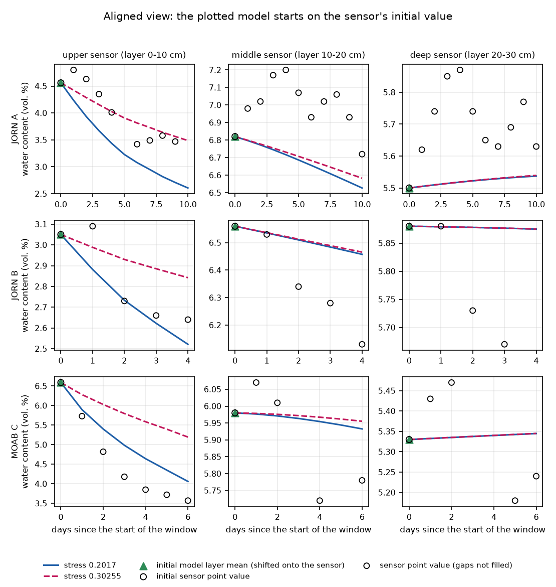
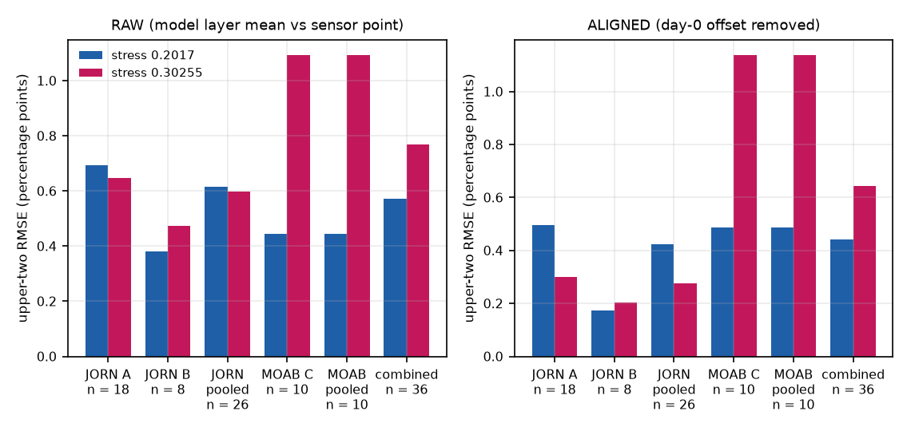
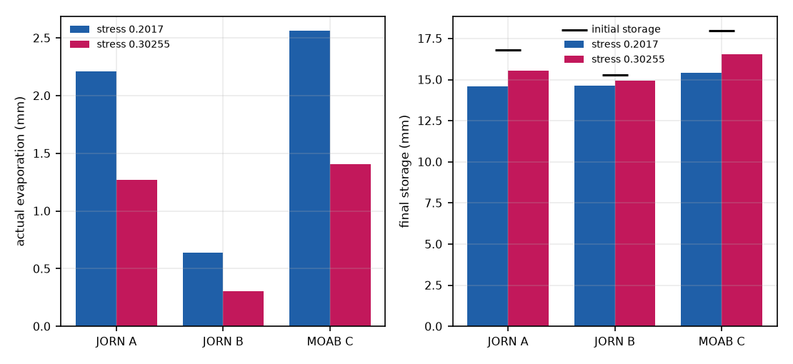

# Fixed evaporation stress 0.2017 against 0.30255 in the earlier JORN and MOAB dry windows

*Six native runs of the three rain-free 2025 windows (JORN A and B, MOAB C) at two fixed stress values, with the user-selected JORN defaults. A comparison, not a calibration, and not an independent validation.*

## 1. Summary

- **The user's JORN selection stands.** For future JORN runs the user chose a field capacity of 10 vol. % in all three layers and an evaporation stress of 0.30255 (with E = 1, SR33 1x conductivities with harmonic interfaces and d = 0.0010239461376024856). It is recorded in the versioned preset cases/subsurface_validation/jorn_defaults.json and in a new AGENTS paragraph; the comparison helper loads the file, the generator builds the JORN configurations from it and the run-time check validates the JORN field capacity, d and E against it and accepts only the preset stress or the declared comparison stress 0.2017 (the explicit exception used here), refusing a JORN configuration that disagrees. It is a JORN case-level visual choice, not a new calibration, not a global model default and not a MOAB default, and frozen older configurations and restart identities are not migrated. It persists whatever this comparison shows; nothing here suggests reversing it.
- **Upper two layers (the primary focus).** Aligned RMSE (percentage points): JORN pooled (n = 26) 0.424 at stress 0.2017 and 0.275 at 0.30255 (lower at 0.30255); MOAB (n = 10) 0.487 at stress 0.2017 and 1.138 at 0.30255 (lower at 0.2017); combined (n = 36) 0.442 at stress 0.2017 and 0.644 at 0.30255 (lower at 0.2017). RAW RMSE: JORN 0.615 at stress 0.2017 and 0.598 at 0.30255 (lower at 0.30255); MOAB 0.445 at stress 0.2017 and 1.093 at 0.30255 (lower at 0.2017); combined 0.573 at stress 0.2017 and 0.768 at 0.30255 (lower at 0.2017). By window the aligned upper-two RMSE is lower at stress 0.30255 in 1 of 3 windows (JORN A: 0.30255; JORN B: 0.2017; MOAB C: 0.2017).
- **All three layers are kept as context.** Aligned RMSE over all 39 JORN values 0.365 at stress 0.2017 and 0.253 at 0.30255 (lower at 0.30255); over the 14 MOAB values 0.417 at stress 0.2017 and 0.964 at 0.30255 (lower at 0.2017); over all 53 values 0.380 at stress 0.2017 and 0.541 at 0.30255 (lower at 0.2017). The third (deep) layer is scored and retained in these numbers; it is not investigated here (see Section 5).
- **The field capacity cannot be tested by these windows.** In all six cases the native columns show exactly zero gravity transfer between layers and zero bottom drainage (every layer stays below its field capacity: the initial layer contents are 3.4-6.5 vol. %). The field capacity is therefore not identifiable from these dry windows, and the dry-window agreement does not validate the 10 vol. % choice.
- **Water.** At a fixed water content the higher stress reduces the evaporation, but the cumulative effect is smaller because the layer stays wetter and evaporates more later: the ratio of cumulative evaporation at 0.30255 to that at 0.2017 is 0.483-0.575 across the windows (the fixed-moisture ratio would be 0.444). No water is added, no water leaves through the bottom or the surface, and the internal gradient exchanges are not losses.
- **What this is not.** The earlier 2025 windows were used to fit d and the stress (jointly, at E = 1, with T = 0 and the old field capacity), so this is not held-out validation. T = 0 and rain-free weather are not proof that no transpiration occurred, and the earlier fit may have absorbed missing transpiration. No refit, transpiration or new physics was added.

## 2. What was run

The three earlier dry windows (Table 1 of the joint d/stress report [8]) are unchanged: JORN A (plot 004, 10 days from 2025-04-08), JORN B (plot 004, 4 days from 2025-04-26) and MOAB C (plot 002, 6 days from 2025-05-22). The observed NEON soil water [4], rain-free definition [5], air temperature [6] and Hargreaves-Samani potential evaporation [3], the integrated initial profile and the QA of the 53 valid observations (JORN 39, MOAB 14; the first instant of each window is excluded and gaps stay gaps) are exactly the historical ones; the prepared inputs of each result equal the stored historical prepared inputs. Each case is a one-square-metre column of three 10 cm layers with an open bottom, gravity on, one 86,400 s step per day, no rain, no transpiration, no vegetation, wind or bed, and E = 1.

Only these things differ from the historical configurations: the field capacity, the stress, the scenario d (0.05 to 0.0010239461), the SYRUP package pin (the old 37d89f23 pin is still refused unmodified) and names and provenance. For JORN the field capacity is the preset's 10 vol. % in all layers; the saturation, residual content, Ks and interface conductivities are the accepted JORN values and were not recomputed. MOAB keeps its own field capacity, 13.93 / 15.62 / 15.62 vol. %, from the current native Saxton-Rawls provider [2] applied to the original MOAB texture, organic matter and measured density [7] (a spatial proxy for the 2025 plot); it is neither JORN's 10 vol. % nor the old 6 kPa value. The two stress values are the exact rounded 0.2017 (the earlier fitted value was 0.20170581117963332) and 0.30255 = 1.5 x 0.2017. Each evaluation runs the Numba and the NumPy backend and a same-process reconstruction of the column from its public state at a midpoint (24 native window evaluations in all). No Green-Ampt storm calculation applies in a rain-free column.

**Table 1. The six cases.**

| Case | Window | Field capacity per layer (vol. %) | Stress | E | d |
|---|---|---|---|---|---|
| JORN4_A_s1 | JORN plot 004, 2025-04-08 to 04-18 (10 days) | 10.00 / 10.00 / 10.00 | 0.20170 | 1 | 0.0010239461 |
| JORN4_A_s1p5 | JORN plot 004, 2025-04-08 to 04-18 (10 days) | 10.00 / 10.00 / 10.00 | 0.30255 | 1 | 0.0010239461 |
| JORN4_B_s1 | JORN plot 004, 2025-04-26 to 04-30 (4 days) | 10.00 / 10.00 / 10.00 | 0.20170 | 1 | 0.0010239461 |
| JORN4_B_s1p5 | JORN plot 004, 2025-04-26 to 04-30 (4 days) | 10.00 / 10.00 / 10.00 | 0.30255 | 1 | 0.0010239461 |
| MOAB2_C_s1 | MOAB plot 002, 2025-05-22 to 05-28 (6 days) | 13.93 / 15.62 / 15.62 | 0.20170 | 1 | 0.0010239461 |
| MOAB2_C_s1p5 | MOAB plot 002, 2025-05-22 to 05-28 (6 days) | 13.93 / 15.62 / 15.62 | 0.30255 | 1 | 0.0010239461 |

## 3. The user's selection and what it means

The preset (schema syrup.jorn_defaults/1, version 1, SHA-256 2bc4320148a946b3...) records the selection with its source (accepted study commit 99465040, tracked case file SHA-256 027dfdd313c43646...), the d provenance (the earlier joint fit) and the statement that the choice is not a calibration or refit. It also records that the unresolved model-versus-sensor discrepancy of the 20-30 cm layer at the January 2024 storm is deferred by the user's decision, and that T = 0 is not required for future LEAF coupling (it holds only in the present controlled experiments). The stress threshold is the water content at which the full potential rate is allowed; below it the demand is multiplied by (water content / threshold)², and a separate residual content stops withdrawal. It is a proxy for the rising resistance of drying soil, not a measured property [1].

## 4. Upper two layers: JORN, MOAB and combined

Scores are RMSE in percentage points (100 x m³/m³) with every valid observation weighted individually (pooled groups are not averages of per-layer scores). RAW compares the model layer mean with the sensor point value. Aligned subtracts one constant day-0 offset per sensor (the integrated initial layer mean minus the initial point value); it shifts the plotted model only, and the physical water is never altered. In the aligned view the green initial model triangle and the open black initial sensor circle coincide by construction.

**Table 2a. Upper two layers: RMSE (percentage points) at the two stress values. n = number of sensor values (the day-0 instant is excluded). MOAB C and MOAB pooled are the same 10 targets because there is only one MOAB window; the pooled row is not additional data. The combined count of 36 is exact.**

| Upper two layers | n | RAW, stress 0.2017 | RAW, stress 0.30255 | Aligned, stress 0.2017 | Aligned, stress 0.30255 |
|---|---|---|---|---|---|
| JORN A (Apr 8-18) | 18 | 0.694 | 0.646 | 0.497 | 0.301 |
| JORN B (Apr 26-30) | 8 | 0.382 | 0.473 | 0.172 | 0.203 |
| JORN pooled | 26 | 0.615 | 0.598 | 0.424 | 0.275 |
| MOAB C (May 22-28) | 10 | 0.445 | 1.093 | 0.487 | 1.138 |
| MOAB pooled | 10 | 0.445 | 1.093 | 0.487 | 1.138 |
| Combined JORN + MOAB | 36 | 0.573 | 0.768 | 0.442 | 0.644 |

**Table 2b. Upper two layers: bias (model minus sensor, percentage points). A positive bias means the model is wetter than the sensor.**

| Upper two layers: bias (percentage points) | n | RAW, stress 0.2017 | RAW, stress 0.30255 | Aligned, stress 0.2017 | Aligned, stress 0.30255 |
|---|---|---|---|---|---|
| JORN A (Apr 8-18) | 18 | -0.651 | -0.369 | -0.463 | -0.182 |
| JORN B (Apr 26-30) | 8 | -0.127 | -0.014 | +0.043 | +0.156 |
| JORN pooled | 26 | -0.490 | -0.260 | -0.308 | -0.078 |
| MOAB C (May 22-28) | 10 | +0.346 | +0.845 | +0.372 | +0.871 |
| MOAB pooled | 10 | +0.346 | +0.845 | +0.372 | +0.871 |
| Combined JORN + MOAB | 36 | -0.258 | +0.047 | -0.119 | +0.186 |

Whether a window prefers one stress over the other depends on the scoring and on the window: the aligned upper-two RMSE is lower at stress 0.30255 in 1 of 3 windows, and the RAW upper-two RMSE in 1 of 3. The pooled and combined groups (Table 2a) are the summary; with 10, 26 or 36 values from three short, correlated windows no significance is claimed, and the earlier fit used these windows, so the comparison cannot validate either stress.

## 5. All three layers (context)

**Table 3a. All three layers: RMSE (percentage points) (JORN 39, MOAB 14, total 53 values). MOAB C and MOAB pooled are the same 14 targets (one MOAB window); the combined count of 53 is exact.**

| All three layers (context) | n | RAW, stress 0.2017 | RAW, stress 0.30255 | Aligned, stress 0.2017 | Aligned, stress 0.30255 |
|---|---|---|---|---|---|
| JORN A (Apr 8-18) | 28 | 0.559 | 0.521 | 0.419 | 0.274 |
| JORN B (Apr 26-30) | 11 | 0.351 | 0.423 | 0.166 | 0.189 |
| JORN pooled | 39 | 0.509 | 0.496 | 0.365 | 0.253 |
| MOAB C (May 22-28) | 14 | 0.386 | 0.928 | 0.417 | 0.964 |
| MOAB pooled | 14 | 0.386 | 0.928 | 0.417 | 0.964 |
| Combined JORN + MOAB | 53 | 0.480 | 0.639 | 0.380 | 0.541 |

**Table 3b. No-change reference: the day-0 sensor value held (RMSE, percentage points). The per-depth scores for every case are in the CSV tables.**

| No-change reference (day-0 sensor value held), RMSE | n upper two | Upper two | n all three | All three |
|---|---|---|---|---|
| JORN A (Apr 8-18) | 18 | 0.554 | 28 | 0.466 |
| JORN B (Apr 26-30) | 8 | 0.303 | 11 | 0.270 |
| JORN pooled | 26 | 0.491 | 39 | 0.420 |
| MOAB C (May 22-28) | 10 | 1.862 | 14 | 1.575 |
| MOAB pooled | 10 | 1.862 | 14 | 1.575 |
| Combined JORN + MOAB | 36 | 1.066 | 53 | 0.886 |

The deep (third) layer is scored and retained in these numbers. By the user's decision, the unresolved model-versus-sensor discrepancy of the 20-30 cm layer is deferred: no sensor, wetting-front or support-cause investigation, censoring or recalibration is made or implied here, and no sensor fault is declared.

## 6. Water budgets

**Table 4. Water budget per case. No water is added, and the bottom drainage and surface return are exactly zero in all six cases (checked from the trajectories); the two interface columns are net gradient exchanges (downward positive, upward negative) between layers: internal transfers, not losses, and not added to the storage change. Gravity transfer between layers is also exactly zero in every case.**

| Case | Initial storage (mm) | Evaporation (mm) | Final storage (mm) | Upper interface net exchange (mm) | Lower interface net exchange (mm) |
|---|---|---|---|---|---|
| JORN4_A_s1 | 16.805 | 2.209 | 14.596 | -0.256 | +0.037 |
| JORN4_A_s1p5 | 16.805 | 1.271 | 15.534 | -0.198 | +0.039 |
| JORN4_B_s1 | 15.264 | 0.636 | 14.627 | -0.107 | -0.005 |
| JORN4_B_s1p5 | 15.264 | 0.307 | 14.957 | -0.099 | -0.005 |
| MOAB2_C_s1 | 17.963 | 2.562 | 15.401 | -0.033 | +0.015 |
| MOAB2_C_s1p5 | 17.963 | 1.404 | 16.559 | -0.010 | +0.015 |

**Table 5. Effect of the stress on the cumulative evaporation.**

| Window | PET sum (mm) | E, stress 0.2017 (mm) | E, stress 0.30255 (mm) | Ratio of the two | Actual E / PET at 0.30255 (%) |
|---|---|---|---|---|---|
| JORN A | 65.12 | 2.209 | 1.271 | 0.575 | 2.0 |
| JORN B | 26.17 | 0.636 | 0.307 | 0.483 | 1.2 |
| MOAB C | 36.89 | 2.562 | 1.404 | 0.548 | 3.8 |

With the stress raised 1.5 times, the evaporation at a fixed water content is multiplied by 1/1.5² = 0.444 (the quadratic branch applies, since every layer stays below both stress values). The cumulative evaporation changes less: the ratios in Table 5 are 0.483-0.575, because the top layer stays wetter and loses more later. The final storage is higher at the higher stress by 0.329-1.158 mm. These numbers come from the sealed trajectories, not from fixed ratios.

## 7. Controls, identities and run time

**Table 6. Per case: Numba against NumPy on the whole trajectory (maximum absolute difference of any recorded quantity), the midpoint public-state reconstruction, the native ledger and layer budget, and Root's independent 90-digit control.**

| Case | Numba vs NumPy, max abs difference | Restart reconstruction | Ledger residual / bound (m³) | Layer budget error (m) | 90-digit control, max error (m) |
|---|---|---|---|---|---|
| JORN4_A_s1 | 0.0e+00 | identical (same process) | 0.0e+00 / 1.90e-15 | 5.4e-19 | 2.1e-18 |
| JORN4_A_s1p5 | 0.0e+00 | identical (same process) | 2.2e-19 / 1.90e-15 | 8.0e-19 | 1.3e-18 |
| JORN4_B_s1 | 0.0e+00 | identical (same process) | 8.7e-19 / 7.46e-16 | 5.9e-19 | 1.1e-18 |
| JORN4_B_s1p5 | 0.0e+00 | identical (same process) | 2.2e-19 / 7.46e-16 | 4.9e-19 | 9.1e-19 |
| MOAB2_C_s1 | 0.0e+00 | identical (same process) | 8.7e-19 / 1.26e-15 | 7.6e-19 | 7.5e-19 |
| MOAB2_C_s1p5 | 0.0e+00 | identical (same process) | 6.5e-19 / 1.26e-15 | 5.7e-19 | 9.6e-19 |

- All files of Root's seal (85) were re-hashed before and after this build. From the sealed result files I recomputed every score (also the group scores, with each valid observation weighted individually), the budgets, the zero gravity transfer and zero bottom drainage, the unchanged historical prepared inputs, the preset, case and source values, and the controls; all agree with Root's audit (relative 1e-9).
- Sources: SYRUP package 180 files (4e38a472...) and MAPLE package 412 files (fbc504bb...) before and after every run; the unmodified historical 37d89f23 pin is still refused.
- The restart control reconstructs the column from its public state (water and time) at a midpoint in the same process and reproduces the whole trajectory exactly. It is not a fresh-process test and not a native checkpoint; no coupled, GPU or scaling claim is made.

**Table 7. Timing, separated and labelled. The fresh driver bundle is one driver call per case and includes input and source checks, JIT compilation, four native window evaluations (Numba, NumPy and the two restart-control runs), scoring and output; the whole fresh command adds interpreter start and the source-verified bootstrap. The warm native column call is Root's timed call of the native column for one window (operator preparation, arrays and daily updates; no input preparation, scoring or output) on the Numba backend after a warm-up. Not kernel-only timing and not a controlled machine benchmark; one CPU column. Differences between cases reflect the shared host and the first-run conditions, not the model.**

| Case | Days | Fresh driver bundle (s) | Whole fresh command (s) | Warm native column call (s) |
|---|---|---|---|---|
| JORN4_A_s1 | 10 | 5.50 | 6.57 | 0.0013 |
| JORN4_A_s1p5 | 10 | 2.93 | 3.98 | 0.0012 |
| JORN4_B_s1 | 4 | 2.93 | 3.99 | 0.0007 |
| JORN4_B_s1p5 | 4 | 2.89 | 3.94 | 0.0007 |
| MOAB2_C_s1 | 6 | 2.95 | 3.98 | 0.0008 |
| MOAB2_C_s1p5 | 6 | 2.89 | 3.91 | 0.0008 |

## 8. Limits

- A comparison of two fixed values, with no refit. The earlier joint fit of d and the stress used these same windows, so the comparison is not held-out validation, and d is conditional on E = 1, T = 0 and the old field capacity.
- The model has no transpiration, and rain-free windows do not prove that none occurred; the earlier fit may have absorbed missing transpiration. This report does not claim transpiration or plant activity was measured.
- The field capacity cannot be tested by these dry windows (gravity transfer is zero in all cases). The user's JORN selection does not depend on this comparison and persists regardless of the ranking.
- Three short windows, point sensors against 10 cm layer means, the soil pits (JORN 2013, MOAB 2014) as a spatial proxy, not demonstrably co-located, and no uncertainty bound for support. The unresolved 20-30 cm January 2024 discrepancy is deferred by the user and not investigated here.

## References

[1] Tietjen, B., Zehe, E., & Jeltsch, F. (2009). Simulating plant water availability in dry lands under climate change: a generic model of two soil layers. Water Resources Research 45, W01418. https://doi.org/10.1029/2007WR006589
[2] Saxton, K. E., & Rawls, W. J. (2006). Soil water characteristic estimates by texture and organic matter for hydrologic solutions. Soil Science Society of America Journal 70, 1569-1578. https://doi.org/10.2136/sssaj2005.0117
[3] Hargreaves, G. H., & Samani, Z. A. (1985). Reference crop evapotranspiration from temperature. Applied Engineering in Agriculture 1, 96-99. https://doi.org/10.13031/2013.26773
[4] NEON (RELEASE-2026). Soil water content and water salinity, DP1.00094.001 (Jornada plot 004 and Moab plot 002, sensors 501-503). https://data.neonscience.org/data-products/DP1.00094.001/RELEASE-2026
[5] NEON (RELEASE-2026). Precipitation, DP1.00045.001 (used to define the rain-free windows). https://data.neonscience.org/data-products/DP1.00045.001/RELEASE-2026
[6] NEON (RELEASE-2026). Single aspirated air temperature, DP1.00002.001 (air temperature only; no soil temperature enters the evaporation demand). https://data.neonscience.org/data-products/DP1.00002.001/RELEASE-2026
[7] NEON (RELEASE-2026). Soil physical and chemical properties, Megapit, DP1.00096.001 (Jornada pit of 2013 and Moab pit of 2014; MOAB pit 1, collected 2014-02-24): texture, organic carbon and bulk density behind the layer properties. A spatial proxy for the plots, not demonstrably co-located. https://data.neonscience.org/data-products/DP1.00096.001/RELEASE-2026
[8] SYRUP project. Joint fit of the diffusion multiplier d and the evaporation-stress threshold at E = 1 (docs/subsurface_hydrology/joint_d_stress_calibration/report.md); the SR33 field-capacity, evaporation and uniform field-capacity sensitivity reports of 2026-11-20 (SYRUP_JORN_160day_SR33_K_sensitivity, ..._SR33_1x_evaporation_sensitivity and ..._uniform_FC_sensitivity).

## Appendix. Identity (compact)

Sources: SYRUP package 180 files, SHA-256 4e38a472e268a56491b788d5b1271cc3c3da23bb1cc3221a8c59d90f3cc864d2; MAPLE package 412 files, SHA-256 fbc504bbcd1ec0c02e6a96089134a06187532455ef7ba5e6f146801c8313c02e. Preset SHA-256 2bc4320148a946b3170c8558919d37884d38895a198736ae2c14e1446aae989d. Case-file hashes: JORN4_A_s1 66b39e139eeb; JORN4_A_s1p5 ebee56d1500c; JORN4_B_s1 884794505007; JORN4_B_s1p5 eda184905649; MOAB2_C_s1 ea11d42cd948; MOAB2_C_s1p5 972c2d6a2a15. The hash of every sealed file is in tables/provenance_seal.csv and artifact_manifest.json; full trajectories, per-depth scores, budgets and the preset values are in the CSV tables. Raw NEON files are not copied.
