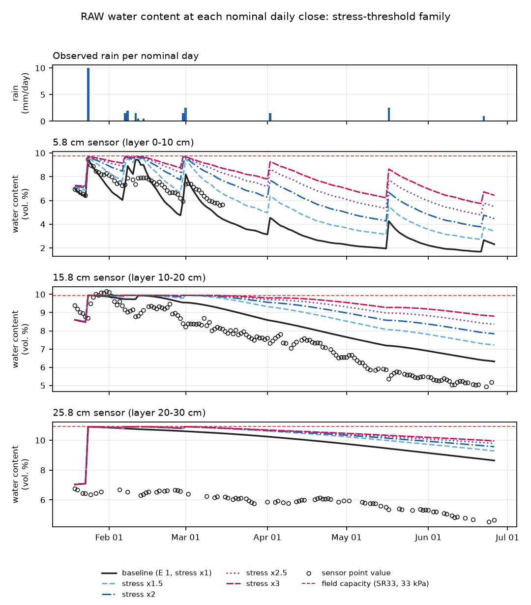
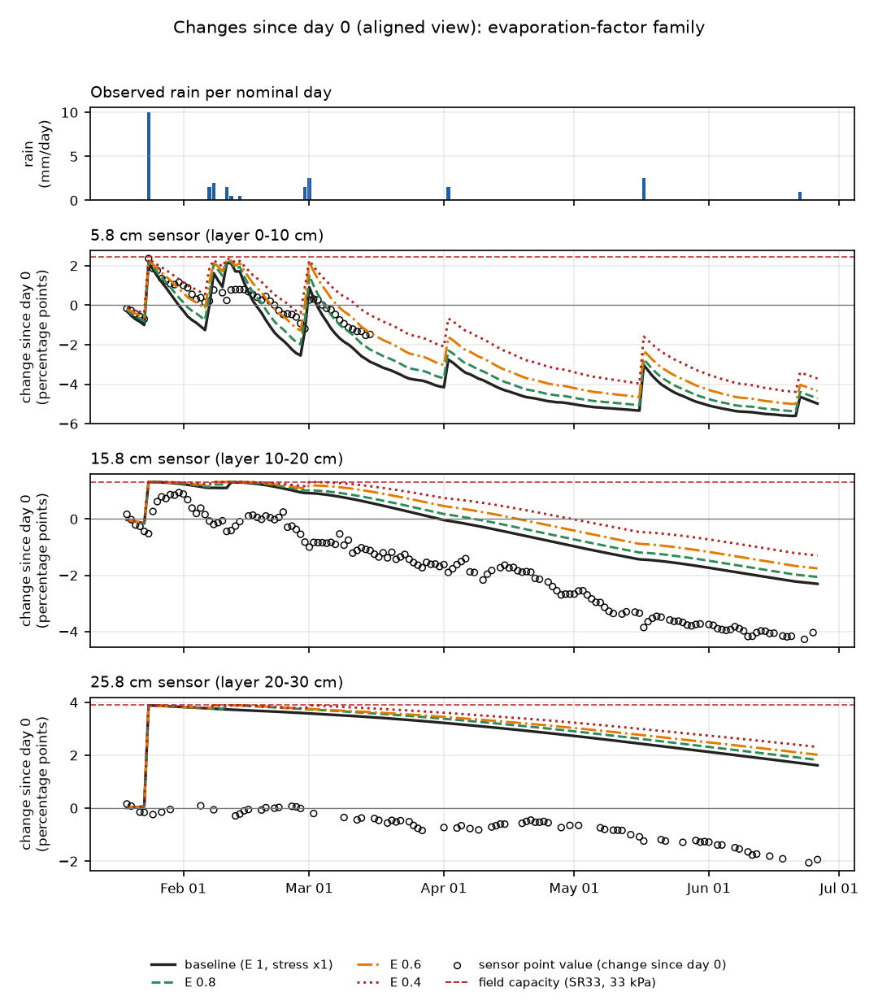
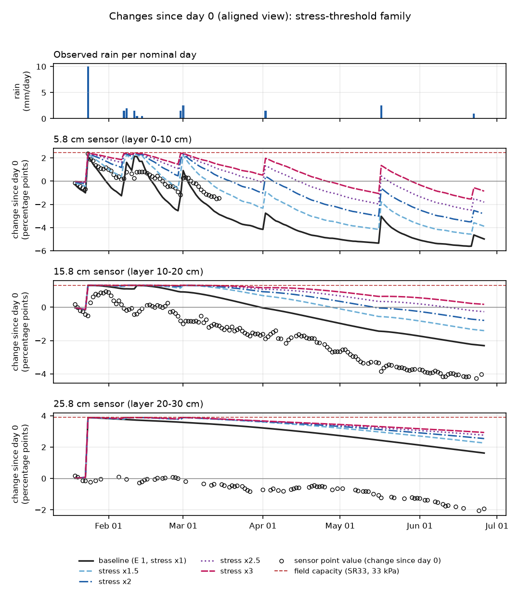
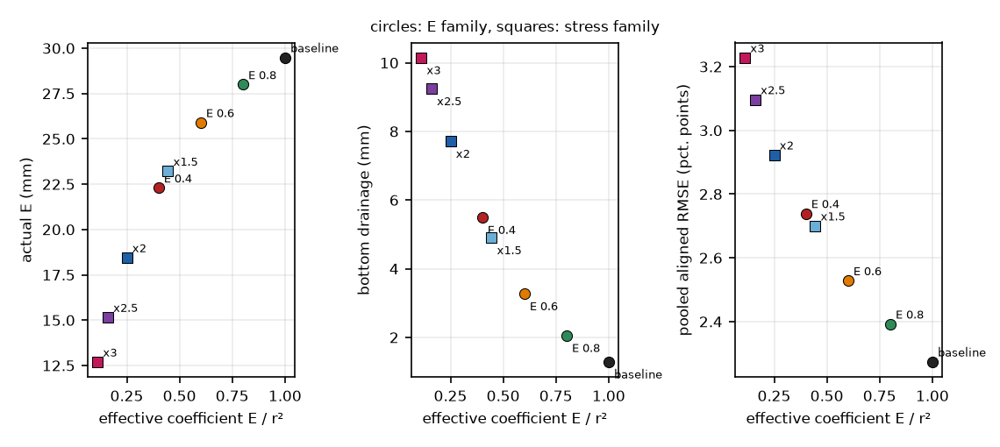

# Evaporation factor and evaporation stress at the SR33 1xK baseline: JORN, January-June 2024

*Two sweeps of the frozen 160-day JORN column: evaporation factor E = 1, 0.8, 0.6, 0.4 at the baseline stress, and E = 1 with the stress threshold multiplied by 1, 1.5, 2, 2.5, 3. Eight unique cases (the baseline is shared). A sensitivity of the native SYRUP column, not a recalibration.*

## 1. Summary

- **The baseline has the lowest full-period, all-depth pooled error, but not at every depth or period.** Pooled aligned RMSE over all 160 days and 282 sensor values (percentage points) is 2.273 at the baseline and 2.392, 2.528, 2.739 for E 0.8, 0.6, 0.4 and 2.700, 2.923, 3.097, 3.228 for stress x1.5, x2, x2.5, x3 (no change: 1.799). The baseline's stress and d were jointly fitted at E = 1 with no transpiration; lowering E or raising the stress moves the pooled fit away from it, although the shallowest sensor (aligned 0.725 at E 0.8 against 0.993) and the two shallower sensors before March 1 (below) are better at some settings. The lowest full-period error is not evidence that E = 1 is the best physical value: the model has no transpiration and the data after March 1 may include it.
- **The two families are one knob.** Every top-layer water content at the evaporation step is at or below field capacity (9.75 vol. %), which is below every stress value, so the quadratic branch (water content / stress)² always applies and a stress multiplier r acts exactly like an evaporation factor E / r². Ordered by that effective coefficient from 1 (the baseline) down to 0.111 (stress x3), pooled error rises and actual evaporation falls monotonically across all eight cases (Figure 6). The sweeps cannot identify E and the stress separately.
- **Less evaporation does not give proportionally less actual evaporation, and the retained water leaves through the bottom.** Actual E is 29.47 mm at the baseline, 27.99, 25.90, 22.29 mm for E 0.8, 0.6, 0.4 (ratios 0.950, 0.879, 0.756, all above the factor) because a wetter top layer evaporates more. Final storage rises (17.27 to 20.24 mm at E 0.4) but bottom drainage also grows from 1.28 to 5.49 mm (to 10.15 mm at stress x3). All 25.088 mm of rain still infiltrates in every case, with no runoff.
- **Before and after March 1 the answer differs.** For the two shallower sensors before March 1, the lowest RAW RMSE is E 0.8 (0.746 against 0.805) and the lowest aligned RMSE is E 0.6 (0.988 against 1.058); from March 1 the baseline is best and every reduction in evaporation makes the model wetter than the sensors. These are different choices from the full-period result and are diagnostics, not a recommendation.
- **The deep-layer discrepancy remains in every case.** The model 20-30 cm layer fills to about its field capacity (10.91 vol. %) at the January 23 storm in all eight cases, whereas the 25.8 cm sensor never exceeds 6.74 vol. %; its first value after that storm, at 2024-01-25, is 6.34 against about 10.90 vol. % in the model. The cause is unresolved; neither a sensor fault nor a data filter is assumed.

## 2. What was run

The base is the accepted SR33 1xK run of the previous study [8]: one 1 m² column of three 10 cm layers with an open bottom, SR33 (33 kPa) field capacities 9.75, 9.94 and 10.91 vol. % [2], all conductivities at 1x, d = 0.0010239461376024856, Tietjen-type exchange [1], observed NEON rain of 25.088 mm [5], Hargreaves-Samani potential evaporation (777.3 mm over the period) from NEON air temperature [6] [3], initial water 22.9424 mm from the NEON soil sensors [4], matrix-only infiltration, daily hydrology, and no transpiration, growth, plants, shading, preferential flow or routing (surface water is exported with zero residence). Evaporation and transpiration are off during rain, and no new sub-daily dry-day step is added. The clock is the earlier daily-weather approximation: 160 nominal days plus 27.5 added storm hours, ending at the 2024-06-26 07:00 UTC close. The baseline rows and ledger reproduce the accepted SR33 1xK case exactly.

Each case file differs from the base only in the requested evaporation factor or stress threshold, its name and an explicit provenance record. Layer properties come from the 2013 Jornada megapit [7], a spatial proxy for the 2024 plot 004 sensors, not demonstrably co-located. Pooled scores use 282 sensor values (56, 147 and 79 at 5.8, 15.8 and 25.8 cm), with gaps left as gaps.

**Table 1. The eight cases. The stress values at x2.5 and x3 exceed saturation: they are hypothetical normalisation scales, accepted without changing capacity, saturation, wilting point or field capacity.**

| Case | Evaporation factor E | Stress threshold (vol. %) | Stress / baseline r | Effective coefficient E / r² | Stress vs top-layer saturation (46.43 vol. %) |
|---|---|---|---|---|---|
| baseline (E 1, stress x1) | 1.00 | 20.17 | 1.0 | 1.0000 | below |
| E 0.8 | 0.80 | 20.17 | 1.0 | 0.8000 | below |
| E 0.6 | 0.60 | 20.17 | 1.0 | 0.6000 | below |
| E 0.4 | 0.40 | 20.17 | 1.0 | 0.4000 | below |
| stress x1.5 | 1.00 | 30.26 | 1.5 | 0.4444 | below |
| stress x2 | 1.00 | 40.34 | 2.0 | 0.2500 | below |
| stress x2.5 | 1.00 | 50.43 | 2.5 | 0.1600 | above |
| stress x3 | 1.00 | 60.51 | 3.0 | 0.1111 | above |

## 3. What the stress threshold is

In the model, the demand for soil evaporation is the potential rate times E. While the top layer holds at least the stress water content, the full demand is allowed; below it the demand is multiplied by (water content / stress)², so evaporation falls with the square of the dryness ratio, and a separate residual content (1 vol. %) stops any withdrawal. The stress threshold is therefore a proxy for the rising resistance of drying soil to evaporation. It is not a measured soil property, not a retention point (suction, field capacity or saturation) and not a separate water store.

**Where the value came from.** Tietjen et al. [1] (section 2.3) define a threshold water content at which stomatal closure begins for combined evapotranspiration, associated in their Table 2 with -1500 kPa. The later EcoHyD code used the wilting-point water content in the same quadratic form, and its Tabernas input of 0.18 is a case value, not a universal one. SYRUP uses the form for soil evaporation only, with plant transpiration requested separately by LEAF. The baseline here, 20.17 vol. %, is neither of those: it was fitted jointly with d, at E = 1 and under the earlier 6 kPa field capacity, to the 53 valid sensor values of the rain-free JORN (April 8-18 and April 26-30, 2025) and MOAB (May 22-28, 2025) windows [8], with transpiration set to zero. It is not the Saxton-Rawls wilting point (3.95-4.63 vol. %) [2].

**What that does and does not mean.** A rain-free window is not proof of a transpiration-free window: if plants were active in April-May, the fitted d and stress could absorb the missing transpiration, because the fit is to total observed soil drying and not to independently measured bare-soil evaporation. This report does not claim that transpiration was measured, or that plants were active, only that the conditional inference is possible; the user's assumed onset of transpiration in March is context for reading the late-period bias; it is an assumption, no phenology was measured and none is implemented. No transpiration is switched on in these runs.

**Why two sweeps give one answer.** At the evaporation step the top layer never holds more than its field capacity (9.75 vol. %), well below even the baseline stress (20.17 vol. %), because gravity moves any excess down first. The quadratic branch therefore always applies, and demand = E x PET x (water content / (r x baseline stress))² = (E / r²) x PET x (water content / baseline stress)². The effective coefficients are 0.444 (x1.5), 0.25 (x2), 0.16 (x2.5) and 0.111 (x3). The native step test of the setup stage confirmed that a stress multiplier r and an evaporation factor E / r² give the same actual evaporation and the same layer water, with an exact water budget and the same limit by available water. A stress above saturation, 50.4 and 60.5 vol. % here, therefore does not mean more stored water and does not change the drying law: at a given water content the demand is lowered by the constant factor 1 / r² while the (water content)² dependence is unchanged, so only the amplitude changes.

## 4. Water: what lower evaporation does

**Table 2a. E family. The two interface rows are separate internal pathway counts and can include the same water: do not add them to each other or to losses and storage.**

| Quantity | baseline (E 1, stress x1) | E 0.8 | E 0.6 | E 0.4 |
|---|---|---|---|---|
| Rain = intake (mm) | 25.088 | 25.088 | 25.088 | 25.088 |
| Runoff / ponding (mm) | 0 | 0 | 0 | 0 |
| Potential soil demand E x PET (mm) | 777.3 | 621.8 | 466.4 | 310.9 |
| Actual evaporation (mm) | 29.47 | 27.99 | 25.90 | 22.29 |
| Actual E / baseline actual E | 1.000 | 0.950 | 0.879 | 0.756 |
| Bottom drainage (mm) | 1.282 | 2.054 | 3.271 | 5.494 |
| Final storage (mm; initial 22.9424) | 17.27 | 17.98 | 18.86 | 20.24 |
| Water crossing the upper interface (0-10 to 10-20 cm) (mm) | 6.77 | 7.65 | 8.91 | 11.23 |
| Water crossing the lower interface (10-20 to 20-30 cm) (mm) | 5.11 | 6.05 | 7.28 | 9.63 |
| Net upward diffusive exchange, top-to-middle (mm) | 6.18 | 5.84 | 5.38 | 4.72 |

**Table 2b. Stress family. Same quantities and the same caution about the interface rows.**

| Quantity | baseline (E 1, stress x1) | stress x1.5 | stress x2 | stress x2.5 | stress x3 |
|---|---|---|---|---|---|
| Rain = intake (mm) | 25.088 | 25.088 | 25.088 | 25.088 | 25.088 |
| Runoff / ponding (mm) | 0 | 0 | 0 | 0 | 0 |
| Potential soil demand E x PET (mm) | 777.3 | 777.3 | 777.3 | 777.3 | 777.3 |
| Actual evaporation (mm) | 29.47 | 23.21 | 18.45 | 15.16 | 12.69 |
| Actual E / baseline actual E | 1.000 | 0.788 | 0.626 | 0.514 | 0.431 |
| Bottom drainage (mm) | 1.282 | 4.901 | 7.714 | 9.242 | 10.147 |
| Final storage (mm; initial 22.9424) | 17.27 | 19.92 | 21.87 | 23.63 | 25.19 |
| Water crossing the upper interface (0-10 to 10-20 cm) (mm) | 6.77 | 10.68 | 13.31 | 14.75 | 15.60 |
| Water crossing the lower interface (10-20 to 20-30 cm) (mm) | 5.11 | 9.04 | 11.86 | 13.39 | 14.30 |
| Net upward diffusive exchange, top-to-middle (mm) | 6.18 | 4.92 | 3.84 | 3.01 | 2.34 |

The baseline takes up all the rain and loses 29.5 mm to evaporation and 1.28 mm through the bottom. With less evaporative demand the profile keeps more water between storms, so more of the later rain exceeds field capacity in these runs and moves down: the upper-interface count rises from 6.77 to 11.23 mm at E 0.4 and 15.60 mm at stress x3, and the bottom drainage from 1.28 to 5.49 and 10.15 mm. Summed over the 160 days, actual evaporation is 1.6% of the summed potential PET at stress x3 and 3.8% at the baseline (160-day totals, not values at the end date); it does not scale linearly with E because the drier top layer evaporates less per unit demand. More stored water at the end (25.2 mm at stress x3) is therefore not a sign of a better model: part of it is deep water that the sensors do not show (below).

## 5. Comparison with the sensors

**RAW** compares model layer means with sensor point values; **aligned** subtracts one constant day-0 offset per depth (+0.19, -0.59 and +0.44 points at 5.8, 15.8 and 25.8 cm) because a 10 cm mean is not a point reading. The offsets are the same in every case, and model water is never altered by the alignment. Figures 1 and 3 show the E family, Figures 2 and 4 the stress family; the dashed red line is the SR33 field capacity (the stress values, 20-61 vol. %, are far above the plotted range).

**Table 3a. ALIGNED RMSE in percentage points (100 x m³/m³) by depth (n = number of sensor values) and pooled. No change = holding the day-0 sensor value.**

| Setting | 5.8 cm (n = 56) | 15.8 cm (n = 147) | 25.8 cm (n = 79) | All pooled (n = 282) |
|---|---|---|---|---|
| baseline (E 1, stress x1) | 0.993 | 1.635 | 3.574 | 2.273 |
| E 0.8 | 0.725 | 1.819 | 3.728 | 2.392 |
| E 0.6 | 0.735 | 2.055 | 3.819 | 2.528 |
| E 0.4 | 1.040 | 2.343 | 3.975 | 2.739 |
| stress x1.5 | 0.946 | 2.286 | 3.959 | 2.700 |
| stress x2 | 1.443 | 2.607 | 4.047 | 2.923 |
| stress x2.5 | 1.738 | 2.856 | 4.112 | 3.097 |
| stress x3 | 1.910 | 3.048 | 4.162 | 3.228 |
| No change (day-0 sensor value held) | 0.881 | 2.343 | 0.886 | 1.799 |

**Table 3b. RAW RMSE in percentage points, same rows and columns.**

| Setting | 5.8 cm (n = 56) | 15.8 cm (n = 147) | 25.8 cm (n = 79) | All pooled (n = 282) |
|---|---|---|---|---|
| baseline (E 1, stress x1) | 0.897 | 1.095 | 4.005 | 2.298 |
| E 0.8 | 0.714 | 1.279 | 4.160 | 2.409 |
| E 0.6 | 0.845 | 1.515 | 4.251 | 2.530 |
| E 0.4 | 1.199 | 1.809 | 4.407 | 2.726 |
| stress x1.5 | 1.099 | 1.750 | 4.391 | 2.690 |
| stress x2 | 1.611 | 2.078 | 4.479 | 2.896 |
| stress x2.5 | 1.908 | 2.333 | 4.544 | 3.057 |
| stress x3 | 2.080 | 2.530 | 4.593 | 3.179 |
| No change (day-0 sensor value held) | 0.881 | 2.343 | 0.886 | 1.799 |

By depth, the shallowest sensor is best at E 0.8 (0.725 against 0.993 at the baseline and 0.881 for no change), whereas the middle and deep sensors are best at the baseline (1.635 against 2.343 no change; 3.574 against 0.886). The middle sensor dominates the pooled score (n = 147), and the deep layer is worse than no change in every case. The final table below pairs each sensor's last valid value with the model at that same close; the shallow sensor has no value after the March 15 close, and the middle sensor none at the June 26 close.

## 6. Before and after March 1

Periods use the nominal local-day label (before 2024-03-01 against from 2024-03-01); each observation is at the daily close that follows its nominal day. No new calendar or transpiration rule is introduced. For the two shallower sensors the counts are 84 before and 119 from March 1; for all three sensors, 104 and 178. Before March 1 the best RAW case for those sensors is E 0.8 (0.746) and the best aligned case E 0.6 (0.988), against 0.805 and 1.058 at the baseline: different cases for different scorings, and neither equals the best full-period case. From March 1 the baseline is best (1.184 RAW) and every reduction raises the error (E 0.4: 2.027; stress x3: 2.933) because the model, which has no transpiration, is already wetter than the sensors (RAW bias +0.98 points for the upper two) and less evaporation widens that.

**Table 4a. RMSE (percentage points) for the 5.8 and 15.8 cm sensors, before March 1 (n = 84) and from March 1 (n = 119).**

| Setting | Before Mar 1 RAW | Before Mar 1 aligned | From Mar 1 RAW | From Mar 1 aligned |
|---|---|---|---|---|
| baseline (E 1, stress x1) | 0.805 | 1.058 | 1.184 | 1.725 |
| E 0.8 | 0.746 | 0.991 | 1.366 | 1.908 |
| E 0.6 | 0.779 | 0.988 | 1.657 | 2.186 |
| E 0.4 | 0.928 | 1.079 | 2.027 | 2.544 |
| stress x1.5 | 0.883 | 1.048 | 1.949 | 2.470 |
| stress x2 | 1.135 | 1.238 | 2.376 | 2.880 |
| stress x2.5 | 1.291 | 1.368 | 2.694 | 3.190 |
| stress x3 | 1.379 | 1.444 | 2.933 | 3.424 |

**Table 4b. RMSE (percentage points) for all three sensors, before March 1 (n = 104) and from March 1 (n = 178).**

| Setting | Before Mar 1 RAW | Before Mar 1 aligned | From Mar 1 RAW | From Mar 1 aligned |
|---|---|---|---|---|
| baseline (E 1, stress x1) | 1.809 | 1.760 | 2.540 | 2.525 |
| E 0.8 | 1.828 | 1.766 | 2.691 | 2.692 |
| E 0.6 | 1.845 | 1.770 | 2.855 | 2.881 |
| E 0.4 | 1.901 | 1.814 | 3.108 | 3.157 |
| stress x1.5 | 1.883 | 1.798 | 3.065 | 3.109 |
| stress x2 | 1.991 | 1.895 | 3.312 | 3.382 |
| stress x2.5 | 2.068 | 1.968 | 3.508 | 3.596 |
| stress x3 | 2.115 | 2.012 | 3.660 | 3.761 |

**Table 4c. RAW bias, model minus sensor (percentage points), by period and sensor group.**

| RAW bias (model minus sensor, percentage points) | Upper two, before Mar 1 | Upper two, from Mar 1 | All three, before Mar 1 | All three, from Mar 1 |
|---|---|---|---|---|
| baseline (E 1, stress x1) | +0.04 | +0.98 | +0.70 | +2.01 |
| E 0.8 | +0.25 | +1.25 | +0.89 | +2.25 |
| E 0.6 | +0.47 | +1.60 | +1.06 | +2.52 |
| E 0.4 | +0.69 | +1.99 | +1.25 | +2.84 |
| stress x1.5 | +0.64 | +1.91 | +1.21 | +2.78 |
| stress x2 | +0.89 | +2.32 | +1.41 | +3.10 |
| stress x2.5 | +1.01 | +2.62 | +1.51 | +3.32 |
| stress x3 | +1.08 | +2.83 | +1.56 | +3.48 |

A higher late no-transpiration soil water can reflect the transpiration the model lacks; a smaller error from lower evaporation before March 1 could equally reflect an over-strong early evaporation or the shallow sensors' support. These data cannot separate them, so no setting is declared best and no parameter is adopted.

## 7. Same-time endpoint comparison and the deep layer

**Table 5. Last valid sensor value at each depth and every case at the SAME close. The shallow sensor has no value after the 2024-03-15 close and the middle sensor none at the 2024-06-26 close; the model's final inventories (Tables 2a and 2b) are valid model end states and imply no observation.**

| Setting (vol. %) | 5.8 cm sensor, 2024-03-15 | 15.8 cm sensor, 2024-06-25 | 25.8 cm sensor, 2024-06-26 |
|---|---|---|---|
| Observed (last valid sensor value) | 5.63 | 5.17 | 4.64 |
| baseline (E 1, stress x1) | 4.43 | 6.34 | 8.64 |
| E 0.8 | 5.05 | 6.58 | 8.84 |
| E 0.6 | 5.88 | 6.89 | 9.04 |
| E 0.4 | 6.79 | 7.34 | 9.33 |
| stress x1.5 | 6.57 | 7.24 | 9.28 |
| stress x2 | 7.67 | 7.85 | 9.57 |
| stress x2.5 | 8.32 | 8.38 | 9.78 |
| stress x3 | 8.71 | 8.81 | 9.96 |

The model 20-30 cm layer is wetted to about its field capacity (10.91 vol. %) by the January 23 storm in all eight cases (daily close about 10.91 vol. % in every case), because the SR33 field capacity is low enough for the gravity step to fill it. The 25.8 cm sensor shows no such wetting: its maximum is 6.74 vol. %, and its first value after the storm (2024-01-25) is 6.34 against about 10.90 vol. %. A whole 20-30 cm bucket that is wetted should be reflected by a probe at 25.8 cm, so the discrepancy stands. Candidate causes include the transport approximation of the cascade, the 2013 soil proxy and a sensor or support effect; none is established, the sensor is not declared faulty and no value was removed. The January filling is essentially unchanged across the eight cases, so neither the evaporation factor nor the stress repairs it.

## 8. Verification and run time

- Before consuming any result I re-hashed all 218 files of Root's seal and checked them again afterwards. From the daily rows I recomputed the per-depth and pooled RAW, aligned and no-change scores, the period scores and counts, the endpoint values, the water budgets and closure, and compared them with Root's audit and period files; all agree (relative 1e-9).
- NumPy and Numba are identical in every tracked output for all eight cases; a 900 s storm step changes layer water by at most 0.00023 percentage points. Root's independent 90-digit calculation (open gravity cascade, evaporation and pair relaxation, no production step call) agrees to 1.1e-17 m or better. Source packages SYRUP 180 files (4e38a472...) and MAPLE 412 files (fbc504bb...) are exact before and after every run. The baseline reproduces the accepted SR33 1xK case exactly. The finer 900 s controls refine the storm steps only; dry interevent evaporation remains one daily step, so no time-resolution qualification of dry-day evaporation is claimed.
- Restart: Root's receipt root_restart_verification.json (PASS, 2026-11-20 22:56:19 UTC) splits the stress x3 case at nominal day 80, resumes it in a fresh process from the driver state and reproduces rows, ledger, cumulative closure, matrix regime, scores, physical end time, added rain hours, nominal elapsed time and completion exactly. It is a driver-level component state reconstruction only, not a native checkpoint or coupled-model acceptance, and no new run was made. Its late files are sealed separately (root_restart_seal.json, 11 files; the 218-file seal is unchanged). GPU, scaling and field-validation claims are not made.

**Table 6a. Timing, separated (separate fresh runs on a shared host with other jobs; not a controlled speed comparison).**

| Run | Integration (s) | Operator prep + JIT (s) | Source checks + input prep (s) | Full fresh command (s) |
|---|---|---|---|---|
| baseline (E 1, stress x1) | 0.0378 | 4.49 | 1.16 | 7.19 |
| E 0.8 | 0.0425 | 4.68 | 1.07 | 7.31 |
| E 0.6 | 0.0369 | 4.36 | 1.05 | 6.88 |
| E 0.4 | 0.0385 | 4.40 | 1.07 | 6.99 |
| stress x1.5 | 0.0424 | 4.48 | 1.03 | 7.01 |
| stress x2 | 0.0473 | 4.69 | 1.04 | 7.40 |
| stress x2.5 | 0.0377 | 4.52 | 1.09 | 7.13 |
| stress x3 | 0.0386 | 4.50 | 1.07 | 7.15 |

**Table 6b. Verification per case: closure, 900 s step, 90-digit control and NumPy/Numba comparison.**

| Run | Closure residual / native bound (m³) | 900 s step: max change (percentage points) | 90-digit check: max error (m) | NumPy vs Numba max difference |
|---|---|---|---|---|
| baseline (E 1, stress x1) | 2.4e-17 / 2.50e-13 | 0.00023 | 1.1e-17 | 0 (exact) |
| E 0.8 | 1.0e-17 / 2.51e-13 | 0.00022 | 7.3e-18 | 0 (exact) |
| E 0.6 | 1.0e-17 / 2.52e-13 | 0.00015 | 7.2e-18 | 0 (exact) |
| E 0.4 | 0.0e+00 / 2.52e-13 | 0.00015 | 9.7e-18 | 0 (exact) |
| stress x1.5 | 6.9e-18 / 2.52e-13 | 0.00015 | 8.8e-18 | 0 (exact) |
| stress x2 | 1.0e-17 / 2.57e-13 | 0.00015 | 6.6e-18 | 0 (exact) |
| stress x2.5 | 5.2e-18 / 2.63e-13 | 0.00015 | 7.0e-18 | 0 (exact) |
| stress x3 | 8.7e-18 / 2.63e-13 | 0.00015 | 8.9e-18 | 0 (exact) |

Integration takes about 0.04 s in each case; the fresh-process time (about 7 s) is dominated by one-time source verification, input preparation and compilation and says nothing about solver speed. One 1 m² CPU column.

## 9. Limits

- A prescribed sensitivity: no calibration, no best parameter, no default change and no adoption. d and the baseline stress are conditional on E = 1, no transpiration and the old field capacity; E and the stress are not separately identified.
- No transpiration, plants or shading; the observed drying after March 1 may include transpiration that the model lacks. This is a conditional inference, not a measurement or a claim of plant activity.
- The above-field-capacity gravity cascade is not rate-limited by any conductivity, and the deep-layer wetting in January is common to all cases. Persistent Green-Ampt history has no automatic reset or drying recovery; here all rain is unponded and below the matrix K, so it does not control intake.
- Point sensors against 10 cm layer means, a daily clock with no new sub-daily dry-day step, a 2013 soil proxy, and the 030 against 020 air-temperature height inherited from the original run. No significance test.

## References

[1] Tietjen, B., Zehe, E., & Jeltsch, F. (2009). Simulating plant water availability in dry lands under climate change: a generic model of two soil layers. Water Resources Research 45, W01418. https://doi.org/10.1029/2007WR006589
[2] Saxton, K. E., & Rawls, W. J. (2006). Soil water characteristic estimates by texture and organic matter for hydrologic solutions. Soil Science Society of America Journal 70, 1569-1578. https://doi.org/10.2136/sssaj2005.0117
[3] Hargreaves, G. H., & Samani, Z. A. (1985). Reference crop evapotranspiration from temperature. Applied Engineering in Agriculture 1, 96-99. https://doi.org/10.13031/2013.26773
[4] NEON (RELEASE-2026). Soil water content and water salinity, DP1.00094.001 (Jornada, JORN, plot 004, sensors 501-503). https://data.neonscience.org/data-products/DP1.00094.001/RELEASE-2026
[5] NEON (RELEASE-2026). Precipitation, DP1.00045.001. https://data.neonscience.org/data-products/DP1.00045.001/RELEASE-2026
[6] NEON (RELEASE-2026). Single aspirated air temperature, DP1.00002.001 (air temperature only; no soil temperature is used by the evaporation demand). https://data.neonscience.org/data-products/DP1.00002.001/RELEASE-2026
[7] NEON (RELEASE-2026). Soil physical and chemical properties, Megapit, DP1.00096.001 (Jornada, 2013-03 pit 1): texture, organic carbon and bulk density behind the layer properties. A spatial proxy for the 2024 plot 004 sensors, not demonstrably co-located. https://data.neonscience.org/data-products/DP1.00096.001/RELEASE-2026
[8] SYRUP project. Joint fit of the diffusion multiplier d and the evaporation-stress threshold at E = 1 (report of 2026-11-18/19), docs/subsurface_hydrology/joint_d_stress_calibration/report.md; and the SR33 field-capacity / all-K/Ks study of 2026-11-20 (SYRUP_JORN_160day_SR33_K_sensitivity_20261120.docx).

## Appendix. Identity (compact)

Sources: SYRUP package 180 files, SHA-256 4e38a472e268a56491b788d5b1271cc3c3da23bb1cc3221a8c59d90f3cc864d2; MAPLE package 412 files, SHA-256 fbc504bbcd1ec0c02e6a96089134a06187532455ef7ba5e6f146801c8313c02e. Base case: jorn_sr33_160day_20261120/study/k1/case_numba.json, SHA-256 f024054f5198ec8358c95f7a33683e6228084e6af246f9790cde586d437f3d2a. Case-file hashes: baseline e2f10115e05a97b9...; E 0.8 8cfcdb89c4e09e1a...; E 0.6 e037d42b907d5f8e...; E 0.4 bb3299c552f13436...; x1.5 3d5da60eb580da77...; x2 261ee1072276c93d...; x2.5 9211eae8ac9bd740...; x3 49918b60a40068e8.... The hash of every sealed file is in tables/provenance_seal.csv and artifact_manifest.json; daily trajectories, scores and period scores of all cases are in the CSV tables. Raw NEON files are not copied.
