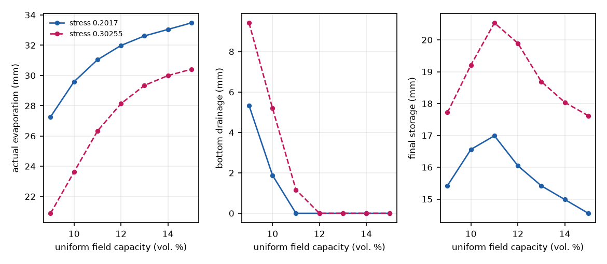
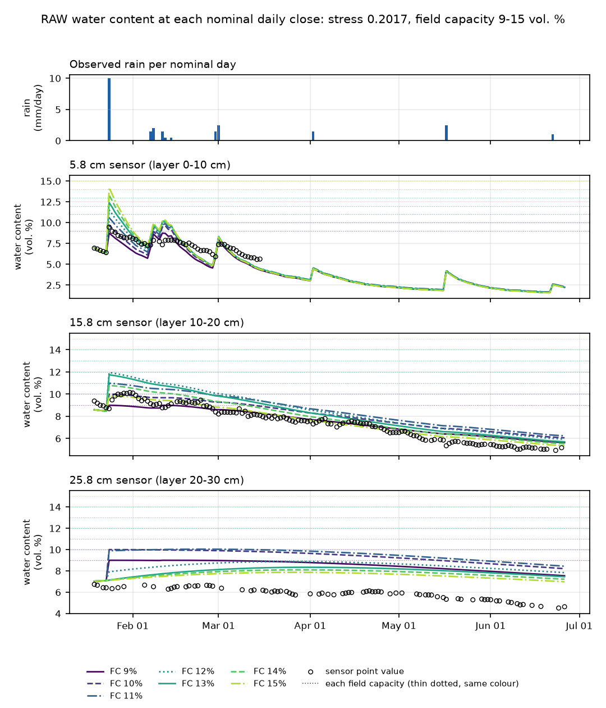
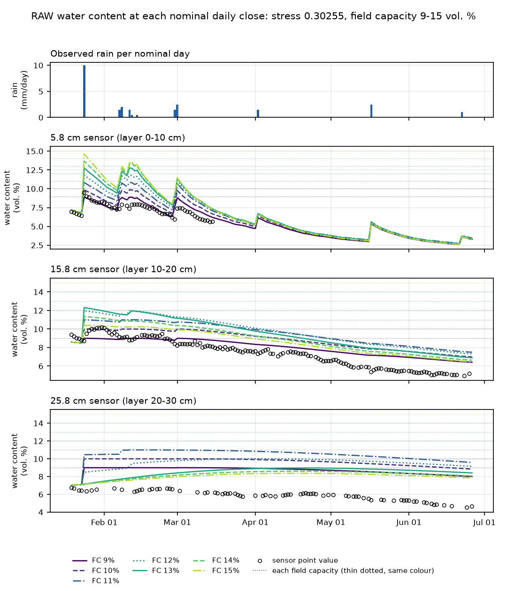
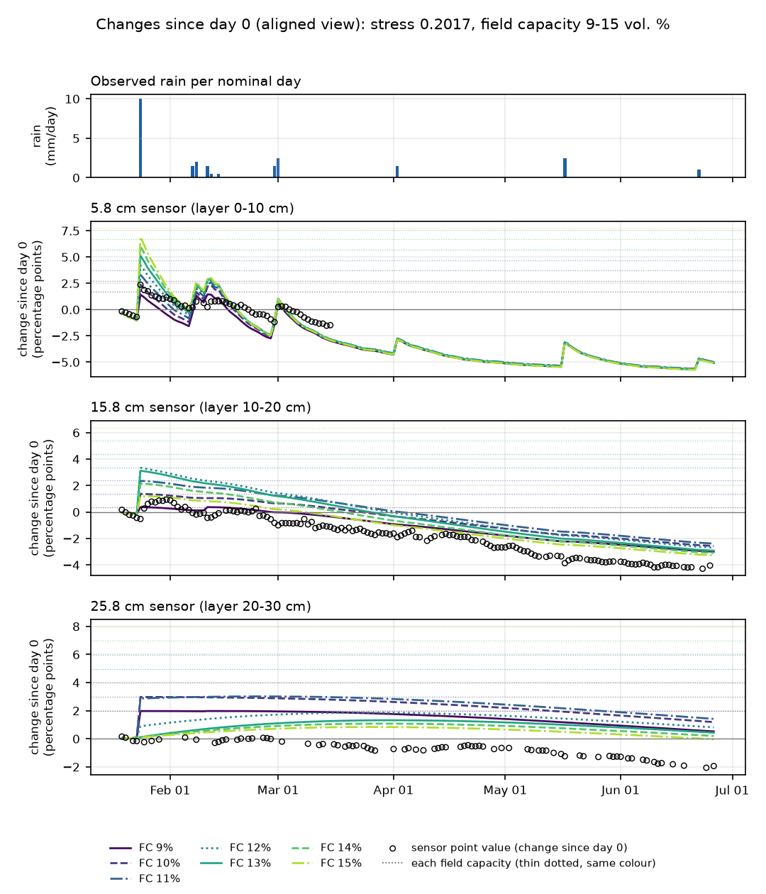
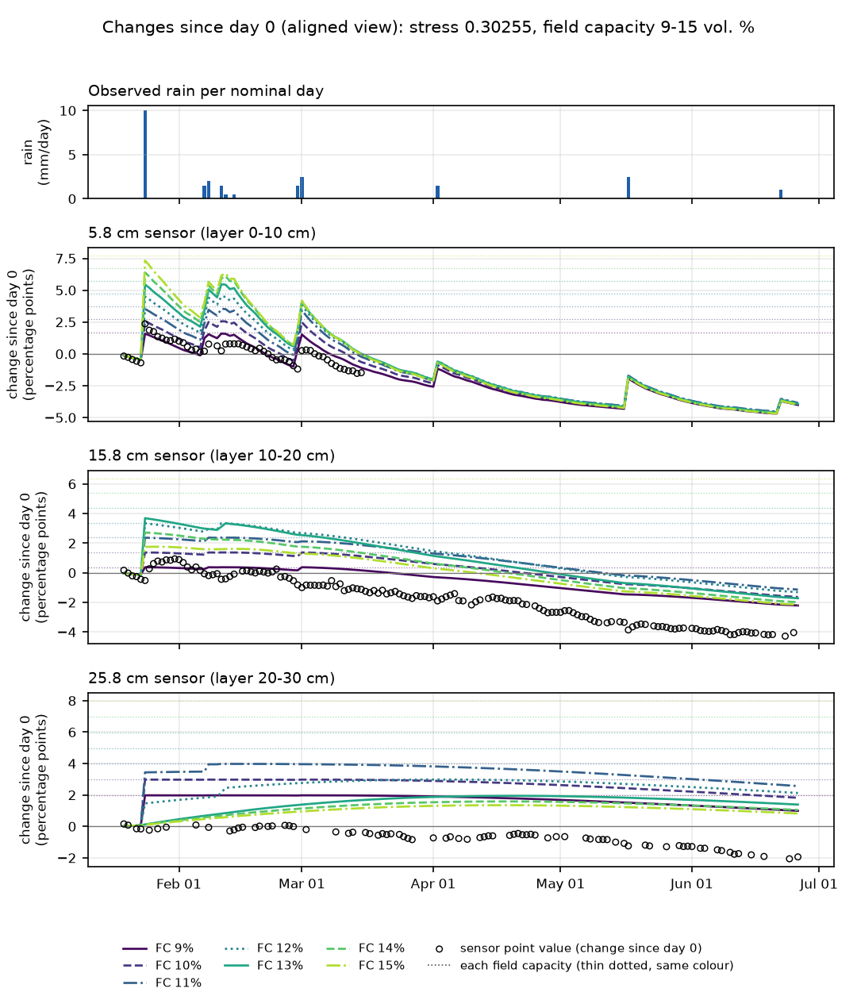

# Uniform field capacity of 9 to 15 vol. % in all layers, at two stress values: JORN, January-June 2024

*The frozen 160-day JORN column of the SR33 1xK study, re-run with one field capacity (9, 10, 11, 12, 13, 14 or 15 vol. %) imposed on all three layers and with the evaporation stress threshold 0.2017 or 0.30255: fourteen crossed cases. Explicit field-capacity overrides, not a recomputed retention curve, a new soil or a recalibration.*

## 1. Summary

- **Pooled error as a function of field capacity.** Pooled aligned RMSE over 282 sensor values (percentage points) rises from 1.419 at FC 9 to a maximum of 2.164 at FC 11, then falls to 1.158 at FC 15 at stress 0.2017, and rises from 1.665 at FC 9 to a maximum of 3.100 at FC 11, then falls to 2.248 at FC 15 at stress 0.30255. The lowest value of each family (stress 0.2017: lowest at FC 15 (1.158); stress 0.30255: lowest at FC 9 (1.665)) is not a physical optimum; the no-change reference is 1.799, and 5 of the 14 cases are better than it. The earlier accepted SR33 case (depth-specific field capacity 9.75 / 9.94 / 10.91 vol. %, stress 0.2017058) scored 2.273 and is shown only as context. RAW and aligned scoring agree on the lowest pooled case of each family (FC 15 at stress 0.2017, FC 9 at 0.30255); the order of the intermediate cases differs between the two scorings.
- **Raising the stress threshold 1.5 times** changes the pooled aligned RMSE by +0.246 to +1.161 points depending on field capacity, and changes the actual evaporation by -6.38 to -3.05 mm (at the same field capacity): the stress and the field capacity interact, and neither can be read alone.
- **The January storm and the deep layer.** Computed, not assumed: at the 2024-01-24 07:00 UTC close (the first close after the 10 mm January 23 storm) the model 20-30 cm layer is within 0.05 points of its field capacity in 4 of the 14 cases. Using a declared descriptive threshold of 0.5 points (not a physical classification), the storm wets the deep layer in 8 cases (the lower field capacities, FC 9-12; by 0.83-3.37 points) and only slightly in the other 6 (FC 13-15; by 0.03-0.06 points). The first following deep sensor reading (Jan 25 close) is 6.34 vol. %, against 7.14-10.47 in the model; the 25.8 cm sensor never exceeds 6.74 vol. %. The higher field capacities remove the large instantaneous storm jump and reduce the positive deep error (raw +0.80 to +0.85 points; +0.36 to +0.41 after subtracting the day-0 offset of +0.44 points), but this does not establish agreement with the sensor: no measurement or support uncertainty bound is available, and a later deep wetting and drying error remains (deep aligned RMSE 1.34-2.39 against 0.886 for no change). Neither a probe fault nor a data filter is assumed.
- **Water.** All 25.088 mm of rain infiltrates in every case, with no runoff. Bottom drainage falls from 5.34 at FC 9 to 0.00 at FC 15 and is zero from FC 11 upward at stress 0.2017 (range 0.00-9.42 mm over all cases), and actual evaporation ranges 20.9-33.5 mm (2.7-4.3% of the summed potential PET). The initial 22.9424 mm is the same in every case and is not rescaled to the field capacity.
- **Seasons.** For the two shallower sensors before March 1 the lowest RAW RMSE is FC 9%, stress 0.30255 (0.598) and the lowest aligned RMSE is FC 9%, stress 0.30255 (0.522); from March 1 the lowest RAW RMSE is FC 15%, stress 0.2017 (0.427). These periods use the user's assumed start of transpiration as context only: the model has no transpiration, and no phenology was measured.

## 2. What was run

The base is the accepted SR33 1xK run [8]: one 1 m² column of three 10 cm layers with an open bottom, all conductivities at 1x, the Tietjen-type gradient exchange [1] with d = 0.0010239461376024856, NEON rain of 25.088 mm [5], Hargreaves-Samani potential evaporation [3] from NEON air temperature [6] (E = 1, 777.3 mm summed PET), initial water 22.9424 mm from the NEON soil sensors [4], matrix-only infiltration, daily hydrology, and no transpiration, growth, plants, shading, preferential flow or routing (surface water is exported with zero residence). Evaporation and transpiration are off during rain, and no new sub-daily dry-day step is added. The clock is the earlier daily-weather approximation: 160 nominal days plus 27.5 added storm hours, ending at the 2024-06-26 07:00 UTC close. Layer properties come from the 2013 Jornada megapit [7], a spatial proxy for the 2024 plot 004 sensors, not demonstrably co-located.

**What changed.** Only the field capacity and the stress threshold differ from the base (and names and provenance text). The field capacity is an explicit user override, 9 to 15 vol. % in all three layers; saturation, wilting point, residual content, Ks, the matrix and interface conductivities, d and the Green-Ampt geometry were not recomputed. These are therefore not seven self-consistent Saxton-Rawls retention curves [2] and not seven new soils. The base used depth-specific values of 9.746, 9.940 and 10.914 vol. %; the uniform values here replace them in the run (the old values remain only in the provenance text as context). The stress values 0.2017 and 0.30255 (= 1.5 x 0.2017) are rounded or scaled sensitivity settings; the earlier fitted value was 0.20170581117963332. Nothing is refit and no default changes.

**Table 1. The fourteen cases (seven field capacities at each of two stress values). A field capacity of x vol. % stores x mm in a 10 cm layer and 3x mm in the 30 cm profile.**

| Field capacity, all layers (vol. %) | Stored at field capacity per 10 cm layer (mm) | Stored at field capacity, profile (mm) | Stress threshold (vol. %) | Stress / 0.2017 |
|---|---|---|---|---|
| 9 | 9 | 27 | 20.170 | 1.0 |
| 10 | 10 | 30 | 20.170 | 1.0 |
| 11 | 11 | 33 | 20.170 | 1.0 |
| 12 | 12 | 36 | 20.170 | 1.0 |
| 13 | 13 | 39 | 20.170 | 1.0 |
| 14 | 14 | 42 | 20.170 | 1.0 |
| 15 | 15 | 45 | 20.170 | 1.0 |
| 9 | 9 | 27 | 30.255 | 1.5 |
| 10 | 10 | 30 | 30.255 | 1.5 |
| 11 | 11 | 33 | 30.255 | 1.5 |
| 12 | 12 | 36 | 30.255 | 1.5 |
| 13 | 13 | 39 | 30.255 | 1.5 |
| 14 | 14 | 42 | 30.255 | 1.5 |
| 15 | 15 | 45 | 30.255 | 1.5 |

## 3. What field capacity does in the model

Field capacity here is the drainage threshold of the gravity step, not a ceiling on storage: any water above it is passed down to the next layer at once, independent of the conductivities (it is not rate-limited by K), and from the bottom layer out of the open bottom. Saturation (about 46 vol. %) is not reached in these runs. At the highest field capacity (15 vol. %) a 10 cm layer holds 15 mm before passing water on; at 9 vol. % it holds 9 mm, so a larger field capacity retains more of each rain pulse in the layer where it arrives and a smaller one sends more of it deeper. The initial layer water is 7.30, 8.62 and 7.02 vol. %, below even 9 vol. %, and it is the same observed profile in all cases.

Changing the field capacity therefore changes which rain pulses cascade through the two interfaces, how much water reaches the bottom, and, through the top-layer water content, the evaporation (the top layer never holds more than its field capacity at the evaporation step, and the stress threshold, 20-30 vol. %, is above every field capacity, so the quadratic reduction applies in all cases). The laws and coefficients of the Tietjen gradient exchange between layers (K, d, interface conductivities) and of the infiltration (matrix K) are unchanged, but the amounts they exchange are not: the exchange follows the moisture profiles, which the field capacity changes (Table 2c). All 25.088 mm of rain enters in every case because every rain rate is below the matrix K and nothing ponds here, not because intake would be invariant under any change of field capacity. This study does not adopt the Saxton-Rawls unsaturated conductivity.

**The stress threshold.** It is the water content at which the full potential rate is still allowed; below it the demand is multiplied by (water content / threshold)², and a separate residual content stops withdrawal. It is a proxy for the rising resistance of drying soil, not a measured soil property or a retention point. The baseline 20.17 vol. % was fitted jointly with d, at E = 1 with transpiration set to zero and the earlier 6 kPa field capacity, to the 53 valid sensor values of rain-free JORN (April 8-18 and 26-30, 2025) and MOAB (May 22-28, 2025) windows [8]; if plants were active then, the fit could have absorbed the missing transpiration. It is not the Saxton-Rawls wilting point (3.95-4.63 vol. %). The value 30.26 vol. % was used here only as a sensitivity setting.

## 4. Water: what the field capacity changes

**Table 2a. Stress 0.2017. Rain = intake = 25.088 mm and runoff = 0 in every case; the initial storage is 22.9424 mm. The two interface columns are separate internal pathway counts and can include the same water: do not add them to each other or to losses and storage.**

| Field capacity (vol. %) | Actual E (mm) | Actual E / PET (%) | Bottom drainage (mm) | Final storage (mm) | Upper-interface crossing (mm) | Lower-interface crossing (mm) |
|---|---|---|---|---|---|---|
| 9 | 27.27 | 3.5 | 5.339 | 15.42 | 8.06 | 7.27 |
| 10 | 29.59 | 3.8 | 1.882 | 16.56 | 6.33 | 4.79 |
| 11 | 31.04 | 4.0 | 0.000 | 16.99 | 5.33 | 2.79 |
| 12 | 31.98 | 4.1 | 0.000 | 16.05 | 4.32 | 0.78 |
| 13 | 32.61 | 4.2 | 0.000 | 15.42 | 3.32 | 0.00 |
| 14 | 33.04 | 4.3 | 0.000 | 14.99 | 2.32 | 0.00 |
| 15 | 33.48 | 4.3 | 0.000 | 14.55 | 1.31 | 0.00 |

**Table 2b. Stress 0.30255. Same quantities and the same caution about the interface columns.**

| Field capacity (vol. %) | Actual E (mm) | Actual E / PET (%) | Bottom drainage (mm) | Final storage (mm) | Upper-interface crossing (mm) | Lower-interface crossing (mm) |
|---|---|---|---|---|---|---|
| 9 | 20.89 | 2.7 | 9.423 | 17.72 | 12.21 | 11.35 |
| 10 | 23.62 | 3.0 | 5.198 | 19.21 | 10.07 | 8.13 |
| 11 | 26.33 | 3.4 | 1.164 | 20.53 | 7.85 | 5.01 |
| 12 | 28.14 | 3.6 | 0.000 | 19.89 | 6.08 | 1.85 |
| 13 | 29.34 | 3.8 | 0.000 | 18.69 | 4.38 | 0.00 |
| 14 | 29.99 | 3.9 | 0.000 | 18.04 | 2.87 | 0.00 |
| 15 | 30.41 | 3.9 | 0.000 | 17.62 | 1.87 | 0.00 |

At stress 0.2017 the actual evaporation rises steadily from 27.27 at FC 9 to 33.48 at FC 15, the bottom drainage falls from 5.34 at FC 9 to 0.00 at FC 15 and is zero from FC 11 upward and the final storage rises from 15.42 at FC 9 to a maximum of 16.99 at FC 11, then falls to 14.55 at FC 15; at stress 0.30255 the evaporation rises steadily from 20.89 at FC 9 to 30.41 at FC 15, the drainage falls from 9.42 at FC 9 to 0.00 at FC 15 and is zero from FC 12 upward and the final storage rises from 17.72 at FC 9 to a maximum of 20.53 at FC 11, then falls to 17.62 at FC 15 (Figure 6). The crossings of the upper interface falls steadily from 8.06 at FC 9 to 1.31 at FC 15 and of the lower interface falls from 7.27 at FC 9 to 0.00 at FC 15 and is zero from FC 13 upward at stress 0.2017. The changes in evaporation, retention and drainage cannot be attributed to the field capacity through drainage alone: the field capacity also changes the top-layer water content on which the evaporation depends.

**Table 2c. Cumulative NET gradient exchange across each interface over 160 days (mm; downward positive, upward negative), with the model deep-layer peak and end value. These are internal transfers: they are not losses and are not added to the other budget terms.**

| Field capacity (vol. %) | Stress | Upper interface, net exchange (mm) | Lower interface, net exchange (mm) | Deep layer peak (vol. %) | Deep layer at the end (vol. %) |
|---|---|---|---|---|---|
| 9 | 0.20170 | -5.183 | -1.402 | 9.00 | 7.55 |
| 10 | 0.20170 | -5.818 | -1.718 | 10.00 | 8.21 |
| 11 | 0.20170 | -6.290 | -1.366 | 10.04 | 8.44 |
| 12 | 0.20170 | -6.200 | +0.034 | 8.88 | 7.84 |
| 13 | 0.20170 | -5.801 | +0.436 | 8.34 | 7.46 |
| 14 | 0.20170 | -5.206 | +0.201 | 8.10 | 7.22 |
| 15 | 0.20170 | -4.614 | -0.035 | 7.87 | 6.99 |
| 9 | 0.30255 | -4.005 | -0.932 | 9.00 | 8.02 |
| 10 | 0.30255 | -4.683 | -1.109 | 10.00 | 8.84 |
| 11 | 0.30255 | -5.250 | -1.284 | 11.00 | 9.59 |
| 12 | 0.30255 | -5.270 | +0.271 | 10.01 | 9.15 |
| 13 | 0.30255 | -4.709 | +1.389 | 8.97 | 8.41 |
| 14 | 0.30255 | -3.812 | +1.048 | 8.61 | 8.07 |
| 15 | 0.30255 | -3.201 | +0.823 | 8.37 | 7.85 |

A fixed K does not mean a fixed exchange. Even where the lower interface passes no gravity water (FC 13 and above), the gradient exchange can still move water into the deep layer, so the deep layer can rise without any gravity transfer. The net integral can also be negative after an earlier wetting peak, so a negative end total is not evidence of no deep wetting: at FC 15 and stress 0.2017 the net exchange across the lower interface is -0.035 mm while the deep layer peaks at 7.87 vol. % before ending at 6.99; at stress 0.30255 it is +0.823 mm and the peak 8.37 vol. %. The exchange amounts therefore differ with the profile history even though the law and coefficients do not.

## 5. Comparison with the sensors

**RAW** compares model layer means with sensor point values; **aligned** subtracts one constant day-0 offset per depth (+0.19, -0.59 and +0.44 points at 5.8, 15.8 and 25.8 cm), because a 10 cm mean is not a point reading. The offsets are the same in every case; model water is never altered by the alignment. Figures 1 and 3 show the seven field capacities at stress 0.2017, Figures 2 and 4 those at 0.30255; the thin dotted lines are the field capacities in the colour of their curve.

**Table 3a. ALIGNED RMSE in percentage points (100 x m³/m³) by depth (n = number of sensor values) and pooled. No change = holding the day-0 sensor value.**

| Setting | 5.8 cm (n = 56) | 15.8 cm (n = 147) | 25.8 cm (n = 79) | All pooled (n = 282) |
|---|---|---|---|---|
| FC 9%, stress 0.2017 | 1.147 | 0.887 | 2.189 | 1.419 |
| FC 10%, stress 0.2017 | 0.981 | 1.392 | 2.996 | 1.928 |
| FC 11%, stress 0.2017 | 0.952 | 1.794 | 3.175 | 2.164 |
| FC 12%, stress 0.2017 | 1.037 | 1.833 | 2.241 | 1.836 |
| FC 13%, stress 0.2017 | 1.187 | 1.613 | 1.770 | 1.585 |
| FC 14%, stress 0.2017 | 1.364 | 1.207 | 1.553 | 1.343 |
| FC 15%, stress 0.2017 | 1.556 | 0.830 | 1.336 | 1.158 |
| FC 9%, stress 0.30255 | 0.583 | 1.451 | 2.395 | 1.665 |
| FC 10%, stress 0.30255 | 1.089 | 2.163 | 3.315 | 2.399 |
| FC 11%, stress 0.30255 | 1.721 | 2.830 | 4.159 | 3.100 |
| FC 12%, stress 0.30255 | 2.262 | 3.040 | 3.354 | 2.998 |
| FC 13%, stress 0.30255 | 2.732 | 2.806 | 2.390 | 2.681 |
| FC 14%, stress 0.30255 | 3.063 | 2.260 | 2.087 | 2.397 |
| FC 15%, stress 0.30255 | 3.299 | 1.910 | 1.881 | 2.248 |
| No change (day-0 sensor value held) | 0.881 | 2.343 | 0.886 | 1.799 |

**Table 3b. RAW RMSE in percentage points, same rows and columns.**

| Setting | 5.8 cm (n = 56) | 15.8 cm (n = 147) | 25.8 cm (n = 79) | All pooled (n = 282) |
|---|---|---|---|---|
| FC 9%, stress 0.2017 | 1.013 | 0.529 | 2.621 | 1.508 |
| FC 10%, stress 0.2017 | 0.896 | 0.857 | 3.428 | 1.958 |
| FC 11%, stress 0.2017 | 0.913 | 1.232 | 3.607 | 2.145 |
| FC 12%, stress 0.2017 | 1.037 | 1.283 | 2.668 | 1.751 |
| FC 13%, stress 0.2017 | 1.209 | 1.074 | 2.188 | 1.494 |
| FC 14%, stress 0.2017 | 1.398 | 0.674 | 1.971 | 1.309 |
| FC 15%, stress 0.2017 | 1.597 | 0.362 | 1.753 | 1.198 |
| FC 9%, stress 0.30255 | 0.682 | 1.002 | 2.826 | 1.689 |
| FC 10%, stress 0.30255 | 1.248 | 1.624 | 3.746 | 2.370 |
| FC 11%, stress 0.30255 | 1.888 | 2.268 | 4.591 | 3.048 |
| FC 12%, stress 0.30255 | 2.432 | 2.471 | 3.781 | 2.892 |
| FC 13%, stress 0.30255 | 2.902 | 2.238 | 2.803 | 2.546 |
| FC 14%, stress 0.30255 | 3.232 | 1.693 | 2.499 | 2.306 |
| FC 15%, stress 0.30255 | 3.466 | 1.353 | 2.292 | 2.194 |
| No change (day-0 sensor value held) | 0.881 | 2.343 | 0.886 | 1.799 |

By depth, the aligned RMSE of the 5.8 cm sensor falls from 1.147 at FC 9 to a minimum of 0.952 at FC 11, then rises to 1.556 at FC 15 at stress 0.2017, the 15.8 cm sensor rises from 0.887 at FC 9 to a maximum of 1.833 at FC 12, then falls to 0.830 at FC 15, and the 25.8 cm sensor rises from 2.189 at FC 9 to a maximum of 3.175 at FC 11, then falls to 1.336 at FC 15 (no change: 0.881, 2.343, 0.886). The middle sensor dominates the pooled score (n = 147). The depths therefore trade against each other, and the pooled minimum is a compromise (Figure 5). Neither the pooled error nor any depth's error is taken as the sole physical criterion; no global best is declared.

## 6. Before and after March 1

Periods use the nominal local-day label (before 2024-03-01 against from 2024-03-01); each observation is at the daily close that follows its nominal day. No new calendar or transpiration rule is introduced: the split follows the user's assumed start of transpiration only as context, and no phenology was measured. For the two shallower sensors the counts are 84 before and 119 from March 1; for all three, 104 and 178. The lowest upper-two RAW RMSE before March 1 is 0.598 (FC 9%, stress 0.30255) and from March 1 0.427 (FC 15%, stress 0.2017); the lowest aligned values are 0.522 before March 1 (FC 9%, stress 0.30255) and 0.875 from March 1 (FC 15%, stress 0.2017). Table 4b shows the RAW bias: a positive bias means the model is wetter than the sensors, which after March 1 may reflect the missing transpiration but cannot be separated from other causes with these data.

**Table 4a. RMSE (percentage points) for the 5.8 and 15.8 cm sensors, before March 1 (n = 84) and from March 1 (n = 119).**

| Setting | Before Mar 1 RAW | Before Mar 1 aligned | From Mar 1 RAW | From Mar 1 aligned |
|---|---|---|---|---|
| FC 9%, stress 0.2017 | 0.865 | 0.890 | 0.548 | 1.016 |
| FC 10%, stress 0.2017 | 0.759 | 0.983 | 0.938 | 1.471 |
| FC 11%, stress 0.2017 | 1.063 | 1.367 | 1.212 | 1.756 |
| FC 12%, stress 0.2017 | 1.417 | 1.726 | 1.060 | 1.598 |
| FC 13%, stress 0.2017 | 1.405 | 1.674 | 0.849 | 1.378 |
| FC 14%, stress 0.2017 | 1.254 | 1.420 | 0.609 | 1.119 |
| FC 15%, stress 0.2017 | 1.293 | 1.317 | 0.427 | 0.875 |
| FC 9%, stress 0.30255 | 0.598 | 0.522 | 1.099 | 1.603 |
| FC 10%, stress 0.30255 | 0.976 | 1.120 | 1.821 | 2.336 |
| FC 11%, stress 0.30255 | 1.694 | 1.884 | 2.450 | 2.963 |
| FC 12%, stress 0.30255 | 2.366 | 2.563 | 2.524 | 3.032 |
| FC 13%, stress 0.30255 | 2.697 | 2.860 | 2.239 | 2.732 |
| FC 14%, stress 0.30255 | 2.660 | 2.733 | 1.860 | 2.336 |
| FC 15%, stress 0.30255 | 2.725 | 2.724 | 1.636 | 2.095 |

**Table 4b. RAW bias, model minus sensor (percentage points), for the upper two and all three sensors, by period (counts 84/119 and 104/178). RMSE for all three sensors is in the CSV tables.**

| RAW bias, model minus sensor (percentage points) | Upper two, before Mar 1 | Upper two, from Mar 1 | All three, before Mar 1 | All three, from Mar 1 |
|---|---|---|---|---|
| FC 9%, stress 0.2017 | -0.55 | +0.24 | -0.05 | +1.07 |
| FC 10%, stress 0.2017 | +0.03 | +0.73 | +0.57 | +1.66 |
| FC 11%, stress 0.2017 | +0.51 | +1.02 | +0.97 | +1.93 |
| FC 12%, stress 0.2017 | +0.88 | +0.87 | +1.03 | +1.54 |
| FC 13%, stress 0.2017 | +0.89 | +0.65 | +0.93 | +1.24 |
| FC 14%, stress 0.2017 | +0.66 | +0.39 | +0.73 | +0.99 |
| FC 15%, stress 0.2017 | +0.43 | +0.13 | +0.52 | +0.73 |
| FC 9%, stress 0.30255 | -0.04 | +1.03 | +0.37 | +1.68 |
| FC 10%, stress 0.30255 | +0.73 | +1.80 | +1.14 | +2.50 |
| FC 11%, stress 0.30255 | +1.48 | +2.43 | +1.88 | +3.22 |
| FC 12%, stress 0.30255 | +2.13 | +2.51 | +2.17 | +3.04 |
| FC 13%, stress 0.30255 | +2.42 | +2.22 | +2.19 | +2.52 |
| FC 14%, stress 0.30255 | +2.23 | +1.83 | +2.01 | +2.14 |
| FC 15%, stress 0.30255 | +2.07 | +1.58 | +1.86 | +1.90 |

## 7. Same-time endpoints and the deep layer

**Table 5. Last valid sensor value at each depth and every case at the SAME close. The shallow sensor has no value after the 2024-03-15 close and the middle sensor none at the 2024-06-26 close; the model's final inventories (Tables 2a and 2b) are valid model end states and imply no observation.**

| Setting (vol. %) | 5.8 cm sensor, 2024-03-15 | 15.8 cm sensor, 2024-06-25 | 25.8 cm sensor, 2024-06-26 |
|---|---|---|---|
| Observed (last valid sensor value) | 5.63 | 5.17 | 4.64 |
| FC 9%, stress 0.2017 | 4.32 | 5.65 | 7.55 |
| FC 10%, stress 0.2017 | 4.41 | 6.08 | 8.21 |
| FC 11%, stress 0.2017 | 4.46 | 6.26 | 8.44 |
| FC 12%, stress 0.2017 | 4.48 | 5.95 | 7.84 |
| FC 13%, stress 0.2017 | 4.46 | 5.73 | 7.46 |
| FC 14%, stress 0.2017 | 4.42 | 5.55 | 7.22 |
| FC 15%, stress 0.2017 | 4.38 | 5.37 | 6.99 |
| FC 9%, stress 0.30255 | 6.20 | 6.43 | 8.02 |
| FC 10%, stress 0.30255 | 6.66 | 7.01 | 8.84 |
| FC 11%, stress 0.30255 | 7.07 | 7.51 | 9.59 |
| FC 12%, stress 0.30255 | 7.24 | 7.33 | 9.15 |
| FC 13%, stress 0.30255 | 7.31 | 6.92 | 8.41 |
| FC 14%, stress 0.30255 | 7.27 | 6.66 | 8.07 |
| FC 15%, stress 0.30255 | 7.24 | 6.49 | 7.85 |

The January 23 storm (10.036 mm, nominal day January 23, closing at 2024-01-24 07:00 UTC) raises the model deep layer by 0.83-3.37 points in the 8 cases where it exceeds the declared descriptive threshold of 0.5 points (FC 9-12; to 7.92-10.46 vol. %; Table 6, Figure 7a) and by 0.03-0.06 points in the other 6 (FC 13-15); the threshold is a convenience for description, not a physical classification. The deep sensor has no value at that close (a gap, not zero); its first following value, at the Jan 25 close, is 6.34 vol. %, against 7.14-10.47 in the model, and its maximum over the record is 6.74 vol. %. Where the deep layer is wetted, a whole 20-30 cm layer should show up at a probe at 25.8 cm, and the sensor shows no corresponding rise. At the higher field capacities the large instantaneous storm jump is removed and the positive error is smaller: the raw error is +0.80 to +0.85 points, and +0.36 to +0.41 after subtracting the day-0 offset between the layer mean and the sensor point (+0.44 points). That reduces the error but does not establish agreement with the sensor: no uncertainty bound for point-against-layer support or measurement exists here, and a later deep wetting and drying error remains (aligned RMSE of the deep sensor 1.34-2.39 for these cases, against 0.886 for no change; Table 3a). Candidate causes of the mismatch include the cascade approximation, the 2013 soil proxy and sensor or support effects; none is established. The sensor is not declared faulty, no value was removed, and the model is not a wetting-front solver.

**Table 6. The model deep layer around the January 23 storm and over the whole record, at the two stress values (the sensor value at the Jan 25 close is 6.34 vol. %).**

| Setting | Deep layer before storm, Jan 23 close (vol. %) | Deep layer after storm, Jan 24 close (vol. %) | Deep layer, Jan 25 close (obs 6.34) (vol. %) | Whole-record deep peak (vol. %) | Date of peak (close) |
|---|---|---|---|---|---|
| FC 9%, stress 0.2017 | 7.09 | 9.00 | 9.00 | 9.00 | 2024-02-11 |
| FC 10%, stress 0.2017 | 7.09 | 10.00 | 10.00 | 10.00 | 2024-01-24 |
| FC 11%, stress 0.2017 | 7.09 | 9.89 | 9.90 | 10.04 | 2024-02-25 |
| FC 12%, stress 0.2017 | 7.09 | 7.92 | 7.95 | 8.88 | 2024-03-25 |
| FC 13%, stress 0.2017 | 7.09 | 7.14 | 7.18 | 8.34 | 2024-03-31 |
| FC 14%, stress 0.2017 | 7.09 | 7.13 | 7.16 | 8.10 | 2024-03-29 |
| FC 15%, stress 0.2017 | 7.09 | 7.12 | 7.14 | 7.87 | 2024-03-26 |
| FC 9%, stress 0.30255 | 7.09 | 9.00 | 9.00 | 9.00 | 2024-02-11 |
| FC 10%, stress 0.30255 | 7.09 | 10.00 | 10.00 | 10.00 | 2024-02-11 |
| FC 11%, stress 0.30255 | 7.09 | 10.46 | 10.47 | 11.00 | 2024-02-11 |
| FC 12%, stress 0.30255 | 7.09 | 8.49 | 8.52 | 10.01 | 2024-04-03 |
| FC 13%, stress 0.30255 | 7.09 | 7.15 | 7.19 | 8.97 | 2024-04-20 |
| FC 14%, stress 0.30255 | 7.09 | 7.14 | 7.17 | 8.61 | 2024-04-18 |
| FC 15%, stress 0.30255 | 7.09 | 7.13 | 7.15 | 8.37 | 2024-04-17 |

## 8. Verification and run time

- Before consuming any result I re-hashed all 423 files of Root's seal and checked them again afterwards. From the daily rows I recomputed the per-depth and pooled RAW, aligned and no-change scores, the period scores and counts, the endpoints, the water budgets, closure and the January deep-layer values, and compared them with Root's audit, period and deep-wetting files; all agree (relative 1e-9).
- NumPy and Numba are identical in every tracked output for all 14 cases; a 900 s storm step changes layer water by at most 0.00061 percentage points. The finer controls refine the storm steps only; dry interevent evaporation remains one daily step, so no time-resolution qualification of dry-day evaporation is claimed. Root's independent 90-digit calculation (open gravity cascade, evaporation and pair relaxation, no production step call; valid here because the rows confirm no surface return or room rejection) agrees within 1.5e-17 m (largest 1.43e-17 m). Source packages SYRUP 180 files (4e38a472...) and MAPLE 412 files (fbc504bb...) are exact before and after every run.
- Restart: Root's receipt root_restart_verification.json (PASS, 2026-11-20 23:25:53 UTC, case fc12_s1p5, split at nominal day 80, fresh-process resume) reproduces the listed outputs exactly. It is a driver-level component state reconstruction only, not a native checkpoint or coupled-model acceptance, and no new run was made. GPU, scaling, large-domain and coupled-model claims are not made.

**Table 7a. Timing, separated (separate fresh runs on a shared host with other jobs; not a controlled speed comparison).**

| Run | Integration (s) | Operator prep + JIT (s) | Source checks + input prep (s) | Full fresh command (s) |
|---|---|---|---|---|
| FC 9%, stress 0.2017 | 0.0376 | 4.28 | 1.03 | 6.72 |
| FC 10%, stress 0.2017 | 0.0369 | 4.38 | 1.03 | 6.84 |
| FC 11%, stress 0.2017 | 0.0371 | 4.31 | 1.01 | 6.77 |
| FC 12%, stress 0.2017 | 0.0386 | 4.27 | 1.02 | 6.79 |
| FC 13%, stress 0.2017 | 0.0375 | 4.34 | 1.01 | 6.81 |
| FC 14%, stress 0.2017 | 0.0368 | 4.36 | 1.02 | 6.85 |
| FC 15%, stress 0.2017 | 0.0381 | 4.32 | 1.04 | 6.83 |
| FC 9%, stress 0.30255 | 0.0366 | 4.34 | 1.03 | 6.80 |
| FC 10%, stress 0.30255 | 0.0398 | 4.44 | 1.03 | 6.98 |
| FC 11%, stress 0.30255 | 0.0373 | 4.38 | 1.05 | 6.95 |
| FC 12%, stress 0.30255 | 0.0399 | 4.39 | 1.04 | 6.90 |
| FC 13%, stress 0.30255 | 0.0376 | 4.77 | 1.07 | 7.32 |
| FC 14%, stress 0.30255 | 0.0368 | 4.38 | 1.05 | 6.90 |
| FC 15%, stress 0.30255 | 0.0390 | 4.49 | 1.04 | 7.03 |

**Table 7b. Verification per case: closure, 900 s step, 90-digit control and NumPy/Numba comparison.**

| Run | Closure residual / native bound (m³) | 900 s step: max change (percentage points) | 90-digit check: max error (m) | NumPy vs Numba max difference |
|---|---|---|---|---|
| FC 9%, stress 0.2017 | 0.0e+00 / 2.34e-13 | 0.00022 | 6.9e-18 | 0 (exact) |
| FC 10%, stress 0.2017 | 1.4e-17 / 2.47e-13 | 0.00038 | 8.3e-18 | 0 (exact) |
| FC 11%, stress 0.2017 | 3.5e-18 / 2.54e-13 | 0.00034 | 8.8e-18 | 0 (exact) |
| FC 12%, stress 0.2017 | 3.5e-18 / 2.55e-13 | 0.00037 | 1.2e-17 | 0 (exact) |
| FC 13%, stress 0.2017 | 1.7e-17 / 2.60e-13 | 0.00037 | 9.8e-18 | 0 (exact) |
| FC 14%, stress 0.2017 | 0.0e+00 / 2.63e-13 | 0.00049 | 1.2e-17 | 0 (exact) |
| FC 15%, stress 0.2017 | 6.9e-18 / 2.66e-13 | 0.00061 | 8.7e-18 | 0 (exact) |
| FC 9%, stress 0.30255 | 4.2e-17 / 2.38e-13 | 0.00015 | 9.5e-18 | 0 (exact) |
| FC 10%, stress 0.30255 | 1.4e-17 / 2.47e-13 | 0.00015 | 9.5e-18 | 0 (exact) |
| FC 11%, stress 0.30255 | 6.9e-18 / 2.69e-13 | 0.00016 | 7.2e-18 | 0 (exact) |
| FC 12%, stress 0.30255 | 3.5e-18 / 2.66e-13 | 0.00031 | 8.2e-18 | 0 (exact) |
| FC 13%, stress 0.30255 | 3.5e-18 / 2.61e-13 | 0.00026 | 1.1e-17 | 0 (exact) |
| FC 14%, stress 0.30255 | 1.7e-17 / 2.58e-13 | 0.00044 | 1.4e-17 | 0 (exact) |
| FC 15%, stress 0.30255 | 6.9e-18 / 2.58e-13 | 0.00055 | 9.6e-18 | 0 (exact) |

Integration takes a few hundredths of a second per case; the fresh-process time is dominated by one-time source verification, input preparation and compilation and says nothing about solver speed. One 1 m² CPU column.

## 9. Limits

- A prescribed sensitivity: no calibration, no best parameter, no default change and no adoption. The field capacity is an override on SR33-derived conductivities, not a self-consistent retention curve; d and the stress threshold are conditional on E = 1, no transpiration and the earlier field capacity, and the stress and field capacity interact.
- No transpiration, plants or shading; the observed drying after March 1 may include transpiration the model lacks. This is a conditional inference, not a measurement or a claim of plant activity. The earlier 2025 dry-period fit may have absorbed missing transpiration.
- The above-field-capacity gravity cascade is instantaneous and not limited by any conductivity; Tietjen K and d (gradient exchange) are unchanged and the Saxton-Rawls unsaturated conductivity is not adopted. Persistent Green-Ampt history has no automatic reset or drying recovery; here all rain is unponded and below the matrix K, so it does not control intake.
- Point sensors against 10 cm layer means, a daily clock with no new sub-daily dry-day step, a 2013 soil proxy for the 2024 plot, and the 030 against 020 air-temperature height inherited from the original run. No significance test; probe error or unrepresentativeness is neither established nor excluded.

## References

[1] Tietjen, B., Zehe, E., & Jeltsch, F. (2009). Simulating plant water availability in dry lands under climate change: a generic model of two soil layers. Water Resources Research 45, W01418. https://doi.org/10.1029/2007WR006589
[2] Saxton, K. E., & Rawls, W. J. (2006). Soil water characteristic estimates by texture and organic matter for hydrologic solutions. Soil Science Society of America Journal 70, 1569-1578. https://doi.org/10.2136/sssaj2005.0117
[3] Hargreaves, G. H., & Samani, Z. A. (1985). Reference crop evapotranspiration from temperature. Applied Engineering in Agriculture 1, 96-99. https://doi.org/10.13031/2013.26773
[4] NEON (RELEASE-2026). Soil water content and water salinity, DP1.00094.001 (Jornada, JORN, plot 004, sensors 501-503). https://data.neonscience.org/data-products/DP1.00094.001/RELEASE-2026
[5] NEON (RELEASE-2026). Precipitation, DP1.00045.001. https://data.neonscience.org/data-products/DP1.00045.001/RELEASE-2026
[6] NEON (RELEASE-2026). Single aspirated air temperature, DP1.00002.001 (air temperature only; no soil temperature is used by the evaporation demand). https://data.neonscience.org/data-products/DP1.00002.001/RELEASE-2026
[7] NEON (RELEASE-2026). Soil physical and chemical properties, Megapit, DP1.00096.001 (Jornada, 2013-03 pit 1): texture, organic carbon and bulk density behind the layer properties. A spatial proxy for the 2024 plot 004 sensors, not demonstrably co-located. https://data.neonscience.org/data-products/DP1.00096.001/RELEASE-2026
[8] SYRUP project. Joint fit of the diffusion multiplier d and the evaporation-stress threshold at E = 1 (2026-11-18/19), docs/subsurface_hydrology/joint_d_stress_calibration/report.md; and the earlier SR33 field-capacity / evaporation-sensitivity reports of 2026-11-20 (SYRUP_JORN_160day_SR33_K_sensitivity_20261120.docx, SYRUP_JORN_160day_SR33_1x_evaporation_sensitivity_20261120.docx).

## Appendix. Identity (compact)

Sources: SYRUP package 180 files, SHA-256 4e38a472e268a56491b788d5b1271cc3c3da23bb1cc3221a8c59d90f3cc864d2; MAPLE package 412 files, SHA-256 fbc504bbcd1ec0c02e6a96089134a06187532455ef7ba5e6f146801c8313c02e. Base case: jorn_sr33_160day_20261120/study/k1/case_numba.json, SHA-256 f024054f5198ec8358c95f7a33683e6228084e6af246f9790cde586d437f3d2a. Case-file hashes: fc9/1 a73495f258f4; fc10/1 8bf65cfd8c4e; fc11/1 3cd82203349c; fc12/1 b026a8831558; fc13/1 61ffc1bb9d18; fc14/1 b66ba4ba672a; fc15/1 2f3879c0ede6; fc9/1p5 d872a32a2551; fc10/1p5 027dfdd313c4; fc11/1p5 7fa78d229839; fc12/1p5 b41e66ec4358; fc13/1p5 d10236c5dc7d; fc14/1p5 7a7a15a5020c; fc15/1p5 f26082eca2e6. The hash of every sealed file is in tables/provenance_seal.csv and artifact_manifest.json; daily trajectories, scores and period scores of all cases are in the CSV tables. Raw NEON files are not copied.
