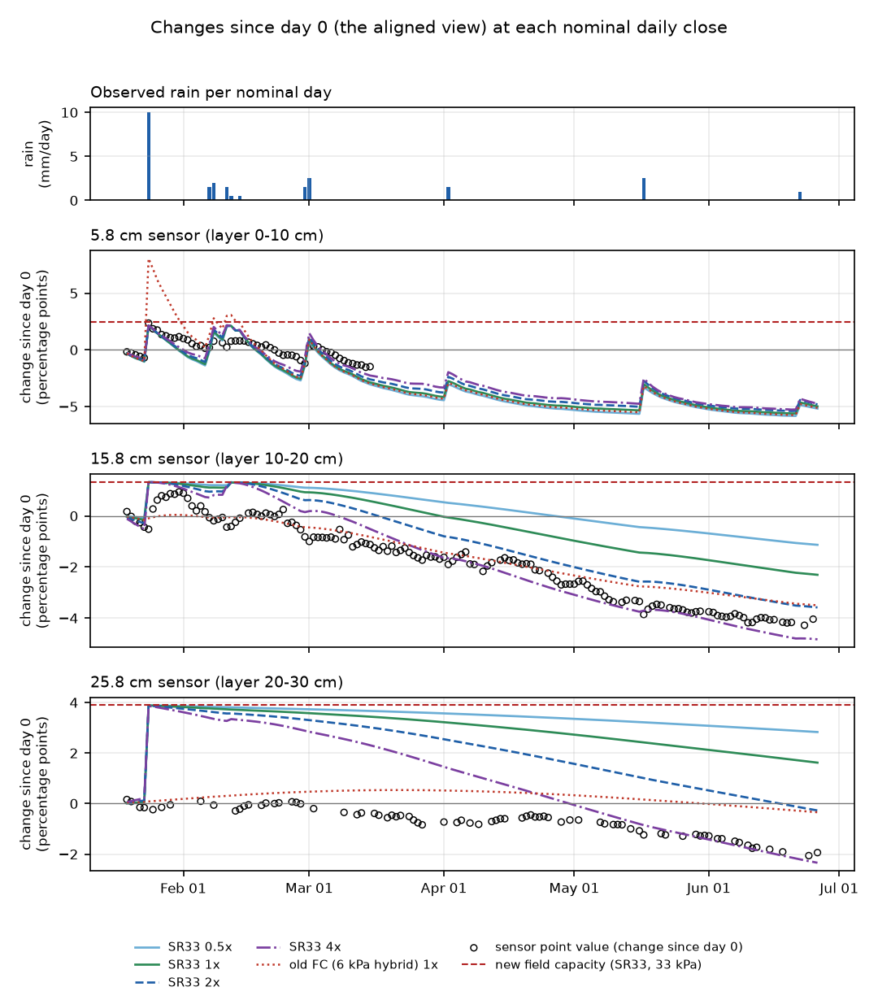

# A new field-capacity default (Saxton-Rawls 33 kPa) and a conductivity sensitivity: JORN, January-June 2024

*The frozen 160-day JORN column re-run with the NEW package default field capacity (about 10 vol. %, replacing about 39.8 vol. %) at all-K/Ks multipliers 0.5, 1, 2 and 4. Only these two things changed. This is a sensitivity of the native SYRUP column, not a recalibration.*

## 1. Summary

- **The new field capacity removes the old over-wetting of the surface but the fit as a whole is worse.** Pooled aligned RMSE against 282 sensor values (percentage points) is 2.750, 2.273, 1.671 and 1.200 for 0.5x, 1x, 2x and 4x, against 1.049 for the old field capacity at 1x (the no-change reference is 1.799). The best new setting (4x) is 14% worse than old FC 1x, and none of the new settings beats it. The old diffusion coefficient d and evaporation stress were fitted under the OLD field capacity; the comparison therefore shows what happens when only the retention changes, not what a re-fitted model would do.
- **Water now moves through the soil during storms.** All 25.088 mm of rain still infiltrates (peak 10.034 mm/h is below the lowest matrix K, 19.1 mm/h), with no runoff. But the new field capacity is below the water content reached in the storm, so the above-field-capacity gravity step carries 6.77 mm across the upper interface and 5.11 mm across the lower one at 1x (upper 6.64-7.40 mm, lower 5.04-5.14 mm across the settings; these are separate internal pathway counts that can include the same water, so they are not added to each other or to losses), and 1.26-1.29 mm leaves through the open bottom. Under the old field capacity nothing moved by gravity and nothing drained.
- **The January 23 surface pulse is now close to the sensor.** The 0-10 cm layer rises 3.14 points at 1x (2.96-3.18 across the settings) against 3.06 at the 5.8 cm sensor; the old field capacity gave 9.06. The shallow sensor is also fitted better than no change at 4x (0.747 vs 0.881), the only shallow setting in any of these runs to do so. Because the above-field-capacity cascade is not rate-limited (see Section 3), this agreement is consistent with reduced surface over-retention under the new field capacity. It does not show that 33 kPa is the actual field capacity of this soil, or that the transfer is correct.
- **The deep layer is now too wet and the middle layer overshoots.** The model deep layer reaches 10.9 vol. % (its field capacity) at the January storm close, while the deep sensor never exceeds 6.74 vol. % in the record; deep aligned RMSE is 2.01-4.07 against 1.05 for old FC 1x. The 72 h middle-layer response is 1.47 points (observed 1.06); old FC gave 0.14.
- **Within the SR33 runs, faster exchange lowers the error and costs water.** Evaporation rises with K (27.3, 29.5, 32.5, 35.8 mm vs 34.0 mm old); final storage falls (19.5 to 11.0 mm vs 14.0). K and d act together in the Tietjen exchange, so they cannot be separated here. The lowest error at 4x is the edge of the tested range, so no best K is implied, and nothing here is a calibration, a default change or a field validation.

## 2. What was run

The baseline is the frozen JORN run of the earlier report [7]: one 1 m² column of three 10 cm layers with an open bottom, daily weather with the observed storm sub-steps, NEON rain [5], Hargreaves-Samani evaporation demand [3] from NEON air temperature [6], initial water from the NEON soil sensors [4], matrix-only infiltration, no plants, transpiration, preferential flow, routing, wind or sediment (surface water is exported with zero residence). Only two things differ from it: the field capacities and the ten conductivity entries (the three layer Ks records in mm/h and m/s, the top matrix Ks and K, and both interface K), each multiplied once by the factor relative to the original (powers of two, exact in binary arithmetic). The configuration check shows nothing else differs apart from the source pin, the name and added provenance text.

**Field capacity.** The new values come from the current provider's default method [2] (the water content at 33 kPa, density-adjusted), using the measured sand, silt and clay of the 2013 Jornada megapit [8] (a spatial proxy for the 2024 plot 004 sensors, not demonstrably co-located), the three approved effective densities and this study's explicit air-entry override of 0. They are 9.75, 9.94 and 10.91 vol. %, versus 39.76, 39.87 and 39.51 vol. % in the old hybrid 6 kPa construction (Table 1). Saturation, wilting point and Ks are identical to the old run; the field-capacity audit already found no arithmetic error in either construction. The 6 kPa convention follows Tietjen et al. [1]; whether 33 kPa is appropriate for this desert sand is a separate question this report does not settle.

**Table 1a. Soil inputs per layer (2013 megapit texture and organic matter; bulk density as approved for the earlier runs). Unchanged from the earlier runs.**

| Layer | Sand / silt / clay (%) | Organic matter (%) | Raw bulk density (g/cm³) | Effective bulk density used (g/cm³) |
|---|---|---|---|---|
| 0-10 cm (A) | 86.7 / 6.2 / 7.1 | 0.34 | 1.420 | 1.420 |
| 10-20 cm (A+Bw mix) | 86.3 / 6.4 / 7.3 | 0.32 | 1.316 | 1.417 |
| 20-30 cm (Bw) | 83.7 / 7.9 / 8.4 | 0.17 | 0.903 | 1.435 |

**Table 1b. Retention properties. Saturation, wilting point and Ks are unchanged; only the field-capacity columns differ (new 33 kPa value against the old 6 kPa hybrid).**

| Layer | Saturation (vol. %) | Wilting point (vol. %) | NEW field capacity, 33 kPa (vol. %) | OLD field capacity, 6 kPa hybrid (vol. %) | Ks, 1x (mm/h) |
|---|---|---|---|---|---|
| 0-10 cm (A) | 46.43 | 3.95 | 9.75 | 39.76 | 120.8 |
| 10-20 cm (A+Bw mix) | 46.52 | 4.04 | 9.94 | 39.87 | 119.7 |
| 20-30 cm (Bw) | 45.86 | 4.63 | 10.91 | 39.51 | 104.3 |

**Table 2. Conductivities by multiplier. The Ks records are the (user-perturbed) source estimates; the matrix K and the two interface K are the direct inputs of the run.**

| Conductivity (mm/h) | SR33 0.5x | SR33 1x | SR33 2x | SR33 4x |
|---|---|---|---|---|
| Matrix K, top layer (direct input) | 19.1 | 38.2 | 76.4 | 152.8 |
| Interface K, 0-10 / 10-20 cm | 19.0 | 38.0 | 76.1 | 152.2 |
| Interface K, 10-20 / 20-30 cm | 17.6 | 35.3 | 70.5 | 141.1 |
| Ks record, layer 0-10 cm | 60.4 | 120.8 | 241.6 | 483.1 |
| Ks record, layer 10-20 cm | 59.9 | 119.7 | 239.4 | 478.8 |
| Ks record, layer 20-30 cm | 52.2 | 104.3 | 208.7 | 417.3 |

**Table 3. What is held fixed. The evaporation stress threshold and d were fitted under the old field capacity and are NOT re-fitted.**

| Fixed in every run | Value |
|---|---|
| Residual water content / evaporation stress threshold | 1 vol. % / 20.171 vol. % (fitted earlier under the OLD field capacity) |
| Tietjen diffusion coefficient d (dimensionless) / evaporation factor | 0.0010239461 / 1 |
| Matrix suction / local conductivity factor | 166 mm (unmeasured reference) / 0.316357 |
| Layers, bottom, gravity | three 10 cm layers, 1 m², open bottom, gravity drainage on |
| Initial storage (all runs) | 22.9424 mm; layer means 7.30, 8.62, 7.02 vol. %; sensor points 7.11, 9.21, 6.58 vol. % |
| Forcing | NEON rain 25.088 mm (peak 10.034 mm/h; 26 half-hour rows with rain on 11 days), Hargreaves PET 1.26-9.37 mm/day (sum 777.3 mm), 160 nominal days from 2024-01-18 07:00 UTC |
| Excluded | transpiration, growth, preferential flow, routing, sediment; surface water exported with zero residence |

**Clock.** As in the earlier runs this is a daily-weather approximation: one 86,400 s inter-event step per nominal day plus the observed storm sub-steps (27.5 added hours, so the physical clock ends at 161.146 days against 160 nominal days, final nominal close 2024-06-26 07:00 UTC). Evaporation and transpiration are off during rain. It is not an exact hourly field chronology. Sensor values after day 0 never drive the model; 282 sensor values (56, 147 and 79 at 5.8, 15.8 and 25.8 cm) are used for scoring, with gaps left as gaps.

## 3. Water: what the new field capacity changes

**Table 4. Event response and water pathways. Old FC 1x is the earlier run; the four SR33 columns are the new runs. The two interface rows are separate internal pathway counts of the gravity step and can include the same water: do not add them to each other or to evaporation, drainage or storage.**

| Quantity | old FC 1x | SR33 0.5x | SR33 1x | SR33 2x | SR33 4x |
|---|---|---|---|---|---|
| Rain = intake (mm) | 25.088 | 25.088 | 25.088 | 25.088 | 25.088 |
| Runoff / ponding (mm) | 0 | 0 | 0 | 0 | 0 |
| Water crossing the upper interface (0-10 to 10-20 cm) by the gravity step (mm) | 0.00 | 6.64 | 6.77 | 7.01 | 7.40 |
| Water crossing the lower interface (10-20 to 20-30 cm) by the gravity step (mm) | 0.00 | 5.14 | 5.11 | 5.06 | 5.04 |
| Bottom drainage (mm) | 0.000 | 1.286 | 1.282 | 1.274 | 1.259 |
| Net diffusive exchange, top-to-middle, upward (mm) | 3.84 | 3.65 | 6.18 | 9.59 | 13.32 |
| Net diffusive exchange, middle-to-deep, upward (mm) | 0.34 | 1.03 | 2.21 | 4.06 | 6.13 |
| Evaporation (mm) | 34.045 | 27.277 | 29.473 | 32.477 | 35.754 |
| Final storage (mm; initial 22.9424) | 13.985 | 19.467 | 17.275 | 14.280 | 11.017 |
| Highest daily-close value, top / middle / deep (vol. %) | 15.35 / 8.67 / 7.56 | 9.43 / 9.94 / 10.91 | 9.44 / 9.94 / 10.91 | 9.46 / 9.95 / 10.90 | 9.46 / 9.95 / 10.88 |
| Top-layer rise at the Jan 23 storm close (points) | 9.06 | 3.18 | 3.14 | 3.07 | 2.96 |
| Middle layer, 72 h change (points) | 0.14 | 1.39 | 1.47 | 1.60 | 1.82 |
| Deep layer, peak gain (mm) | 0.54 | 3.89 | 3.88 | 3.87 | 3.86 |
| Model end state 2024-06-26 07:00 UTC, top / middle / deep (vol. %); no observation implied | 2.18 / 5.13 / 6.68 | 2.12 / 7.49 / 9.85 | 2.31 / 6.32 / 8.64 | 2.49 / 5.04 / 6.75 | 2.54 / 3.79 / 4.68 |

Rain is below the matrix K in every case, so the multipliers and the field-capacity change cannot alter how much rain enters. What changes is where it goes. In the old run the top layer kept the storm water (it rose to 15.3 vol. % against a field capacity of 39.8) and returned it slowly by diffusion. With a field capacity near 10 vol. %, a layer wetted past that value passes the excess down at once: 100.0% of the interface-1 transfer happens on rain days, and the deep layer is filled to its own field capacity (10.91 vol. % against 10.91) and then spills 1.28 mm out of the bottom. This above-field-capacity step is not rate-limited by any conductivity (the Saxton-Rawls Ku is not used in the current bucket), so the SR33 K multiplier changes it only slightly (upper-interface count 6.64 to 7.40 mm, lower 5.14 to 5.04 mm; these two counts can include the same water). Between storms the layers below field capacity exchange by the Tietjen gradient exchange, upward net (top-middle 3.7 to 13.3 mm), which feeds evaporation more at large K. Highest daily-close values stay close to the new field capacity (9.44, 9.94 and 10.91 vol. % at 1x, against 9.75, 9.94 and 10.91), because excess is passed down during the storm step.

## 4. Comparison with the sensors

Two scorings are used. **RAW** compares model layer means directly with sensor point values. **Aligned** subtracts one constant day-0 offset per depth (+0.19, -0.59 and +0.44 points at 5.8, 15.8 and 25.8 cm) because a 10 cm layer mean is not a point reading; the offsets are the same in every run and model water is never altered by the alignment. All runs start from the same 22.9424 mm. Pooled scores weight every value equally, so the middle sensor (n = 147) dominates.

**Table 5a. ALIGNED RMSE in percentage points (100 x m³/m³) by depth (n = number of sensor values) and pooled. No change = holding the day-0 sensor value. Old FC 2x and 4x are the earlier all-K/Ks runs, shown so K can be compared at matched settings.**

| Setting | 5.8 cm (n = 56) | 15.8 cm (n = 147) | 25.8 cm (n = 79) | All pooled (n = 282) |
|---|---|---|---|---|
| old FC 1x | 1.817 | 0.506 | 1.054 | 1.049 |
| SR33 0.5x | 1.061 | 2.272 | 4.074 | 2.750 |
| SR33 1x | 0.993 | 1.635 | 3.574 | 2.273 |
| SR33 2x | 0.884 | 0.950 | 2.781 | 1.671 |
| SR33 4x | 0.747 | 0.613 | 2.011 | 1.200 |
| old FC 2x | 1.752 | 0.351 | 0.798 | 0.923 |
| old FC 4x | 1.640 | 0.730 | 0.799 | 0.995 |
| No change (day-0 sensor value held) | 0.881 | 2.343 | 0.886 | 1.799 |

**Table 5b. RAW RMSE in percentage points, same rows and columns.**

| Setting | 5.8 cm (n = 56) | 15.8 cm (n = 147) | 25.8 cm (n = 79) | All pooled (n = 282) |
|---|---|---|---|---|
| old FC 1x | 1.865 | 0.534 | 1.469 | 1.202 |
| SR33 0.5x | 0.956 | 1.743 | 4.506 | 2.730 |
| SR33 1x | 0.897 | 1.095 | 4.005 | 2.298 |
| SR33 2x | 0.806 | 0.463 | 3.203 | 1.765 |
| SR33 4x | 0.707 | 0.737 | 2.355 | 1.391 |
| old FC 2x | 1.802 | 0.838 | 1.216 | 1.194 |
| old FC 4x | 1.695 | 1.265 | 1.029 | 1.304 |
| No change (day-0 sensor value held) | 0.881 | 2.343 | 0.886 | 1.799 |

**Table 6a. RAW bias (model minus sensor, percentage points) by depth and pooled.**

| RAW bias, model minus sensor (percentage points) | 5.8 cm (n = 56) | 15.8 cm (n = 147) | 25.8 cm (n = 79) | All pooled (n = 282) |
|---|---|---|---|---|
| old FC 1x | +0.57 | -0.32 | +1.40 | +0.34 |
| SR33 0.5x | -0.48 | +1.52 | +4.41 | +1.93 |
| SR33 1x | -0.40 | +0.97 | +3.92 | +1.52 |
| SR33 2x | -0.26 | +0.29 | +3.07 | +0.96 |
| SR33 4x | -0.06 | -0.43 | +1.92 | +0.30 |

**Table 6b. Last valid sensor value at each depth, paired with each SR33 run at the SAME close. The shallow sensor has no value after the 2024-03-15 close and the middle sensor none at the 2024-06-26 close; no model-end value is compared with these.**

| Sensor | Last valid sensor close (UTC) | Observed (vol. %) | SR33 0.5x at that close (vol. %) | SR33 1x at that close (vol. %) | SR33 2x at that close (vol. %) | SR33 4x at that close (vol. %) |
|---|---|---|---|---|---|---|
| 5.8 cm sensor | 2024-03-15 07:00 UTC | 5.63 | 4.25 | 4.43 | 4.69 | 5.03 |
| 15.8 cm sensor | 2024-06-25 07:00 UTC | 5.17 | 7.51 | 6.34 | 5.06 | 3.81 |
| 25.8 cm sensor | 2024-06-26 07:00 UTC | 4.64 | 9.85 | 8.64 | 6.75 | 4.68 |

Depth by depth the answer differs. **Shallow:** every SR33 setting from 0.5x to 2x is worse than no change (1.061, 0.993, 0.884 vs 0.881); 4x is better (0.747), whereas the old field capacity gave 1.82. The shallow layer is therefore the clear gain, produced by removing the storm over-wetting. **Middle:** best at 4x (0.613), against 0.506 for old FC 1x and 2.34 for no change; at 0.5x it is 2.27. **Deep:** every SR33 setting is worse than no change (2.01 to 4.07 vs 0.89) and than old FC 1x (1.05). The deep RAW bias is +1.92 to +4.41 points, and it is the dominant reason the pooled score stays above old FC 1x. The model deep layer is filled at the January storm, whereas the sensor stays below 6.7 vol. %. The deep sensor has no value at the January 23 close (a gap, not zero). At the last deep sensor value (the final close, 2024-06-26 07:00 UTC) the model deep layer is 4.68 vol. % at 4x against a sensor of 4.64, but 9.85 at 0.5x.

Around the storm (Figure 3) the shallow rise is 3.18, 3.14, 3.07 and 2.96 points against 3.06 observed (old FC: 9.06), and the 72 h middle-layer change is 1.39, 1.47, 1.60 and 1.82 points against 1.06 observed (old FC: 0.14): the middle layer now overshoots at every setting, where old FC undershot. There is no shallow or middle sensor value at the final close (June 26). Compared at the same time, the last valid shallow value (2024-03-15) is 5.63 vol. % against 4.43 for SR33 1x, and the last valid middle value (2024-06-25) is 5.17 against 6.34 (Table 6b). The fast, instantaneous above-field-capacity cascade is not qualified and sends rain deeper on short timescales than the sensors suggest; omitted transpiration, the old-field-capacity-conditional d and evaporation stress, and soil and probe support that are not co-located (a 10 cm layer mean against a point sensor) may also contribute to the remaining discrepancies. These are untested explanations; none was tested or adopted here.

**Table 7a. Old versus new field capacity at matched K: pooled RMSE in percentage points (n = 282). Only the field capacity differs within each row.**

| K multiplier | Aligned RMSE, old FC | Aligned RMSE, SR33 | RAW RMSE, old FC | RAW RMSE, SR33 |
|---|---|---|---|---|
| 1x | 1.049 | 2.273 | 1.202 | 2.298 |
| 2x | 0.923 | 1.671 | 1.194 | 1.765 |
| 4x | 0.995 | 1.200 | 1.304 | 1.391 |

**Table 7b. Old versus new field capacity at matched K: water budget terms (mm).**

| K multiplier | Evaporation, old FC (mm) | Evaporation, SR33 (mm) | Bottom drainage, SR33 (mm) | Final storage, old FC (mm) | Final storage, SR33 (mm) |
|---|---|---|---|---|---|
| 1x | 34.05 | 29.47 | 1.28 (old: 0) | 13.98 | 17.27 |
| 2x | 35.83 | 32.48 | 1.27 (old: 0) | 12.20 | 14.28 |
| 4x | 37.96 | 35.75 | 1.26 (old: 0) | 10.07 | 11.02 |

![Figure 4. (a) Pooled RMSE by setting (dark = aligned, lighter = RAW; hatched = old field capacity; dotted line = pooled no-change reference). (b) Aligned RMSE by depth; dotted lines are the per-depth no-change values. (c) Water pathways in mm over 160 days, shown side by side and not stacked: evaporation, the gravity step across the upper and the lower interface separately (internal counts that can include the same water; they are not losses and must not be added), and bottom drainage. Categories are equally spaced settings, not a continuous fit.](figures/fig4_scores_and_budgets.png)

## 5. Verification and run time

- Before consuming any result I re-hashed all 120 files of Root's seal and checked them again afterwards. From the daily rows of all runs I recomputed the per-depth and pooled RAW, aligned and no-change RMSE and counts, the water budgets, the Jan 23 responses, the zero runoff/ponding/onset/room-rejection checks (bottom drainage is positive and accounted), NumPy = Numba row equality, the 900 s differences and the source pins, and compared the sensor values with Root's independent raw-file audit; all agree with Root's audit (relative 1e-9).
- NumPy and Numba results are exactly identical in every tracked output at all four settings (maximum difference 0). A 900 s storm step changes layer water by at most 0.00072 percentage points. Root's independent 90-digit calculation (open gravity cascade, evaporation and pair relaxation; it does not call the production update) agrees to 1.5e-17 m or better, and the native conservation bounds pass.
- Source packages SYRUP 180 files (4e38a472...) and MAPLE 412 files (fbc504bb...) are exact before and after every run. The first k0p5 launch failed before any import because the runner's bootstrap file was missing beside its config; no model step ran, and the successful launch record used here is actual_numba_runs_v2.
- Restart: Root's day-80 split and fresh-process resume of the 1x case reproduces every tracked output exactly. This is a driver-level component state reconstruction, not a production checkpoint or coupled-model acceptance. No GPU, scaling or field validation is claimed.

**Table 8a. Timing, separated. Separate fresh runs on a shared host with other jobs: not a controlled speed comparison.**

| Run | Integration (s) | Operator prep + JIT (s) | Source checks + input prep (s) | Full fresh command (s) |
|---|---|---|---|---|
| SR33 0.5x | 0.0414 | 4.59 | 1.13 | 7.26 |
| SR33 1x | 0.0378 | 4.40 | 1.06 | 7.00 |
| SR33 2x | 0.0411 | 4.70 | 1.12 | 7.38 |
| SR33 4x | 0.0392 | 4.43 | 1.06 | 7.01 |

**Table 8b. Verification per run: closure, 900 s step, 90-digit control and NumPy/Numba comparison.**

| Run | Closure residual / native bound (m³) | 900 s step: max change (percentage points) | 90-digit check: max error (m) | NumPy vs Numba max difference |
|---|---|---|---|---|
| SR33 0.5x | 1.7e-17 / 2.50e-13 | 0.00015 | 1.5e-17 | 0 (exact) |
| SR33 1x | 2.4e-17 / 2.50e-13 | 0.00023 | 1.1e-17 | 0 (exact) |
| SR33 2x | 2.4e-17 / 2.59e-13 | 0.00040 | 7.2e-18 | 0 (exact) |
| SR33 4x | 1.2e-17 / 2.85e-13 | 0.00072 | 7.5e-18 | 0 (exact) |

Integration takes about 0.04 s in each run. The fresh-process time (about 7 s) is dominated by one-time source verification, input preparation and compilation and says nothing about solver speed or the effect of K. One 1 m² CPU column: no scaling claim.

## 6. Limits

- This is a prescribed sensitivity: no calibration, default change, adoption of the K multiplier or claim that the new field capacity improves the fit. The evaporation stress and d are conditional on the old field capacity; K and d are confounded; the lowest SR33 error is at the edge of the tested range (4x).
- The above-field-capacity gravity cascade is not rate-limited by any conductivity; how much water it passes down, and therefore the deep-layer wetting and bottom drainage, depends on the current water content, the rain inputs and the boundaries as well as on field capacity; K and d change those inventories only indirectly. The Saxton-Rawls Ku is not used.
- Point sensors against 10 cm layer means, a daily clock, a thin open-bottom 30 cm column, no transpiration, no preferential flow, and the 030 vs 020 air-temperature height difference inherited from the original run. No significance test is made.

- Persistent Green-Ampt wetting history has no automatic reset or drying recovery, and no general repeated-storm infiltration qualification exists. Here all rain is unponded and below the matrix K, so wetting history does not control actual intake in these runs.

## References

[1] Tietjen, B., Zehe, E., & Jeltsch, F. (2009). Simulating plant water availability in dry lands under climate change: a generic model of two soil layers. Water Resources Research 45, W01418. https://doi.org/10.1029/2007WR006589
[2] Saxton, K. E., & Rawls, W. J. (2006). Soil water characteristic estimates by texture and organic matter for hydrologic solutions. Soil Science Society of America Journal 70, 1569-1578. https://doi.org/10.2136/sssaj2005.0117
[3] Hargreaves, G. H., & Samani, Z. A. (1985). Reference crop evapotranspiration from temperature. Applied Engineering in Agriculture 1, 96-99. https://doi.org/10.13031/2013.26773
[4] NEON (RELEASE-2026). Soil water content and water salinity, DP1.00094.001 (Jornada, JORN, plot 004, sensors 501-503). https://data.neonscience.org/data-products/DP1.00094.001/RELEASE-2026
[5] NEON (RELEASE-2026). Precipitation, DP1.00045.001. https://data.neonscience.org/data-products/DP1.00045.001/RELEASE-2026
[6] NEON (RELEASE-2026). Single aspirated air temperature, DP1.00002.001. https://data.neonscience.org/data-products/DP1.00002.001/RELEASE-2026
[8] NEON (RELEASE-2026). Soil physical and chemical properties, Megapit, DP1.00096.001 (Jornada, 2013-03 pit 1: perbiogeosample, perhorizon and perbulksample tables; primary texture, organic carbon and bulk density as used in the field-capacity audit of 2026-11-20). https://data.neonscience.org/data-products/DP1.00096.001/RELEASE-2026
[7] Earlier reports of this study, by file name only: SYRUP_JORN_160day_rainfall_comparison_20261119.docx (original run, old field capacity), SYRUP_JORN_160day_K_Ks_multipliers_2x_3x_4x_20261120.docx and SYRUP_JORN_field_capacity_worked_audit_20261120.docx.

## Appendix. Identity (compact)

Sources: SYRUP package 180 files, SHA-256 4e38a472e268a56491b788d5b1271cc3c3da23bb1cc3221a8c59d90f3cc864d2; MAPLE package 412 files, SHA-256 fbc504bbcd1ec0c02e6a96089134a06187532455ef7ba5e6f146801c8313c02e. Case-file hashes: SR33 0.5x 1c27e71312bce8f8...; SR33 1x f024054f5198ec83...; SR33 2x 31affd0fdeb5ef4a...; SR33 4x f303fee5cfadd641.... Full hashes of every sealed file, the daily trajectories of all runs and the parameter differences are in tables/provenance_seal.csv, tables/case_hashes.csv, tables/parameter_diff_vs_original.csv and tables/daily_trajectories.csv. Raw NEON files are not copied.
