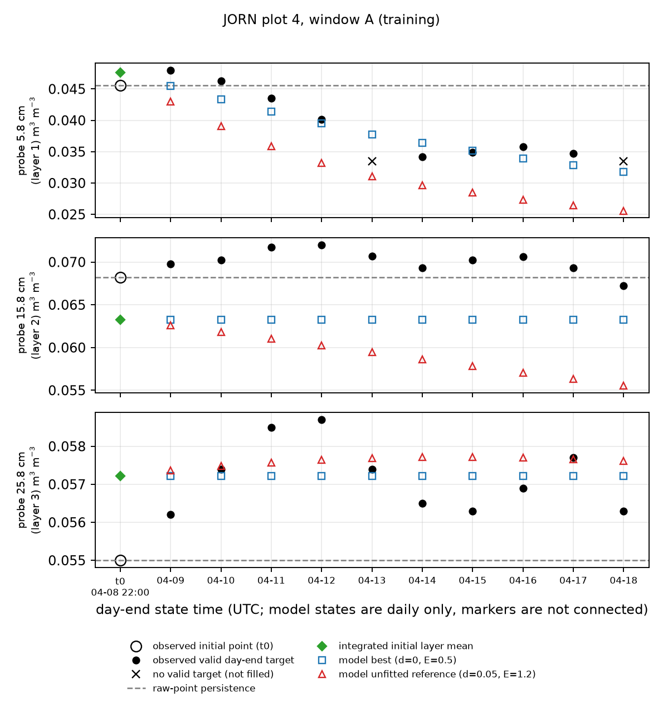
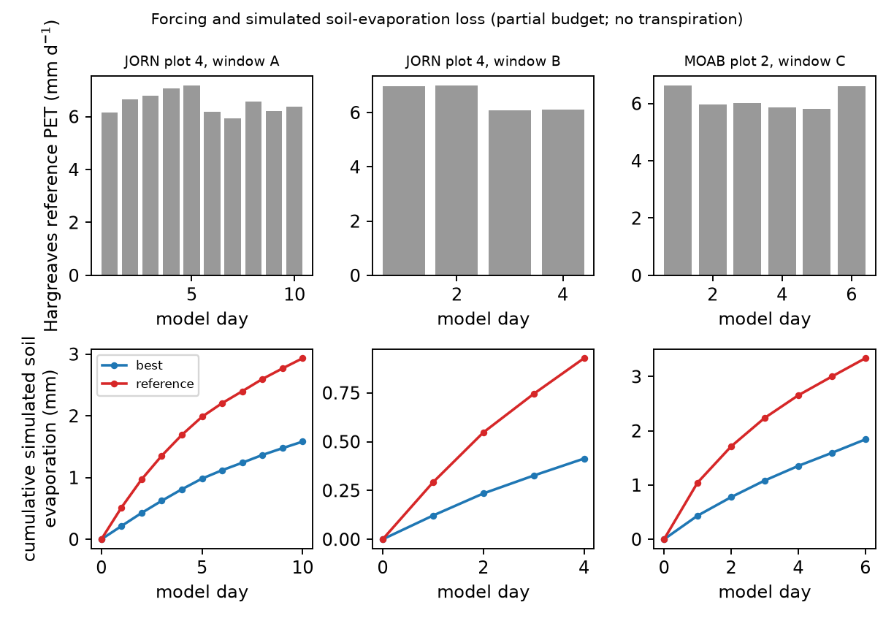
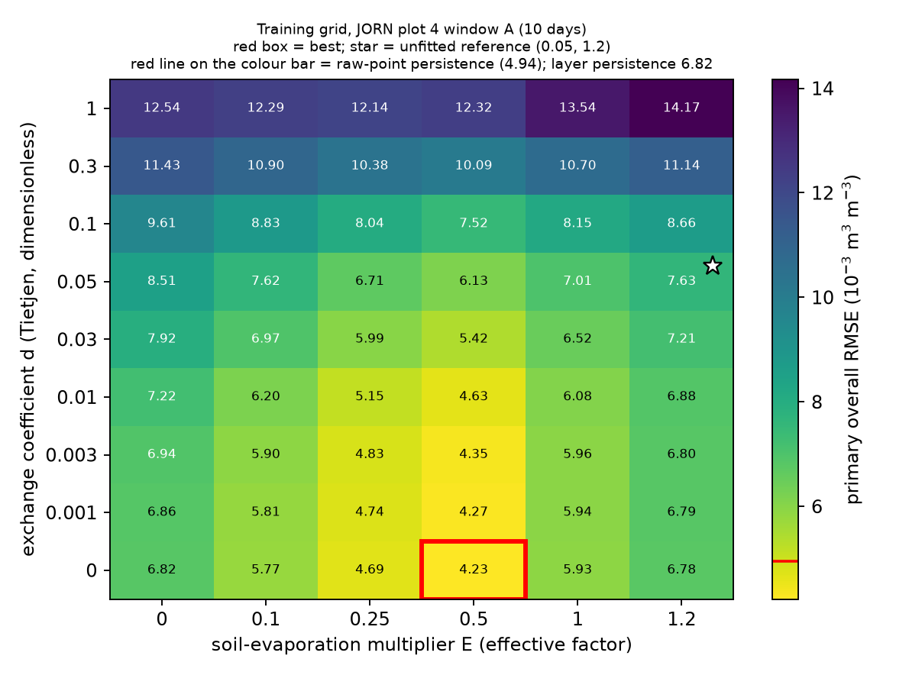
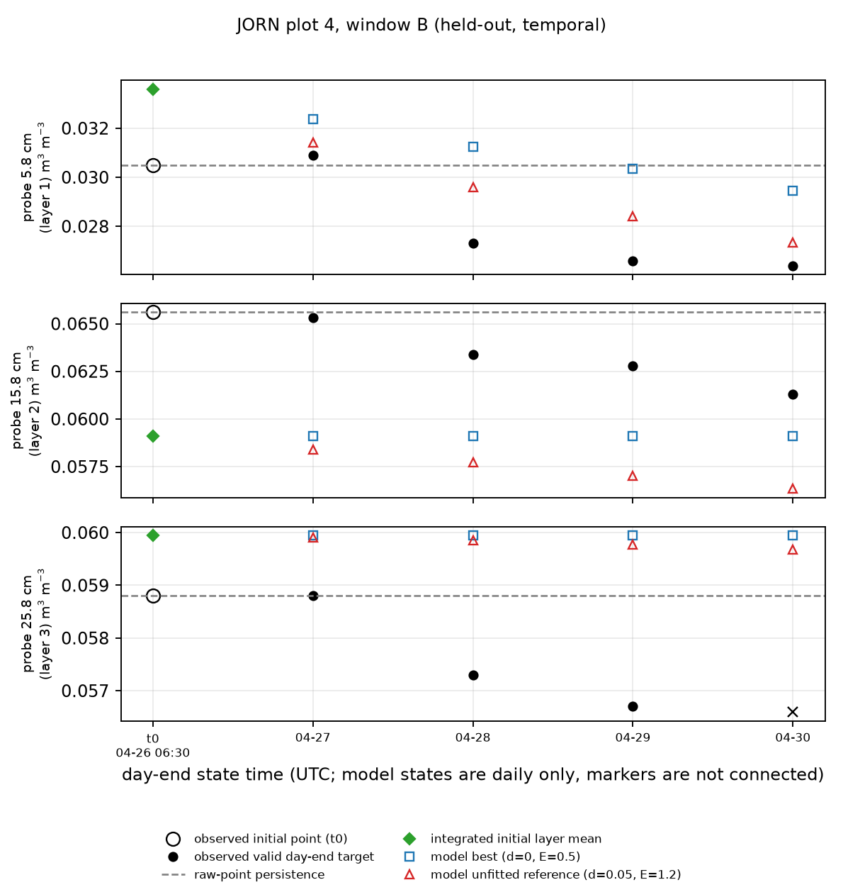
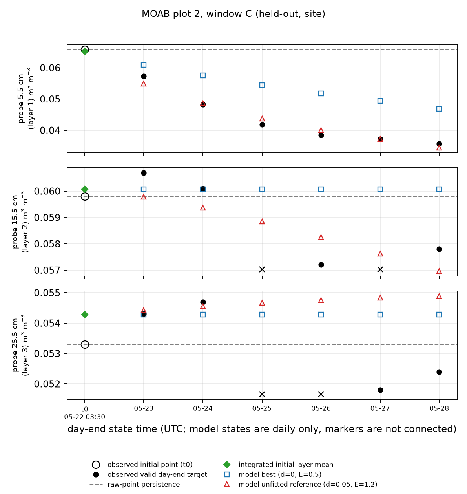

# Observed shallow-profile dry-down with the SYRUP layered soil column: a generic reference-soil mechanism diagnostic

*JORN and MOAB, NEON RELEASE-2026 observations; three 10 cm layers; daily end-state comparison. Results report generated 2026-11-14 from sealed result files.*

> STATUS. Actual CPU results (NumPy and Numba, native SYRUP column) are analysed here. The CUDA / GPU observed-profile qualification is PENDING and is NOT claimed: Root's pre-launch guard refused GPU0 (busy) and no GPU process ran. This report reads the evidence folder and will be rebuilt when a genuine GPU completion record is supplied.
>
> SCOPE. A generic, user-approved reference soil with observed initial moisture and observed air temperature. This is a mechanism diagnostic, not a site hydraulic validation, not a calibration of a physical diffusivity, and not a field evapotranspiration budget.
>

## 1. Executive summary

Three actual daily dry-down windows with no rain were simulated with the native SYRUP fixed-layer column. The reference soil (residual 0.01, evaporation stress 0.18, field capacity = saturation = 0.26, Ks 6.9 mm/h) is the generic EcoHyD example soil, not a property of the sites. Two free quantities were explored on a grid that was frozen before any run: the exchange coefficient d (9 values) and a soil-evaporation multiplier E (6 values). Only window A of JORN plot 4 was used for the selection (training); the selected pair was then applied without refitting to two other windows. Scores use the primary overall RMSE, the square root of the mean of the three per-layer mean squared errors, against observed day-end soil moisture.

**Table 1. Primary overall RMSE (10^-3 m3 m-3) of the training-selected pair (d = 0, E = 0.5) against the two persistence nulls.**

| Window | Valid targets (501/502/503; joint) | Best-pair RMSE | Raw-point persistence RMSE | Layer-mean persistence RMSE | Beats raw-point persistence? |
|---|---|---|---|---|---|
| JORN plot 4, window A (training) | 8/10/10; 8 | 4.226 | 4.944 | 6.822 | yes |
| JORN plot 4, window B (held-out, temporal) | 4/4/3; 3 | 3.437 | 2.623 | 4.549 | no |
| MOAB plot 2, window C (held-out, site) | 6/4/4; 3 | 6.427 | 13.907 | 13.588 | yes |

* Training (JORN 4, A, 10 days): the best pair on the grid is d = 0, E = 0.5 (RMSE 4.226), better than raw-point persistence (4.944; MSE skill 0.27) and much better than the integrated layer-mean persistence (6.822; skill 0.62). The selection is d = 0: on these 10 days, adding interlayer exchange made the fit worse at every E. That is not evidence that the soil has zero physical diffusivity.
* Held-out JORN 4, B (4 days, 3 joint targets): the training pair (RMSE 3.437) does NOT beat raw-point persistence (2.623); it does beat layer-mean persistence (4.549). The unfitted reference pair scores 3.768.
* Held-out MOAB 2, C (6 days, different site, 3 joint targets): the training pair (6.427) beats raw-point persistence (13.907), and the unfitted reference pair is better still (1.520). The reference pair changes both d and E relative to the training pair and the held-out protocol has no matched control that changes only one of them, so the MOAB improvement cannot be attributed to exchange alone (Section 6).
* No significance tests, no field-property inference and no physical calibration are claimed. Open and closed bottom boundaries gave identical results because no water ever exceeded field capacity (Section 7).

## 2. Observations and experimental design

Observed data are the frozen NEON RELEASE-2026 products: soil water content and water salinity (DP1.00094.001, 30-minute means, plots 4 at JORN and 2 at MOAB), tipping-bucket precipitation (used only to select rain-free windows and to confirm that every forcing half-hour is rain-free), and single-aspirated air temperature (DP1.00002.001) at the level nearest 2 m (1.51 m at JORN, 1.95 m at MOAB; chosen before any outcome). Soil-moisture depths are taken from the corrected NEON depth table (JORN plot 4: 5.8, 15.8, 25.8 cm; MOAB plot 2: 5.5, 15.5, 25.5 cm), not from the shifted sensor-position file shipped with the release. The three probes sit in the model layers 0-10, 10-20 and 20-30 cm. They are point measurements; the model layers are layer averages (a stated representativeness difference). NEON announced on 2026-11-09 that a reprocessed RELEASE-2027 with revised depths, calibration and quality control is expected in January 2027; that is an announcement, not data used here, and any later release will be a separate analysis.

A window is a run of rain-free, quality-passing half-hours of at least 120 h; the first 72 h are excluded. The initial state is the first genuinely simultaneous passing three-probe observation whose 30-minute interval ends strictly after the exclusion; its end time is t0, and the model advances in whole 86 400 s steps from t0. Observations are compared only where a passing observation interval ENDS at exactly the model day-end time; a missing or failing target is left empty (never interpolated or filled). The model states are instantaneous end-of-day states and the observations are 30-minute means ending at those instants; no sub-daily trajectory is modelled or drawn.

**Table 2. Windows. The modelled days are the consecutive whole days from t0 whose 24 h air-temperature window is complete; the whole rain-free suffix after the first incomplete day (listed in the text) is excluded, without skipping or filling.**

| Window | t0 (UTC) | Modelled days | Rain-free days available | Initial point theta 501/502/503 | Integrated initial layer theta 1/2/3 |
|---|---|---|---|---|---|
| JORN plot 4, window A (training) | 2025-04-08 22:00 | 10 | 13 | 0.0456/0.0682/0.0550 | 0.0476/0.0632/0.0572 |
| JORN plot 4, window B (held-out, temporal) | 2025-04-26 06:30 | 4 | 4 | 0.0305/0.0656/0.0588 | 0.0336/0.0591/0.0599 |
| MOAB plot 2, window C (held-out, site) | 2025-05-22 03:30 | 6 | 9 | 0.0659/0.0598/0.0533 | 0.0653/0.0601/0.0543 |

Excluded time. JORN plot 4, window A: the first incomplete forcing day is day 11, 2025-04-18 22:00 to 2025-04-19 22:00 UTC (1 of 48 records fail QA); the 3 remaining whole rain-free days (days 11 to 13, beginning with that incomplete day) and any partial tail are not modelled; JORN plot 4, window B: no incomplete forcing day; the rain-free run is 4 days and ends at the end of the month file (censored at the month end, so later days are unknown); MOAB plot 2, window C: the first incomplete forcing day is day 7, 2025-05-28 03:30 to 2025-05-29 03:30 UTC (3 of 48 records fail QA); the 3 remaining whole rain-free days (days 7 to 9, beginning with that incomplete day) and any partial tail are not modelled. No day was skipped over to reach later complete days, and no missing record was filled.

The initial layer water is the exact integral of the piecewise-linear profile through the three observed point values at their actual depths, with constant extension above the shallowest and below the deepest probe, so the integrated layer mean differs from the raw point values. Both are shown as persistence nulls: the raw point values held constant (the natural null for a point sensor) and the integrated layer means held constant (the null for the layer state the model starts from).

*Figure 1. JORN 4 window A (training): observed day-end targets, the training-selected model, the unfitted reference and raw-point persistence for the three probe layers.*

## 3. Model, reference soil and forcing

The model is the existing SYRUP fixed-layer column (maple_syrup.subsurface), unchanged. Layer i has thickness dz_i (0.1 m here) and stores the water inventory W_i = theta_i x dz_i (metres of water, equivalently m3 per m2 of ground), so theta_i = W_i/dz_i. One daily step (dt = 86 400 s, one cell of 1 m2, no added water) applies in this order: (i) gravity drainage of water above field capacity (open bottom primary, closed as sensitivity); (ii) soil evaporation from the top layer: with PET_m_s = PET_mm_day / (1000 x 86 400) the potential rate in m/s, the demand over the step is demand_m = E x PET_m_s x m(theta_1) x dt (for one day, E x (PET_mm_day / 1000) x m(theta_1) metres), capped by the top-layer water above the residual; here m = 0 at or below the residual, m = (theta_1/theta*)^2 between the residual and the stress threshold theta* = 0.18, and m = 1 above; (iii) sequential, top-down, pair-wise diffusive exchange between neighbouring layers i and j (Tietjen et al. donor-depth form).

Exchange coefficient and pair update. In the donor-depth form the directional diffusivity is D = d x K x dz_donor, where d is the dimensionless exchange coefficient, K the interface conductivity (m/s) and dz_donor the THICKNESS (m) of the layer that gives water (the donor is the layer with the larger theta); it is not a water depth. With the conductance G = D/s, where s is the distance between the layer centres (here (dz_i + dz_j)/2), one pair relaxes exactly over the step: q = (theta_i - theta_j)/(1/dz_i + 1/dz_j) x (1 - exp[-G (1/dz_i + 1/dz_j) dt]), the volume per m2 moved from i to j when positive. The transfer |q| is then bounded by the donor's water above its residual and by the receiver's remaining capacity (saturation minus current inventory), and the pairs are processed in order from the top, each using the already updated inventories. Soil moisture outputs are theta in m3 m-3. Budget terms are native volumes in m3 for the 1 m2 cell; dividing by the cell area gives water depth in metres, numerically equal for a 1 m2 cell but not the same quantity (1 mm over 1 m2 is 1 litre), and losses are reported in mm.

Reference soil. The residual 0.01, evaporation stress 0.18, field capacity = saturation = 0.26 and Ks = 6.9 mm/h come from the parameter file soilparameters_tabernas.txt of the downloaded 2023 EcoHyD archive (commit 80b10e6b; Baldauf et al. 2023), where the soil-moisture entries are labelled vol% but are used as volume fractions (0.26 is a fraction, not 26). The interface conductivity K = sqrt(Ks x Ku) with Ku = Ks/(1 + 30/26)^3 (6.06e-7 m/s) follows that archive's cell constructor. The archive's own layer depths (60 and 80 mm) are not used; the three 10 cm layers are the user's choice. This is not the 2009 original release, and these are not properties of JORN or MOAB. Field capacity equals saturation, so the reference soil can hold no gravity-draining water. The accepted site pedotransfer provider (Saxton and Rawls 2006) refuses the surface estimates from the JORN and MOAB megapit data (unsupported air entry or density), and no unsupported prediction was used; measured retention and conductivity data would be needed for a physical site case.

Forcing. For each model day the complete 24 h window of air-temperature records is required (48 passing half-hours): Tmin is the minimum of the 30-minute minima, Tmax the maximum of the 30-minute maxima and Tmean the count-weighted mean of the 30-minute means. Reference PET (mm d-1) is the Hargreaves-type temperature method with the EcoHyD astronomical constants (Hargreaves and Samani 1985; SYRUP weather_pet), evaluated at the megapit latitude with terrain factor 1 and the calendar date of the window midpoint in a fixed UTC-7 standard-time calendar. E is an effective multiplier on that demand, not a measured canopy or cover value. No transpiration, rain, lateral or deeper unobserved flux, root or plant growth is included, so the simulated loss is a partial soil-evaporation budget and not total evapotranspiration.

*Figure 2. Reference PET from the complete air-temperature days (top) and the cumulative simulated soil evaporation of the training-selected and reference pairs (bottom).*

## 4. Protocol and scoring

The frozen grid was d in {0, 0.001, 0.003, 0.01, 0.03, 0.05, 0.1, 0.3, 1} by E in {0, 0.1, 0.25, 0.5, 1, 1.2} (54 open-bottom scenarios), plus two closed-bottom sensitivities, all on window A only. The training selection is the minimum primary overall RMSE; ties go to the smaller E, then the smaller d (no tie occurred: 1 scenario at the minimum). The held-out scenarios are then fixed: the training pair, d = 0 at the fitted E (identical to the training pair here, because the fitted d is 0), E = 0 at the fitted d, the unfitted reference (d = 0.05, E = 1.2) and the zero-exchange, zero-evaporation control; duplicates are merged, leaving three scenarios per held-out window. Nothing was refitted on the held-out windows.

Primary overall RMSE is sqrt(mean over layers of the per-layer MSE) computed on the valid targets of each layer; the number of valid targets per layer is reported. MSE skill is 1 - MSE_model/MSE_reference and is left undefined when the reference MSE is zero or a layer has no valid target. With few days and sensor-level differences the numbers are descriptive; no p-values are given.

## 5. Training results (JORN plot 4, window A)

*Figure 3. Primary overall RMSE over the frozen grid. The minimum is at d = 0, E = 0.5; raising d raises the error at every E.*

The best pair has per-layer RMSE (10^-3 m3 m-3) 2.008 / 6.985 / 0.865 for the probes at 5.8, 15.8 and 25.8 cm (valid targets 8/10/10); the biases are -1.189 (layer 1), -6.866 (layer 2) and 0.030 (layer 3). Against raw-point persistence the shallow layer improves strongly (2.008 against 7.907) because it dries in the observations, and the deepest layer improves (0.865 against 2.354); the middle layer is worse (6.985 against 2.295) because its integrated initial mean (0.0632) lies below the probe readings (0.0672-0.0720), and nothing acts on that layer when d = 0. The zero-evaporation, zero-exchange control equals the layer-mean persistence (6.822) as it must, because no gravity flux acts. E = 0.5 removes 1.58 mm from the top layer over 10 days; the reference E = 1.2 with d = 0.05 removes 2.93 mm and scores 7.628, worse than raw-point persistence.

Identifiability. The error surface is shallow near the minimum along E (E = 0.25: 4.69, E = 0.5: 4.23, E = 1: 5.93 on the 10^-3 scale), the grid is coarse, only 8-10 targets per layer exist and the supplied sensor uncertainty (0.2135 m3 m-3, retained as supplied) is large relative to the signals, although it does not characterise the precision of relative changes. The selected values should be read as an effective best grid point for this window and this generic soil, not as estimates of a physical parameter.

## 6. Held-out results and persistence

**Table 3. Held-out scores (RMSE in 10^-3 m3 m-3). Skill = 1 - MSE/MSE_reference; negative means worse than the reference.**

| Window | Scenario | Overall RMSE | Pooled RMSE (alt.) | Skill vs point | Skill vs layer | Evaporation (mm) |
|---|---|---|---|---|---|---|
| JORN plot 4, window B | training pair (d=0, E=0.5) | 3.437 | 3.510 | -0.72 | 0.43 | 0.41 |
| JORN plot 4, window B | unfitted reference (d=0.05, E=1.2) | 3.768 | 3.869 | -1.06 | 0.31 | 0.93 |
| JORN plot 4, window B | zero exchange, zero evaporation | 4.549 | 4.691 | -2.01 | 0.00 | 0.00 |
| JORN plot 4, window B | raw-point persistence | 2.623 | 2.703 | - | - | 0 |
| JORN plot 4, window B | layer-mean persistence | 4.549 | 4.691 | - | - | 0 |
| MOAB plot 2, window C | training pair (d=0, E=0.5) | 6.427 | 7.230 | 0.79 | 0.78 | 1.84 |
| MOAB plot 2, window C | unfitted reference (d=0.05, E=1.2) | 1.520 | 1.518 | 0.99 | 0.99 | 3.34 |
| MOAB plot 2, window C | zero exchange, zero evaporation | 13.588 | 15.380 | 0.05 | 0.00 | 0.00 |
| MOAB plot 2, window C | raw-point persistence | 13.907 | 15.749 | - | - | 0 |
| MOAB plot 2, window C | layer-mean persistence | 13.588 | 15.380 | - | - | 0 |

*Figure 4. JORN 4 window B (held-out, temporal).*

*Figure 5. MOAB 2 window C (held-out, site). Days without a valid target for a probe are marked and not filled.*

* JORN 4 B: only 4 days and 3 joint targets. The training pair is worse than raw-point persistence (skill -0.72) but better than layer-mean persistence (skill 0.43); the reference is similar (3.768). The shallow probe is already drier at t0 than the integrated layer mean, so the initial mean over-states the top layer and any loss helps relative to layer persistence.
* MOAB 2 C: the top layer dries from 0.0659 to 0.0357 (an observed change of about 3.0 mm in 10 cm, taken from point values) and the training pair removes 1.84 mm while the reference removes 3.34 mm. The reference scores far better here (1.520 against 6.427), but it differs from the training pair in both d and E, and no held-out scenario changes only E (or only d) while keeping the other fixed. The larger loss is the likelier reason, yet the data do not separate the two; a matched sensitivity could be added later and would have to be labelled post hoc.
* Taking raw-point persistence as a predictor too, the best overall predictor is the training pair on the training window (the best grid point by construction), raw-point persistence on JORN 4 B, and the unfitted reference pair on MOAB 2 C. Among the three SYRUP scenarios the training pair is the best on JORN 4 B and not at MOAB. The reference pair performs poorly on the training window (7.6 against 4.9 for raw-point persistence, although it is not the worst of the 54 grid points) and on JORN 4 B, yet is clearly best at MOAB. Skill does not transfer across windows and sites in a simple way, consistent with a generic soil, a single effective E and a few-day sample.

## 7. Numerical verification and what the diagnostics do and do not show

All 62 scenario runs executed on the native column with both NumPy and Numba (first backend Numba); the whole trajectories (states, fluxes, residuals, times and cumulative budgets) agree with a maximum absolute difference of 0.0e+00 (bit-identical in these runs) within the inherited contract. Per-step and cumulative water ledgers close within the native MAPLE floating-point bound (the cumulative residual and bound are in the result files; the native ledger is in m3 for the 1 m2 cell, numerically equal to water depth in m, and the reported losses are in mm). A midpoint restart rebuilt from the exported state (water and time) through the public column-state constructor reproduces the whole trajectory and the cumulative budget exactly; this is an experiment-driver check, not a lifecycle checkpoint qualification. Root's independent controls passed: original CSV joins, QA, forcing, a rational (exact Fraction) check of the initial integral, and scores; and a 70-digit decimal re-solution of the declared equations for all 62 scenarios. The decimal control uses high-precision arithmetic on the SAME binary64 initial water and properties as the native run (the initial integral is checked separately against the exact rational integral), so it tests the arithmetic and the declared equations, not the decimal-literal inputs. Its maximum water error was 3.3e-18 m, at most 0.03 of the native single-step bound; that comparison is a diagnostic check, not a formal cumulative error bound, and the native cumulative ledger closure is enforced separately in every run. Root's selection and persistence audit (evidence/root_selection_and_persistence_audit.json) independently confirmed the 54-scenario selection (d = 0, E = 0.5), the persistence values and the closed-bottom equalities. This builder also recomputed every score, persistence value, skill and the grid selection from the exported targets and layer states and re-derived the Hargreaves PET.

No drainage, no surface return and no percolation occurred in any scenario, because every layer stayed far below the reference field capacity of 0.26. The open and closed bottom controls therefore agree exactly; this does not validate the boundary or any drainage behaviour, which these experiments never exercise. Source and sensor identities are unchanged: the production package (180 modules), MAPLE 412 files, LEAF and its helper were checked before and after each run (identities in the appendix).

Hardware. The CUDA observed-profile qualification is pending. The pre-launch guard refused GPU0 because it was in use, so no GPU child ran and nothing here depends on a GPU. No large-GPU timing or memory claim could be made from a one-cell profile in any case.

## 8. Interpretation, limits and next steps

* What can be said: with observed initialisation and observed air temperature, a simple daily soil-evaporation term with an effective multiplier near 0.5 reduces the error of a layer-state forecast on the training window and improves on raw-point persistence there; on a second window at the same site it does not, and on a different site a larger multiplier does much better.
* What cannot be said: a zero fitted d does not mean zero physical diffusivity; the reference soil is not the site soil; the sensors are points and the model layers are averages; the sensor-reported uncertainty exceeds the signals; 4-10 days and 3-8 joint targets cannot support a significance claim; the observed drying can include temperature artefacts and processes (transpiration, vapour flow, deeper flow) that are not modelled. Nothing here implies a bedrock or boundary at 30 cm, a measured canopy cover, or a field evapotranspiration closure.
* Priorities: measured hydraulic properties and a supported parameterisation for the sites; evaporation, transpiration and deeper-boundary observations; longer quality-controlled periods with more independent windows; a separate, explicitly qualified analysis of the NEON RELEASE-2027 data once it exists; and, if wanted, matched held-out controls that vary d and E one at a time. None of these should be replaced by tuning an unobserved flux to fit.

## References

1. Tietjen B, Zehe E, Jeltsch F (2009). Simulating plant water availability in dry lands under climate change: A generic model of two soil layers. Water Resources Research45,W01418. https://doi.org/10.1029/2007WR006589
2. Tietjen B, Jeltsch F, Zehe E, Classen N, Groengroeft A, Schiffers K, Oldeland J (2010). Effects of climate change on the coupled dynamics of water and vegetation in drylands. Ecohydrology3,226–237. https://doi.org/10.1002/eco.70
3. Baldauf S, Cantón Y, Tietjen B (2023). Biocrusts intensify water redistribution and improve water availability to dryland vegetation: insights from a spatially-explicit ecohydrological model. Frontiers in Microbiology14,1179291. https://doi.org/10.3389/fmicb.2023.1179291
4. Hargreaves GH, Samani ZA (1985). Reference crop evapotranspiration from temperature. Applied Engineering in Agriculture1(2),96–99. https://doi.org/10.13031/2013.26773
5. Saxton KE, Rawls WJ (2006). Soil water characteristic estimates by texture and organic matter for hydrologic solutions. Soil Science Society of America Journal70,1569–1578. https://doi.org/10.2136/sssaj2005.0117
6. National Ecological Observatory Network. RELEASE-2026 soil water content and water salinity (DP1.00094.001), single aspirated air temperature (DP1.00002.001), tipping-bucket precipitation (DP1.00045.001), megapit soil characterization (DP1.00096.001). https://data.neonscience.org/data-products/DP1.00094.001/RELEASE-2026
7. NEON (2026-11-09). Soil water content and water salinity (DP1.00094.001) algorithm updates. https://www.neonscience.org/impact/observatory-blog/soil-water-content-and-water-salinity-dp100094001-algorithm-updates

## Appendix. Reproduction, identities and file receipts

**Table 4. Executed CPU runs (data/completion.json). Result hashes were re-checked by this builder.**

| Run | Scenarios | Config sha256 (first 16) | Result sha256 (first 16) | Wall time s (CPU, incl. first compile) |
|---|---|---|---|---|
| JORN4_A_training | 56 | e8e69dfc1ee647ce | 1b47b5e07c8e3603 | 3.53 |
| JORN4_B_heldout | 3 | 625dfce8e8fc3f73 | 1f509ee7ff72e946 | 0.22 |
| MOAB2_C_heldout | 3 | a9d13681c2ba6d1f | 75db0c14cc22ba1b | 0.22 |

* Build command: MPLCONFIGDIR=/tmp/syrup-observed-mpl PYTHONDONTWRITEBYTECODE=1 PYTHONPATH=/tmp/syrup-manuals-citation-tools-20261020 /home/okin/MAPLE/.venv/bin/python -B build_report.py (python-docx 1.2.0; the existing helper bundle; nothing installed).
* Runs: Root's sealed driver (frozen configs, 52 sealed files) with the explicit configs in data/*_config.json; run mode cpu; backends numba then numpy; Python/NumPy/Numba versions in data/runtime.json.
* Sources: SYRUP production package 37d89f23dbf60626c85f85ea5dd6d1734d3bc7a4aa61d8f2fdfc29f237bcfbd0 (180 files); native MAPLE fbc504bbcd1ec0c02e6a96089134a06187532455ef7ba5e6f146801c8313c02e (412 files); LEAF 38009872f8969f86b56c720adc1b5d9ffefc554fb9cacf90855d999db604530f with helper 333921bb645d984fa8e7449619d03114262ee333c7fea61a22493a878fd9ccc5 were verified by Root before and after.
* Data: NEON RELEASE-2026 files and the corrected-depth table (sha256 876fd5bd...827f) pinned in the configs; air-temperature manifests and the MOAB megapit retrieval verified (evidence/root_all_new_data_audit.json). Reference-soil source: EcoHyD 2023 archive commit 80b10e6b6b82ad16e9fd41a31901cc3157d880e9, soilparameters_tabernas.txt sha256 db02855a9359eed71c1976309ccefeaa3780a2314c2b57cd08b2f9ec4ec77e62 (evidence/root_reference_code_manifest.json).
* Root verification: 68 CPU tests passed, 2 GPU-gated tests skipped; independent audit rows: JORN4_A_training, JORN4_B_heldout, MOAB2_C_heldout.
* Observed-driver reproduction (Root's sealed environment; paths are examples): the driver is `python -m benchmarks.subsurface_validation.drydown_driver --config CONFIG.json [--out DIR] [--execute]` run from the checkout containing `benchmarks/`; without --execute it prints the plan, with it the native column runs. Environment: the sealed MAPLE 9f/fbc504bb materialization and the SYRUP `src` on PYTHONPATH, CUDA_VISIBLE_DEVICES empty for CPU, NUMBA_CACHE_DIR set, and the data locations given by SYRUP_PHASE3_TASKS_ROOT, SYRUP_PHASE3_TASK_DIR, SYRUP_PHASE3_RAW_ROOT, SYRUP_PHASE3_DEPTH_TABLE, SYRUP_PHASE3_AIR_JORN, SYRUP_PHASE3_AIR_MOAB, SYRUP_PHASE3_MEGAPIT_MOAB and SYRUP_PHASE3_INVENTORY (see `benchmarks/subsurface_validation/paths.py`).
* Configs: the CPU configs list backends numba, numpy; the CUDA-lane configs (one extra backend entry cuda, nothing else different) are in the task `config_proposals/*_cuda.json`. Every config pins the inventory file, the corrected-depth table, the air manifest and the expected SYRUP and MAPLE package identities, and the driver asserts them before and after the run: a different source is refused, never adopted automatically. The GPU path of the driver is authored and host-tested only; a real GPU0 run by Root is pending and nothing in this report depends on it.
* Source provenance: accepted SYRUP source commit bb28af6c58c2892cb3c065d73d33b88285c498f0 (package 37d89f23, 180 files); the analysis branch is based on main commit cd07f46bd3f5e4e51c2932c63b145a67b3cb1a17 (task baseline). Root's selection and persistence audit: evidence/root_selection_and_persistence_audit.json.
* No credential, token or temporary download address is used or stored by this report.
