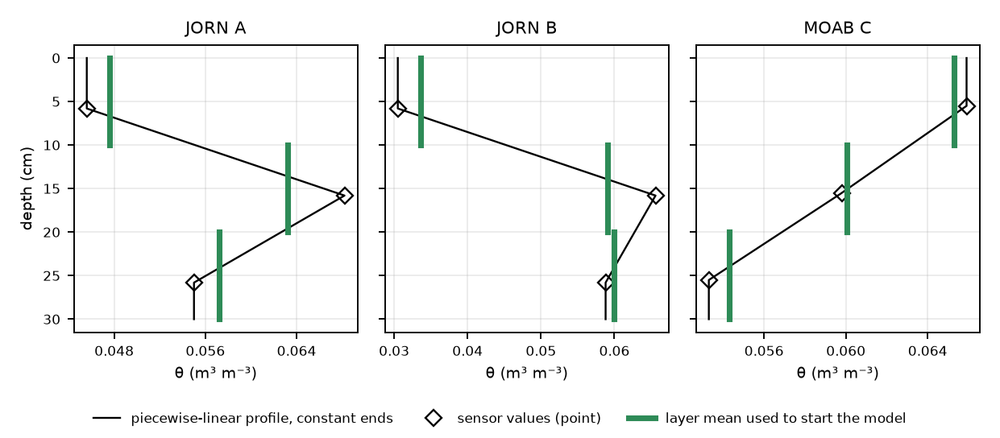
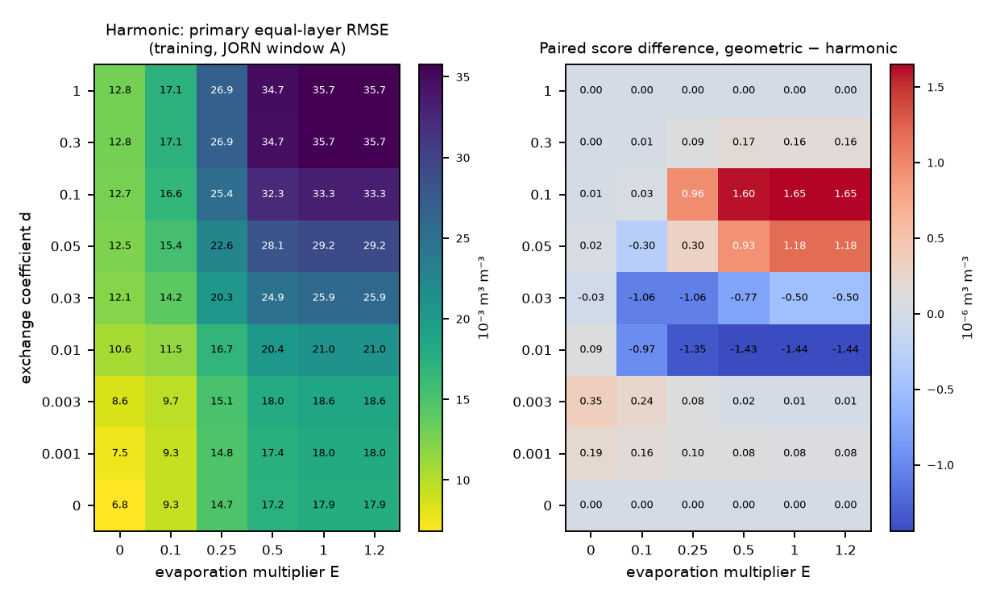
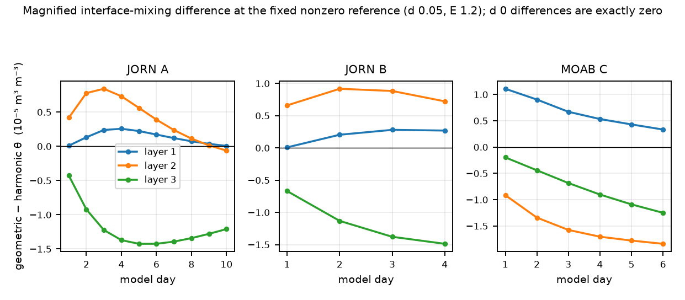
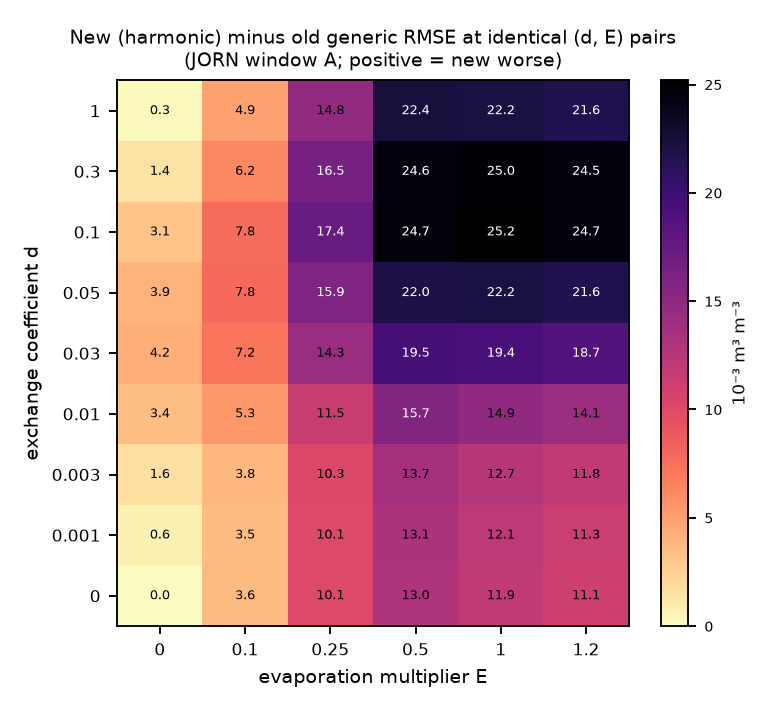
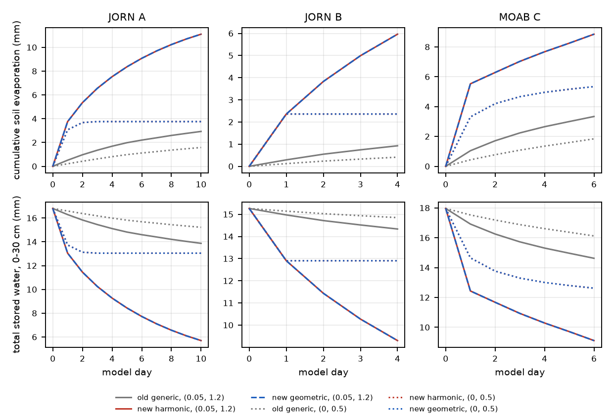

# Harmonic versus geometric interface conductivity in the SYRUP dry-down model: JORN and MOAB site-derived hydraulics

*Comparison report for three frozen NEON dry-down windows · generated 2026-11-17 from sealed actual runs · diagnostic, not field validation*

## 1. Summary

SYRUP's layered soil-water model needs one conductivity at each boundary between soil layers. Two averages of the neighbouring layers' conductivities are defensible: the **harmonic** mean, which mirrors resistances in series, and the **geometric** mean. This report runs both through the same native SYRUP dry-down driver on three short NEON soil-moisture windows (JORN, the Jornada Experimental Range, plot 4 twice; MOAB, the Moab site, plot 2 once), using layer properties derived for those two sites, and compares them with each other and with the earlier generic-soil results at identical settings.

- **Harmonic and geometric are practically indistinguishable here.** Over the 56 paired JORN A training scenarios the largest water-content difference is 1.60×10⁻⁵ m³ m⁻³; in the 3-scenario held-out sets it is 1.49×10⁻⁵ (JORN B) and 1.84×10⁻⁵ (MOAB C). Primary-score differences never exceed 2.46×10⁻⁶ m³ m⁻³. Adjacent layers' saturated conductivities are close (Ks ≈ 104–121 mm h⁻¹ at JORN and 57–64 mm h⁻¹ at MOAB), so the two means differ by at most 0.24 % at any interface.
- **Training selects the same pair for both methods: d 0, E 0** (primary RMSE 6.822×10⁻³ m³ m⁻³ on the coarse 9×6 grid). That optimum equals persistence of the integrated initial layer means. For JORN A the raw initial sensor values (point persistence, 4.944×10⁻³ m³ m⁻³) score better; for MOAB C layer persistence is the better of the two. At d = 0 the interface cannot act, so the held-out matches for the common pair are identical for H and G *by construction*; this does not prove the two laws equivalent. The nonzero reference and the paired training grid therefore carry the comparison.
- **The properties and the lower evaporation-stress scale matter far more than the averaging.** At the fixed reference (d 0.05, E 1.2) and at the earlier generic best (d 0, E 0.5), all three new fits score worse than the earlier generic soil at the identical pair (for example MOAB C at the reference: 18.7×10⁻³ against 1.5×10⁻³ m³ m⁻³ before). The new stress scales (top-layer θ1500: 0.0395 JORN, 0.0590 MOAB, against 0.18) let the top layer lose water much faster. The d = 0 controls isolate the evaporation-limit effect from exchange: no exchange, gravity or saturation limit acts there, although the unchanged residual-availability cap still limits E.
- **Gravity drainage, surface return and bottom drainage are exactly zero in every run** because every daily state stays below field capacity. The field-capacity and saturation limits therefore never act, open and closed bottoms are identical, and nothing here tests bottom drainage. The interface conductivity does act on the d > 0 exchange.
- **The new values are derived surrogates, not measured hydraulic properties, and should not be treated as validated site hydraulics.** Texture is NEON field data, organic carbon is estimated, and hydraulics come from a pedotransfer regression with project-approved bounding floors; only three short windows were used.

## 2. What was run and why

The experiment uses the existing, independently qualified SYRUP dry-down driver unchanged (production source package 37d89f23…, 180 files). It evolves three 10 cm soil layers (0–30 cm) with potential evaporation from a Hargreaves temperature model [Hargreaves & Samani 1985] at each site's latitude, transpiration off, gravity on, no rain, no storm, no vegetation, wind or bed. **Clock.** Model days are not NEON calendar days: day k ends at the window's anchor time plus k × 86 400 s, at the anchor's own clock time (JORN A 22:00 UTC, JORN B 06:30 UTC, MOAB C 03:30 UTC). Each day uses the 48 consecutive passing half-hour weather records of its anchor-aligned 24 h window (for example JORN A day 1 uses 2025-04-08T22:00Z to 2025-04-09T22:00Z), and its PET date is the calendar date of the window midpoint at fixed UTC−7 (April 9 for that example). The observed daily target is the passing 30-minute mean ending exactly at the model day end, not an instantaneous value and not a daily mean. The water model starts from the sensor profile at the anchor. The soil-water and exchange formulation follows Tietjen's two-layer approach [Tietjen 2009; Tietjen 2010] as implemented in the EcoHyD code used for SYRUP's reference parameters [Baldauf 2023].

**Table 1. Frozen windows (RELEASE-2026 data). Days are anchor-aligned 24 h windows (anchor + k × 86 400 s) with 48 consecutive passing half-hour weather records each; the anchor column gives the clock time of every day end. Missing sensor values stay missing.**

| Window | Role | Model days | Anchor (UTC) | Joint targets | Valid targets per layer (1/2/3) | Latitude (°N) |
|---|---|---|---|---|---|---|
| JORN A | training | 10 | 2025-04-08 22:00:00 | 8 | 8/10/10 | 32.591 |
| JORN B | temporal hold-out | 4 | 2025-04-26 06:30:00 | 3 | 4/4/3 | 32.591 |
| MOAB C | site hold-out | 6 | 2025-05-22 03:30:00 | 3 | 6/4/4 | 38.251 |

**Layer interface conductivity.** Each layer i has a fixed redistribution conductivity K_i = f·Ks_i, where Ks_i is the saturated conductivity and f = (1 + 30/26)^−1.5 = 0.31635738822500753 is the EcoHyD factor retained from the current SYRUP implementation. K_i is not a moisture-dependent conductivity and not a wetting-front suction. For a pair of adjacent layers, half-layer distances to the shared edge give weights w_i = h_i/(h_i + h_j) and w_j = h_j/(h_i + h_j), with h the layer thickness taken from the actual layer edges (all 0.1 m here, so both weights are 0.5).

    Harmonic:   K_if = 1 / Σ(w·/K·) = 1 / (w_i/K_i + w_j/K_j)

    Geometric:  K_if = exp(w_i ln K_i + w_j ln K_j)

For equal layer thicknesses these reduce to 2K_iK_j/(K_i + K_j) and √(K_iK_j). When the two conductivities are identical both return K exactly, which preserves the earlier homogeneous-reference identity. Zero, negative, non-finite or malformed inputs are refused before anything runs. The harmonic form is the series-resistance (layers in series) rule for flow normal to layers [Hoffmann et al. 2002, Eq. 5, p. 19] and is the better-motivated physical choice for vertical layering. That is a motivation for the *averaging only*: it does not validate SYRUP's moisture-gradient exchange law or Richards-equation flow, and the windows used here cannot select either mean empirically because adjacent Ks values are close.

**What the interface conductivity does.** The exchange between neighbouring layers is a pair relaxation in which the donor layer depth enters as d·K_if·h_donor, with d the dimensionless exchange coefficient; the donor and capacity limits of the existing exact-pair relaxation are unchanged. The gravity/field-capacity cascade does not use K_if. At d = 0 the exchange vanishes, so every d = 0 scenario must be, and is, identical for H and G (checked for all 7 d = 0 training controls and for every held-out d = 0 match).

## 3. Site-derived layer properties

Both sites use three 10 cm layers with edges 0, 0.1, 0.2, 0.3 m. Soil texture and bulk density come from the NEON megapit measurements [NEON data], used as site proxies for the sensor plots; the estimated hydraulic values are not co-located hydraulic measurements. organic carbon is estimated, and organic matter is taken as 1.724 × estimated OC (g kg⁻¹)/10 percent, a provisional conversion. Saturated conductivity, retention and field capacity at 6 kPa (FC6) are Saxton–Rawls 2006 pedotransfer regression outputs [Saxton & Rawls 2006] computed from layer-averaged (dry-mass-mixed) texture and organic matter **before** the floors are applied. The floors are project-approved bounded assumptions for this sensitivity study, not Saxton–Rawls recommendations. The air entry is floored at zero, max(predicted, 0), and for JORN the effective bulk density is max(raw, 1 g cm⁻³, 0.901 × the regression's normal density). The air entry entered FC6 only; no derived air entry is passed to the native provider as a measured override and the provider's default recipe is not adopted. Residual water content is 0.01 for all layers. MOAB uses a 6 cm A plus 4 cm Bw dry-mass mixture for layer 1 and Bw for layers 2 and 3, with no density change.

**Table 2. Raw and effective inputs and the derived hydraulic table (all derived surrogates; raw measurements remain in the canonical receipt). θ1500 is the predicted water content at 1500 kPa; FC6 and saturation are volumetric. The air entry is 0 where the raw regression value is negative.**

| Site | Layer (record) | Raw ρ (g cm⁻³) | Effective ρ | Raw air entry (kPa) | Effective air entry | θ residual | θ1500 | θ FC6 | θ sat. | Ks (mm h⁻¹) |
|---|---|---|---|---|---|---|---|---|---|---|
| JORN | 1 (JORN_A) | 1.4196 | 1.4196 | -0.6079 | 0.0000 | 0.010 | 0.0395 | 0.3976 | 0.4643 | 120.79 |
| JORN | 2 (JORN_10_20_dry_mass) | 1.3164 | 1.4173 | -0.5913 | 0.0000 | 0.010 | 0.0404 | 0.3987 | 0.4652 | 119.71 |
| JORN | 3 (JORN_Bw) | 0.9035 | 1.4346 | -0.4608 | 0.0000 | 0.010 | 0.0463 | 0.3951 | 0.4586 | 104.33 |
| MOAB | 1 (MOAB_0_10_dry_mass) | 1.5045 | 1.5045 | 0.1339 | 0.1339 | 0.010 | 0.0590 | 0.3800 | 0.4322 | 63.95 |
| MOAB | 2 (MOAB_Bw) | 1.4818 | 1.4818 | 0.4343 | 0.4343 | 0.010 | 0.0726 | 0.3922 | 0.4408 | 57.26 |
| MOAB | 3 (MOAB_Bw) | 1.4818 | 1.4818 | 0.4343 | 0.4343 | 0.010 | 0.0726 | 0.3922 | 0.4408 | 57.26 |

The raw JORN Bw density (0.9035 g cm⁻³) is low but is not shown to be wrong; the density floor and the zero air-entry floor are bounding assumptions that let the surrogate be evaluated, not corrections of the measurements. SYRUP's native property provider stays strict and unchanged, and these values are prescribed inputs, not a provider recipe.

**Table 3. Interface conductivities for the two means. Geometric differs from harmonic by 0.001–0.24 % and exactly 0 for MOAB's lower pair (identical layers).**

| Site | Interface | K upper = f·Ks (mm h⁻¹) | K lower (mm h⁻¹) | Harmonic K_if (mm h⁻¹) | Geometric K_if (mm h⁻¹) | G vs H (%) |
|---|---|---|---|---|---|---|
| JORN | 1↔2 | 38.2117 | 37.8704 | 38.0403 | 38.0407 | 0.001 |
| JORN | 2↔3 | 37.8704 | 33.0063 | 35.2715 | 35.3548 | 0.236 |
| MOAB | 1↔2 | 20.2321 | 18.1139 | 19.1145 | 19.1437 | 0.153 |
| MOAB | 2↔3 | 18.1139 | 18.1139 | 18.1139 | 18.1139 | 0.000 |

### How these differ from the earlier generic soil

The earlier generic reference soil took field capacity equal to saturation (0.26), a wilting point and evaporation-stress scale of 0.18, Ks of 6.9 mm h⁻¹, and an interface conductivity of 2.182866 mm h⁻¹ (= f × 6.9). The new soils have conductivities roughly 8–18 times larger and, importantly, a *much lower* evaporation-stress scale, taken here as the top-layer predicted θ1500 (0.0395 JORN, 0.0590 MOAB; a declared assumption) and held fixed within a run. Lower-layer wilting values are informative but do not enter surface evaporation.

**Table 4. Old generic reference and new site-derived parameters.**

| Soil | Field capacity θ | Evaporation stress scale θ | Ks (mm h⁻¹) | Interface K (mm h⁻¹) |
|---|---|---|---|---|
| Old generic reference soil | 0.26 (FC = saturation) | 0.18 | 6.9 | 2.1829 (all pairs) |
| New JORN (three layers) | 0.398 / 0.399 / 0.395 (FC6; saturation 0.464 / 0.465 / 0.459) | 0.0395 (top θ1500) | 120.8 / 119.7 / 104.3 (15.1–17.5× old) | 38.0 / 35.3 (harmonic) |
| New MOAB (three layers) | 0.380 / 0.392 / 0.392 (FC6; saturation 0.432 / 0.441 / 0.441) | 0.0590 (top θ1500) | 64.0 / 57.3 / 57.3 (8.3–9.3× old) | 19.1 / 18.1 (harmonic) |

## 4. Experiment design

Training (JORN A, both methods) runs the same 9 × 6 grid of exchange coefficient d ∈ {0, 0.001, 0.003, 0.01, 0.03, 0.05, 0.1, 0.3, 1} and evaporation multiplier E ∈ {0, 0.1, 0.25, 0.5, 1, 1.2} with an open bottom, plus two closed-bottom controls (d 0, E 0 and d 0.05, E 1.2): 56 scenarios per method. The method selecting the best pair uses only training: the lowest primary equal-layer RMSE, √(mean of per-layer mean-square errors), with ties to smaller E, then smaller d. Held-out windows (JORN B at the same site, MOAB C at a different site) were then run for the de-duplicated union of the selected pairs, the unfitted reference (0.05, 1.2), the earlier generic best (0, 0.5) and the d = 0 / E = 0 controls: three distinct scenarios, run under both methods. No held-out refit and no grid refinement, extra windows or property re-tuning followed the outcomes. The d = 0, E = 0 optimum is the best of a discrete 9 × 6 grid only; it is not evidence that zero evaporation is physical or a global optimum.

**Initial profile.** Each window starts from the agreed piecewise-linear integration of the sensor profile with constant values beyond the end sensors, averaged over each layer. A single sensor at 5.8 cm can sit above or below the 0–10 cm layer mean when the profile has a gradient, so the starting layer mean and the first sensor reading differ; no new operator was introduced and the observations are scored against the layer states as before. Persistence controls hold either the integrated layer means (layer persistence) or the raw sensor values (point persistence) constant.



*Figure 1. Initial sensor profile, its piecewise-linear integration with constant ends, and the resulting layer means that start the model.*

## 5. Results

### 5.1 Training and selection

**Table 5. Training selection, persistence controls and old/new comparison (JORN A; primary equal-layer RMSE in 10⁻³ m³ m⁻³). Both methods select the same pair and score identically.**

| Method | Training-selected pair (9×6 grid) | Selected RMSE | Point persistence | Layer persistence | Reference (0.05, 1.2) RMSE | Old generic RMSE at reference | Old generic RMSE at its best (0, 0.5) |
|---|---|---|---|---|---|---|---|
| Harmonic | d 0, E 0 | 6.822 | 4.944 | 6.822 | 29.213 | 7.628 | 4.226 |
| Geometric | d 0, E 0 | 6.822 | 4.944 | 6.822 | 29.214 | 7.628 | 4.226 |

The selected d = 0, E = 0 run keeps the integrated initial layer means for ten days; its score (6.822×10⁻³ m³ m⁻³) is therefore exactly the layer-persistence score (6.822×10⁻³), while holding the raw sensor values scores better (4.944×10⁻³). The dry-down model with active evaporation scores worse than either control on this window.



*Figure 2. Left: harmonic primary RMSE over the 9×6 training grid. Right: geometric − harmonic score at each matching (d, E) pair, in 10⁻⁶ m³ m⁻³ (zero in the d = 0 row).*

### 5.2 Interface mixing at the nonzero reference and over the whole grid

**Table 6. Geometric − harmonic differences at the fixed nonzero reference (d 0.05, E 1.2). Relative differences are on the harmonic value; no zero denominators were hidden.**

| Window | RMSE G − H (10⁻⁶) | Max \|Δθ\| (10⁻⁵) | Max relative Δθ (%) | Max \|Δ layer water\| (mm) | Max \|Δ daily evaporation\| (mm) | \|Δ final storage\| (mm) | H final storage (mm) |
|---|---|---|---|---|---|---|---|
| JORN A | +1.179 | 1.424 | 0.0521 | 0.001424 | 0.0002569 | 0.001265 | 5.697 |
| JORN B | -2.458 | 1.487 | 0.0365 | 0.001487 | 0.0002807 | 0.0004944 | 9.301 |
| MOAB C | +2.238 | 1.839 | 0.0578 | 0.001839 | 0.0008762 | 0.002754 | 9.112 |

**Table 7. Largest geometric − harmonic differences over every paired scenario: all 56 for JORN A (the training grid and controls) and the 3 distinct scenarios for each held-out window; the held-out rows are not training-grid values.**

| Window | Scenarios paired | Max \|Δθ\| (10⁻⁵ m³ m⁻³) | Max \|Δ primary RMSE\| (10⁻⁶) | Max \|Δ layer water\| (mm) | Max \|Δ daily evaporation\| (mm) | Max \|Δ final storage\| (mm) |
|---|---|---|---|---|---|---|
| JORN A | 56 | 1.603 | 1.646 | 0.001603 | 0.0002786 | 0.001265 |
| JORN B | 3 | 1.487 | 2.458 | 0.001487 | 0.0002807 | 0.0004944 |
| MOAB C | 3 | 1.839 | 2.238 | 0.001839 | 0.0008762 | 0.002754 |

Over the 56 paired JORN A training scenarios the largest θ difference is 1.603×10⁻⁵ m³ m⁻³; over the 3 held-out scenarios it is 1.487×10⁻⁵ (JORN B) and 1.839×10⁻⁵ (MOAB C). The largest primary-score differences are 1.646, 2.458 and 2.238×10⁻⁶ m³ m⁻³ (JORN A, JORN B, MOAB C). The largest difference in final stored water is 0.002754 mm (MOAB C), against reference evaporation of 11.1, 6.0, 8.9 mm (JORN A, JORN B, MOAB C). Every d = 0 difference is exactly zero. These are differences in this model, not statements about measurement detectability: no sensor precision was assessed, and no significance is claimed from three short windows.



*Figure 3. Magnified geometric − harmonic layer moisture at the nonzero reference, by window and layer.*

### 5.3 Held-out transfer and the earlier generic soil

**Table 8. Overall RMSE (10⁻³ m³ m⁻³) for the key pairs, with the earlier generic-soil score at the *identical* pair. G − H in 10⁻⁶. Primary held-out matches use the common H-selected pair (0, 0), where H = G by construction.**

| Window | Pair (d, E) | H RMSE | G RMSE | G − H (10⁻⁶) | Old generic RMSE | Point pers. | Layer pers. |
|---|---|---|---|---|---|---|---|
| JORN B | (0, 0) selected | 4.549 | 4.549 | +0.000 | 4.549 | 2.623 | 4.549 |
| JORN B | (0.05, 1.2) reference | 14.503 | 14.501 | -2.458 | 3.768 | 2.623 | 4.549 |
| JORN B | (0, 0.5) old generic best | 10.729 | 10.729 | +0.000 | 3.437 | 2.623 | 4.549 |
| MOAB C | (0, 0) selected | 13.588 | 13.588 | +0.000 | 13.588 | 13.907 | 13.588 |
| MOAB C | (0.05, 1.2) reference | 18.671 | 18.673 | +2.238 | 1.520 | 13.907 | 13.588 |
| MOAB C | (0, 0.5) old generic best | 13.878 | 13.878 | +0.000 | 6.427 | 13.907 | 13.588 |
| JORN A | (0, 0) selected | 6.822 | 6.822 | +0.000 | 6.822 | 4.944 | 6.822 |
| JORN A | (0.05, 1.2) reference | 29.213 | 29.214 | +1.179 | 7.628 | 4.944 | 6.822 |
| JORN A | (0, 0.5) old generic best | 17.240 | 17.240 | +0.000 | 4.226 | 4.944 | 6.822 |

At the training-selected pair the held-out scores equal the layer-persistence scores of each window and the two methods agree exactly. At the unfitted reference and at the earlier generic best (0, 0.5) the new site-derived properties score worse than the earlier generic soil at the identical pair in all three windows, by more than a factor of 10 at the MOAB reference, where the earlier generic reference scored well while evaporating less water. These two controls are the only pairs I state this for. The statement is scoped: the same (d, E) settings transferred poorly to the derived properties in these windows. The earlier generic soil is not validated truth, so the comparison does not say which soil is closer to the real hydraulics.


*Figure 4. Layer moisture time series. Black circles: observed end-of-day sensor values (missing days are not drawn or connected); open diamond: observed initial point value; green square and line: integrated initial layer mean and the held d 0, E 0 run; grey: old generic reference; red/blue: new harmonic and geometric at the reference (the two overlap).*



*Figure 5. New (harmonic) minus old generic overall RMSE at every identical (d, E) pair, JORN A. The (d 0, E 0) cell is exactly zero because both soils then simply hold the initial layer means.*

**Table 9. Per-layer sample size, bias (model − observation, 10⁻³ m³ m⁻³) and RMSE (10⁻³). The primary score is the equal-layer RMSE √(mean of layer MSEs); the pooled alternative (all layer errors together) is stored in the JSON results and differs slightly.**

| Window | Scenario | L1 N | L1 bias | L1 RMSE | L2 N | L2 bias | L2 RMSE | L3 N | L3 bias | L3 RMSE |
|---|---|---|---|---|---|---|---|---|---|---|
| JORN A | point persistence | 8 | +5.91 | 7.91 | 10 | -1.90 | 2.30 | 10 | -2.19 | 2.35 |
| JORN A | layer persistence (= d 0, E 0) | 8 | +7.91 | 9.49 | 10 | -6.87 | 6.99 | 10 | +0.03 | 0.86 |
| JORN A | harmonic reference (0.05, 1.2) | 8 | -21.40 | 21.48 | 10 | -38.68 | 39.66 | 10 | -20.66 | 22.93 |
| JORN A | geometric reference (0.05, 1.2) | 8 | -21.39 | 21.48 | 10 | -38.67 | 39.66 | 10 | -20.67 | 22.94 |
| JORN A | old generic reference (0.05, 1.2) | 8 | -6.81 | 6.94 | 10 | -11.04 | 11.20 | 10 | +0.42 | 0.96 |
| JORN B | point persistence | 4 | +2.70 | 3.26 | 4 | +2.40 | 2.80 | 3 | +1.20 | 1.49 |
| JORN B | layer persistence (= d 0, E 0) | 4 | +5.80 | 6.08 | 4 | -4.10 | 4.35 | 3 | +2.34 | 2.50 |
| JORN B | harmonic reference (0.05, 1.2) | 4 | -6.72 | 6.78 | 4 | -22.46 | 22.84 | 3 | -7.25 | 7.97 |
| JORN B | geometric reference (0.05, 1.2) | 4 | -6.71 | 6.78 | 4 | -22.45 | 22.83 | 3 | -7.26 | 7.99 |
| JORN B | old generic reference (0.05, 1.2) | 4 | +1.39 | 1.56 | 4 | -5.83 | 5.87 | 3 | +2.24 | 2.39 |
| MOAB C | point persistence | 6 | +22.78 | 23.99 | 4 | +0.85 | 1.71 | 4 | +0.00 | 1.23 |
| MOAB C | layer persistence (= d 0, E 0) | 6 | +22.17 | 23.41 | 4 | +1.11 | 1.85 | 4 | +0.98 | 1.57 |
| MOAB C | harmonic reference (0.05, 1.2) | 6 | -25.76 | 26.50 | 4 | -16.59 | 17.47 | 4 | -5.02 | 6.17 |
| MOAB C | geometric reference (0.05, 1.2) | 6 | -25.75 | 26.50 | 4 | -16.60 | 17.49 | 4 | -5.02 | 6.18 |
| MOAB C | old generic reference (0.05, 1.2) | 6 | +0.04 | 1.50 | 4 | -0.36 | 0.89 | 4 | +1.38 | 1.97 |

### 5.4 Why the evaporation stress scale dominates

For the flat bare-soil test the actual daily soil evaporation is E = min(max(W_top − W_res, 0), E_factor × PET × min(1, (θ_top/θ_stress)²)), with W_top and W_res the top-layer water and residual water (m), PET in m, and θ_stress the stress scale. The potential rate applies in full at or above θ_stress and falls quadratically below it; no water is removed below residual. θ1500 is used here as the stress scale, not as a hard threshold where evaporation stops, and that choice is a declared assumption, not a direct field measurement. With the earlier generic scale of 0.18 the initial top-layer multiplier min(1, (θ/θ_stress)²) is 0.069911 (JORN A), 0.034836 (JORN B) and 0.131537 (MOAB C); with the new scales it is 1.000000, 0.723098 and 1.000000, so the new soils start evaporating at much more of the potential rate. In the d = 0, E = 0.5 control (no exchange, gravity or saturation limit; the residual-availability cap still limits E) the new top layer reaches the 0.01 residual on day 3 in JORN A and day 1 in JORN B, and in MOAB C it is still 0.011873 on day 6 (old generic top layer at the end of the windows: 0.0318, 0.0295 and 0.0469). This supports the stress-scale interpretation; for d > 0 I do not attribute the difference to a single cause.

**Table 10. Top-layer behaviour in the d 0, E 0.5 control (derived from the stored layer states).**

| Window | Initial top-layer θ (layer mean) | First day top layer at residual 0.01 (new, d 0, E 0.5) | Final top-layer θ new | Final top-layer θ old generic |
|---|---|---|---|---|
| JORN A | 0.0476 | 3 | 0.01000 | 0.03177 |
| JORN B | 0.0336 | 1 | 0.01000 | 0.02946 |
| MOAB C | 0.0653 | not reached | 0.01187 | 0.04687 |



*Figure 6. Cumulative soil evaporation and total stored water (0–30 cm) for the reference and the old generic best, old versus new, by window.*

### 5.5 Gravity, bottom boundary and states below field capacity

In all 62 CPU scenarios per method (124 in total) the daily layer states stay below the new field-capacity values, so percolation, surface return and bottom drainage are exactly zero throughout. The field-capacity and saturation limits never act, and the open and closed-bottom controls are therefore identical here. The gravity step is an instantaneous field-capacity cascade independent of the interface conductivity, while the interface conductivity does act on the d > 0 exchange. **Bottom drainage is not validated.** The runs include no rainfall, infiltration or storm, and the full rainfall/infiltration path remains untested with these properties.

## 6. Interpretation and limits

- **Averaging choice.** The two means differ by at most 0.24 % in interface conductivity and by at most ~2×10⁻⁵ m³ m⁻³ in water content over these windows. The harmonic mean is preferable on physical grounds for vertical layers, but these homogeneous adjacent Ks values and short windows cannot discriminate between them empirically. Because they are close, this result is not a reason to change any runtime default or recommended setting.
- **Parameter transfer.** The derived properties are regression surrogates for two sites with estimated organic carbon and project-approved bounding floors (not Saxton–Rawls recommendations). At the fixed reference (d 0.05, E 1.2) and the earlier generic best (d 0, E 0.5), all three new fits score worse than the earlier generic soil at the identical pair (for example MOAB reference 0.018671 against 0.001520, harmonic). I state this only for those two controls; the whole grid was not summarized that way. The selected d 0, E 0 is the best of a coarse, prespecified grid (E = 0, 0.1, 0.25, …) and does not exclude a physical fit at E between 0 and 0.1. Further tuning would need new hold-out windows. The earlier generic soil is not validated truth, and the new estimates should not be read as validated site hydraulic values.
- **Initial-state mismatch.** The layer means that start the model can differ from the first sensor reading when the profile has a gradient, and the layer-persistence control equals the best-scoring model. The model is not outperforming holding the starting state in these windows.
- **Scope.** Three short windows (3–8 joint scored days), one 10-day training window, no sensitivity or refit beyond the frozen grid, no storm or transpiration, and no field validation.

### Possible follow-up (not run)

Sensitivity of the evaporation stress scale and effective density, calibration against field profiles with measured hydraulic properties, observation of evaporation versus transpiration separately, and additional independent hold-out windows would address the limits above. None of these were run for this report, and no new model runs were performed to write it.

## Appendix A. Qualification, identities and reproduction

### A.1 Backend and independent checks

Actual CPU runs (NumPy and Numba) covered 124 scenarios (62 per method: 56 training + 3 + 3 held-out); actual CUDA on GPU 0 (NVIDIA GeForce GTX 1080 Ti, CuPy 14.2.0, driver 13000, runtime 12090) repeated the same scenarios, with NumPy, Numba and CUDA all compared pairwise and a column-state midpoint reconstruction on each backend (not a native lifecycle checkpoint). A separate generic62 repeat of the earlier generic reference configurations also passed. The maximum backend trajectory difference over the new comparisons is 3.469e-18; it is the largest of the mixed trajectory fields (the per-step ledger residual, in m³), not a unitless physical error. By physical field the largest CPU/CUDA differences are 8.674e-19 m (layer water) and 1.388e-17 m³ m⁻³ (θ) (`data/root_additional_metrics.json`). The d = 0 runs and the held-out windows are exactly equal CPU/CUDA; this is not claimed to be bitwise for every scenario. An independent 70-digit Decimal check of the declared dry-column equations gave a maximum water error 2.154e-18 m, and the largest native cumulative residual over its bound was 0.002327. The Decimal check is an independent diagnostic, not a formal global error proof.

**Table 11. Single-column whole validation loops including startup and compilation. The CPU loop runs 2 backends (NumPy, Numba) plus the reconstruction; the GPU loop runs 3 backends (NumPy, Numba, CUDA) plus the reconstruction. These are different workloads, not a CPU/GPU performance benchmark. The last column is the largest mixed trajectory field difference (the ledger residual field is in m³), not a unitless physical error.**

| Configuration | Scenarios | CPU loop incl. startup (s) | CUDA loop incl. startup (s) | Max \|CUDA − CPU\| trajectory field |
|---|---|---|---|---|
| JORN4_A_training_harmonic | 56 | 3.49 | 5.80 | 6.776e-21 |
| JORN4_A_training_geometric | 56 | 0.90 | 2.29 | 3.469e-18 |
| JORN4_B_heldout_harmonic | 3 | 0.22 | 0.26 | 0.000e+00 |
| JORN4_B_heldout_geometric | 3 | 0.23 | 0.26 | 0.000e+00 |
| MOAB2_C_heldout_harmonic | 3 | 0.23 | 0.28 | 0.000e+00 |
| MOAB2_C_heldout_geometric | 3 | 0.23 | 0.28 | 0.000e+00 |

### A.2 Source and package identities

- SYRUP production package (180 files): sha256 37d89f23dbf60626c85f85ea5dd6d1734d3bc7a4aa61d8f2fdfc29f237bcfbd0, source commit bb28af6c58c2892cb3c065d73d33b88285c498f0 (analysis Git base 9adab66e190887a60627dae8a07d58022b32446f), unchanged before and after every run.
- MAPLE (412 files): sha256 fbc504bbcd1ec0c02e6a96089134a06187532455ef7ba5e6f146801c8313c02e, commit 9f466d2cfcd52991b24496cf67f4562d6268afa9. LEAF package 38009872f8969f86b56c720adc1b5d9ffefc554fb9cacf90855d999db604530f (28 files). External helper `benchmarks.spatial_mapping` from the qualified LEAF tree (47 260 bytes, sha256 333921bb645d984fa8e7449619d03114262ee333c7fea61a22493a878fd9ccc5). EcoHyD reference code (not executed here): commit 80b10e6b6b82ad16e9fd41a31901cc3157d880e9. All of these are also in `data/qualified_source_identities.json`.
- Canonical property receipt root_relative_density_probe.json, sha256 9ad303384f26116f37088aa6609d3519c7396d22d46d8d0ac42919358165675f.
- All 12 actual configurations (6 CPU, 6 CUDA) were independently validated against the frozen parent bytes (root_config_binding_disposition.json). A review found that an orchestrator expected-hash check was vacuous in the first launch; it was fixed for future runs and a post-hoc source audit proved the outputs unchanged. This is recorded, not a model defect.
- Full identities are in the data files: `data/source_guard_cpu/sources_before.json` and `data/source_guard_cuda/sources_before.json` (package sha256 and file counts for maple_syrup, maple and LEAF 38009872f8969f86b56c720adc1b5d9ffefc554fb9cacf90855d999db604530f), `data/frozen_helper_manifest.json` (per-file helper sha256), and the config/result hashes in `data/actual_cpu/completion.json` and `data/actual_cuda/completion.json`.
- Original parameter-audit JSON and scripts for raw texture/OM provenance: data/property_audit/.

### A.3 Reproduction

```
cd analysis_candidate/docs/subsurface_hydrology/site_properties_mixing
PYTHONPATH=<task>/report_tools MPLCONFIGDIR=/tmp/syrup-site-mixing-mpl PYTHONDONTWRITEBYTECODE=1 \
  /home/okin/MAPLE/.venv/bin/python -B build_report.py
```

The script reads only data/ and ../observed_drydown/data, re-derives every score, the selection, the integrated initial layers and the envelopes (asserting them against the sealed values), and rewrites report.md, tables/, figures/, verification.md and the DOCX. The model runs themselves are not reproduced by this script.

## References

- **Tietjen 2009** — Tietjen B, Zehe E, Jeltsch F (2009). Simulating plant water availability in dry lands under climate change: a generic model of two soil layers. Water Resources Research 45, W01418. <https://doi.org/10.1029/2007WR006589>
- **Tietjen 2010** — Tietjen B, Jeltsch F, Zehe E, Classen N, Groengroeft A, Schiffers K, Oldeland J (2010). Effects of climate change on the coupled dynamics of water and vegetation in drylands. Ecohydrology 3, 226–237. <https://doi.org/10.1002/eco.70>
- **Saxton & Rawls 2006** — Saxton KE, Rawls WJ (2006). Soil water characteristic estimates by texture and organic matter for hydrologic solutions. Soil Science Society of America Journal 70, 1569–1578. <https://doi.org/10.2136/sssaj2005.0117>
- **Hargreaves & Samani 1985** — Hargreaves GH, Samani ZA (1985). Reference crop evapotranspiration from temperature. Applied Engineering in Agriculture 1(2), 96–99. <https://doi.org/10.13031/2013.26773>
- **Baldauf 2023** — Baldauf S, Cantón Y, Tietjen B (2023). Biocrusts intensify water redistribution and improve water availability to dryland vegetation: insights from a spatially-explicit ecohydrological model. Frontiers in Microbiology 14, 1179291 (and the downloaded EcoHyD code release, commit 80b10e6b6b82ad16e9fd41a31901cc3157d880e9, used by SYRUP's reference parameters). <https://doi.org/10.3389/fmicb.2023.1179291>
- **Hoffmann et al. 2002** — Hoffmann JP, Ripich MA, Ellett KM (2002). Characteristics of shallow deposits beneath Rillito Creek, Pima County, Arizona. U.S. Geological Survey Water-Resources Investigations Report 01-4257 (harmonic series rule for flow normal to layers, Eq. 5, p. 19). <https://doi.org/10.3133/wri014257>
- **NEON data** — National Ecological Observatory Network. RELEASE-2026: soil water content and water salinity DP1.00094.001; single aspirated air temperature DP1.00002.001; precipitation DP1.00045.001; megapit soil characterization DP1.00096.001. <https://data.neonscience.org/data-products/DP1.00094.001/RELEASE-2026>
- **NEON notice 2026** — NEON (2026-11-09). Soil water content and water salinity (DP1.00094.001) algorithm updates: planned for RELEASE-2027 (depth workaround, calibration and QA revisions). The frozen RELEASE-2026 files used here are retained; no silent migration. <https://www.neonscience.org/impact/observatory-blog/soil-water-content-and-water-salinity-dp100094001-algorithm-updates>
